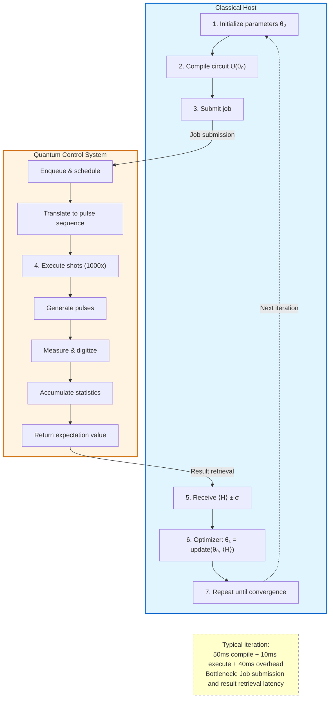
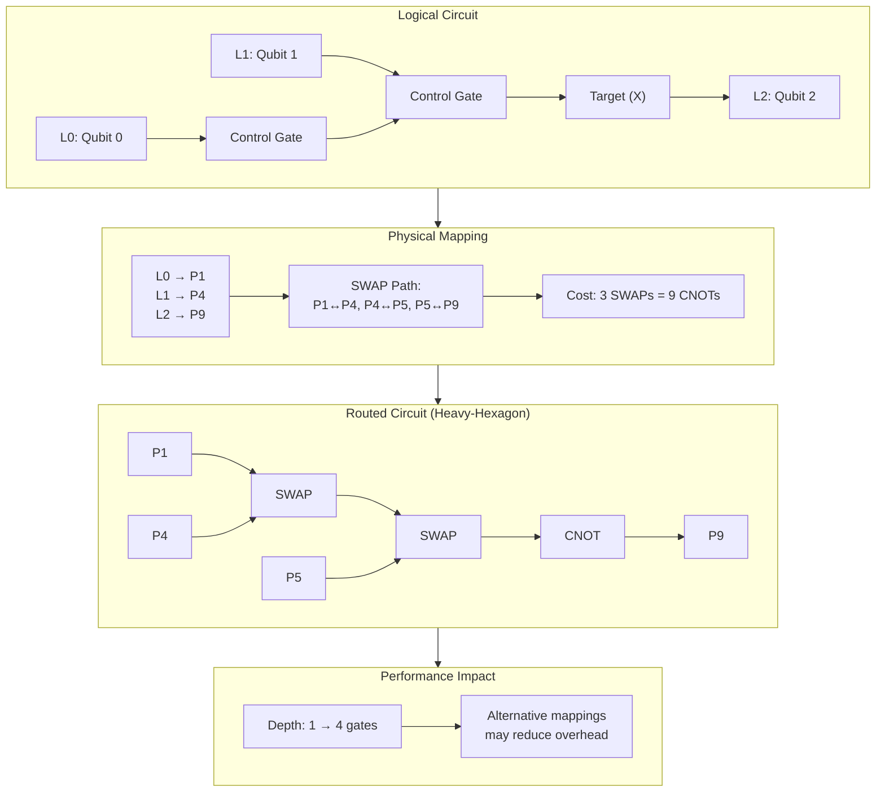
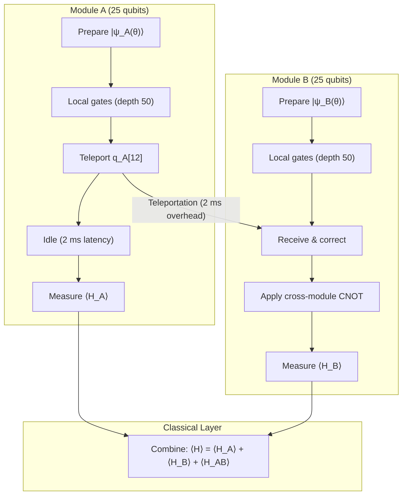

# Lesson 6: Quantum Computing Systems and Distributed Architectures

## 1. First-Principles Intuition & Invariants

Quantum computing systems represent a fundamental departure from classical von Neumann architectures, not merely in their computational primitives but in their entire systems engineering stack. Where classical distributed systems achieve fault tolerance through redundant replication and state machine consensus, quantum systems must contend with the no-cloning theorem—a physical prohibition against copying arbitrary quantum states. Where classical compilers optimize instruction schedules for pipeline depth and cache locality, quantum compilers must reason about gate fidelity decay, crosstalk between adjacent qubits, and the exponential overhead of error correction codes that consume thousands of physical qubits to protect a single logical qubit.

The systems architecture of a quantum computer begins with the physics of the quantum processing unit itself. Whether implemented in superconducting transmon qubits cooled to millikelvin temperatures, trapped ions suspended in electromagnetic fields, or topological anyons in exotic materials, every quantum system shares a common constraint: decoherence. Quantum states decay through interaction with their environment on timescales measured in microseconds to milliseconds, creating a hard real-time deadline for computation. This is not a soft latency target like network round-trip time or disk seek latency—it is a fundamental physical clock beyond which quantum information is irreversibly lost to thermal noise.

The quantum-classical interface defines the first major architectural boundary. Quantum processors cannot execute general-purpose control flow, perform conditional branching on measurement outcomes in real time, or maintain classical state across gate sequences without external coordination. Instead, quantum circuits operate as static directed acyclic graphs of unitary transformations, parameterized by classical control signals generated by a classical host system. The classical controller manages three critical functions: pulse generation and waveform synthesis for gate operations, real-time feedback for mid-circuit measurements that enable error correction, and orchestration of hybrid algorithms that interleave quantum subroutines with classical optimization loops.

Consider the Variational Quantum Eigensolver (VQE), a prototypical hybrid algorithm used for molecular ground-state energy estimation. The quantum processor prepares a parameterized trial wavefunction using a sequence of single-qubit rotations and two-qubit entangling gates, then measures the expectation value of a Hamiltonian operator decomposed into Pauli string terms. The classical optimizer—typically a gradient-free method like COBYLA or a gradient-based approach using parameter shift rules—receives the measured energy and proposes updated gate parameters. This quantum-classical feedback loop repeats until convergence, with the quantum processor serving as a specialized coprocessor for high-dimensional function evaluation rather than a standalone computational engine.

The resource hierarchy in quantum systems differs fundamentally from classical memory and compute hierarchies. In classical systems, we reason about L1/L2/L3 cache lines, DRAM channels, and persistent storage tiers, with each level trading capacity for latency. Quantum systems instead expose a resource graph where nodes represent physical qubits with measured coherence times (T1 energy relaxation, T2 dephasing), and edges represent coupling topologies that determine which two-qubit gates can be implemented natively. A quantum compiler must map logical qubits in the algorithm's abstract circuit to physical qubits in the hardware graph, inserting SWAP gates to route interactions across non-adjacent qubits while minimizing circuit depth to stay within the coherence budget.

Gate fidelities introduce a probabilistic failure model absent from deterministic classical logic. A typical superconducting qubit system might achieve single-qubit gate fidelities of 99.95% and two-qubit gate fidelities of 99.5%, meaning a circuit with 100 two-qubit gates accumulates roughly 40% error probability before error correction. This necessitates quantum error correction codes like the surface code, which encodes a single logical qubit into a two-dimensional lattice of physical qubits with stabilizer measurements that detect and correct errors without collapsing the encoded state. The surface code's distance d determines its error threshold—the maximum physical error rate below which logical error rates decrease exponentially with code distance—but requires O(d²) physical qubits per logical qubit.

Distributed quantum computation emerges from the need to scale beyond single monolithic quantum processors. Current state-of-the-art systems contain 50–1000 physical qubits, far below the millions required for fault-tolerant algorithms like Shor's factoring algorithm. Distributed architectures partition quantum circuits across multiple processors connected by quantum communication channels, analogous to distributed classical systems partitioning data and computation across networked nodes. However, quantum channels cannot simply transmit qubit states as classical bits—the no-cloning theorem prohibits copying, and measurement destroys superposition. Instead, distributed quantum systems rely on entanglement distribution and quantum teleportation, where pre-shared Bell pairs enable the transfer of quantum states through classical communication and local operations.

The latency characteristics of quantum networking impose severe constraints on distributed algorithm design. Generating entangled Bell pairs between remote quantum processors requires either photonic transmission through optical fiber (limited by photon loss scaling exponentially with distance) or quantum repeater nodes that perform entanglement swapping and purification (adding multiplicative latency overhead). At fiber optic scales, entanglement generation rates drop to kilohertz or lower, while quantum gates operate on nanosecond timescales—a six-order-of-magnitude gap. This asymmetry forces distributed quantum algorithms to minimize the number of inter-processor qubit movements, favoring computation patterns where most entanglement remains local within a single processor.

Quantum cloud architectures mirror classical Infrastructure-as-a-Service models but require fundamentally different resource isolation and scheduling primitives. Multiple users cannot time-share a quantum processor through context switching—quantum states cannot be serialized to classical storage and restored, and intermediate measurement destroys coherence. Instead, quantum cloud systems allocate exclusive time slices to each job, treating the quantum processor as a batch-mode accelerator similar to GPU job queues. Job scheduling must account for calibration overhead, where the quantum system periodically pauses user workloads to recalibrate gate parameters as qubit frequencies drift with temperature fluctuations, and for the thermal cycling time required to cool superconducting systems from room temperature to operating conditions after maintenance.

The compilation pipeline for quantum circuits spans multiple abstraction layers, each with distinct optimization objectives. At the highest level, quantum algorithm developers express circuits in gate-level abstractions using domain-specific languages like Qiskit, Cirq, or Q#, specifying logical qubits and ideal gates without hardware constraints. The compiler frontend performs gate synthesis, decomposing high-level operations into native gate sets supported by the target hardware—typically a basis like {RZ, SX, CNOT} for superconducting qubits or {RZ, RX, RXX} for trapped ions. The middle layer handles qubit routing and layout, solving the NP-hard problem of mapping logical qubits to physical qubits while minimizing SWAP gate overhead. The backend optimizes pulse-level control sequences, compiling abstract gates into microwave waveforms shaped by Gaussian or DRAG (Derivative Removal by Adiabatic Gate) envelopes that suppress leakage to non-computational qubit states.

Resource allocation in quantum systems must reason about multi-dimensional constraints simultaneously. Circuit depth determines the time window during which qubits must maintain coherence. Circuit width specifies the number of physical qubits required, potentially increased by error correction overhead. Gate count affects total error accumulation. Connectivity constraints limit which logical qubits can interact directly. Calibration drift means gate fidelities measured during morning characterization runs may not hold for afternoon jobs. Scheduling algorithms must balance these factors while respecting exclusive resource allocation—unlike classical systems where virtualization allows oversubscription, quantum processors provide a fixed, non-fungible resource pool.

## 2. Core Architecture & Mechanics

The anatomy of a quantum computing system comprises four primary subsystems: the quantum processing unit residing at cryogenic temperatures, the control electronics generating microwave and optical signals, the classical compute infrastructure managing compilation and job orchestration, and the quantum-classical interface mediating real-time communication. Each subsystem presents distinct engineering challenges rooted in the physics of quantum information processing.

### Quantum Processing Unit Architecture

The quantum processing unit (QPU) represents the only component where quantum coherence must be preserved. In superconducting systems, the QPU consists of a two-dimensional lattice of transmon qubits fabricated on silicon or sapphire substrates using aluminum or niobium thin films. Each qubit behaves as a nonlinear LC oscillator with an anharmonic energy spectrum, where the lowest two energy levels |0⟩ and |1⟩ encode the computational basis. The Josephson junction—a thin insulating barrier between two superconductors—provides the critical nonlinearity that prevents microwave control pulses from exciting transitions to higher energy levels outside the computational subspace.

Qubit-qubit coupling architectures determine the native two-qubit gate set and connectivity graph. Capacitive coupling between adjacent transmons enables fixed-frequency or tunable coupling schemes. In fixed-coupling designs, qubits operate at distinct frequencies to avoid unwanted crosstalk, and two-qubit gates like the cross-resonance gate exploit the AC Stark shift to create conditional rotations. Tunable coupling introduces an intermediate coupler qubit or parametric flux modulation, allowing coupling strength to be dynamically adjusted and enabling higher-fidelity gates at the cost of additional control complexity.

The qubit connectivity topology profoundly impacts compilation overhead. A heavy-hexagon lattice provides degree-three connectivity where each qubit couples to three neighbors, balancing gate fidelity against routing flexibility. This topology naturally supports the surface code error correction structure, where each physical qubit participates in multiple stabilizer measurements. Linear or one-dimensional qubit chains, common in ion trap systems, minimize control complexity but maximize SWAP gate overhead for non-local interactions. All-to-all connectivity, achievable in small trapped-ion systems through shared motional modes, eliminates routing overhead entirely but scales poorly beyond tens of qubits due to increasing crosstalk and control field complexity.

```
Superconducting Qubit Lattice Topology (Heavy-Hexagon):

        Q0 --- Q1 --- Q2
       /  \   /  \   /  \
      Q3 - Q4 - Q5 - Q6 - Q7
       \  /   \  /   \  /
        Q8 --- Q9 --- Q10

Degree-3 connectivity | Supports surface code
Native gates: {RZ, SX, CNOT} via cross-resonance
Typical coherence: T1 = 100 μs, T2 = 80 μs
Gate times: Single-qubit = 20 ns, Two-qubit = 400 ns
```

### Control Electronics and Pulse Generation

The control system translates high-level gate operations into precisely timed microwave pulses that drive qubit transitions. For a single-qubit X rotation, the control system must generate a Gaussian-enveloped microwave burst at the qubit's transition frequency, typically 4–6 GHz for superconducting transmons. The pulse envelope shape critically affects gate fidelity—sharp rectangular pulses cause spectral leakage that excites unwanted transitions, while Gaussian or DRAG-corrected pulses concentrate energy in the target transition.

Modern quantum control systems employ arbitrary waveform generators (AWGs) capable of synthesizing complex pulse shapes with nanosecond timing resolution and millihertz frequency precision. Each qubit requires at least one dedicated control channel for single-qubit gates, plus additional channels for readout and two-qubit gate operations. A 50-qubit system might require 200+ analog channels, each with independent phase, amplitude, and frequency control. This channel scaling represents a major engineering bottleneck—the cryogenic environment limits thermal budget and physical wiring density, forcing multiplexing schemes and integrated cryogenic control electronics.

The readout process collapses quantum superpositions into classical bits through dispersive measurement. Each qubit couples to a high-Q resonator with a distinct frequency, and the qubit state shifts the resonator frequency through the AC Stark effect. A readout pulse probes the resonator transmission, and a heterodyne detection chain measures the transmitted signal's amplitude and phase. The signal must traverse multiple amplification stages, including a Josephson parametric amplifier operating near the quantum noise limit at millikelvin temperatures, followed by high-electron-mobility transistor (HEMT) amplifiers at 4 K, and finally room-temperature amplifiers and analog-to-digital converters.

Readout latency determines the feasibility of mid-circuit measurement and real-time feedback, essential for quantum error correction and adaptive algorithms. Fast readout requires balancing measurement strength against qubit relaxation—strong readout drives improve signal-to-noise ratio but heat the qubit and reduce T1 coherence time. State-of-the-art superconducting systems achieve readout in 200–500 ns with 99% fidelity, while ion trap systems leverage electron shelving for near-perfect readout at the cost of millisecond timescales.

### Quantum-Classical Interface and Feedback Loops

The quantum-classical interface operates at three temporal scales, each requiring distinct architectural approaches. The microsecond scale encompasses real-time feedback for error correction, where measurement outcomes trigger conditional gate sequences within a single coherence time. The millisecond scale covers hybrid algorithm loops like VQE, where classical optimizers update quantum circuit parameters based on measurement statistics. The second-to-minute scale includes job scheduling, calibration routines, and iterative algorithm execution.

Real-time feedback demands deterministic low-latency signal processing pipelines. Field-programmable gate arrays (FPGAs) provide the necessary microsecond-scale response times, implementing decode logic that interprets measurement outcomes and triggers pre-compiled pulse sequences based on classical branching logic. The FPGA stores a lookup table of conditional pulse sequences, indexed by measurement bit patterns, avoiding the latency of instruction fetch and decode present in general-purpose CPUs. This architecture enables syndrome extraction for quantum error correction, where stabilizer measurements detect error patterns and trigger corrective Pauli gates within the code's logical cycle time.

Hybrid algorithm orchestration requires efficient communication between the classical host and quantum processor. Each VQE iteration involves compiling a parameterized circuit, submitting the job to the quantum control system, waiting for execution and measurement, retrieving result statistics, and invoking the classical optimizer. This round-trip latency, typically 10–100 ms depending on queue depth and control software overhead, dominates total algorithm runtime for shallow circuits. Batching techniques amortize overhead by executing multiple parameter sets in parallel, exploiting the independence of circuit evaluations to saturate the quantum processor's duty cycle.



### Compilation Pipeline and Optimization Passes

Quantum compilation transforms high-level circuit specifications into executable pulse sequences through a multi-stage pipeline, each stage applying domain-specific optimizations constrained by hardware capabilities. The pipeline depth and sophistication directly impact both circuit fidelity and execution time.

The frontend synthesis stage decomposes high-level gates into the hardware's native gate set. A controlled-U operation might decompose into a sequence of single-qubit rotations and CNOT gates using the Shende-Bullock-Markov decomposition. This expansion can increase gate count significantly—a Toffoli gate requires six CNOTs in the standard decomposition—but enables execution on hardware supporting only a minimal gate basis. The synthesis stage must also handle gate inversions and adjoints, recognizing opportunities to cancel adjacent inverse operations before hardware mapping.

Qubit routing represents the most computationally intensive compilation phase, mapping logical qubits from the abstract circuit onto physical qubits in the hardware topology. This mapping must satisfy connectivity constraints: if the circuit specifies a CNOT between logical qubits L3 and L7, and the hardware lacks a direct physical connection between the assigned physical qubits, the compiler must insert SWAP gates to bring the qubits adjacent. The routing problem is NP-complete, and production compilers employ heuristics like look-ahead search trees, stochastic search, or SAT-based synthesis.

Modern routing algorithms use token swapping formulations, modeling the problem as a permutation network where SWAP gates move qubit states through the connectivity graph. The objective function minimizes total circuit depth, accounting for both inserted SWAP gates (typically 3× the two-qubit gate time) and the original circuit gates. Advanced compilers perform gate commutation analysis, recognizing that some gates can be reordered to reduce SWAP overhead. For example, if two non-interacting two-qubit gates target disjoint qubit pairs, the compiler may reorder them to improve routing efficiency.



Backend optimization performs gate fusion, pulse optimization, and crosstalk mitigation. Gate fusion merges adjacent single-qubit gates into a single composite rotation, reducing total gate count and control overhead. Pulse optimization uses optimal control theory, typically GRAPE (Gradient Ascent Pulse Engineering) or GOAT (Gradient Optimization of Analytic conTrols), to synthesize pulse shapes that maximize gate fidelity given hardware constraints like bandwidth limits and control amplitude bounds. These techniques can improve two-qubit gate fidelities by 0.1–0.5 percentage points, critical for reducing error rates in deep circuits.

Crosstalk mitigation addresses unwanted interactions between simultaneous gate operations. When two adjacent qubits undergo independent single-qubit rotations, the microwave drive on qubit A may induce unwanted frequency shifts on qubit B through capacitive coupling. The compiler can insert dynamical decoupling sequences, apply frequency detuning during idle periods, or schedule conflicting gates serially rather than in parallel. These strategies trade circuit depth against crosstalk-induced errors, and the optimal choice depends on measured crosstalk matrices characterizing all pairwise qubit interactions.

### Distributed Quantum Architecture and Entanglement Distribution

Distributed quantum computation scales beyond single-processor limits by partitioning circuits across multiple quantum modules connected via quantum communication channels. This architecture mirrors classical distributed systems but requires fundamentally different communication primitives: quantum teleportation for state transfer and entanglement swapping for network routing.

The quantum network stack comprises three layers: physical, link, and network. The physical layer generates entangled photon pairs through spontaneous parametric down-conversion in nonlinear crystals or four-wave mixing in optical fibers. One photon transmits through an optical fiber to a remote node while the other remains local, establishing a distributed Bell pair. Photon loss scales exponentially with fiber length—standard telecom fibers lose 0.2 dB/km, yielding 1% transmission probability over 100 km—limiting direct transmission range and necessitating quantum repeaters.

The link layer performs entanglement purification, trading multiple noisy Bell pairs for fewer high-fidelity pairs through local operations and classical communication (LOCC). Purification protocols like the Bennett-Brassard-Smolin (BBS) protocol measure parity between two Bell pairs, keeping one pair conditional on matching parity outcomes. This process distills entanglement fidelity at the cost of reducing entanglement generation rate, creating a rate-fidelity tradeoff analogous to classical erasure coding.

The network layer routes entanglement across multi-hop paths using entanglement swapping. Consider three nodes A, B, C where A-B and B-C share Bell pairs. A Bell measurement on B's two qubits projects A and C into an entangled state, extending entanglement without transmitting quantum states through C's channel. Quantum repeater nodes perform this operation recursively, enabling long-distance entanglement distribution at the cost of multiplicative latency overhead—each swap requires generating Bell pairs, performing measurements, and communicating classical results.

Distributed quantum algorithms exploit this infrastructure by partitioning circuits to minimize inter-module qubit teleportations. Teleportation consumes one Bell pair and requires two classical bits of communication to correct the received state. The communication round-trip latency, typically milliseconds for metropolitan-scale networks, dwarfs quantum gate times by six orders of magnitude. Algorithms must therefore exhibit coarse-grained parallelism where large subcircuits execute independently on each module before synchronizing through teleportation.



## 3. High-Performance Optimization & Failure Modes

Performance optimization in quantum systems demands reasoning across multiple resource dimensions simultaneously: circuit depth determines coherence budget consumption, gate count affects error accumulation, qubit layout impacts routing overhead, and parallelism determines hardware utilization. Unlike classical systems where optimizations often involve local transformations preserving semantics, quantum optimizations must navigate a high-dimensional space of equivalent circuits with vastly different resource footprints.

### Circuit Depth Reduction and Gate Parallelization

Circuit depth directly correlates with error rates through the gate fidelity model E = 1 - (1 - ε)^D where D represents depth and ε denotes average gate error. Reducing depth by a factor of two squares the circuit's success probability. Compilers exploit gate commutativity to maximize parallelism—any two gates operating on disjoint qubit sets commute and can execute simultaneously. The challenge lies in identifying maximal independent gate sets while respecting hardware constraints on simultaneous gate execution.

Hardware-aware scheduling accounts for resource conflicts beyond qubit occupancy. Superconducting systems often share control channels across multiple qubits through frequency multiplexing, preventing simultaneous operation of qubits within the same frequency band. Ion trap systems face global crosstalk where laser beams addressing individual ions induce unwanted rotations on neighboring ions, limiting parallelism to spatially separated operations. The compiler must model these constraints as a resource dependency graph, solving a constrained scheduling problem to minimize critical path length.

Advanced optimizations perform circuit transformation via basis changes. The ZX-calculus provides a graphical rewrite system where quantum circuits are represented as diagrams composed of colored nodes (Z and X basis) and edges (entanglement). Local rewrite rules simplify circuit structure, often revealing cancellations invisible in the gate representation. A compiler implementing ZX-calculus simplification might reduce a 50-gate Clifford circuit to 20 gates through systematic application of spider fusion and local complementation rules.

Template matching identifies and replaces common circuit patterns with optimized equivalents. A sequence of CNOTs implementing qubit permutations might be replaced with a single SWAP network using Vizing's theorem for edge coloring in bipartite graphs. Peephole optimization recognizes that certain gate sequences, like adjacent CNOTs with swapped control and target, can be replaced with single gates or local rotations. Production compilers maintain libraries of thousands of such templates, indexed by circuit topology fingerprints for fast matching.

### Error Mitigation and Noise-Adaptive Compilation

Quantum error mitigation techniques extract more accurate results from noisy quantum hardware without the overhead of full quantum error correction. These methods apply classical post-processing or modify circuit execution to suppress errors statistically, extending the effective coherence time of near-term devices.

Zero-noise extrapolation executes the target circuit multiple times at artificially amplified noise levels, then extrapolates measurement outcomes back to the zero-noise limit. Noise amplification is achieved by replacing each gate with multiple copies or adding identity operations that increase decoherence without changing the ideal output. Fitting a polynomial or exponential model to the noise-outcome curve and evaluating at zero noise produces an error-mitigated estimate. This technique is effective when noise scales linearly or slowly with circuit depth but introduces statistical overhead from repeated execution.

Probabilistic error cancellation constructs a quasi-probability distribution over noisy circuits such that the ideal circuit equals the expectation value over the distribution. Each noisy operation is decomposed as a linear combination of implementable operations with signed coefficients. Executing circuits sampled from this distribution and combining outcomes with appropriate weights yields the ideal result. The sampling overhead scales exponentially with circuit depth in worst case, but for practical circuits with structured noise, overhead remains polynomial.

Noise-adaptive compilation customizes circuits to the instantaneous noise characteristics of the hardware. Quantum processors exhibit spatial and temporal noise variation—certain qubits have higher error rates due to fabrication defects, and error rates drift over hours as the system warms or cryogenic infrastructure fluctuates. The compiler ingests recent calibration data, including per-qubit T1/T2 times, gate fidelities, and readout errors, then optimizes the circuit routing and gate scheduling to preferentially use high-fidelity qubits and gates while avoiding known bad actors.

Dynamic decoupling inserts identity sequences during idle periods to refocus dephasing noise. A qubit waiting for a subsequent gate undergoes free evolution under environmental noise, accumulating phase errors. Inserting a π-pulse sequence like X-delay-X applies a spin echo that refocuses dephasing, extending effective T2 coherence time. Advanced decoupling sequences like XY4 or Uhrig DD achieve higher-order noise suppression by carefully spacing pulses according to filter functions that cancel noise power at specific frequencies.

### Resource Allocation and Quantum Job Scheduling

Quantum job schedulers face unique constraints absent in classical systems. Qubits cannot be virtualized or time-shared—a running job has exclusive access to physical qubits, and context switching via state serialization is impossible due to the no-cloning theorem. Jobs cannot checkpoint and resume—a preempted quantum circuit loses all coherence and must restart from initialization. This creates a batch-mode execution model where the scheduler must partition time into discrete allocation windows.

The scheduler must balance competing objectives: maximizing hardware utilization (minimize idle time), ensuring fairness across users, respecting job priorities, and accounting for calibration overhead. Calibration jobs periodically measure gate fidelities, update pulse parameters, and recalibrate readout discriminators, consuming 10–20% of total system time. These calibrations cannot be deferred indefinitely—gate parameters drift, and using stale calibrations degrades job fidelity—so the scheduler must interleave calibration with user jobs based on drift models and fidelity targets.

Qubit subset allocation allows multiple independent jobs to execute concurrently if they fit within disjoint qubit regions. A 100-qubit processor might simultaneously run two 40-qubit jobs and one 20-qubit job, maximizing throughput. However, this requires solving a bin-packing problem with irregular-shaped jobs (circuits may require specific qubit topologies) and spatial interference constraints (jobs using adjacent qubits may experience crosstalk). The scheduler maintains a spatial allocation map, tracking which qubit regions are occupied and evaluating candidate job placements for feasibility.

Priority inversion occurs when high-priority jobs block on calibration or other maintenance, allowing lower-priority jobs to execute during the delay. Aging mechanisms prevent starvation by gradually increasing the priority of long-waiting jobs, ensuring eventual execution even under heavy high-priority load. The scheduler also implements fair-share allocation across user groups, tracking historical usage and throttling users who exceed their quota while giving unused capacity to below-quota users.

```mermaid
flowchart TD

    subgraph legend ["Legend"]
        L1["🔵 Compute Job"]
        L2["🔴 Calibration"]
        L3["⚪ Idle"]
    end

    subgraph metrics ["System Metrics (8-hour window)"]
        M1["Utilization: 85%\n(excl. calibration)"]
        M2["Avg Wait Time: 12 min"]
        M3["Calibration Overhead: 18%"]
    end

    subgraph timeline ["Quantum Job Schedule — 100 Qubits Total"]

        subgraph t0000 ["00:00 — 00:15 (Calibration Window)"]
            CAL1["🔴 Calibration\nAll 100 qubits · 15 min"]
        end

        subgraph t0015 ["00:15 — 00:30"]
            direction LR
            JA["🔵 Job A\nQubits 0–39 · 40q · 30 min\nStarts 00:00, ends 00:30"]
            JB["🔵 Job B\nQubits 60–99 · 40q · 20 min\nStarts 00:00, ends 00:20"]
        end

        subgraph t0030 ["00:30 — 01:15"]
            direction LR
            JC["🔵 Job C\nQubits 0–39 · 40q · 45 min\nStarts 00:30, ends 01:15"]
            JD["🔵 Job D\nQubits 40–59 · 20q · 10 min\nStarts 00:30, ends 00:40"]
        end

        subgraph t0120 ["01:20 — 02:20"]
            direction LR
            JE["🔵 Job E\nQubits 0–39 · 40q · 60 min\nStarts 01:20, ends 02:20"]
            JF["🔵 Job F\nQubits 60–99 · 40q · 30 min\nStarts 01:20, ends 01:50"]
            IDLE1["⚪ Idle\nQubits 40–59"]
        end

        subgraph t0220 ["02:20 — 02:35 (Calibration Window)"]
            CAL2["🔴 Calibration\nAll 100 qubits · 15 min"]
        end

    end

    CAL1 --> JA
    CAL1 --> JB
    JA --> JC
    JB --> JD
    JD --> IDLE1
    JC --> JE
    IDLE1 --> JE
    JD -.->|"Qubits 40–59 idle\n00:40 – 01:20"| IDLE1
    JE --> CAL2
    JF --> CAL2
```



### Fault Tolerance and Error Correction Codes

Quantum error correction transforms noisy physical qubits into reliable logical qubits by encoding quantum information redundantly across entangled states. The surface code represents the leading practical approach due to its high error threshold, local connectivity requirements, and compatibility with superconducting architectures. Each logical qubit is encoded in a two-dimensional lattice of physical qubits, with stabilizer measurements detecting errors without collapsing the encoded state.

The surface code operates through repeated syndrome extraction cycles. Ancilla qubits couple to data qubits through sequences of CNOT gates, measuring the parity of adjacent qubit pairs without learning individual qubit states. These syndrome measurements reveal error patterns: a bit-flip error on a data qubit flips two adjacent X-stabilizer syndromes, while a phase-flip flips Z-stabilizers. A classical decoder processes the syndrome history, inferring the most likely error chain using minimum-weight perfect matching algorithms that run in polynomial time.

The code distance d determines the minimum number of physical errors required to cause a logical error. A distance-d surface code corrects up to ⌊(d-1)/2⌋ errors, requiring a lattice of 2d² - 2d + 1 physical qubits. For a physical error rate p and code distance d, the logical error rate scales approximately as p_logical ≈ (p/p_threshold)^((d+1)/2) when p < p_threshold. The surface code achieves error thresholds near 1%, meaning physical error rates below this value enable arbitrarily long quantum computations by increasing code distance.

Logical gate operations on encoded qubits require careful design to preserve fault tolerance. Transversal gates, which apply physical gates in parallel across all code qubits without spreading errors, provide the simplest fault-tolerant implementation but are restricted by the Eastin-Knill theorem—no error correction code can transversally implement a universal gate set. The surface code natively supports transversal Pauli gates and the physical CNOT between logical qubits encoded in adjacent lattice regions. Non-Clifford gates like the T gate require expensive magic state distillation, preparing specialized ancilla states through error correction and consuming them via teleportation-based gate injection.

The resource overhead of fault-tolerant quantum computation is staggering. A single logical qubit with error rate 10^-12, sufficient for Shor's algorithm factoring 2048-bit RSA keys, requires approximately 1000 physical qubits at p = 10^-3 physical error rate. The full algorithm requires roughly 20 million noisy physical qubits and executes over several hours. Near-term devices with 1000 physical qubits can implement only trivial logical operations, creating a quantum resource cliff where fault tolerance remains impractical until physical error rates improve by one to two orders of magnitude.

### Failure Modes and Debugging Strategies

Quantum systems exhibit failure modes spanning hardware physics, control electronics, compilation errors, and algorithm design flaws. Distinguishing between these failure classes requires systematic debugging combining hardware characterization, simulation, and experiment design.

Hardware failures manifest as sudden fidelity degradation affecting specific qubits or gates. A qubit's T1 time dropping from 100 μs to 10 μs suggests loss of qubit isolation through capacitive coupling to a defect state or mechanical resonance. Two-qubit gate fidelity degradation localized to a single qubit pair indicates crosstalk, control pulse calibration drift, or physical damage to the coupling element. Identifying hardware failures requires continuous monitoring of calibration metrics, automated alerting when parameters exceed control limits, and root cause analysis correlating failures with environmental factors like cryostat temperature cycling or microwave source phase noise.

Control errors arise from pulse generation inaccuracies, timing jitter, or readout processing bugs. A phase error accumulating linearly with circuit depth suggests local oscillator frequency miscalibration. A systematic bias in readout outcomes indicates readout classifier drift or improper analog gain staging. Debugging control errors requires comparing ideal simulated pulse sequences against oscilloscope captures of synthesized waveforms, analyzing frequency domain characteristics for spurious tones or harmonic distortion, and injecting known test states to validate readout accuracy.

Compilation bugs produce circuits that are syntactically valid but semantically incorrect. A qubit routing error might incorrectly map logical qubits, causing the circuit to compute a different function than intended. A gate decomposition bug might use the wrong single-qubit rotation axes. Detecting compilation errors requires cross-validation between multiple compilers, systematic testing using small circuits with known outputs, and symbolic simulation to verify circuit equivalence before and after compilation passes.

Algorithmic failures occur when quantum circuits produce incorrect results due to flawed algorithm design rather than hardware noise. A VQE optimization converging to a local minimum far from the true ground state suggests poor ansatz design or insufficient parameter initialization. A quantum phase estimation algorithm returning incorrect eigenvalues may indicate too few precision qubits or improper controlled-unitary decomposition. Debugging requires classical simulation of ideal noiseless circuits to establish ground truth, then introducing noise models incrementally to identify sensitivity to specific error mechanisms.

```
Systematic Quantum Debugging Workflow:

1. Isolate failure scope:
   - Single job or multiple jobs?
   - Specific qubits or systemic?
   - Reproducible or intermittent?

2. Characterize via calibration:
   - Measure T1, T2, gate fidelity, readout fidelity
   - Compare against historical baselines
   - Identify outlier qubits/gates

3. Analyze compilation artifacts:
   - Inspect routed circuit for correctness
   - Verify gate decompositions
   - Check pulse sequences against gate definitions

4. Validate with simple circuits:
   - Run Bell state preparation (test entanglement)
   - Run randomized benchmarking (measure avg gate fidelity)
   - Run state tomography on small subsystems

5. Correlate with environmental logs:
   - Cryostat temperature stability
   - Microwave source phase noise
   - Classical compute node health

6. Escalate to hardware team if:
   - Calibration metrics persistently degraded
   - Physical replacement required
   - Control software bugs identified
```

### Performance Benchmarking and Profiling

Benchmarking quantum systems requires metrics that account for both gate fidelity and circuit depth overhead. Simple metrics like two-qubit gate count omit the impact of gate errors, while fidelity measurements alone ignore the cost of SWAP routing. Composite metrics like quantum volume and circuit layer operations per second (CLOPS) provide holistic system characterization.

Quantum volume, defined as V = 2^n where n is the maximum circuit width and depth for which random circuits achieve greater than 2/3 success probability, captures both qubit count and error rate in a single figure of merit. Measuring quantum volume requires executing square random circuits of increasing size, calculating heavy output generation (whether measurement outcomes fall in the upper half of the outcome distribution), and identifying the largest size exceeding the 2/3 threshold. Quantum volume scales exponentially with system improvements, providing a useful aggregate benchmark but obscuring specific bottlenecks.

CLOPS measures the rate at which a system can execute quantum circuits in a hybrid algorithm setting, accounting for compilation, execution, and classical processing latency. A system with high CLOPS can iterate VQE or QAOA loops rapidly, accelerating algorithm convergence. Benchmarking CLOPS requires submitting a stream of parameterized circuits and measuring end-to-end latency from submission to result retrieval. Optimizing CLOPS involves reducing classical overhead through circuit caching, batch execution, and asynchronous result streaming.

Application-specific benchmarks measure performance on domain-relevant circuits. A quantum chemistry benchmark might measure the accuracy of molecular ground state energy estimation for a test molecule set, accounting for both algorithmic convergence and hardware noise. An optimization benchmark evaluates approximation ratio achieved by QAOA for MaxCut or graph coloring problems. These benchmarks provide more actionable insights than general-purpose metrics, revealing whether a system can practically solve target applications.

Profiling quantum circuits identifies performance bottlenecks by attributing execution time and error accumulation to specific circuit components. A profiler might report that 60% of circuit errors arise from two-qubit gates involving a single high-error qubit, suggesting recompilation with that qubit avoided. Timing profiles reveal that SWAP routing consumes 80% of circuit depth, motivating topology-aware algorithm design. Building quantum profilers requires instrumenting the compilation and execution stack to collect per-gate metrics, then aggregating and visualizing results in a form that guides optimization.

The ultimate measure of quantum system performance is the ability to execute useful algorithms that outperform classical approaches. Demonstrating quantum advantage requires not only building hardware with sufficient qubits and fidelity but also developing algorithms where quantum speedups materialize at practical problem sizes, compiling those algorithms efficiently to minimize overhead, and validating results against classical verification methods. This end-to-end capability remains the frontier of quantum computing systems engineering, demanding continued innovation across hardware, software, and algorithmic layers simultaneously.
