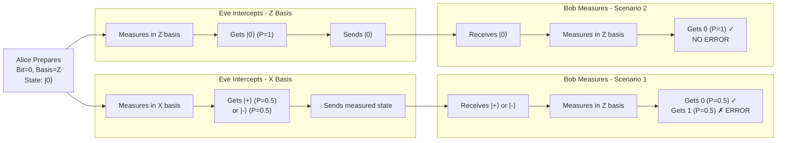

# Lesson 3: Security Proofs, Attack Models

## 1. First-Principles Intuition & Invariants

The history of cryptography, until the late twentieth century, is a history of unverified assumptions. Every classical cryptosystem from Caesar ciphers to RSA rests on conjectured hardness: the belief that factoring large integers or computing discrete logarithms is computationally intractable. These are not theorems. They are open problems in complexity theory. The security of trillions of dollars in daily financial transactions depends on no one finding a clever shortcut that mathematicians have missed for decades. Quantum cryptography breaks from this tradition entirely. It offers something that classical cryptography cannot: security whose guarantees derive from physical law rather than from computational conjecture.

This distinction is not merely philosophical. For a systems engineer designing infrastructure that must remain confidential for thirty years, the difference between "probably secure against today's computers" and "secure against any conceivable adversary regardless of computational power" is the entire problem. The former guarantee evaporates the moment a sufficiently powerful quantum computer becomes available, or the moment a breakthrough in mathematical algorithms occurs. The latter guarantee does not evaporate because it is grounded in the postulates of quantum mechanics, which we have no reason to believe are negotiable.

Understanding why quantum key distribution (QKD) can be proven secure requires internalizing three invariants that quantum mechanics enforces unconditionally.

The first is the **no-cloning theorem**, which states that an arbitrary unknown quantum state cannot be perfectly copied. Formally, there is no unitary operator $U$ such that $U|\psi\rangle|0\rangle = |\psi\rangle|\psi\rangle$ for all states $|\psi\rangle$. The proof follows directly from the linearity of quantum mechanics: if such a $U$ existed, applying it to a superposition $|\psi\rangle = \alpha|0\rangle + \beta|1\rangle$ would require the output to simultaneously equal $|\psi\rangle|\psi\rangle = \alpha^2|00\rangle + \alpha\beta|01\rangle + \beta\alpha|10\rangle + \beta^2|11\rangle$ and also $\alpha|00\rangle + \beta|11\rangle$ (from linearity applied to the basis states), which are only compatible when $\alpha\beta = 0$. An eavesdropper cannot intercept a qubit, duplicate it, forward the original to Bob, and analyze the copy at leisure. That strategy, which works perfectly in classical networks, is physically forbidden.

The second invariant is **measurement disturbance**. When a qubit is in superposition, any measurement collapses that superposition irreversibly. If Eve measures a qubit encoded in the rectilinear basis $\{|0\rangle, |1\rangle\}$ but that qubit was prepared in the diagonal basis $\{|+\rangle, |-\rangle\}$, her measurement projects the state onto one of the rectilinear basis states, destroying the original diagonal encoding. When she then forwards this disturbed state to Bob, Bob's measurement in the correct diagonal basis will produce a random result with probability one half. This disturbance is not a consequence of imperfect technology. It is a consequence of the structure of Hilbert space.

The third invariant is **information gain versus disturbance tradeoff**. Any strategy an eavesdropper uses to extract information about a qubit's state must, on average, introduce disturbance. This is quantified rigorously in the security proofs discussed below, but the intuition is clean: quantum information is not a passive resource that can be observed without consequence. The act of measurement is not a window; it is an intervention.

These three invariants collectively enable the central mechanism of QKD security: **eavesdropping detection**. Alice and Bob do not need to prevent Eve from intercepting their quantum channel. They need only detect that she has done so, then discard the compromised key material. The question that security proofs must answer is: under exactly what conditions, against exactly what adversaries, and over exactly what key lengths can this detection guarantee be made rigorous?

### The Role of the Quantum Bit Error Rate

The **Quantum Bit Error Rate (QBER)** is the operational instrument through which eavesdropping detection is actualized. After completing the quantum transmission phase and sifting (reconciling bases via the authenticated classical channel), Alice and Bob publicly compare a randomly chosen subset of their sifted key bits. The fraction of these check bits that disagree constitutes the QBER.

In an idealized noiseless channel with no eavesdropping, the QBER is zero. In any real channel, photon loss, detector dark counts, alignment jitter, and thermal noise introduce errors, so the QBER is never exactly zero even without an adversary. A well-engineered fiber QKD link might exhibit a background QBER between 0.5% and 2%. The critical insight is that eavesdropping adds error on top of this background. The question is: how much error does a given attack strategy necessarily introduce?

For the BB84 protocol, consider the simplest attack: Eve intercepts each photon, measures it in a randomly chosen basis (rectilinear or diagonal with probability one half each), and resends a fresh photon prepared in the state she measured. When Eve chooses the same basis as Alice, she gets the correct bit and resends undisturbed. When she chooses the wrong basis (which happens with probability one half), she gets a random result, prepares a photon in that randomly chosen state, and resends it. Bob then measures in Alice's original basis. When Eve chose the wrong basis and Bob happens to choose the correct one, there is a one half probability that Bob gets the wrong bit. The overall error rate introduced by this intercept-resend attack on every photon is therefore:

$$\text{QBER}_\text{IR} = \frac{1}{2} \cdot \frac{1}{2} = \frac{1}{4} = 25\%$$

This 25% figure is a canonical threshold. If Alice and Bob observe a QBER significantly exceeding their expected channel noise, they can conclude with high probability that the channel is compromised and abort. If they observe a QBER below an agreed threshold, they can bound the information Eve could have learned and proceed through privacy amplification to distill a provably secure final key.

---

## 2. Core Architecture & Mechanics

### The Intercept-Resend Attack in Detail

An intercept-resend attack is the quantum analog of a classical wiretap. Eve physically intercepts each photon traveling from Alice to Bob, performs a projective measurement, and injects a replacement photon into the channel directed toward Bob. The attack is entirely within the bounds of classical quantum mechanics; no exotic technology is required. What makes it detectable is precisely the measurement disturbance invariant established above.

The state space of BB84 uses four states drawn from two mutually unbiased bases. The rectilinear basis $\mathcal{Z} = \{|0\rangle, |1\rangle\}$ and the diagonal basis $\mathcal{X} = \{|+\rangle = \frac{1}{\sqrt{2}}(|0\rangle + |1\rangle), |-\rangle = \frac{1}{\sqrt{2}}(|0\rangle - |1\rangle)\}$ are mutually unbiased because a measurement of a $\mathcal{Z}$-basis state in the $\mathcal{X}$ basis yields either outcome with equal probability $\frac{1}{2}$, and vice versa. This is not a property of a clever encoding scheme; it is a geometric property of the angle between the measurement bases in Hilbert space.



The asymmetric structure above is what makes partial intercept-resend attacks interesting from an engineering perspective. If Eve only intercepts a fraction $f$ of photons and performs intercept-resend on those, she introduces a QBER of $f/4$. For small $f$, this may be hidden within the noise floor of the channel. Eve gains information about $f$ bits in the sifted key but introduces a detectable signature. Privacy amplification is designed to account for exactly this: given an observed QBER $Q$, we can bound the maximum fraction of the key that Eve may have learned, and compress the key by a sufficient factor to remove that information.

### Entanglement-Based Attacks

The intercept-resend attack is conceptually simple but suboptimal from Eve's perspective. A sophisticated adversary can do better using **coherent attacks**, which are the most general attacks quantum mechanics permits.

In a coherent attack, Eve does not measure individual qubits in transit. Instead, she couples an ancilla (probe) system to each qubit, allowing the qubit-ancilla system to evolve unitarily, and stores all ancillas in a quantum memory without measuring them. She forwards the qubits to Bob. After Alice and Bob reconcile their bases over the classical channel and announce which bits are check bits, Eve measures her ancillas collectively (using a measurement that depends on Alice and Bob's announcements) to extract maximum information. This strategy is strictly more powerful than individual attacks because quantum memories allow Eve to defer her measurement decision until she has access to the most informative basis choice.

The E91 protocol, introduced by Artur Ekert in 1991, is built directly on entanglement and in some ways makes the connection to Bell inequalities even more transparent. Alice and Bob each receive one photon from an entangled pair in the singlet state:

$$|\Psi^-\rangle = \frac{1}{\sqrt{2}}(|01\rangle - |10\rangle)$$

Each party independently chooses a measurement basis from a set of three angles. When they choose compatible bases, their results are perfectly anticorrelated (since it's a singlet state), generating key bits. When they choose incompatible bases, the results are discarded but used to compute a **Bell parameter** $S$.

The CHSH inequality states that for any local hidden variable theory:

$$S = |E(a, b) - E(a, b') + E(a', b) + E(a', b')| \leq 2$$

where $E(a, b)$ is the correlation coefficient for measurement angles $a$ (Alice) and $b$ (Bob). Quantum mechanics predicts $S = 2\sqrt{2} \approx 2.828$ for optimal angles. If Alice and Bob observe $S$ close to $2\sqrt{2}$, they know the qubits are genuinely entangled and no local hidden variable (which would include any classical eavesdropping strategy that doesn't violate special relativity) can account for their correlations. A violation of the CHSH inequality is a certificate of entanglement, and entanglement with an external party is bounded: the **monogamy of entanglement** theorem states that if Alice and Bob share maximal entanglement, Eve can share no entanglement with either of them.

The architectural flow for an entanglement-based QKD session looks as follows:

```mermaid
sequenceDiagram
    participant S as Entangled Pair Source
    participant A as Alice (Measurement Station)
    participant B as Bob (Measurement Station)
    participant C as Classical Auth Channel
    participant E as Eve (Adversary Model)

    S->>A: Photon_A of |Ψ⁻⟩
    S->>B: Photon_B of |Ψ⁻⟩
    E-->>A: (Intercept attempt disturbs entanglement)
    A->>A: Random basis selection θ_A ∈ {0°, 45°, 90°}
    B->>B: Random basis selection θ_B ∈ {45°, 90°, 135°}
    A->>C: Announce basis θ_A (not result)
    B->>C: Announce basis θ_B (not result)
    C->>A: Bob's basis θ_B
    C->>B: Alice's basis θ_A
    A->>A: Classify: key bit (compatible) or CHSH sample (incompatible)
    B->>B: Classify: key bit (compatible) or CHSH sample (incompatible)
    A->>C: Publish CHSH correlators
    B->>C: Publish CHSH correlators
    A->>A: Compute Bell parameter S
    B->>B: Verify S > 2 (quantum) vs S ≤ 2 (compromised)
```



If Eve intercepts photons or introduces ancilla entanglement, she disturbs the singlet correlations and $S$ drops toward 2 or below. The Bell parameter thus serves as a continuous eavesdropping witness for the E91 protocol, playing the same role that QBER plays in BB84.

### The Security Proof Architecture

The modern framework for proving QKD security was established through a sequence of landmark results: Mayers (1996), Lo and Chau (1999), and most significantly Shor and Preskill (2000), who showed that BB84's security can be reduced to the security of CSS (Calderbank-Shor-Steane) quantum error-correcting codes. The Shor-Preskill proof is elegant precisely because it bridges two previously separate fields.

The core idea is that quantum error correction and privacy amplification are dual operations. A CSS code that corrects bit-flip errors also, by its structure, corrects phase-flip errors. Bit-flip reconciliation (error correction on the raw key) corresponds to correcting $X$ errors on the quantum channel. Phase-flip reconciliation (privacy amplification to remove Eve's information) corresponds to correcting $Z$ errors. Alice and Bob do not literally run a quantum error-correcting code on their transmitted qubits, but the security of the key they distill is equivalent to the security they would achieve if they did.

Formally, let $n$ be the number of transmitted qubits after sifting, $e_b$ be the observed bit error rate (QBER), and $e_p$ be the inferred phase error rate (which bounds Eve's information). For symmetric attacks on BB84, $e_p \leq e_b + \delta$ for a statistical tolerance $\delta$. The number of secure bits that can be extracted is:

$$\ell \leq n \left[ 1 - h(e_b) - h(e_p) \right]$$

where $h(x) = -x\log_2 x - (1-x)\log_2(1-x)$ is the binary entropy function. The term $h(e_b)$ accounts for bits spent on classical error correction; the term $h(e_p)$ accounts for the compression in privacy amplification needed to destroy Eve's knowledge. When $e_b = e_p = Q$, this becomes the **key rate formula**:

$$r = 1 - 2h(Q)$$

which yields a positive key rate for $Q < 11\%$ (where $h(0.11) \approx 0.5$). At $Q = 11\%$, the channel is so noisy that Alice and Bob cannot extract a secure key; they abort. At $Q = 25\%$ (the full intercept-resend attack), $h(0.25) \approx 0.811$, giving $r = 1 - 1.622 < 0$, confirming that the attack leaves no extractable secure key.

---

## 3. High-Performance Optimization & Failure Modes

### Finite-Key Analysis: The Gap Between Asymptotic and Real

The key rate formula $r = 1 - 2h(Q)$ is an **asymptotic result**. It assumes Alice and Bob exchange infinitely many qubits, allowing statistical estimates to converge to their true values with zero uncertainty. Real QKD systems exchange finite numbers of photons. A metropolitan fiber link might achieve 10,000 to 1,000,000 sifted bits per second; a satellite-based link might achieve far fewer. At finite block sizes, statistical fluctuations in the observed QBER, in the basis reconciliation, and in the sampling used for security tests can all cause a system that appears secure to actually leak information, or cause excessive conservatism that renders key rates negligible.

Finite-key analysis was placed on a rigorous footing primarily through the work of Renner (2005) and subsequently refined by Tomamichel, Lim, Gisin, and Renato Renner (2012) using **smooth min-entropy** as the central quantity. The smooth min-entropy $H^\epsilon_\text{min}(A|E)$ captures Eve's uncertainty about Alice's key register $A$ given her full quantum side information $E$, up to a smoothing parameter $\epsilon$ that bounds the probability of a "bad" event where the actual entropy is lower than the smooth min-entropy predicts.

The practical finite-key secure key length takes the form:

$$\ell = \lfloor n \cdot r_\infty - 7\sqrt{n} \cdot \log_2(1/\epsilon_\text{sec}) - \text{leak}_\text{EC} \rfloor$$

where $r_\infty$ is the asymptotic key rate, the $7\sqrt{n}$ term is a statistical correction that arises from the uncertainty in estimating channel parameters from a finite sample, $\epsilon_\text{sec}$ is the target security parameter (typically $10^{-10}$ or smaller), and $\text{leak}_\text{EC}$ is the number of bits revealed during error correction over the classical channel.

The $\sqrt{n}$ scaling of the correction term is the crucial feature. For small $n$, the correction term can dominate the asymptotic rate, producing zero or negative secure key length. The following table illustrates approximate secure key lengths as a function of block size for a channel with $Q = 2\%$ and $\epsilon_\text{sec} = 10^{-10}$:

| Sifted Block Size $n$ | Asymptotic Key Bits | Finite-Key Correction | Secure Key Bits |
|---|---|---|---|
| $10^4$ | 7,900 | ~8,200 | 0 (abort) |
| $10^5$ | 79,000 | ~26,000 | ~53,000 |
| $10^6$ | 790,000 | ~82,000 | ~708,000 |
| $10^7$ | 7,900,000 | ~260,000 | ~7,640,000 |

The engineering implication is unambiguous: systems that operate at low photon rates or over high-loss channels may need to accumulate blocks over seconds or minutes before extracting a single secure key. This latency constraint is a fundamental systems design parameter, not a tunable software knob.

### Composable Security and the Universal Composability Framework

A subtle but critical engineering requirement is that QKD's security guarantee must hold when the QKD-generated key is subsequently used inside a larger cryptographic system. It is insufficient to prove that a protocol is "secure in isolation" if that security breaks down when the key is plugged into an AES-encrypted VPN or used to authenticate a TLS session. This is the problem that **composable security** frameworks are designed to solve.

The standard formulation, due to Ben-Or, Horodecki, Leung, Mayers, and Oppenheim (2004) and Renner and König (2005), defines security in terms of the **trace distance** between the real protocol's output and an ideal protocol whose output is a perfectly uniform, perfectly independent key:

$$d(\rho_{KE}, \tau_K \otimes \rho_E) \leq \epsilon$$

where $\rho_{KE}$ is the joint state of the key $K$ and Eve's quantum system $E$ at the end of the real protocol, $\tau_K$ is the maximally mixed state over all possible keys, and $\epsilon$ is the security parameter. When this condition holds, any subsequent use of key $K$ in any cryptographic application behaves as if it used a perfectly random key, up to an additive $\epsilon$ in distinguishing advantage. This is the Universal Composability (UC) condition for quantum protocols.

The trace distance criterion is strictly stronger than semantic security and strictly stronger than computational indistinguishability. It says that no unbounded quantum adversary, running any quantum algorithm, in any computational context, can distinguish the real key from uniform random with advantage greater than $\epsilon$. This is the operational meaning of "unconditional security."

For implementors building QKD-integrated systems, the composable security parameter $\epsilon$ must be tracked through the protocol stack. If the QKD layer achieves $\epsilon_\text{QKD} = 10^{-10}$ and the subsequent symmetric encryption layer has a collision-resistance failure probability of $\epsilon_\text{AES} = 10^{-20}$, the overall system has security parameter $\epsilon_\text{total} \leq \epsilon_\text{QKD} + \epsilon_\text{AES} \approx 10^{-10}$ by the union bound. The QKD layer dominates, so choosing $\epsilon_\text{QKD}$ smaller improves the overall guarantee at the cost of more key bits consumed for privacy amplification.

### Practical QBER Monitoring and Key Management in Software

The systems engineer's job in a QKD deployment is to implement the classical post-processing pipeline that transforms raw detection events into provably secure key material. This pipeline has well-defined stages and performance-critical bottlenecks.

The first stage is **sifting**: Alice and Bob exchange basis choices over the authenticated channel and retain only the bits where their choices agree. For BB84 with uniform random basis choices, roughly 50% of raw bits survive sifting. The sifting protocol itself must be authenticated using an unconditionally secure method, typically a Wegman-Carter MAC keyed on a small pre-shared secret.

The second stage is **parameter estimation**: a subset of the sifted key (typically 10–50%, chosen adaptively based on desired statistical confidence) is sacrificed as check bits. Alice and Bob publicly compare these bits, compute the QBER, and determine whether to proceed, adjust key rate, or abort. The check bit fraction trades security against throughput: more check bits give tighter QBER estimates (smaller finite-key corrections) but reduce available raw key material.

The following C implementation computes the QBER from two aligned bitstrings and determines the maximum extractable key length under finite-key analysis. The implementation uses the Hamming weight of the XOR (popcount) for efficiency and applies the Tomamichel-Lim finite-key formula:

```c
#include <stdint.h>
#include <stdlib.h>
#include <math.h>
#include <stdio.h>
#include <string.h>

#define MAX_BLOCK_BITS  (1 << 24)  /* 16M bit maximum block */
#define MAX_BLOCK_WORDS (MAX_BLOCK_BITS / 64)

/* Binary entropy function h(x) = -x log2(x) - (1-x) log2(1-x) */
static double binary_entropy(double x) {
    if (x <= 0.0 || x >= 1.0) return 0.0;
    return -x * log2(x) - (1.0 - x) * log2(1.0 - x);
}

/*
 * Compute QBER from two word-aligned bitstrings of length n_bits.
 * alice_bits and bob_bits must be n_words = ceil(n_bits/64) uint64_t words.
 * Returns the fraction of differing bits in the check sample.
 */
double compute_qber(const uint64_t *alice_bits,
                    const uint64_t *bob_bits,
                    size_t n_words,
                    size_t n_bits)
{
    uint64_t total_errors = 0;

    for (size_t i = 0; i < n_words; i++) {
        total_errors += (uint64_t)__builtin_popcountll(alice_bits[i] ^ bob_bits[i]);
    }

    /* Mask off padding bits in the final word */
    size_t remainder = n_bits % 64;
    if (remainder != 0) {
        uint64_t mask = ((uint64_t)1 << remainder) - 1;
        uint64_t last_word_errors =
            (uint64_t)__builtin_popcountll(
                (alice_bits[n_words - 1] ^ bob_bits[n_words - 1]) & mask);
        /* Subtract last word's unmasked contribution and add masked */
        total_errors -= (uint64_t)__builtin_popcountll(
                            alice_bits[n_words - 1] ^ bob_bits[n_words - 1]);
        total_errors += last_word_errors;
    }

    return (double)total_errors / (double)n_bits;
}

/*
 * Wegman-Carter authentication tag for the sifting channel.
 * Uses a universal hash H_{a,b}(m) = (a * m + b) mod p for a prime p.
 * In production, use a proper WC-MAC library. This demonstrates the structure.
 */
typedef struct {
    uint64_t a;
    uint64_t b;
    uint64_t prime;  /* Mersenne prime 2^61 - 1 */
} WCMacKey;

static uint64_t wc_mac(const WCMacKey *key, uint64_t message_hash) {
    /* Multiply using 128-bit intermediate to avoid overflow */
    __uint128_t prod = (__uint128_t)key->a * message_hash + key->b;
    uint64_t p = key->prime;
    uint64_t result = (uint64_t)(prod % p);
    return result;
}

typedef struct {
    double qber;             /* Observed quantum bit error rate          */
    double asymptotic_rate;  /* r_inf = 1 - 2h(QBER) for BB84           */
    int64_t secure_key_bits; /* Finite-key secure output length          */
    double epsilon_sec;      /* Composable security parameter            */
    int    abort;            /* 1 if QBER exceeds abort threshold        */
} KeyRateResult;

/*
 * Compute the finite-key secure key length using the Tomamichel-Lim formula.
 *
 *   l = n * r_inf - 7 * sqrt(n) * log2(1/epsilon) - leak_EC
 *
 * where:
 *   n          = number of sifted bits used for key generation (not check bits)
 *   r_inf      = asymptotic key rate 1 - 2*h(qber)
 *   epsilon    = composable security parameter
 *   leak_EC    = bits revealed during error correction ≈ n * h(qber) / 0.95
 *                (0.95 factor models a good LDPC decoder at 95% of Shannon limit)
 *
 * qber_abort   = 0.11 is the BB84 security threshold for symmetric attacks.
 * check_frac   = fraction of sifted bits used as check bits [0.1, 0.5]
 */
KeyRateResult finite_key_analysis(size_t n_sifted,
                                   double qber,
                                   double epsilon_sec,
                                   double check_frac)
{
    KeyRateResult result = {0};
    result.qber        = qber;
    result.epsilon_sec = epsilon_sec;

    const double QBER_ABORT_THRESHOLD = 0.11;
    if (qber >= QBER_ABORT_THRESHOLD) {
        result.abort = 1;
        result.secure_key_bits = 0;
        result.asymptotic_rate = 0.0;
        return result;
    }

    /* n_key: sifted bits devoted to key; n_check: sacrificed for QBER estimation */
    size_t n_check = (size_t)(n_sifted * check_frac);
    size_t n_key   = n_sifted - n_check;

    if (n_key == 0) {
        result.secure_key_bits = 0;
        return result;
    }

    double h_qber        = binary_entropy(qber);
    double r_inf         = 1.0 - 2.0 * h_qber;
    result.asymptotic_rate = r_inf;

    if (r_inf <= 0.0) {
        result.abort = 1;
        result.secure_key_bits = 0;
        return result;
    }

    double n             = (double)n_key;
    double log2_inv_eps  = log2(1.0 / epsilon_sec);

    /* Statistical correction from finite-key smooth min-entropy bound */
    double finite_correction = 7.0 * sqrt(n) * log2_inv_eps;

    /* Classical information leakage during error correction (Cascade / LDPC) */
    double ec_efficiency = 0.95;    /* fraction of Shannon limit achieved      */
    double leak_ec       = n * h_qber / ec_efficiency;

    double l = n * r_inf - finite_correction - leak_ec;
    result.secure_key_bits = (l > 0.0) ? (int64_t)floor(l) : 0;

    return result;
}

/*
 * Demonstrate a complete post-processing decision for a 1M-sifted-bit block.
 */
int main(void) {
    const size_t N_SIFTED   = 1000000;
    const double EPSILON_SEC = 1e-10;
    const double CHECK_FRAC  = 0.20;    /* 20% check bits */

    /* Simulate observed QBERs representing different channel conditions */
    double test_qbers[] = {0.005, 0.02, 0.05, 0.10, 0.11, 0.15};
    size_t n_tests = sizeof(test_qbers) / sizeof(test_qbers[0]);

    printf("%-12s %-18s %-22s %-20s %s\n",
           "QBER", "Asymptotic Rate", "Finite Correction",
           "Secure Key Bits", "Decision");
    printf("%s\n", "----------------------------------------------------------------------"
                   "-------------------");

    for (size_t i = 0; i < n_tests; i++) {
        KeyRateResult r = finite_key_analysis(N_SIFTED, test_qbers[i],
                                               EPSILON_SEC, CHECK_FRAC);

        double n_key = (double)(N_SIFTED - (size_t)(N_SIFTED * CHECK_FRAC));
        double finite_corr = 7.0 * sqrt(n_key) * log2(1.0 / EPSILON_SEC);

        printf("%-12.3f %-18.4f %-22.0f %-20ld %s\n",
               test_qbers[i],
               r.asymptotic_rate,
               finite_corr,
               r.secure_key_bits,
               r.abort ? "ABORT" : "PROCEED");
    }

    printf("\nNote: n_sifted=%zu, epsilon_sec=1e-10, check_frac=%.0f%%\n",
           N_SIFTED, CHECK_FRAC * 100.0);
    return 0;
}
```

Compile and run this with:

```text
gcc -O2 -std=c11 -lm -o qkd_keyrate qkd_keyrate.c && ./qkd_keyrate
```

The output illustrates the sharp cliff in extractable key bits as QBER approaches the 11% threshold, and the pronounced difference between asymptotic and finite-key rates even at 1 million sifted bits. At low QBERs (0.5%), the finite-key correction is relatively small and throughput is high. At 10% QBER, the asymptotic rate is about 6%, but finite-key corrections consume a substantial fraction of that rate, leaving a much smaller usable output.

### Privacy Amplification: The Final Defense Layer

Privacy amplification is the protocol step that destroys whatever partial information Eve has accumulated. Even if Eve has intercepted every qubit and stored detailed ancilla measurements, privacy amplification compresses the reconciled key to a length where Eve's mutual information with the final key is bounded by $\epsilon_\text{sec}$. The mechanism is a family of **universal hash functions** applied to the full reconciled key string.

A family of functions $\mathcal{H} = \{h : \{0,1\}^n \to \{0,1\}^\ell\}$ is 2-universal if for any two distinct inputs $x \neq y$ and a uniformly random $h \in \mathcal{H}$:

$$\Pr_{h \in \mathcal{H}}[h(x) = h(y)] \leq \frac{1}{2^\ell}$$

The Leftover Hash Lemma (Bennett, Brassard, and Robert, 1988; quantum generalization by Renner and König) states that applying a randomly chosen function from a 2-universal family to an $n$-bit string with min-entropy $k$ produces an $\ell$-bit output that is $\epsilon$-close to uniform, where:

$$\ell = k - 2\log_2(1/\epsilon)$$

The choice of hash family matters for performance. Toeplitz matrices (multiplication of the reconciled key by a random Toeplitz matrix over GF(2)) are a standard choice: an $\ell \times n$ Toeplitz matrix requires storing only $n + \ell - 1$ random bits (since the diagonals are constant) and matrix-vector multiplication over GF(2) can be implemented as a convolution, executable in $O(n \log n)$ operations via FFT-based polynomial multiplication. For $n = 10^6$ bits, a software implementation using 64-bit XOR and shift operations can process the hash in tens of milliseconds on a modern CPU, well within the latency budget of most QKD key management systems.

The seed for the Toeplitz matrix must itself be generated from a certified randomness source. Using a quantum random number generator (QRNG) based on photon shot noise or vacuum fluctuations closes this loop: the same quantum optical infrastructure used for the QKD channel can serve as a QRNG for hash seed generation, ensuring that the privacy amplification step does not reintroduce classical randomness assumptions.

### Attack Model Failure Modes and Defense Hierarchy

The security proofs discussed above make specific assumptions about the adversary's capabilities and the correctness of the implementation. Each assumption is a potential failure point in a real deployment.

The **photon number splitting (PNS) attack** exploits the fact that practical QKD sources are weak coherent pulse (WCP) lasers rather than perfect single-photon sources. A WCP laser with mean photon number $\mu$ produces multi-photon pulses with probability approximately $\mu^2/2$ for small $\mu$. When a pulse contains two photons, Eve can split off one photon using a lossless beamsplitter, store it in a quantum memory, and forward the other to Bob undetected. After basis reconciliation, Eve measures her stored photon in the correct basis and gains the full bit value with no disturbance to the QBER. This attack is mitigated by the **decoy state protocol**, which mixes pulses of different intensities ($\mu_\text{signal}$, $\mu_\text{decoy}$, vacuum) in a random pattern. By comparing detection rates across intensity levels, Alice and Bob can bound the fraction of single-photon pulses and the maximum information Eve could have extracted via PNS, restoring security without requiring a true single-photon source.

**Detector side-channel attacks** represent a different failure mode: attacks that target the classical measurement apparatus rather than the quantum channel. The **blinding attack** (Lydersen et al., 2010) demonstrated that by illuminating a single-photon avalanche diode (SPAD) detector with continuous bright light, an adversary can transition the detector from its single-photon counting regime into a linear detector regime. In this regime, the detector only fires when the trigger pulse exceeds a threshold that depends on the polarization of an injected bright pulse. Eve can thus inject her own bright pulses with controlled polarization, causing Bob's detector to fire only when Eve sends the "correct" state, while suppressing clicks for the other state. The resulting detection pattern reveals full information to Eve with zero QBER contribution.

The detector blinding attack is devastating precisely because it lies outside the security proof's model. The proof assumes an abstract quantum channel and abstract measurement devices; it says nothing about the electrical behavior of SPADs under high-intensity illumination. The industry response has been **measurement-device-independent QKD (MDI-QKD)**, in which Alice and Bob both send qubits to an untrusted relay (which may be Eve herself), and security is established through a Bell-state measurement protocol. Any manipulation of the detectors, including blinding, produces a detectable signature in the Bell-state correlations. The price paid is a substantially lower key rate due to the indirect measurement architecture, but the trust model is drastically improved: Alice and Bob need only trust their own transmitter hardware.

The deepest defense is **device-independent QKD (DI-QKD)**, which removes trust assumptions from both sources and detectors by relying solely on observed Bell inequality violations. If Alice and Bob's devices produce correlations that violate the CHSH inequality by a sufficient margin, security follows from quantum mechanics alone, regardless of how the devices are built or whether they were supplied by a potentially malicious vendor. DI-QKD was proven secure in principle by Pironio et al. (2009) and Vazirani and Vidick (2014), but its practical key rates are extremely low due to the detection efficiency requirements (loophole-free Bell tests require near-unity efficiency detectors, which current technology only barely achieves). The first loophole-free Bell test demonstrations (Hensen et al., 2015; Giustina et al., 2015) used photon pair sources and superconducting nanowire single-photon detectors at cryogenic temperatures, achieving CHSH violations of approximately $S = 2.42$ with enough statistical significance to close both the locality and detection loopholes simultaneously. DI-QKD at practical key rates over metropolitan distances remains an open engineering problem as of this writing, but it represents the theoretical asymptote of the security hierarchy: a protocol whose security requires trusting nothing but quantum mechanics itself.

The systems engineer deploying QKD today works somewhere in the middle of this hierarchy. Full device independence is not yet practical; pure BB84 with WCP sources and standard detectors carries real risks from PNS and detector attacks. Decoy-state BB84 combined with MDI-QKD architectures represents a pragmatic near-term choice that closes the most exploited attack surfaces while maintaining sufficient key rates for real-world applications. Understanding where each deployed system sits on this hierarchy, and what assumptions it rests on, is not an academic exercise. It is the operational security posture.
