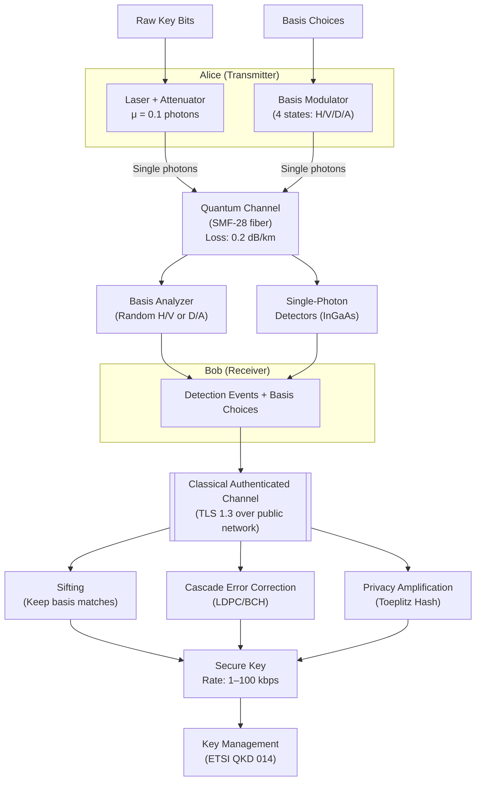

# Lesson 4: Implementation, Practical Systems

## 1. First-Principles Intuition & Invariants

The transition from quantum cryptographic theory to operational systems represents one of the most challenging engineering endeavors in modern computing infrastructure. Unlike classical cryptographic implementations where software correctness and timing side-channels dominate security analysis, quantum key distribution systems must contend with fundamental physics constraints that cannot be abstracted away through software engineering practices. The security proof of BB84 or E91 protocols assumes perfect single-photon sources, lossless quantum channels, and ideal detectors—assumptions that collapse immediately upon contact with physical reality. Every photon lost to fiber attenuation, every multi-photon emission event from imperfect sources, and every dark count in avalanche photodiodes represents not merely degraded performance but a potential vulnerability that an adversary can exploit through photon number splitting attacks or detector blinding techniques.

The practical QKD system must therefore be understood as a hybrid classical-quantum artifact where quantum mechanical processes generate raw correlated bit strings, but classical post-processing infrastructure performs the heavy lifting of error correction, privacy amplification, and key management. This classical layer consumes the majority of system complexity and represents the primary attack surface for implementation vulnerabilities. The quantum channel produces raw keys at rates fundamentally bounded by quantum measurement statistics and channel loss—typically measured in kilobits per second over metropolitan distances—while the classical reconciliation and authentication protocols must execute with deterministic timing guarantees to prevent denial-of-service attacks that exhaust buffer space or create timing side-channels.

The security parameter $\varepsilon$ in practical QKD systems quantifies the composable security bound: the probability that an adversary can distinguish the output key from uniform random bits. Achieving $\varepsilon < 10^{-10}$ requires careful budget allocation across quantum bit error rate (QBER), finite-size effects in privacy amplification, and authentication failure probability. The raw key generation rate $R$ scales with detection efficiency $\eta_{\text{det}}$, channel transmittance $\eta_{\text{channel}}$, and repetition rate $f_{\text{rep}}$ according to $R \approx f_{\text{rep}} \cdot \eta_{\text{channel}} \cdot \eta_{\text{det}} \cdot (1 - h(Q))$ where $h(Q)$ is the binary entropy of the QBER. This relationship exposes the brutal physics tax: every additional kilometer of fiber attenuates the signal by $0.2$ dB/km at $1550$ nm, cutting transmittance by half every $15$ km, which translates directly to halving the secure key rate.

Deploying QKD into production networks necessitates integration with existing key management infrastructure through standards-compliant interfaces. The ETSI GS QKD 004 specification defines application interfaces where QKD devices appear as hardware security modules generating high-entropy keying material, while ETSI GS QKD 014 addresses the protocol and data format for key delivery to cryptographic applications. This integration layer must resolve the impedance mismatch between QKD's continuous key generation model and classical applications expecting on-demand key establishment, typically through key buffering, lifetime management, and fallback to post-quantum classical algorithms when quantum channels experience outages.

## 2. Core Architecture & Mechanics

The canonical QKD system architecture decomposes into four principal subsystems: quantum transmission hardware, quantum reception and measurement hardware, classical synchronization and basis reconciliation, and post-processing pipeline. The quantum transmitter begins with a laser source—typically a distributed feedback laser diode operating at $1550$ nm telecom wavelength—whose output passes through an intensity modulator or attenuator to achieve mean photon number $\mu \approx 0.1$ per pulse. This attenuation regime, operating in the Poisson statistics domain, ensures that multi-photon events occur with probability $P(n \geq 2) \approx \mu^2/2$, limiting photon-number-splitting attack opportunities. Variable optical attenuators using MEMS mirror arrays or electro-absorption modulators provide sub-nanosecond switching times necessary for decoy-state protocols where three intensity levels ($\mu$, $\nu$, $\omega$ with $\mu > \nu > \omega \approx 0$) are randomly selected per pulse to detect photon-splitting attacks through statistical analysis of detection rates.

State preparation hardware implements the chosen protocol basis. For polarization-encoded BB84, a phase modulator driven by high-speed digital-to-analog converters rotates the polarization state to four positions corresponding to horizontal, vertical, diagonal, and anti-diagonal polarizations. The modulator voltage-to-phase response exhibits thermal drift and piezoelectric hysteresis, requiring continuous calibration through optical power monitoring and feedback control loops operating at $1$ kHz to maintain polarization extinction ratios exceeding $25$ dB. Time-bin encoding implementations replace polarization modulators with unbalanced Mach-Zehnder interferometers where the path length difference $\Delta L = c \cdot \Delta t$ defines the temporal separation between early and late time bins, with typical values of $\Delta t = 1$ ns corresponding to $30$ cm path imbalance. Thermal stability requirements demand temperature control within $\pm 0.01$ K to prevent phase drift between interferometer arms.

The quantum channel itself—standard SMF-28 single-mode fiber in metropolitan deployments—imposes fundamental loss mechanisms beyond simple attenuation. Rayleigh scattering from density fluctuations frozen into the glass matrix contributes the dominant loss mechanism, with additional contributions from infrared absorption by hydroxyl impurities and ultraviolet absorption band tails. Fiber birefringence from manufacturing stress randomly rotates polarization states along the fiber length, necessitating automatic polarization compensation at the receiver using lithium niobate waveguide controllers or fiber squeezers with piezoelectric actuators. These compensators track the state of polarization on microsecond timescales to counteract vibration-induced birefringence fluctuations while avoiding megahertz-scale dither that would introduce crosstalk between polarization bases.

The receiver architecture centers on single-photon detectors whose quantum efficiency, dark count rate, dead time, and timing jitter collectively determine system performance. Indium gallium arsenide avalanche photodiodes operated in Geiger mode above breakdown voltage achieve quantum efficiencies approaching $25\%$ at $1550$ nm, but suffer from afterpulsing where charge carriers trapped during an avalanche trigger spurious detection events microseconds later with exponentially decaying probability. Gated detection mitigates afterpulsing by activating the bias voltage only during brief $1$-$5$ ns windows synchronized to expected photon arrivals, but this necessitates nanosecond-precision timing synchronization between transmitter and receiver. Superconducting nanowire single-photon detectors fabricated from $5$ nm thick niobium nitride films cooled to $2$ K achieve quantum efficiencies exceeding $90\%$ with sub-nanosecond jitter and negligible dark counts, but require closed-cycle cryocoolers consuming $50$ W that introduce vibration and maintenance complexity.

Basis reconciliation and sifting extract the correlated bit subset where Alice and Bob measured in matching bases. Alice announces her basis choice for each pulse over the classical authenticated channel—$n$ bits of public communication for $n$ transmitted pulses—and Bob responds with his basis choices, after which both parties retain only the subset of bits where bases coincided. For BB84, this sifts the raw detection events by a factor of two on average, since bases match with $50\%$ probability. Cascade error correction, introduced by Brassard and Salvail, corrects the residual bit errors arising from detector noise and eavesdropping through interactive binary search over randomly permuted blocks. Alice and Bob publicly compare parities of selected bit blocks, performing bisection to locate and correct errors, then iterate with different permutations to catch errors that fall on block boundaries. Each parity disclosure leaks $1$ bit of information, requiring privacy amplification to remove adversary knowledge.

The privacy amplification stage consumes the syndrome information leaked during error correction and extracts a shorter uniformly random key provably decorrelated from adversary knowledge. Universal hash functions implement this compression: Alice and Bob agree on a random Toeplitz matrix $T$ of dimension $m \times n$ with $m < n$, then compute their final key as $K = T \cdot X$ where $X$ is the error-corrected sifted key. The Leftover Hash Lemma guarantees that if the adversary's initial mutual information with $X$ was at most $t$ bits, the output key $K$ satisfies $\varepsilon$-security provided $m \leq n - t - 2\log_2(1/\varepsilon)$. Computing this bound requires estimating the adversary's information through QBER analysis: the phase error rate in the signal basis upper-bounds Eve's information via quantum mutual information formulas derived from optimal collective attack strategies. Finite-size effects dominate practical systems since statistical fluctuations in $10^6$ to $10^9$ sifted bits introduce uncertainty in QBER estimation that must be accounted through confidence intervals, typically reducing the final key length by $10^4$ to $10^5$ bits to maintain security.

Classical synchronization deserves particular attention as it represents a common vulnerability point. The quantum transmitter must notify the receiver of pulse arrival times with sufficient precision for gated detector operation. GPS-disciplined oscillators provide $10$ ns absolute timing accuracy, but this uncertainty exceeds typical detector gate widths by an order of magnitude. Systems therefore establish initial coarse synchronization via GPS timestamps, then perform fine synchronization through optical clock recovery where a strong classical laser pulse precedes the quantum signal, allowing the receiver to lock a phase-locked loop to the transmitter's repetition rate. This synchronization signal travels the same fiber path as quantum states, inheriting identical propagation delays and temperature-induced variations. The PLL bandwidth must be sufficiently narrow to reject high-frequency noise while tracking slow thermal drifts, typically implemented with loop filters having corner frequencies near $100$ Hz.

## 3. High-Performance Optimization & Failure Modes

Maximizing secure key rate under fixed hardware constraints demands careful optimization of the full protocol stack, starting with decoy-state parameter selection. The three-intensity BB84 protocol requires choosing mean photon numbers $\mu$, $\nu$, and $\omega$ along with their statistical mixing probabilities $p_\mu$, $p_\nu$, $p_\omega$ to maximize the single-photon contribution to the final key rate while maintaining sufficient statistics to bound multi-photon events. Numerical optimization reveals that setting $\mu \approx 0.5$, $\nu \approx 0.1$, and $\omega \approx 0.001$ with mixing probabilities weighted heavily toward $\mu$ typically maximizes rate over metropolitan distances. The single-photon key rate estimate emerges from solving a system of detection rate equations accounting for different photon-number components, with conservative lower bounds derived through convex optimization techniques that account for statistical fluctuations in finite data blocks.

Fiber link budget optimization considers the trade-off between detector efficiency, gate width, and background noise. Wider detector gates capture more signal photons from temporal pulse broadening in fiber dispersion, but accumulate more dark counts and background photons scaling linearly with gate width. The optimal gate width $\Delta t_{\text{opt}}$ balances these effects according to $\Delta t_{\text{opt}} \approx \sigma_t \sqrt{2\ln(\eta_{\text{det}} N_{\text{signal}}/n_{\text{dark}})}$ where $\sigma_t$ is the pulse width, $N_{\text{signal}}$ is the expected signal count per gate, and $n_{\text{dark}}$ is the dark count rate. This typically yields gates of $1$ to $3$ ns for InGaAs detectors and sub-nanosecond gates for superconducting detectors. Spectral filtering at the receiver using narrowband Fabry-Perot etalons or fiber Bragg gratings reduces background photons from ambient light and Raman scattered pump photons, with filter bandwidths near $0.1$ nm providing $20$ dB rejection of out-of-band noise while passing the signal with minimal loss.

Error correction code optimization presents a trade-off between correction capability, syndrome leakage, and computational complexity. Low-density parity-check codes constructed via progressive edge-growth algorithms achieve near-Shannon-limit performance at QBER values up to $11\%$ for BB84, but require thousands of parity check bits that must be transmitted over the classical channel. Rate-adaptive LDPC codes dynamically puncture or extend the code based on measured QBER, avoiding over-correction that unnecessarily reveals information when channel quality is high. Hardware-accelerated LDPC decoders using min-sum approximation to belief propagation execute on FPGA fabric with parallelized check node and variable node update circuits, achieving throughput exceeding $100$ Mbps for codes of length $10^5$ bits. This computational requirement dominates system latency in high-rate systems where quantum transmission completes in milliseconds but error correction consumes seconds.

Privacy amplification acceleration exploits the special structure of Toeplitz matrix multiplication. The naive matrix-vector product requires $O(mn)$ operations for an $m \times n$ matrix, but Toeplitz matrices possess only $m + n - 1$ unique elements arranged such that diagonals contain repeated values. Fast Fourier transform-based multiplication reduces complexity to $O((m+n)\log(m+n))$ by embedding the Toeplitz matrix in a circulant matrix, computing the product via FFT convolution, and extracting the relevant output segment. GPU implementations of radix-2 FFT algorithms process $10^8$-bit keys in under one second on consumer graphics hardware, while FPGA implementations achieve $500$ Mbps sustained throughput through pipelined FFT cores and dedicated AXI DMA channels for key buffer transfers.

Trusted node architectures extend QKD range beyond direct fiber links by chaining multiple QKD segments with intermediate relay nodes that receive, decrypt, and re-encrypt keys between adjacent segments. Each trusted node represents a potential compromise point where plaintext keys exist momentarily in memory, requiring physical security measures including tamper-evident enclosures, power analysis shielding, and secure key erasure protocols that overwrite memory with cryptographic random data followed by hardware reset. The end-to-end security reduces to the security of the weakest segment, with the total security parameter satisfying $\varepsilon_{\text{total}} \leq k \cdot \varepsilon_{\text{segment}}$ for $k$ segments under sequential composition. Quantum repeaters based on entanglement swapping and quantum memory promise trustless range extension, but practical implementations remain at early research stages due to quantum memory lifetimes limited to milliseconds and entanglement swapping fidelities below $90\%$.

Integration with post-quantum classical cryptography provides defense-in-depth against both future quantum computer attacks and potential QKD implementation vulnerabilities. Hybrid key establishment protocols combine QKD-generated keys with post-quantum key encapsulation mechanisms such as CRYSTALS-Kyber through bitwise XOR or hash-based combiners. The combined key remains secure as long as either the quantum channel resists eavesdropping or the classical algorithm resists cryptanalysis, providing a security hedge against unexpected advances in either domain. Authentication of the classical channel presents a bootstrapping challenge since public-key signatures face quantum threats; practical deployments use long-term symmetric authentication keys established through trusted courier during initial system installation, then continuously refresh these keys using QKD output to achieve information-theoretic authentication security.

Failure mode analysis must consider both natural errors and adversarial attacks. Optical connector contamination introduces loss spikes that appear indistinguishable from channel attacks in loss-based anomaly detection, requiring correlation with physical inspection logs and statistical analysis of loss pattern dynamics. Detector blinding attacks exploit the nonlinear response of avalanche photodiodes above saturation, where continuous-wave illumination disables Geiger-mode operation and allows the adversary to induce classical photocurrent responses proportional to subsequent signal amplitude. Countermeasures include out-of-band optical power monitoring that triggers alarms when background light exceeds thresholds, and active quenching circuits that enforce dead time even under bright illumination. Side-channel attacks targeting the classical post-processing hardware follow standard software exploitation vectors: buffer overflows in error correction code parsers, timing attacks on hash function implementations, and electromagnetic analysis of memory bus traffic during key derivation, all requiring standard software hardening practices including memory-safe languages, constant-time cryptographic primitives, and electromagnetic shielding.

System monitoring and telemetry provide operational visibility into quantum channel health and security relevant parameters. Real-time tracking of QBER, detection rate, and coincidence visibility allows operators to detect gradual degradation from fiber aging or catastrophic failures from fiber cuts. Statistical process control charts applying Shewhart control rules flag deviations exceeding $3\sigma$ thresholds that may indicate attacks or hardware failures requiring investigation. Comprehensive logging of all classical channel exchanges, authentication outcomes, and key generation events provides audit trails for security forensics, with logs cryptographically timestamped and integrity-protected using hash chains anchored in hardware security modules. Performance metrics including secure key rate, system uptime, and mean time between key refresh cycles inform capacity planning and SLA compliance verification for carrier-grade deployments.

The path toward gigabit-scale quantum networks requires not merely incremental detector and source improvements but architectural innovations including wavelength-division multiplexing to pack multiple QKD channels onto single fibers, satellite-based free-space links to bypass fiber attenuation through space transmission over $1000$ km ground-to-satellite paths, and ultimately quantum repeaters leveraging entanglement purification and quantum error correction to achieve capacity scaling laws fundamentally different from classical networks. Until such infrastructure matures, practical QKD systems occupy a niche role protecting high-value symmetric keys for government and financial applications where information-theoretic security justifies the cost and complexity overhead beyond classical key establishment protocols.
