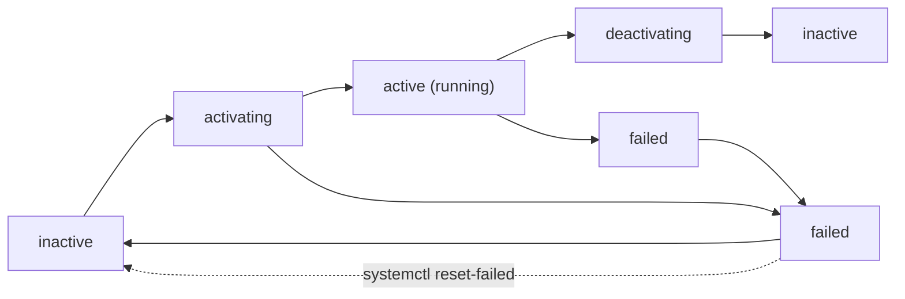

# Lesson 2: Service Lifecycle, Process Supervision, Execution Model

## 1. First-Principles Intuition & Invariants

Every operating system faces the same fundamental problem: a process exists in time, and time is adversarial. Processes crash, stall, exhaust memory, block on dead file descriptors, and silently produce garbage without anyone noticing. The classical Unix answer to this problem was `init`, a process with PID 1 whose sole architectural virtue was that it could not be killed by the kernel. Everything it spawned was a child, and when children died, `init` reaped them. That was the extent of its supervision model. If a daemon died, nothing restarted it. If it took too long to start, nothing noticed. If it was holding a socket that other daemons needed, those other daemons simply failed or spun in retry loops until a human intervened.

Systemd's answer to this problem is fundamentally different in kind, not just in degree. Where `init` was a passive process reaper, systemd is an active state machine engine. Every service unit is a formal state object with well-defined transitions, and systemd's job is to drive those objects toward their desired states while enforcing constraints about ordering, resource allocation, and failure response. This reframing has enormous practical consequences. It means that "starting a service" is not a fire-and-forget operation but a synchronization protocol with explicit completion semantics. It means that "a failed service" is not a terminal condition but a triggerable event that can initiate restart logic, notifications, or dependency teardown. It means that the execution environment of a process is not an accident of ambient shell state but a precisely constructed sandbox assembled from declarative unit file directives.

To internalize this, you need to hold two invariants simultaneously. The first is the **activation invariant**: a service does not become active until it has completed the precise readiness protocol its type demands. The second is the **supervision invariant**: once active, a service's lifetime is coupled to systemd's awareness through the cgroup hierarchy, not through fragile PID tracking. These two invariants together eliminate entire categories of bugs that plagued SysV init systems — the "daemon appears to start but its children escape supervision" problem, the "service is running but not ready" race condition, and the "PID file contains a stale PID after a crash" corruption problem.

The activation invariant materializes in the form of service types. The supervision invariant materializes in cgroup delegation. Understanding both demands understanding how the kernel actually represents process trees.

When systemd forks a service, it immediately places that service's main process into a cgroup that systemd owns and names. This is not optional; it is architecturally central. A cgroup, in the context of cgroups v2 (the unified hierarchy), is a kernel-managed group of processes that share resource accounting boundaries and can be subjected to resource limits as a unit. What makes cgroup-based supervision categorically superior to PID-based supervision is that you cannot escape a cgroup by forking. A double-forked daemon that abandons its parent still remains inside the cgroup that systemd created, because cgroup membership is inherited at fork time and can only be changed by a process with appropriate capabilities writing to the kernel's cgroup filesystem. This means systemd always knows exactly which processes belong to a given unit, regardless of how deeply they have forked or daemonized. When you run `systemctl status nginx.service`, the memory and CPU figures you see reflect the entire cgroup subtree, not just the main PID.

The implication for the PID 1 architecture is subtle but important. Systemd itself does not need to be a direct parent of the processes it supervises. It delegates process creation to the `fork()` + `execve()` path and then tracks supervision through the cgroup control plane. The direct parent relationship, which SysV `init` depended on for `wait()` semantics, becomes a secondary concern. Systemd registers a `SIGCHLD` handler for direct children and uses the kernel's prctl `PR_SET_CHILD_SUBREAPER` mechanism to absorb orphaned grandchildren, but its primary supervision channel is the cgroup hierarchy, not the process table.

---

## 2. Core Architecture & Mechanics

### Service Types and Readiness Protocols

The `Type=` directive in a service unit file is not a cosmetic classification. It defines the readiness protocol — the precise sequence of events that must occur before systemd transitions the unit from `activating` to `active (running)`. Choosing the wrong type does not merely produce a warning; it breaks the ordering guarantees that dependent units rely on.

**`Type=simple`** is the default and the least expressive. Systemd considers the service active the moment it successfully calls `fork()` and `execve()` on the `ExecStart=` binary. It makes no claim about whether the process has opened its sockets, loaded its configuration, or is ready to accept work. For a service that has no dependents, this is fine. For a service that other units order themselves after with `After=` and `Requires=`, it is a race condition waiting to surface under load, because `After=` ordering guarantees only that systemd will *start* the unit before its dependents, not that it will be *ready* when they begin their own initialization.

**`Type=forking`** exists for compatibility with traditional Unix daemons that double-fork to detach from the controlling terminal and then write their actual PID to a file. Systemd waits for the original `ExecStart=` process to exit, reads the PID file specified by `PIDFile=`, and considers that PID to be the main process for subsequent tracking. This is the most brittle of all service types. If the daemon writes its PID file before it has fully initialized, or if it crashes after writing the PID file but before becoming ready, systemd has no mechanism to know. PIDFile also creates a time-of-check-to-time-of-use window where the PID can be recycled by the kernel between the write and the read. For any new service you are authoring, `Type=forking` should be considered a legacy compatibility shim, not a design target.

**`Type=oneshot`** changes the semantics entirely. Systemd considers the unit's activation complete only after the `ExecStart=` process exits with status zero. This models a task rather than a daemon — a filesystem check, a key import, a network namespace configuration, or a migration script. When combined with `RemainAfterExit=yes`, the unit transitions to `active (exited)` after completion and remains in that state, allowing other units to express dependencies on the task having been performed without requiring a persistent process. This is architecturally correct for initialization work that transforms system state rather than serving ongoing requests.

**`Type=notify`** is the right choice for any new daemon you write that you want to integrate cleanly with systemd. It uses an IPC mechanism built into libsystemd: the daemon calls `sd_notify(0, "READY=1")`, which sends a datagram to a Unix socket whose path systemd placed in the environment variable `NOTIFY_SOCKET`. Systemd holds the unit in the `activating` state until it receives this datagram, at which point it transitions the unit to `active (running)` and considers the activation sequence complete. The power of this protocol is that the daemon controls precisely when it declares readiness, after it has bound its listening sockets, loaded its configuration, and is genuinely prepared to handle requests. You can also send `STATUS=message` to update the status line visible in `systemctl status`, and `WATCHDOG=1` to respond to watchdog challenges (discussed below).

**`Type=notify-fd`** is a newer variant introduced in systemd 253 that uses `LISTEN_FDS` file descriptor passing rather than a path-based socket, eliminating the TOCTOU exposure in the socket path environment variable. It is worth using for new high-security services.

**`Type=dbus`** is specific to services that acquire a well-known name on the D-Bus system bus. Systemd considers the unit active when the specified `BusName=` appears on the bus. This integrates naturally with D-Bus activation semantics but couples your service supervision to the D-Bus broker's availability, which creates its own dependency ordering requirements. For system services that do not use D-Bus, this type adds unnecessary complexity.

**`Type=idle`** is a scheduling curiosity more than a supervision primitive. Systemd defers executing the service until all active jobs have been dispatched, preventing its output from interleaving with boot-time progress messages. It is semantically equivalent to `Type=simple` in terms of readiness detection and is rarely relevant outside of interactive boot services like `getty`.

### Exec Environment Construction

Before systemd calls `execve()` on your binary, it constructs an execution environment from scratch. This is one of the most practically important and least-appreciated aspects of systemd service management, because it means that a binary that works perfectly when you run it from a shell may behave differently or fail entirely when run as a service, not because of a bug in your code but because of differences in the environment.

The environment construction pipeline proceeds in a defined order. Systemd begins with an empty environment (not the calling process's environment) and then layers in directives from the unit file. `Environment=` adds static key-value pairs. `EnvironmentFile=` reads key-value pairs from a file, with the `-` prefix meaning the file's absence is not fatal. `PassEnvironment=` selects specific variables from systemd's own environment to pass through, and `UnsetEnvironment=` removes variables that might otherwise be inherited. The result is a fully deterministic environment, isolated from the terminal session of whoever ran `systemctl start`.

The working directory defaults to the root filesystem unless `WorkingDirectory=` is set. The umask defaults to 0022 unless `UMask=` overrides it. Standard input defaults to `/dev/null`; standard output and error default to the journal via the `sd-journal` socket protocol unless `StandardOutput=` and `StandardError=` direct them elsewhere. `StandardOutput=journal+console` is a useful setting for services where you want output to reach both the journal and any connected console simultaneously.

Credential isolation deserves particular attention. `User=` and `Group=` specify the UNIX credentials under which the process runs, and systemd handles the credential transition before `execve()`, not through a setuid wrapper. `SupplementaryGroups=` adds group memberships. `NoNewPrivileges=yes` calls `prctl(PR_SET_NO_NEW_PRIVS, 1)` on the process, preventing it from gaining additional privileges through setuid binaries or file capabilities, even if it later calls `execve()` on such a binary. This directive has become a cornerstone of service hardening in modern deployments and costs nothing in performance.

The filesystem namespace construction, controlled by directives like `ProtectSystem=`, `ProtectHome=`, `PrivateTmp=`, `PrivateNetwork=`, and `ReadOnlyPaths=`, occurs through Linux mount namespaces. When `PrivateTmp=yes` is set, systemd creates a new mount namespace for the service and bind-mounts a fresh temporary directory over `/tmp` and `/var/tmp`. The service sees an empty tmp directory; processes outside the service see a different one. This eliminates an entire class of privilege escalation attacks that rely on predictable tmp file paths. `ProtectSystem=strict` remounts the entire filesystem hierarchy read-only except for `/dev`, `/proc`, `/sys`, and explicitly writable paths. The service can read the system but cannot modify it without an explicit `ReadWritePaths=` exception.

### The Cgroup Integration Model

When systemd starts a service, it creates a cgroup at the path `/sys/fs/cgroup/<slice>/<service>.service`. The slice hierarchy — `system.slice` for system services, `user.slice` for user services, `machine.slice` for containers — reflects the resource accounting domains you want to manage. Each service's cgroup is a child of its slice's cgroup, and resource limits propagate downward through the hierarchy.

The `CPUWeight=`, `MemoryMax=`, `MemoryHigh=`, `IOWeight=`, and `TasksMax=` directives translate directly into writes to the cgroup's controller files. `MemoryMax=` writes to `memory.max` and enforces a hard limit that triggers the OOM killer when exceeded. `MemoryHigh=` writes to `memory.high`, a soft limit that triggers memory reclaim pressure without immediately killing processes, which is the correct knob for production services where you want to constrain memory usage without risking an ungraceful kill. The distinction between these two limits matters enormously in practice: a service that slowly leaks memory will trigger `memory.high` long before it hits `memory.max`, giving you time to observe the trend through `systemctl status` or journal inspection before processes start dying.

```text
systemd (PID 1)
     │
     ├── system.slice
     │      ├── nginx.service      ← /sys/fs/cgroup/system.slice/nginx.service/
     │      │      memory.max = 512M
     │      │      cpu.weight = 100
     │      │
     │      └── postgresql.service ← /sys/fs/cgroup/system.slice/postgresql.service/
     │             memory.max = 4G
     │             cpu.weight = 400
     │
     └── user.slice
            └── user-1000.slice
                   └── session-3.scope
```

`systemd-cgls` renders this hierarchy as a live tree, and `systemd-cgtop` shows resource consumption per cgroup slice, making it straightforward to identify which service is driving CPU or memory pressure without instrumenting any application code.

### Restart Policies and the Restart State Machine

A unit's restart behavior is controlled by three cooperating directives: `Restart=`, `RestartSec=`, and the rate-limiting pair `StartLimitBurst=` / `StartLimitIntervalSec=`.

The `Restart=` directive specifies the trigger conditions for automatic restart. `Restart=no` is the default and means systemd never restarts the service. `Restart=on-failure` restarts when the process exits with a nonzero status, is killed by a signal other than `SIGTERM` or `SIGKILL` (which systemd itself uses for clean stops), or when the watchdog timeout expires. `Restart=always` restarts on any exit, including clean exits with status zero, which is appropriate for services designed to run indefinitely. `Restart=on-abnormal` adds watchdog and signal exits but not clean exits or the `on-failure` exit codes. The taxonomy matters: a service that exits cleanly as part of its protocol (a oneshot-style worker that processes one batch and exits) should not use `Restart=on-failure` or it will immediately restart and process nothing again.

`RestartSec=` introduces a delay between the process exiting and systemd attempting the restart. The default is 100 milliseconds, which is aggressive enough that a tight crash-restart loop can saturate CPU. Setting `RestartSec=5s` for most services is prudent. For services with external dependencies like databases, `RestartSec=10s` or longer gives the dependency time to recover before the service hammers it with connection attempts.

The rate limiter `StartLimitBurst=` and `StartLimitIntervalSec=` define a token bucket: if the service starts more than `StartLimitBurst=` times within `StartLimitIntervalSec=` seconds, systemd stops trying and transitions the unit to the `failed` state. The defaults are five starts in ten seconds. When a service hits this limit, `systemctl reset-failed servicename` is required before systemd will attempt another restart. This is intentional: it prevents a crashlooping service from consuming unbounded resources, and it creates an observable event (the transition to `failed`) that monitoring systems can alert on.

The full unit state machine, simplified to its most practically relevant transitions, looks like this:



The `activating` state is where service type semantics are enforced. For `Type=notify`, the unit stays in `activating` until the `READY=1` datagram arrives or the `TimeoutStartSec=` deadline expires, whichever comes first. `TimeoutStartSec=` defaults to ninety seconds in most distributions; for services with well-understood startup profiles, constraining it to five or ten seconds catches hangs early and gives the restart policy a chance to recover faster.

### Watchdog Protocol

The watchdog protocol extends the notification socket with a keepalive channel. When a service sets `WatchdogSec=` to a nonzero duration, systemd sets the environment variable `WATCHDOG_USEC` to that duration in microseconds before `execve()`. The daemon is expected to call `sd_notify(0, "WATCHDOG=1")` at a frequency greater than once per `WatchdogSec=` interval. If the interval expires without a keepalive, systemd treats it as a service failure and applies the restart policy.

The contract this implements is subtle: it is not just a liveness check (the process is running) but a progress check (the process's watchdog heartbeat path is executing). A deadlocked process continues to exist and consume CPU but will fail to send `WATCHDOG=1` through its main service loop, triggering the watchdog. The recommended implementation pattern is to send the keepalive from the same event loop iteration that processes requests, so that a livelocked or deadlocked service fails the watchdog even if its process is technically alive.

A complete, minimal C implementation of a notify-type service with watchdog support demonstrates both protocols in their native form:

```c
#define _GNU_SOURCE
#include <stdio.h>
#include <stdlib.h>
#include <string.h>
#include <unistd.h>
#include <errno.h>
#include <time.h>
#include <sys/socket.h>
#include <sys/un.h>
#include <systemd/sd-daemon.h>

/*
 * Compile: gcc -o watchdog_service watchdog_service.c $(pkg-config --cflags --libs libsystemd)
 * Unit file should set: Type=notify, WatchdogSec=10s, Restart=on-failure
 */

static int sd_notify_send(const char *state) {
    const char *sock_path = getenv("NOTIFY_SOCKET");
    if (!sock_path) return 0;

    int fd = socket(AF_UNIX, SOCK_DGRAM | SOCK_CLOEXEC, 0);
    if (fd < 0) return -errno;

    struct sockaddr_un addr = { .sun_family = AF_UNIX };
    if (sock_path[0] == '@') {
        /* Abstract namespace socket */
        addr.sun_path[0] = '\0';
        strncpy(addr.sun_path + 1, sock_path + 1, sizeof(addr.sun_path) - 2);
    } else {
        strncpy(addr.sun_path, sock_path, sizeof(addr.sun_path) - 1);
    }

    struct iovec iov = {
        .iov_base = (void *)state,
        .iov_len  = strlen(state),
    };
    struct msghdr msg = {
        .msg_name    = &addr,
        .msg_namelen = sizeof(addr),
        .msg_iov     = &iov,
        .msg_iovlen  = 1,
    };

    int ret = sendmsg(fd, &msg, MSG_NOSIGNAL);
    close(fd);
    return ret < 0 ? -errno : 0;
}

static uint64_t watchdog_usec(void) {
    const char *val = getenv("WATCHDOG_USEC");
    if (!val) return 0;
    return (uint64_t)strtoull(val, NULL, 10);
}

static uint64_t now_usec(void) {
    struct timespec ts;
    clock_gettime(CLOCK_MONOTONIC, &ts);
    return (uint64_t)ts.tv_sec * 1000000ULL + (uint64_t)ts.tv_nsec / 1000ULL;
}

int main(void) {
    uint64_t wdog = watchdog_usec();
    uint64_t ping_interval_usec = wdog > 0 ? wdog / 2 : 0;
    uint64_t last_ping = now_usec();

    /* Perform real initialization here: bind sockets, load config, etc. */
    sd_notify_send("STATUS=Initializing service...");
    usleep(500000); /* Simulate startup work */

    /* Signal readiness to systemd. Units with After=this.service will now proceed. */
    sd_notify_send("READY=1\nSTATUS=Serving requests");

    /* Main service loop */
    for (;;) {
        /*
         * Real work: accept connections, process jobs, etc.
         * Simulated here with a short sleep representing one event loop tick.
         */
        usleep(100000);

        uint64_t now = now_usec();
        if (ping_interval_usec > 0 && (now - last_ping) >= ping_interval_usec) {
            sd_notify_send("WATCHDOG=1");
            last_ping = now;
        }
    }

    /* Reached on graceful shutdown signal (SIGTERM handler not shown for brevity) */
    sd_notify_send("STOPPING=1");
    return EXIT_SUCCESS;
}
```

The corresponding unit file for this binary makes the type contract explicit:

```ini
[Unit]
Description=Watchdog Notify Service Example
Documentation=man:sd_notify(3)
After=network.target

[Service]
Type=notify
ExecStart=/usr/local/bin/watchdog_service
Restart=on-failure
RestartSec=5s
WatchdogSec=10s
StartLimitBurst=5
StartLimitIntervalSec=60s

User=nobody
Group=nogroup
NoNewPrivileges=yes
ProtectSystem=strict
ProtectHome=yes
PrivateTmp=yes
MemoryMax=128M
CPUWeight=100

[Install]
WantedBy=multi-user.target
```

### Socket Activation Primitives

Socket activation decouples the moment a listening socket is created from the moment the daemon that handles connections on that socket starts. This is not an optimization trick; it is a fundamental rearchitecting of service availability semantics. Under socket activation, systemd creates the socket, binds it to its address, and begins queuing incoming connections at the kernel level before the service process exists. The TCP stack will accept the three-way handshake and buffer data in the socket's receive queue. When the service eventually starts and calls `accept()`, those connections are waiting. No connection is refused during the brief interval between boot and service startup.

Systemd implements this through a `.socket` unit that is paired with a `.service` unit of the same base name. The `.socket` unit's `ListenStream=`, `ListenDatagram=`, or `ListenSequentialPacket=` directives specify what to bind. When a connection arrives, systemd starts the paired service and passes the listening socket as a pre-opened file descriptor. The service discovers these file descriptors through the `LISTEN_FDS` environment variable, which contains the count of passed file descriptors starting at file descriptor number 3 (after stdin, stdout, and stderr). The `LISTEN_PID` variable contains the service's expected PID, which the service should validate before trusting `LISTEN_FDS`.

```ini
# /etc/systemd/system/echo-server.socket
[Unit]
Description=Echo Server Listening Socket

[Socket]
ListenStream=127.0.0.1:9000
Accept=no

[Install]
WantedBy=sockets.target
```

```ini
# /etc/systemd/system/echo-server.service
[Unit]
Description=Echo Server Service
Requires=echo-server.socket
After=echo-server.socket

[Service]
Type=notify
ExecStart=/usr/local/bin/echo_server
NonBlocking=yes

[Install]
WantedBy=multi-user.target
```

A service consuming socket-activated file descriptors uses `sd_listen_fds()` from libsystemd or manually reads `LISTEN_FDS` and iterates from `SD_LISTEN_FDS_START` (defined as 3). The complete C implementation of a socket-activated echo server shows the pattern at its lowest level:

```c
#define _GNU_SOURCE
#include <stdio.h>
#include <stdlib.h>
#include <string.h>
#include <unistd.h>
#include <errno.h>
#include <sys/socket.h>
#include <sys/types.h>
#include <netinet/in.h>
#include <systemd/sd-daemon.h>

/*
 * Compile: gcc -o echo_server echo_server.c $(pkg-config --cflags --libs libsystemd)
 * Start via: systemctl start echo-server.socket
 * Test with: echo "hello" | nc 127.0.0.1 9000
 */

#define BUFFER_SIZE 4096

static void handle_client(int client_fd) {
    char buf[BUFFER_SIZE];
    ssize_t n;
    while ((n = recv(client_fd, buf, sizeof(buf), 0)) > 0) {
        ssize_t sent = 0;
        while (sent < n) {
            ssize_t w = send(client_fd, buf + sent, (size_t)(n - sent), MSG_NOSIGNAL);
            if (w <= 0) goto cleanup;
            sent += w;
        }
    }
cleanup:
    close(client_fd);
}

int main(void) {
    int n_fds = sd_listen_fds(1);
    if (n_fds < 1) {
        fprintf(stderr, "echo_server: no socket fds received from systemd (n_fds=%d)\n", n_fds);
        return EXIT_FAILURE;
    }

    int listen_fd = SD_LISTEN_FDS_START; /* fd 3 */

    if (!sd_is_socket_inet(listen_fd, AF_INET, SOCK_STREAM, 1, 9000)) {
        fprintf(stderr, "echo_server: fd %d is not the expected TCP socket\n", listen_fd);
        return EXIT_FAILURE;
    }

    sd_notify(0, "READY=1\nSTATUS=Accepting connections on port 9000");

    for (;;) {
        struct sockaddr_in client_addr;
        socklen_t addr_len = sizeof(client_addr);
        int client_fd = accept4(listen_fd,
                                (struct sockaddr *)&client_addr,
                                &addr_len,
                                SOCK_CLOEXEC);
        if (client_fd < 0) {
            if (errno == EINTR) continue;
            perror("accept4");
            break;
        }
        handle_client(client_fd);
    }

    return EXIT_SUCCESS;
}
```

The `sd_is_socket_inet()` check is a defensive practice that validates the passed file descriptor matches the expected socket family, type, and port before the service trusts it, guarding against misconfiguration or unit file errors that might pass an unexpected descriptor.

`Accept=yes` on the socket unit changes the semantics: systemd accepts each incoming connection and spawns a fresh service instance per connection, passing the connected socket rather than the listening socket. This is the inetd model and is appropriate for low-volume or one-shot request handlers, but it carries the overhead of a fork and exec per connection, making it unsuitable for high-throughput services.

---

## 3. High-Performance Optimization & Failure Modes

### Type Mismatch and the Invisible Race

The most common systemd configuration error in production systems is a `Type=simple` service with dependents ordered after it, where the service's initialization takes a nonnegligible amount of time. Because `Type=simple` declares readiness at fork time, all dependent services begin their own activation sequences while the first service is still loading configuration, populating caches, or waiting for database connections. The result is a boot-time race: sometimes the dependent starts fast enough that it retries connections until the first service finishes; sometimes it fails on the first attempt, falls into its restart delay, and wastes precious boot seconds.

The fix is mechanical: change `Type=simple` to `Type=notify` and add an `sd_notify(0, "READY=1")` call after genuine initialization is complete. For services whose source you cannot modify, `Type=forking` with an accurate `PIDFile=` and a `ExecStartPost=` probe script can approximate readiness signaling, though this remains inherently fragile. Alternatively, `Type=exec` (available in systemd 250+) is a middle ground that considers the unit active once the `execve()` call succeeds in the child, eliminating the fork-but-not-exec window without requiring application-level notify support.

### StartLimitBurst Exhaustion Under Cascading Failure

A service that depends on an external resource — a database, a message queue, a configuration service — will crash on startup if that resource is unavailable. With `Restart=on-failure` and default rate limits, it will restart five times in ten seconds and then enter `failed` state, requiring manual intervention. During a cascading failure scenario where the external dependency is recovering, this means your service has exhausted its restart budget before the dependency comes back online.

The correct configuration for dependency-sensitive services is to combine `RestartSec=10s` with an expanded `StartLimitBurst=10` and `StartLimitIntervalSec=300s`, giving the service ten restart attempts spread over five minutes. Additionally, the `ExecStartPre=` directive can run a lightweight probe command before the main binary starts:

```ini
ExecStartPre=/usr/bin/pg_isready -h postgres-host -p 5432 -U appuser
```

If `pg_isready` exits nonzero, systemd aborts the start attempt and applies the restart delay, consuming one burst token but preventing the main binary from launching into a known-failure state. This is more resource-efficient than letting the full application binary start, attempt connections, fail, and exit.

### Watchdog Tuning Under GC Pressure

For services written in garbage-collected languages (Java, Go, Python), stop-the-world garbage collection pauses can prevent the event loop from executing long enough to miss a watchdog interval. A service with `WatchdogSec=5s` running a Java application that occasionally pauses for 6 seconds during a full GC will experience spurious watchdog kills. The correct approach is to set `WatchdogSec=` to a multiple of the worst-case GC pause time you are willing to tolerate, typically two to three times the 99th percentile GC pause observed under load. For a service with a worst-case 2-second GC pause, `WatchdogSec=15s` with a watchdog heartbeat sent every 5 seconds gives adequate margin.

For Go services, the `GOGC` and `GOMEMLIMIT` environment variables (set via `Environment=` in the unit file) control GC aggressiveness and can reduce worst-case pause duration. Setting `GOMEMLIMIT` to 80% of the service's `MemoryMax=` prevents the Go runtime from allocating up to the cgroup limit and triggering an OOM kill just before a GC cycle would have reclaimed memory.

### Cgroup Memory Limit Sizing and OOM Interaction

Setting `MemoryMax=` too close to a service's steady-state working set size creates a situation where the kernel's OOM killer fires not because of a leak but because of normal peak usage during request bursts. The OOM killer targets processes inside the cgroup and kills them without warning, leaving no meaningful log entry beyond the kernel's `oom_kill_process` message in `dmesg`. From systemd's perspective, a process killed by SIGKILL (which the OOM killer uses) with a nonzero exit status triggers `Restart=on-failure`, creating a cycle that is difficult to diagnose without correlating journal timestamps with `dmesg` output.

Sizing `MemoryMax=` requires measuring the service's resident set size under realistic peak load with `systemd-cgtop` or by reading `/sys/fs/cgroup/system.slice/servicename.service/memory.current` directly. Add 25–50% headroom above the measured peak RSS for the `MemoryMax=` value. Set `MemoryHigh=` to the measured peak RSS itself; this creates backpressure that slows allocation without killing processes, giving you an observable signal that the service is approaching its limit before it crosses into OOM territory.

```bash
# Read current memory consumption of a live service's cgroup
cat /sys/fs/cgroup/system.slice/myapp.service/memory.current

# Check peak memory since service start (requires kernel 5.14+)
cat /sys/fs/cgroup/system.slice/myapp.service/memory.peak

# Watch per-service resource consumption live (1-second refresh)
systemd-cgtop -d 1
```

### Unit File Validation and Pre-Deployment Verification

Before deploying a unit file to a production system, the `systemd-analyze verify` command performs static analysis on the unit and its transitive dependency graph without starting anything:

```bash
systemd-analyze verify /etc/systemd/system/myapp.service
```

This catches missing `After=` ordering that would create a startup race, invalid directive names, unresolvable `Requires=` targets, and type-incompatible directive combinations. For socket units, it validates that the paired service unit exists and that their `Requires=`/`After=` relationships are consistent.

`systemd-analyze security myapp.service` produces a scored security profile of the service's sandbox configuration, enumerating which attack surface categories are exposed by the current directives. It outputs a numeric exposure score from 0 (fully sandboxed) to 10 (no restrictions), with per-directive explanations of what each score component represents. This is not a theoretical exercise: running this command against production service files regularly surfaces forgotten `ProtectSystem=` or `NoNewPrivileges=` directives that were removed during a debugging session and never restored.

The combination of `systemd-analyze verify` for correctness and `systemd-analyze security` for defense posture, run as part of a CI pipeline that lints unit files alongside application code, eliminates entire categories of production incidents before they reach a running system.
