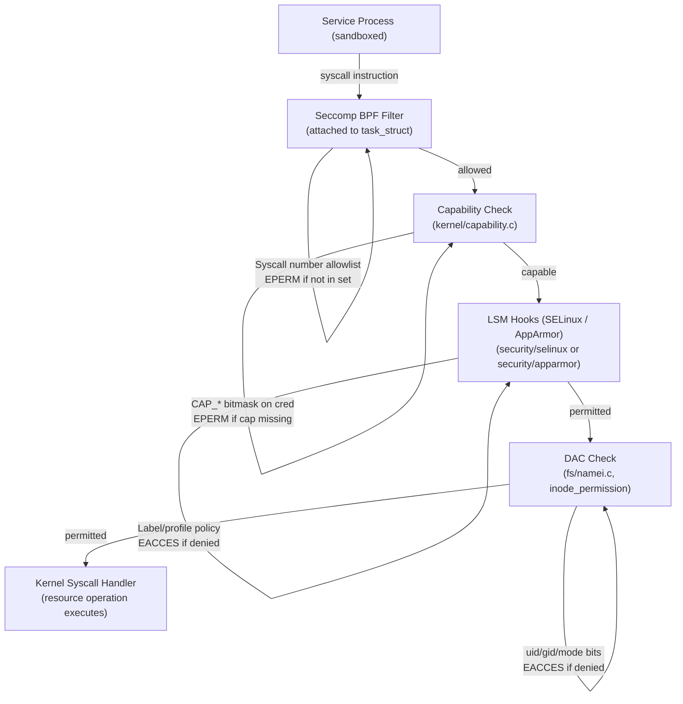

# Lesson 3: Resource Control, Isolation Boundaries, Sandboxing Mechanisms

## 1. First-Principles Intuition & Invariants

Every operating system faces a fundamental coordination problem: multiple processes share a finite pool of CPU cycles, memory pages, and I/O bandwidth, yet each process believes, to varying degrees, that it owns the machine. Left unchecked, a single runaway service can exhaust swap, saturate disk queues, or monopolize scheduler time—collapsing co-located workloads with no clean recovery path short of a reboot. The traditional UNIX answer to this problem was coarse: `nice` values, `ulimit` constraints, and file permission bits. These mechanisms were never designed for the multi-tenant, declarative service lifecycle that modern infrastructure demands. Systemd's resource control model is the production-grade answer to that design gap, and understanding it requires tracing the machinery from kernel data structures up through the unit file directives that express policy.

The invariant at the heart of systemd's resource model is hierarchical cgroup placement. Every service, slice, and scope that systemd manages is a node in a cgroup v2 tree. The kernel's cgroup v2 interface, unified under a single hierarchy mounted at `/sys/fs/cgroup`, abandoned the per-subsystem hierarchy fragmentation of cgroup v1 and replaced it with a single tree where every controller—`cpu`, `memory`, `io`, `pids`—operates on the same set of nodes simultaneously. This unification is not merely an administrative convenience; it is architecturally necessary for correct enforcement. Under cgroup v1, a process could belong to different subtrees in different subsystems, making coordinated multi-resource policy incoherent. Under cgroup v2, the invariant is strict: a process belongs to exactly one cgroup node, and all controllers observe that same placement.

Systemd's slice abstraction maps directly onto this tree. When systemd starts `postgresql.service`, it places that service's processes under a cgroup path like `/system.slice/postgresql.service`. The `system.slice` cgroup is itself a child of the root cgroup. The `-.slice` (root slice), `system.slice`, `user.slice`, and `machine.slice` form the top-level partitions, beneath which individual services and user sessions are subordinate nodes. This placement is automatic, mandatory, and not optional—systemd always places units in the cgroup tree, whether or not any resource limits have been configured. The placement itself, independent of any controller policy, is what gives systemd clean and reliable process tracking: when a service's cgroup is empty, all its processes have exited, with no ambiguity about adopted children or double-forking daemons.

Isolation is a separate but complementary concern. Where cgroup control answers "how much of a resource can this service consume," namespace isolation answers "what does this service perceive about the system it runs on." Linux namespaces are kernel objects that virtualize six distinct global resources: PID, network, mount, IPC, UTS, and user identity. A process whose network namespace is not the host network namespace cannot observe host network interfaces; a process in an isolated PID namespace sees itself as PID 1; a process in an isolated mount namespace carries its own private mount table. Systemd provisions namespaces automatically through unit file directives—no manual `unshare` invocation is required—and the kernel enforces these boundaries at the syscall level with no userspace cooperation needed.

The philosophical invariant binding cgroup control and namespace isolation together is the principle of *least ambient authority*: a service should possess only the capabilities, resource budget, and system visibility that its function strictly requires. This is not merely a security posture; it is an operational reliability posture. A service that cannot see the host's `/tmp` cannot inadvertently fill the root filesystem with temporary data. A service that has no `CAP_NET_BIND_SERVICE` capability cannot bind privileged ports, eliminating an entire class of misconfiguration. A service whose memory ceiling is enforced by the kernel will receive an OOM kill targeting only its cgroup, leaving co-resident services unaffected. These properties compound: a fully sandboxed service is simultaneously harder to exploit, harder to misconfigure, and easier to reason about under failure.

Seccomp filtering adds a third enforcement dimension orthogonal to both resource limits and namespace isolation. Where namespaces control visibility and cgroups control resource allocation, seccomp operates at the system call boundary itself, enforcing policy on which kernel interfaces the service is permitted to invoke. The seccomp BPF filter, loaded at process start by systemd and evaluated entirely within the kernel, intercepts every syscall before execution and either permits it, returns an error, or delivers a signal. This is a mandatory access control mechanism with zero runtime overhead for allowed syscalls—the filter runs in kernel context before the syscall executes, and the common path (a permitted syscall) adds only the BPF evaluation time, which amounts to a handful of nanoseconds. The more important property is that an exploited service process that cannot issue `execve`, `socket`, or `ptrace` syscalls is severely limited in what post-exploitation pivots are available.

Together, these four mechanisms—cgroup resource accounting, namespace isolation, capability bounding, and seccomp filtering—form a layered defense model that systemd can deploy declaratively through unit file directives, without requiring the administrator to understand raw kernel interfaces. That is the core value proposition: the complexity lives in systemd's implementation; the operator expresses intent through a readable unit file.

---

## 2. Core Architecture & Mechanics

### Cgroup v2 Resource Accounting

To understand how systemd translates `CPUQuota=50%` into an enforced CPU ceiling, you need to follow the path from unit file directive to kernel data structure. When systemd parses a service unit and encounters `CPUQuota=50%`, it computes the corresponding cgroup v2 `cpu.max` file value. The `cpu.max` interface accepts a pair `$MAX $PERIOD` expressed in microseconds, where the kernel's CFS bandwidth controller enforces that processes within the cgroup consume at most `$MAX` microseconds of CPU time within each `$PERIOD` window. A quota of 50% on a 100 ms period becomes `50000 100000`. Systemd writes this value to `/sys/fs/cgroup/system.slice/postgresql.service/cpu.max` after the service's cgroup is created but before the service process is exec'd.

The CFS bandwidth controller interacts with the per-CPU run queues through two kernel data structures: `cfs_bandwidth` embedded in the `task_group` structure, and per-CPU `cfs_rq` structures that track consumed time against the group's quota. At each scheduler tick, `update_curr` advances the current task's `vruntime` and charges elapsed time against the cgroup's bandwidth pool. When the pool empties, the cgroup's tasks are throttled: they are removed from the run queue and placed in a throttled list. A high-resolution timer fires at the end of each period, refills the pool, and unthrottles the tasks. This mechanism is entirely within the kernel; the cgroup filesystem interface at `/sys/fs/cgroup/` is simply a projection of these kernel structures into a browsable pseudo-filesystem.

Memory control under cgroup v2 is governed by `memory.max` (the hard limit triggering OOM kill) and `memory.high` (the soft limit triggering memory pressure reclaim before the hard limit is reached). When a process in the cgroup allocates memory and the cgroup's usage crosses `memory.high`, the kernel invokes the memory reclaim path asynchronously—swapping pages, reclaiming file-backed pages from the page cache—while allowing the allocation to succeed. If usage reaches `memory.max` and reclaim cannot free enough memory, the kernel invokes the cgroup OOM killer, which selects a victim within the cgroup and delivers `SIGKILL`. Critically, in cgroup v2, the OOM kill is scoped to the cgroup: processes outside the cgroup are not candidates. This is the key operational advantage over system-wide OOM behavior. The corresponding unit file directives are `MemoryHigh=` and `MemoryMax=`, accepting values like `1G` or `512M`.

Block I/O control is expressed through `IOReadBandwidthMax=` and `IOWriteBandwidthMax=`, which systemd maps to the cgroup v2 `io.max` file. The kernel's block layer uses the BFQ (Budget Fair Queueing) or throttle policy to enforce these limits on individual block devices, identified by their `major:minor` device number. Because `io.max` operates at the cgroup level, the enforcement is per-cgroup-node: all processes within `postgresql.service` share the same I/O budget, regardless of how many threads issue I/O concurrently. The `io.stat` file exposes per-cgroup I/O accounting in real time, which is invaluable for diagnosing whether a service is I/O-bound or whether it is saturating shared storage.

The relationship between slices and services is a delegation tree that determines which controllers are active at each level. Under cgroup v2's "domain controller" model, a controller must be enabled at every ancestor node between the root and the target node. Systemd manages this automatically: when you set `CPUQuota=` on a service, systemd ensures that the `cpu` controller is listed in `cgroup.subtree_control` at the slice and root levels. You can observe the active controllers on any cgroup node with:

```text
cat /sys/fs/cgroup/system.slice/cgroup.subtree_control
```

The following diagram traces the cgroup tree for a typical systemd deployment, showing the inheritance path from the root slice down to an individual service:

```text
/ (root cgroup)
└── -.slice  [cpu, memory, io, pids active]
    ├── system.slice
    │   ├── postgresql.service   [cpu.max, memory.max, io.max enforced here]
    │   ├── nginx.service
    │   └── sshd.service
    ├── user.slice
    │   └── user-1000.slice
    │       └── session-1.scope
    └── machine.slice
        └── containerd.service
```

Each node is a directory under `/sys/fs/cgroup/`, and each controller file within that directory is a live kernel interface. Writing to `cpu.max` changes enforcement immediately without restarting the service.

### Namespace Isolation

Systemd provisions namespaces through the `clone(2)` flags it passes when spawning the service process. The directives `PrivateNetwork=yes`, `PrivateTmp=yes`, `PrivatePIDs=yes`, and `PrivateUsers=yes` each correspond to one or more `CLONE_NEW*` flags. When systemd forks the service process, it calls `clone` with the appropriate flags set, and the kernel instantiates new namespace objects for that process. The service then inherits these new namespaces, and all further child processes it forks will inherit them in turn.

`PrivateNetwork=yes` creates a new network namespace (`CLONE_NEWNET`) that contains only a loopback interface. The service cannot see host network interfaces, cannot open raw sockets on the host network, and cannot communicate externally unless you explicitly configure a veth pair or a socket-activated fd. This directive is appropriate for any service that communicates exclusively via Unix domain sockets or localhost.

`PrivateTmp=yes` creates a new mount namespace (`CLONE_NEWNS`) and bind-mounts a fresh `tmpfs` over both `/tmp` and `/var/tmp` within that namespace. The service gets a clean, private temporary directory tree that is automatically destroyed when the service exits. No other service can read or write the service's `/tmp` files. This eliminates an entire category of TOCTOU vulnerabilities that exploit predictable `/tmp` paths. Under the hood, systemd creates the private tmpfs in a private mount namespace by calling `unshare(CLONE_NEWNS)` in the service's pre-exec path, then mounting the tmpfs before executing the service binary.

`PrivatePIDs=yes` (available in systemd ≥ 252 on kernels ≥ 6.1) creates a new PID namespace so the service cannot observe or signal processes outside its own namespace. The service's initial process appears as PID 1 within the namespace, and `/proc` mounted within the namespace reflects only the namespace's processes. This prevents a compromised service from enumerating other services or sending signals to unrelated processes.

### Filesystem Sandboxing

The filesystem sandboxing directives compose on top of the mount namespace that `PrivateTmp=yes` or `ProtectSystem=` create. `ProtectSystem=strict` remounts the entire filesystem hierarchy read-only within the service's mount namespace, then selectively re-mounts writable mounts only for paths explicitly listed in `ReadWritePaths=`. `ProtectHome=yes` bind-mounts an empty tmpfs over `/home`, `/root`, and `/run/user`, making the service's access to user home directories impossible regardless of file permissions.

`ReadOnlyPaths=` and `ReadWritePaths=` provide fine-grained control within that framework. A service that must write only to `/var/lib/postgresql` can be configured as:

```ini
ProtectSystem=strict
ProtectHome=yes
ReadWritePaths=/var/lib/postgresql /run/postgresql
ReadOnlyPaths=/etc/postgresql
```

This creates a mount namespace in which every bind-mount of the specified paths is established with the correct `MS_RDONLY` or writable flags before execing the service binary. The kernel enforces these mounts at the VFS layer: a write to a read-only bind-mount returns `EROFS` unconditionally, regardless of the process's capabilities or the underlying filesystem's permissions.

`BindPaths=` and `BindReadOnlyPaths=` extend this by allowing arbitrary host paths to be projected into the service's namespace at different mount points, enabling controlled data sharing between the host and a sandboxed service without exposing broader filesystem access.

### Capability Bounding

Linux capabilities decompose root privilege into 41 discrete tokens (as of kernel 6.x). The capability sets that matter for service hardening are the bounding set and the ambient set. The bounding set is a ceiling: no `execve` can grant a capability not present in the bounding set, regardless of the binary's file capabilities. The ambient set allows non-root processes to inherit capabilities across `execve`. Systemd controls these through `CapabilityBoundingSet=` and `AmbientCapabilities=`.

A minimal web server that needs only to bind port 80 and read its configuration should be configured as:

```ini
CapabilityBoundingSet=CAP_NET_BIND_SERVICE
AmbientCapabilities=CAP_NET_BIND_SERVICE
NoNewPrivileges=yes
```

`NoNewPrivileges=yes` calls `prctl(PR_SET_NO_NEW_PRIVS, 1)` on the service process before exec. This flag is monotonically inheritable and irreversible: once set, neither `setuid` binaries nor file capabilities can elevate the process's privilege. It is the essential prerequisite for meaningful seccomp filtering, because without it, a compromised process could exec a setuid binary to escape the filter.

### Seccomp Filtering

Systemd's `SystemCallFilter=` directive loads a seccomp BPF program that the kernel evaluates at every syscall entry. The filter operates in one of two modes: allowlist (the default when you use predefined call sets) or denylist. Systemd ships a set of named syscall groups—`@system-service`, `@file-system`, `@network-io`, `@process`—that aggregate the syscalls appropriate for each class of service, so you rarely need to enumerate individual syscall numbers.

A database service with strict filtering looks like:

```ini
SystemCallFilter=@system-service @file-system @io-event @ipc @network-io @process @signal @sync
SystemCallArchitectures=native
SystemCallErrorNumber=EPERM
```

`SystemCallArchitectures=native` is a critical directive that discards all syscalls not matching the native ABI. Without it, a 64-bit process can issue 32-bit syscalls through the `int 0x80` interface, which may not be covered by the filter's 64-bit syscall numbers—a classic filter bypass technique.

The seccomp filter is loaded by systemd using `seccomp_load(3)` from libseccomp before execing the service binary. It is attached to the process's `task_struct` and evaluated by the kernel at every `syscall` instruction before the syscall handler runs. The evaluation overhead for a simple allowlist filter over 50 syscalls is on the order of 100–200 nanoseconds per syscall, which is negligible for I/O-bound or CPU-bound services and acceptable for syscall-intensive workloads.

### SELinux and AppArmor Integration

Systemd integrates with MAC frameworks through two paths. For SELinux, systemd calls `setexeccon(3)` before forking the service process, specifying the SELinux security context in which the service will execute. This context is typically derived from the `SELinuxContext=` directive in the unit file, or from the automatic transition rules in the loaded SELinux policy. The kernel's SELinux LSM hook then enforces the context's access vector rules on every subsequent file open, socket operation, and IPC call that the service issues. For AppArmor, systemd calls `aa_change_onexec(3)` to specify the profile that will be applied when the service binary is exec'd, and the AppArmor LSM enforces the profile's allow/deny rules against file, network, and capability operations.

The relationship between seccomp and MAC frameworks is additive, not exclusive. Seccomp filters the system call numbers themselves; SELinux and AppArmor filter the objects and operations the calls act upon. A service may pass seccomp's `open` check but still be denied by SELinux's file access vector because the target file's label does not match the service's context. Both enforcement layers must be satisfied for the operation to proceed. This additive composition is the security invariant: compromising one layer does not automatically grant access through the other.

The following diagram shows the enforcement pipeline a syscall traverses from a sandboxed service process through to the kernel:



---

## 3. High-Performance Optimization & Failure Modes

### Hardening a Production Service End-to-End

The most effective workflow for hardening a service is systematic and iterative: start with systemd's built-in analyzer, establish a threat model for the service's actual function, and tighten each layer independently. The `systemd-analyze security` command produces a scored summary of a unit's sandbox strength, exposing which directives are absent and their relative weight. Run it against an unhardened service:

```bash
systemd-analyze security postgresql.service
```

The output assigns an exposure score from 0.0 (fully sandboxed) to 10.0 (completely exposed). Each missing directive is listed with its exposure contribution, giving you a prioritized hardening backlog. This is not a theoretical exercise—the score directly maps to kernel-enforced policies that are either active or absent.

A production-grade unit file for a database service integrating all discussed mechanisms looks like this:

```ini
[Unit]
Description=PostgreSQL Database Server
After=network.target

[Service]
Type=notify
User=postgres
Group=postgres
ExecStart=/usr/lib/postgresql/16/bin/postgres -D /var/lib/postgresql/16/main
ExecReload=/bin/kill -HUP $MAINPID

# --- Cgroup Resource Limits ---
CPUQuota=200%
CPUWeight=100
MemoryHigh=6G
MemoryMax=8G
MemorySwapMax=0
IOReadBandwidthMax=/dev/sda 400M
IOWriteBandwidthMax=/dev/sda 200M
TasksMax=512

# --- Filesystem Sandboxing ---
ProtectSystem=strict
ProtectHome=yes
PrivateTmp=yes
PrivateDevices=yes
PrivateIPC=yes
ReadWritePaths=/var/lib/postgresql /run/postgresql /var/log/postgresql
ReadOnlyPaths=/etc/postgresql /etc/ssl/certs

# --- Capability Bounding ---
CapabilityBoundingSet=
AmbientCapabilities=
NoNewPrivileges=yes

# --- Namespace Isolation ---
PrivateNetwork=no
RestrictAddressFamilies=AF_UNIX AF_INET AF_INET6
IPAddressAllow=localhost 10.0.0.0/8
IPAddressDeny=any

# --- Seccomp Filtering ---
SystemCallFilter=@system-service @file-system @io-event @ipc @network-io @process @signal @sync
SystemCallArchitectures=native
SystemCallErrorNumber=EPERM

# --- Additional Hardening ---
ProtectKernelTunables=yes
ProtectKernelModules=yes
ProtectKernelLogs=yes
ProtectClock=yes
ProtectControlGroups=yes
RestrictNamespaces=yes
RestrictRealtime=yes
RestrictSUIDSGID=yes
LockPersonality=yes
MemoryDenyWriteExecute=yes
UMask=0077

[Install]
WantedBy=multi-user.target
```

`MemorySwapMax=0` prevents the service from using swap, which is correct for latency-sensitive database workloads where swap-induced pauses are operationally unacceptable. `MemoryDenyWriteExecute=yes` prevents `mmap(2)` with both `PROT_WRITE` and `PROT_EXEC` simultaneously, eliminating the ability of an attacker to allocate shellcode via JIT-style mappings in an exploited process. `LockPersonality=yes` calls `prctl(PR_SET_NO_NEW_PRIVS)` and prevents `personality(2)` from switching execution domains, closing the ABI-switching seccomp bypass mentioned earlier.

### Diagnosing Resource Throttling

When a service is CPU-throttled by the bandwidth controller, its latency profile changes in a characteristic way: requests complete normally up to the quota window boundary, then experience a burst of high-latency responses as the pool refills. The diagnostic path begins with reading the cgroup's throttle statistics:

```bash
cat /sys/fs/cgroup/system.slice/postgresql.service/cpu.stat
```

This outputs `nr_throttled` (count of throttling periods) and `throttled_usec` (cumulative throttled time). If `nr_throttled` is nonzero and growing, the service is quota-bound. The correct response is either to raise `CPUQuota=` or to investigate whether the service has a workload spike that should be handled by application-level rate limiting rather than by raising a system-wide quota. The distinction matters: raising the quota increases blast radius; application-level throttling preserves isolation guarantees.

For memory, the `memory.events` file is the first-line diagnostic tool:

```bash
cat /sys/fs/cgroup/system.slice/postgresql.service/memory.events
```

The `high` field counts how many times the service crossed `MemoryHigh=` and triggered reclaim. The `oom_kill` field counts OOM kill events. A service with a nonzero `oom_kill` count has been killed by the cgroup OOM killer—this is a hard signal that `MemoryMax=` is set below the service's working set. The correct response is to profile the service's actual memory consumption under production load using `/proc/<pid>/smaps_rollup` before adjusting the limit.

### Failure Modes in Namespace Provisioning

The most common failure mode when introducing `PrivateTmp=yes` to an existing service is that the service writes socket files, lock files, or state files to `/tmp` or `/var/tmp` paths that other services reference. After `PrivateTmp=yes` is applied, those paths exist in the service's private mount namespace but are invisible to other services. The diagnostic is straightforward:

```bash
journalctl -u postgresql.service --since "5 minutes ago" | grep "No such file"
```

Combined with:

```bash
ls -la /proc/$(systemctl show -p MainPID --value postgresql.service)/root/tmp/
```

This lists the service's private `/tmp` contents via the process's `/proc` filesystem entry, which bypasses the mount namespace boundary from the host perspective. If socket or lock files are present there that other services expect at `/tmp`, the solution is to migrate those files to `/run/postgresql` (a service-owned directory outside the private tmp) and add it to `ReadWritePaths=`.

`ProtectSystem=strict` commonly breaks services that write to `/etc` at runtime, attempt to load kernel modules, or write to `/usr`. The failure manifests as `EROFS` errors in the journal. The fix is to identify the specific paths the service needs to write and add them to `ReadWritePaths=`, or—if the write is unnecessary—to treat the error as a signal that the service was doing something it should not have been doing in the first place.

### Seccomp Filter Debugging

When a seccomp filter blocks a legitimate syscall, the service receives `EPERM` (or `SIGSYS` if `SystemCallErrorNumber=` is not set to override the signal) and typically crashes or logs a cryptic error. The diagnostic tool is `ausearch` from the Linux Audit framework when SELinux/audit is active, or `strace` on a development host to observe which syscalls the service actually invokes:

```bash
strace -f -e trace=all -o /tmp/postgres_strace.log \
    sudo -u postgres /usr/lib/postgresql/16/bin/postgres -D /var/lib/postgresql/16/main
```

Parsing the strace output for unique syscall names and comparing against systemd's predefined call groups identifies any syscalls the service uses that are not covered by the current filter. For production diagnosis without strace overhead, enable audit logging and look for `type=SECCOMP` audit records:

```bash
journalctl -k | grep "SECCOMP"
```

Each record includes the syscall number and the calling process, which you can map to a syscall name with `ausyscall <number>`. Once you have the missing syscall name, add it explicitly to `SystemCallFilter=` rather than relaxing the entire filter.

### Capability Errors and NoNewPrivileges Interaction

A subtle failure mode occurs when `NoNewPrivileges=yes` is set on a service that calls `su` or `sudo` internally, or that relies on setuid helper binaries like `unix_chkpwd` for PAM authentication. `NoNewPrivileges=yes` causes the kernel to strip the setuid bit from all subsequent `execve` calls, so the helper binary runs with the calling process's credentials rather than root. The service's authentication calls fail with permission denied. The correct resolution is to audit why the service needs setuid helpers at all; most production services should not, and replacing the dependency on a setuid helper with a properly privileged socket-activated service is the architecturally sound fix.

The `CapabilityBoundingSet=` empty string (`CapabilityBoundingSet=`) drops all capabilities, including capabilities the service process might have inherited from a previous stage. This is the correct posture for a service running as a dedicated non-root user that never needs elevated privilege. Combined with `NoNewPrivileges=yes`, this configuration ensures that even if the service binary or one of its linked libraries contains a setuid exploit, the kernel will not honor the privilege escalation. The bounding set check happens in `cap_bprm_set_creds` before the binary's entry point executes, making it a pre-execution guarantee rather than a runtime check.

Understanding these failure modes and their diagnostic paths converts systemd's sandbox directives from opaque configuration into a coherent, auditable security posture. The enforcement mechanisms are kernel-level and cannot be bypassed by the service itself; the administrator's task is to express accurate policy and verify it through the diagnostic tools the kernel and systemd expose.
