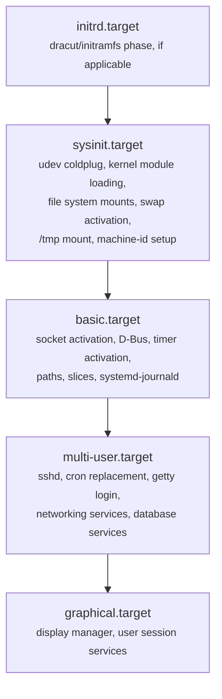
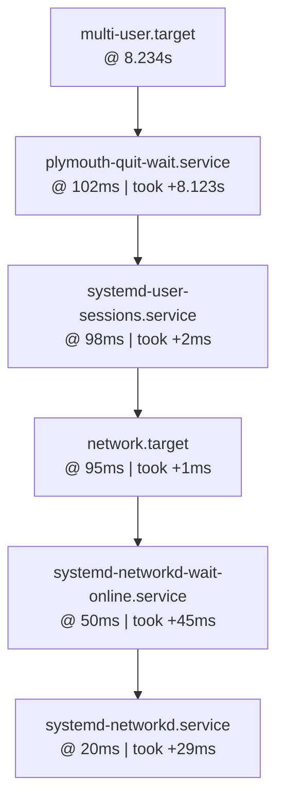

# Lesson 4: Structured Logging, Timer Units, Boot Orchestration

## 1. First-Principles Intuition & Invariants

The syslog protocol, codified in RFC 3164, imposed a flat text record on a problem domain that is fundamentally relational. Every log line produced by a running process carries an inherent schema: the process identity, the PID, the UID, the cgroup hierarchy, the boot session, the network namespace, the timestamp precision, the priority facility, and the structured key-value payload. The syslog daemon of the pre-systemd era collapsed this schema into a single unstructured string, parsed heuristically by pattern-matching rules in log aggregators downstream. The result was a lossy projection. The journal subsystem, implemented by `systemd-journald`, inverts that architecture: the source process emits structured fields, the journal daemon attaches kernel and cgroup provenance, and the storage layer indexes those fields in a binary format designed for indexed lookup rather than sequential grep. The fundamental invariant is that a journal entry is not a string. It is a set of typed field-value pairs, each independently indexed, collectively forming an entry object whose identity is pinned to a specific boot session and a specific monotonic timestamp.

The logging pipeline begins at the process boundary. A service writing to stdout or stderr has those streams connected to the journal by default, because `systemd` sets the standard output and error file descriptors to a connected `AF_UNIX` `SOCK_DGRAM` socket, or in some configurations, a pipe whose read end is the journal process. The journal daemon, running as root, reads from `/run/systemd/journal/socket`, attaches provenance fields, and writes the entry to the binary store. The provenance attachment is the critical mechanism. When a containerized process writes a log line, `journald` reads the cgroup of the sender via `SO_PEERCRED` and the cgroup membership of the socket peer, resolving the unit name, the slice, the machine ID, and the boot ID. These fields are injected into the entry before persistence, producing a record that is queryable by unit, by boot, by priority, and by arbitrary structured field, without any pattern-matching heuristic.

The timer subsystem addresses a parallel design problem. The cron daemon, the traditional Unix task scheduler, operates on wall-clock calendar expressions and forks a new process for each invocation. It has no native concept of service dependencies, no transactional relationship to the boot state, and no integration with the process supervisor. A `systemd` timer unit, by contrast, is a declarative scheduling specification bound to a service unit through the systemd dependency graph. The timer activates the service through the same transaction engine that governs boot ordering, which means the timer's service can declare `Requires=` on a database socket, `After=` on a network target, and benefit from the same restart, resource, and cgroup semantics as any permanently running service. The timer model separates two temporal domains: monotonic time, anchored to system boot or timer activation, and realtime, anchored to wall-clock calendar expressions. The invariant is that monotonic timers are immune to clock skew and NTP corrections, while calendar timers conform to human schedule semantics, including timezone-aware evaluation.

Boot orchestration is the third pillar of this lesson, and it rests on the concept of a transactional dependency graph. `systemd` does not "run init scripts in order." It builds a directed graph of units, where edges represent ordering (`After=`, `Before=`) and requirement (`Requires=`, `Wants=`, `Requisite=`) relationships. When the user or an automated process requests a unit activation, `systemd` computes a transaction: it resolves the full set of units that must be active, determines the topological ordering from the dependency edges, detects cycles, and generates jobs that are executed by the manager's event loop. Targets are synchronization points in this graph. A target unit like `multi-user.target` or `graphical.target` does no work itself; it exists to collect `Wants=` dependencies from service units and to impose ordering constraints that ensure all prerequisite services are active before the next phase begins. The boot process is thus a cascade of transactions, each gated on a target reaching its active state.

---

## 2. Core Architecture & Mechanics

### The Journal Binary Format

The journal file, stored at `/var/log/journal/<machine-id>/system.journal` for persistent storage or `/run/log/journal/<machine-id>/system.journal` for volatile storage, is a memory-mapped binary structure defined in `src/libsystemd/sd-journal/journal-file.h`. The file is organized as a sequence of objects, each prefixed by a type tag and a size field. The core object types are `OBJECT_DATA`, `OBJECT_FIELD`, `OBJECT_ENTRY`, `OBJECT_DATA_HASH_TABLE`, `OBJECT_FIELD_HASH_TABLE`, and `OBJECT_ENTRY_ARRAY`. The file header, occupying the first page, contains the file signature `LPKSHHRH`, the machine ID, the boot ID, the sequential number, and offsets to the two hash tables and the entry array.

The indexing architecture is the key to the journal's query performance. Each unique field name, such as `_SYSTEMD_UNIT` or `MESSAGE`, is stored once as an `OBJECT_FIELD`. Each unique field-value pair, such as `_SYSTEMD_UNIT=sshd.service`, is stored once as an `OBJECT_DATA` object. The data object is hashed and inserted into the data hash table. A journal entry, stored as an `OBJECT_ENTRY`, does not contain inline field data. It contains an array of offsets pointing to the `OBJECT_DATA` objects that constitute its fields. This design means that if ten thousand log entries all share the same `_SYSTEMD_UNIT=nginx.service` field, the string `nginx.service` is stored once in the file, and each entry references it by offset. The entry array object provides a contiguous, append-ordered index of all entry offsets, enabling `journalctl --reverse` and sequential traversal without hash table traversal.

```mermaid
flowchart TD
    subgraph header ["Journal File Header (page 0)"]
        HDR["signature, machine_id, boot_id, seqnum
        offsets → data_hash_table, field_hash_table,
        entry_array, tail_entry_array,
        arena_offset, arena_size"]
    end

    subgraph fields ["Field Objects"]
        F1["OBJECT_FIELD: '_SYSTEMD_UNIT'"]
        F2["OBJECT_FIELD: 'MESSAGE'"]
        F3["OBJECT_FIELD: 'PRIORITY'"]
    end

    subgraph data_objects ["Data Objects"]
        D1["OBJECT_DATA: '_SYSTEMD_UNIT=nginx.service'
        hash table entry → next pointer (chaining)"]
        D2["OBJECT_DATA: 'MESSAGE=worker process exited'"]
        D3["OBJECT_DATA: 'PRIORITY=6'"]
    end

    subgraph entries ["Entry Objects"]
        E1["OBJECT_ENTRY: entry #1
        [offset→DATA, offset→DATA, offset→DATA, …
```

The hash table uses chaining with open addressing fallback. When a hash collision occurs, the journal implementation walks the chain of data objects linked through the `next_hash_offset` field. The hash function is a Jenkins hash variant, chosen for its uniform distribution and incremental computation properties. When the hash table load factor exceeds a threshold, `journald` allocates a new, larger hash table and rehashes, updating the header offsets atomically. The file is designed for concurrent append-only writes with a single writer, and crash consistency is maintained through the `seqnum` counter and the `tail_entry_array_offset` pointer, which allows recovery to the last consistent entry on unclean shutdown.

### Structured Logging from C

The primary API for emitting structured journal entries from C is `sd_journal_send`, declared in `<systemd/sd-journal.h>`. This function takes a variadic list of `FIELD=value` string pairs, terminated by `NULL`, and sends them over the journal socket. The function `sd_journal_sendv` accepts an `iovec` array for pre-structured data, avoiding the variadic format string entirely. The convenience macro `SD_JOURNAL_MESSAGE` sets the `MESSAGE` field, while `SD_JOURNAL_PRIORITY` sets the syslog priority. Custom fields must use uppercase alphanumeric names with underscores, matching the journal field naming convention.

```c
#include <systemd/sd-journal.h>
#include <stdio.h>
#include <string.h>
#include <errno.h>
#include <unistd.h>

int main(void) {
    /* Emit a structured entry with custom fields and a priority. */
    int rc = sd_journal_send(
        "MESSAGE=order processing completed for batch id 8492",
        "PRIORITY=6",                    /* LOG_INFO */
        "SYSLOG_IDENTIFIER=order-worker",
        "ORDER_BATCH_ID=8492",
        "ORDER_ITEM_COUNT=1024",
        "ORDER_DURATION_MS=312",
        "ORDER_STATUS=COMPLETED",
        NULL
    );

    if (rc < 0) {
        /* sd_journal_send returns negative errno on failure. */
        fprintf(stderr, "sd_journal_send failed: %s\n", strerror(-rc));
        return 1;
    }

    /* Emit an error entry using the convenience macro for the MESSAGE field. */
    sd_journal_perror("failed to flush order batch to persistent store");

    /* Use the _sendv variant for pre-structured iovec data, which avoids
     * variadic argument processing and allows reuse of field buffers. */
    struct iovec fields[4];
    fields[0].iov_base = (void *)"MESSAGE=database connection pool exhausted";
    fields[0].iov_len = strlen(fields[0].iov_base);
    fields[1].iov_base = (void *)"PRIORITY=3";   /* LOG_ERR */
    fields[1].iov_len = strlen(fields[1].iov_base);
    fields[2].iov_base = (void *)"DB_POOL_SIZE=20";
    fields[2].iov_len = strlen(fields[2].iov_base);
    fields[3].iov_base = (void *)"DB_POOL_EXHAUSTED=1";
    fields[3].iov_len = strlen(fields[3].iov_base);

    rc = sd_journal_sendv(fields, 4);
    if (rc < 0) {
        fprintf(stderr, "sd_journal_sendv failed: %s\n", strerror(-rc));
        return 1;
    }

    return 0;
}
```

Compile this with `cc -o order-worker order-worker.c -lsystemd`. The linked library `libsystemd` provides the `sd_journal_send` implementation, which constructs a datagram containing each field as a newline-separated `KEY=VALUE` pair and sends it to `/run/systemd/journal/socket` via `SOCK_DGRAM`. The journal daemon reads the datagram, resolves the sender's credentials via `SO_PEERCRED` on the socket, and attaches the provenance fields `_PID`, `_UID`, `_GID`, `_COMM`, `_EXE`, `_CMDLINE`, `_SYSTEMD_UNIT`, `_SYSTEMD_SLICE`, `_SYSTEMD_CGROUP`, `_BOOT_ID`, `_MACHINE_ID`, `__REALTIME_TIMESTAMP`, and `__MONOTONIC_TIMESTAMP`.

Querying the journal with structured field filters uses the `journalctl` command with the `-f` (field) syntax. To find all entries from the `order-worker` unit with a specific batch ID, execute:

```bash
journalctl _SYSTEMD_UNIT=order-worker.service ORDER_BATCH_ID=8492 --output=json
```

The `--output=json` flag produces each entry as a JSON object, with each journal field mapped to a JSON key. The `__REALTIME_TIMESTAMP` field is emitted as a microsecond-precision integer, which downstream parsers convert to ISO 8601. The `--output=json-pretty` variant adds indentation. The `--output=cat` variant emits only the `MESSAGE` field content, suitable for piping into text-processing tools when the structured metadata is not needed for the immediate query.

### Timer Unit Semantics

A `systemd` timer unit is a `.timer` file that declares scheduling directives and is paired with a `.service` unit of the same base name. The timer, when activated, arms a timer event in the systemd event loop. When the timer fires, `systemd` enqueues a start job for the associated service. The service runs to completion (its `Type=` is typically `oneshot`), and the timer re-arms based on its configuration.

The `[Timer]` section supports two families of directives: monotonic and realtime. Monotonic timers use `OnBootSec=`, `OnStartupSec=`, `OnUnitActiveSec=`, and `OnUnitInactiveSec=`, each accepting a time span expression like `5min`, `2h`, or `1d 12h 30min`. `OnBootSec=` is relative to system boot. `OnStartupSec=` is relative to the systemd manager process start. `OnUnitActiveSec=` is relative to the last activation of the associated service. `OnUnitInactiveSec=` is relative to the last deactivation. Realtime timers use `OnCalendar=`, which accepts a calendar expression conforming to a syntax that supersedes cron.

```ini
# /etc/systemd/system/db-vacuum.timer
[Unit]
Description=Run database VACUUM at 02:00 every night

[Timer]
OnCalendar=*-*-* 02:00:00
Persistent=true
AccuracySec=1min
RandomizedDelaySec=5min

[Install]
WantedBy=timers.target
```

```ini
# /etc/systemd/system/db-vacuum.service
[Unit]
Description=Database VACUUM operation
Requires=postgresql.service
After=postgresql.service

[Service]
Type=oneshot
ExecStart=/usr/local/bin/db-vacuum --analyze --verbose
User=postgres
Group=postgres
```

The `Persistent=true` directive instructs `systemd` to record the last trigger time in `/var/lib/systemd/timers/stamp-db-vacuum`. On boot, if the calendar time for the missed trigger has passed, the timer fires immediately. This is the mechanism that replaces the anacron concept of "run jobs that were missed while the system was down." The `AccuracySec` directive defines a coalescing window: the timer may fire anywhere within the specified window after the scheduled time, allowing the kernel to batch timer expirations and reduce wakeups. The default is `1min`. Setting `AccuracySec=1us` disables coalescing for time-critical applications. The `RandomizedDelaySec` directive adds a uniformly distributed random delay up to the specified value, which spreads the load of many timers firing at the same calendar point across a fleet of machines.

Calendar expressions follow a pattern of `DayOfWeek Year-Month-Day Hour:Minute:Second`, where each component accepts ranges, lists, and repetition steps. The expression `Mon *-*-* 02:00:00` fires every Monday at 02:00. The expression `*-*-* 02,14:00:00` fires at 02:00 and 14:00 daily. The expression `*-*-01..07 02:00:00` fires at 02:00 on the first seven days of every month, approximating "first weekend of the month." The special values `hourly`, `daily`, `weekly`, `monthly`, `yearly`, `minutely` are shorthand for the corresponding calendar expressions. The `systemd-analyze calendar` command validates and expands calendar expressions, showing the next several trigger times:

```bash
systemd-analyze calendar "Mon *-*-* 02:00:00"
```

```
  Original form: Mon *-*-* 02:00:00
Normalized form: Mon *-*-* 02:00:00
    Next elapse: Mon 2025-01-13 02:00:00 CET
       (in UTC): Mon 2025-01-13 01:00:00 UTC
       From now: 2 days 14 hours left
```

The `systemd-analyze timespan` command parses and normalizes time span expressions used in monotonic timers:

```bash
systemd-analyze timespan "1d 6h 30min"
```

```
Original: 1d 6h 30min
μs: 109800000
Human: 1d 6h 30min
```

A monotonic timer example for a health-check polling loop, where the service runs every 30 seconds after boot and re-arms 30 seconds after each completion:

```ini
# /etc/systemd/system/health-probe.timer
[Unit]
Description=Periodic health probe timer

[Timer]
OnBootSec=1min
OnUnitActiveSec=30s
Unit=health-probe.service

[Install]
WantedBy=timers.target
```

```ini
# /etc/systemd/system/health-probe.service
[Unit]
Description=Health probe execution
After=network-online.target
Wants=network-online.target

[Service]
Type=oneshot
ExecStart=/usr/local/bin/health-probe --endpoint=https://api.internal/health
```

The `OnBootSec=1min` ensures the first probe runs one minute after boot, giving network configuration time to settle. The `OnUnitActiveSec=30s` re-arms the timer 30 seconds after the service's last activation, meaning the 30-second interval begins when the probe completes, not when it starts. If the probe takes 5 seconds to run, the effective cycle is 35 seconds wall time. This is the correct semantics for polling: the interval is measured from completion to next start, preventing overlap if the probe hangs.

### Boot Transaction Ordering

The systemd boot process begins when the kernel executes `/sbin/init` (symlinked to `/lib/systemd/systemd`) as PID 1. The manager process reads its configuration from `/etc/systemd/system.conf`, loads the default target specified by the `Default=` directive (typically `default.target`, itself a symlink to `graphical.target` or `multi-user.target`), and begins transaction generation. The target unit declares `Wants=` on a set of service units, and each service unit declares its own `Wants=`, `Requires=`, `After=`, and `Before=` relationships. The manager resolves the transitive closure of dependencies, computes a topological sort, and generates activation jobs.

The boot dependency graph is layered through a hierarchy of targets, each serving as a synchronization barrier:



Each target in this chain declares `Requires=` and `After=` on the target below it, enforcing the cascade. Services that should run in the `sysinit` phase declare `After=sysinit.target` implicitly through their placement in `sysinit.target.wants/` or explicitly via `Requires=sysinit.target`. The `systemd` generator programs, located at `/lib/systemd/system-generators/`, translate legacy configuration formats like `/etc/fstab` and `/etc/crypttab` into transient unit files at boot, injecting mount and crypto units into the dependency graph dynamically.

The ordering semantics distinguish between requirement and ordering. A `Requires=` dependency means that if the dependent unit fails to start, the transaction is aborted and the requiring unit is also stopped. A `Wants=` dependency is weaker: the dependent unit is pulled into the transaction, but its failure does not propagate. A `Requisite=` dependency means the dependent unit must already be active, but is not started as part of the transaction. An `After=` dependency means the ordering job for this unit waits until the named unit's activation job completes, but does not create a requirement. A `Before=` is the inverse. The critical invariant is that `After=` and `Before=` only impose ordering on activation; they do not create dependencies. If unit A has `After=B` but no `Requires=B` or `Wants=B`, and nothing else pulls B into the transaction, B is never started and A starts immediately without waiting.

The `WantedBy=` directive in the `[Install]` section creates a symlink in the `.wants/` directory of the named target when `systemctl enable` is executed. This is how service units declare their boot phase. A service with `WantedBy=multi-user.target` gets a symlink at `/etc/systemd/system/multi-user.target.wants/myapp.service`, which causes `multi-user.target` to have a `Wants=myapp.service` dependency, pulling the service into the boot transaction.

### Diagnosing Boot Ordering

The `systemd-analyze` tool suite provides visibility into the boot transaction. The `blame` subcommand sorts units by their activation time, revealing which services consumed the most wall time during boot:

```bash
systemd-analyze blame
```

```
         8.123s plymouth-quit-wait.service
         4.567s dev-mapper-root.device
         2.891s systemd-udevd.service
         1.234s networkd-dispatcher.service
           987ms systemd-logind.service
           456ms sshd.service
           ...
```

The `critical-chain` subcommand shows the ordering dependency chain for a given target, annotated with activation times. This reveals which units are on the critical path, meaning the boot cannot proceed until they complete:

```bash
systemd-analyze critical-chain multi-user.target
```



The `plot` subcommand generates an SVG timeline showing every unit's activation window, which is the definitive diagnostic for understanding parallelism and serialization in the boot:

```bash
systemd-analyze plot > boot-timeline.svg
```

The SVG renders a Gantt chart where each row is a unit and the horizontal axis is wall time. Blocks are color-coded by type: blue for activation, green for active, red for failed. Long sequential chains of blocks indicate serialization bottlenecks, while wide parallel bands indicate healthy parallelism.

---

## 3. High-Performance Optimization & Failure Modes

### Journal Storage Configuration and Rotation

The journal storage mode is controlled by the `Storage=` directive in `/etc/systemd/journald.conf`. The value `persistent` writes to `/var/log/journal/`, which survives reboot. The value `volatile` writes to `/run/log/journal/`, which is a tmpfs mount cleared on reboot. The value `auto` writes to persistent storage if `/var/log/journal/` exists, otherwise volatile. The value `none` discards all log data but still forwards to syslog and forward sockets.

The size of the journal is bounded by several directives. `SystemMaxUse=` limits the total disk usage of persistent journal files. The default is calculated as 10% of the filesystem size or 4GB, whichever is smaller. `SystemKeepFree=` ensures that at least the specified amount of disk space remains free; the journal will reduce its size before the filesystem fills. `SystemMaxFileSize=` limits the size of individual journal files before rotation occurs. `MaxRetentionSec=` sets the maximum age of journal entries; files older than this are deleted regardless of size constraints.

```ini
# /etc/systemd/journald.conf
[Journal]
Storage=persistent
Compress=yes
CompressThresholdBytes=512
SystemMaxUse=2G
SystemKeepFree=1G
SystemMaxFileSize=100M
MaxRetentionSec=30day
MaxFileSec=1month
RateLimitIntervalSec=30s
RateLimitBurst=10000
ForwardToSyslog=no
ForwardToKMsg=no
ForwardToConsole=no
ReadKMsg=yes
```

The `Compress=yes` directive enables LZ4 compression for data objects exceeding `CompressThresholdBytes`. LZ4 is chosen over gzip or zstd because its decompression speed is critical: `journalctl` reads entries synchronously, and decompression latency directly affects query responsiveness. The compression applies to individual data objects, not the entire file, so partial file corruption does not prevent recovery of uncompressed regions.

The `RateLimitIntervalSec` and `RateLimitBurst` directives implement a token bucket per service. If a single service logs more than `RateLimitBurst` messages within `RateLimitIntervalSec`, the journal drops subsequent messages from that service for the remainder of the interval and emits a single `Suppressed N messages` entry when the interval expires. This prevents a runaway logging loop from filling the journal or consuming disk I/O. The default is 10000 messages per 30 seconds, which is generous for most applications but can be hit by chatty network services during error storms. Per-unit overrides are possible through drop-in files in `/etc/systemd/journald@<service>.conf.d/`.

### Journal Forwarding and Remote Collection

The journal forwarding architecture supports three export paths. First, `ForwardToSyslog=yes` causes `journald` to forward each entry to a configured syslog daemon via the traditional `/dev/log` socket, enabling coexistence with legacy log aggregation. Second, `ForwardToKMsg=yes` forwards entries to the kernel ring buffer, visible via `dmesg`, which is useful for capturing early boot messages before the journal is writable. Third, `systemd-journal-remote` and `systemd-journal-upload` provide network-based forwarding using the Journal Export Format, a binary protocol carried over HTTP or HTTPS.

The `systemd-journal-upload` service reads from the local journal and sends entries to a remote collector. Configuration is placed in `/etc/systemd/journal-upload.conf`:

```ini
# /etc/systemd/journal-upload.conf
[Upload]
URL=https://log-collector.internal:19532
ServerCertificateFile=/etc/ssl/certs/log-collector.crt
ClientCertificateFile=/etc/ssl/certs/journal-upload-client.crt
ClientKeyFile=/etc/ssl/private/journal-upload-client.key
TrustedCertificateFile=/etc/ssl/certs/log-colceptor-ca.crt
```

The corresponding receiver runs `systemd-journal-remote`, which listens on the configured port and writes received entries to a local journal file. The receiver configuration specifies the listen socket and output directory:

```ini
# /etc/systemd/journal-remote.conf
[Remote]
Seal=no
Compress=yes
SplitMode=host
StateFile=/var/lib/systemd/journal-upload/state
```

The `SplitMode=host` directive writes entries from each remote host to a separate journal file, keyed by the remote machine ID. The `Seal=yes` option, when available with FSS (Forward Secure Sealing) support, appends a cryptographic signature chain to the journal, enabling detection of tampering after the fact. The sealing key is derived from a seed file, and each entry is signed with a key derived from the previous entry's key, forming a hash chain. An attacker who modifies or deletes entries breaks the chain, and the `journalctl --verify` command detects the inconsistency.

The Journal Export Format, used by the upload and remote services, is a binary format that preserves all journal fields. Each entry is encoded as a sequence of field-value pairs, where each pair is a 64-bit little-endian length followed by the field name, an equals sign, and the value. A newline delimiter separates entries. This format is more efficient than JSON for large payloads because it avoids base64 encoding of binary data and preserves the microsecond timestamp precision without string parsing.

To forward logs via a simpler mechanism, the `journalctl --output=export` command produces the export format on stdout, which can be piped to a remote collector:

```bash
journalctl --output=export --since="1 hour ago" | curl -T - https://log-collector.internal:19532/upload
```

### Timer Failure Modes and Edge Cases

The most common timer failure is the `Persistent=true` interaction with clock changes. When a system boots after being powered off for several days, all `Persistent=true` timers that should have fired during the downtime will trigger immediately and simultaneously. If multiple timer-activated services share dependencies on the same resource, such as a database connection pool, the simultaneous activation can cause resource contention. The `RandomizedDelaySec` directive mitigates this by spreading activation across a window, but it does not enforce a maximum concurrency limit. For services that cannot tolerate parallel execution, a `LockFile=` directive in the `[Service]` section or an explicit `ExecStartPre=` semaphore script is necessary.

A second failure mode involves `OnUnitActiveSec=` timers where the associated service fails. If the service exits with a non-zero status, the timer continues to re-arm and retry on the next interval. If the failure is persistent, such as a broken database connection, the timer generates repeated failed activation jobs that consume CPU and journal space. The `Unit=` directive in the timer can be pointed at a wrapper service that implements backoff:

```ini
# /etc/systemd/system/db-sync.timer
[Unit]
Description=Database sync timer

[Timer]
OnBootSec=5min
OnUnitActiveSec=5min
Unit=db-sync.service
```

```ini
# /etc/systemd/system/db-sync.service
[Unit]
Description=Database sync with exponential backoff
After=network-online.target

[Service]
Type=oneshot
ExecStartPre=/usr/local/bin/db-sync-precheck
ExecStart=/usr/local/bin/db-sync
Restart=no
ExecStartPost=/usr/local/bin/db-sync-postcheck
```

The `db-sync-precheck` script verifies database connectivity and exits non-zero if the connection fails, preventing the main `ExecStart` from running. The `Restart=no` directive ensures that the service does not retry within the same activation job; the next attempt is deferred to the next timer interval.

A subtle failure mode involves `AccuracySec` and real-time scheduling. If `AccuracySec` is set to a large value like `10min` and the timer's service has a hard real-time deadline, the coalescing window can cause the service to fire up to 10 minutes late. This is by design, but it can surprise operators who expect cron-like precision. The solution is to set `AccuracySec=1s` for time-sensitive timers, accepting the cost of additional CPU wakeups.

### Boot Transaction Failures and Debugging

When a unit fails during boot, the manager records the failure and continues if the unit is not on the critical path. If a `Requires=` dependency fails, the transaction is aborted and the dependent unit is also stopped. This cascading failure can make the root cause hard to identify, because the failure manifests as a missing service rather than a failed one.

The `systemctl --failed` command lists all units in the `failed` state:

```bash
systemctl --failed
```

```
  UNIT                     LOAD   ACTIVE SUB    DESCRIPTION
● postgresql.service       loaded failed failed PostgreSQL RDBMS
● networking.service       loaded failed failed Raise network interfaces

LOAD   = Reflects whether the unit definition was properly loaded.
ACTIVE = The high-level unit activation state, i.e. generalization of SUB.
SUB    = The low-level unit activation state, values depend on unit type.

2 loaded units listed.
```

The `systemctl status` command for a failed unit shows the last 10 log lines and the exit status:

```bash
systemctl status postgresql.service
```

```
● postgresql.service - PostgreSQL RDBMS
     Loaded: loaded (/lib/systemd/system/postgresql.service; enabled)
     Active: failed (Result: exit-code) since Mon 2025-01-13 09:42:01 UTC; 3min ago
   Main PID: 12345 (code=exited, status=1/FAILURE)
      Tasks: 0 (limit: 4915)
     Memory: 0B
        CPU: 234ms

Jan 13 09:42:01 db-host postgres[12345]: FATAL: could not access lock file "/run/postgresql/.s.PGSQL.5432.lock": No such file or directory
Jan 13 09:42:01 db-host systemd[1]: postgresql.service: Main process exited, code=exited, status=1/FAILURE
Jan 13 09:42:01 db-host systemd[1]: postgresql.service: Failed with result 'exit-code'.
```

For deeper boot transaction analysis, the `systemctl list-jobs` command shows the current job queue. During boot, if a unit is stuck in `activating` state, listing jobs reveals what the transaction is waiting for:

```bash
systemctl list-jobs
```

```
JOB UNIT                        TYPE  STATE
1234 postgresql.service         start waiting
1235 pg-backup.service           start waiting
1236 multi-user.target           start waiting

3 jobs listed.
```

The `waiting` state indicates that the job is blocked on an ordering dependency. The `systemctl list-dependencies` command shows the full dependency tree for a unit, which identifies the blocking unit:

```bash
systemctl list-dependencies --reverse postgresql.service
```

This shows which units depend on `postgresql.service`, revealing the full impact of its failure on the boot graph. The `--before` and `--after` flags show ordering dependencies separately from requirement dependencies, which is essential for understanding why a unit has not started.

The `systemd.log_level=debug` kernel command line parameter causes PID 1 to log verbose transaction generation and job execution details to the journal. Combined with `systemd.log_target=console`, these messages are visible on the console during early boot, before the journal is available. The `systemd.show_status=1` parameter forces status output to the console, showing each unit activation as it occurs. For a completely stuck boot, the `systemd.unit=rescue.target` parameter on the kernel command line boots into rescue mode, which provides a root shell with minimal services.

The `journalctl --list-boots` command shows every boot session recorded in the journal, with boot IDs and timestamps:

```bash
journalctl --list-boots
```

```
IDX    BOOT ID             FIRST ENTRY                 LAST ENTRY
-3     a1b2c3d4e5f6...     Mon 2025-01-10 08:00:01      Mon 2025-01-10 18:42:33
-2     b2c3d4e5f6a1...     Tue 2025-01-11 08:01:12      Tue 2025-01-11 19:01:45
-1     c3d4e5f6a1b2...     Wed 2025-01-12 08:00:55      Wed 2025-01-12 17:30:22
  0     d4e5f6a1b2c3...     Mon 2025-01-13 08:00:33      Mon 2025-01-13 09:45:01
```

The index number can be used as a relative boot selector: `journalctl -b -1` shows the previous boot's logs, `journalctl -b -2` shows the one before that, and `journalctl -b 0` shows the current boot. This is the primary tool for diagnosing boot failures: boot the system, inspect the current boot to see what failed, then use `-b -1` to compare with the previous successful boot and identify what changed. The `--boot` flag combined with `--unit=` filters to a specific service across boots:

```bash
journalctl --boot=-1 --unit=postgresql.service --priority=err
```

This shows all error-priority entries from the `postgresql.service` unit during the previous boot, providing the targeted evidence needed to isolate whether the failure was a transient condition or a persistent configuration problem.
