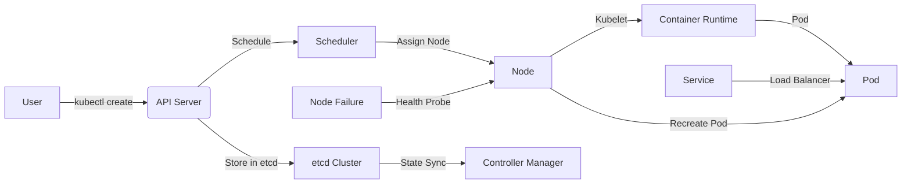

# Foundation: Kubernetes

## 1. Conceptual Mental Model (Core intuition, analogies, and first principles)

Kubernetes is a **distributed systems orchestration layer** that abstracts infrastructure complexity to enable resilient, scalable container deployments. At its core, it operates on three fundamental principles:

1. **Atomic State Abstraction**: Kubernetes treats infrastructure as a *state machine* where every resource (pods, services, nodes) exists in a defined state with explicit transitions. This avoids the "state vs. configuration" trap of traditional infrastructure management.

2. **Consensus-Driven Control Plane**: The API server acts as a distributed consensus node (using gRPC and etcd's Raft protocol) that maintains cluster state through majority voting. This ensures that all nodes agree on the desired state before executing operations.

3. **Self-Healing via Event-Driven Triggers**: When a node fails or a container crashes, the kubelet triggers a *state recovery loop* (not a manual intervention) that:
   - Detects failure via health probes (TCP/HTTP)
   - Re-creates the pod on a new node
   - Validates resource constraints (CPU/memory)
   - Updates etcd with the new state

**Analogy**: Imagine Kubernetes as a *distributed swarm intelligence system* for microservices. Like ants coordinating foraging, Kubernetes:
- Uses *pods* as individual worker ants (with shared resources)
- Uses *etcd* as the pheromone trail (distributed state)
- Uses *controllers* as the queen (maintaining desired state)
- Self-heals when ants (pods) get lost in the forest (node failures)

**Why this matters**: This mental model explains why Kubernetes *must* run on distributed systems (not single machines) and why network partitions cause cascading failures if not handled by consensus protocols.

## 2. Essential Terminology & Taxonomy

| Term                | Definition & Underlying Mechanism                                                                 | Validation Command                     |
|---------------------|--------------------------------------------------------------------------------------------------|----------------------------------------|
| **Pod**             | Smallest deployable unit (1+ containers sharing network namespace). *Underlying*: Linux namespaces (pid, net, mount) + cgroups for resource isolation | `kubectl get pods -o wide`            |
| **Node**            | Physical/virtual machine running workloads. *Underlying*: Kernel (v4.18+) with kubelet (gRPC) and container runtime (containerd) | `kubectl get nodes -o wide`           |
| **etcd**            | Distributed key-value store (Raft consensus). *Underlying*: In-memory storage with leader election for state replication | `etcdctl cluster-health`              |
| **Service**         | Network abstraction for pod discovery. *Underlying*: CNI plugins (e.g., Calico) + IPVS load balancing | `kubectl get svc -o wide`             |
| **Deployment**      | Declarative update strategy (rolling updates). *Underlying*: Controller manager watches pod state | `kubectl rollout status deployment/myapp` |
| **Controller Manager** | Maintains desired state via controllers (e.g., node controller). *Underlying*: gRPC + event loops | `kubectl get controllermanager`       |

> 💡 **Key Insight**: Kubernetes *does not* manage the underlying OS kernel. It *uses* kernel features (namespaces, cgroups) as building blocks while abstracting away their complexity.

## 3. Architecture & Core Workflow

**Workflow Explanation**:
1. **User** creates a pod definition via `kubectl`
2. **API Server** stores the request in etcd (distributed key-value store)
3. **Scheduler** assigns the pod to a node with available resources
4. **Kubelet** (node agent) runs the container via container runtime
5. **Controller Manager** maintains desired state by:
   - Watching pod health via `livenessProbe`/`readinessProbe`
   - Re-creating pods on node failure (via event loop)
6. **Service** provides stable network endpoint via CNI plugin

**Critical Underlying Mechanisms**:
- **etcd**: Uses Raft consensus (not HTTP) for state replication (avoids split-brain)
- **Health Probes**: TCP/HTTP checks (not simple process existence) prevent false positives
- **Network Policies**: CNI plugins enforce isolation (e.g., Calico uses BGP for routing)

## 4. Common Misconceptions & Mental Traps

| Misconception                          | Reality & Validation                                                                 | Destructive Risk                     |
|----------------------------------------|-----------------------------------------------------------------------------------|--------------------------------------|
| "Kubernetes is just a container manager" | It's a *distributed state machine* that manages *infrastructure state* (not just containers) | Single-node clusters fail without networking |
| "etcd is a simple database"            | It's a *consensus protocol* (Raft) with leader election and state replication        | etcd corruption causes cluster-wide failure |
| "Pods are stateless by default"        | Pods *can* be stateful (via persistent volumes). State is *not* managed by Kubernetes | Data loss during pod restarts        |
| "Kubernetes works without networking"  | Requires TCP/IP for API server ↔ node communication (even in single-node clusters) | Kubelet fails to start (no network)  |

**Safety Check**: Run `kubectl get nodes -o json | jq '.items[].status.conditions'` to verify node health. If `Ready` is missing, the cluster is unstable.

## 5. Socratic Discussion Starters

1. **How does Kubernetes prevent the "split-brain" problem in etcd during network partitions, and what happens if the solution fails?**  
   *(Probes consensus protocol depth, failure recovery, and real-world trade-offs)*

2. **Why does Kubernetes require *explicit* health probes (not just process checks) for self-healing, and what would happen if we omitted them?**  
   *(Reveals the difference between process-level and network-level state)*

3. **If you had to design a Kubernetes-like system for a *single* machine (no networking), what would you change about the core workflow to avoid the "single point of failure" trap?**  
   *(Forces understanding of distributed vs. monolithic systems)*
