# Lesson 2: Solid Modeling Workflows

## 1. First-Principles Intuition & Invariants

The fundamental tension in modern CAD systems for additive manufacturing lies in the paradox of geometric permanence versus iterative refinement. When we design a parametric bracket for a 3D printer extruder mount, we are not merely drawing lines on a digital canvas—we are constructing a semantic chain of manufacturing intent that must survive dimensional revisions, material substitutions, and tolerance adjustments without catastrophic collapse. This requirement forces us to confront the philosophical distinction between **parametric modeling**, where geometry emerges as the deterministic output of a constraint-solving engine, and **direct modeling**, where the designer manipulates surfaces and edges as plastic entities divorced from their historical genesis.

At the heart of parametric modeling lies the concept of the **feature tree**—a directed acyclic graph (DAG) where each node represents a volumetric operation (extrusion, Boolean subtraction, fillet) and each edge encodes parent-child dependencies. When you sketch a rectangular profile and extrude it 40 millimeters to form a base block, the CAD kernel does not simply generate a polyhedral mesh and discard the instructions. Instead, it records the sketch plane orientation, the dimensional constraints tying the rectangle's edges to named parameters (e.g., `base_width = 60mm`, `base_length = 80mm`), and the extrusion depth as a function potentially linked to other features. This forensic record enables **upstream propagation**: if you later change `base_width` to 70 millimeters, the solver recomputes all dependent features—holes positioned relative to the rectangle's edges, mounting bosses centered on its faces, chamfers that blend into its perimeter—without requiring manual repositioning.

The mathematical substrate of parametric solvers is the **variational constraint system**, typically implemented as a nonlinear equation solver (Newton-Raphson or Levenberg-Marquardt) operating over a sparse matrix of geometric invariants. When you dimension a sketch with a 45-millimeter horizontal distance constraint and a perpendicularity constraint between two lines, the solver translates these into equations of the form $\|\mathbf{p}_2 - \mathbf{p}_1\|_x = 45$ and $(\mathbf{v}_a \cdot \mathbf{v}_b) = 0$, where $\mathbf{p}$ represents point coordinates and $\mathbf{v}$ represents direction vectors. The kernel iteratively adjusts vertex positions until the residual error drops below a tolerance threshold, typically $10^{-6}$ millimeters. This explains why over-constrained sketches—where redundant dimensions create conflicting equations—trigger solver failures, and why under-constrained sketches exhibit phantom degrees of freedom that drift unpredictably during regeneration.

Direct modeling, by contrast, treats solid bodies as boundary-representation (B-rep) data structures where faces, edges, and vertices exist as independent topological entities. When you pull a face 15 millimeters in a direct modeling environment, the kernel performs a local perturbation of the B-rep graph: it extends adjacent faces, recomputes tangency conditions at shared edges, and heals any resulting gaps through surface blending. The operation carries no memory of its origin—there is no feature tree node encoding "Face Offset: 15mm on Entity #47." This amnesia grants extraordinary flexibility for ad-hoc modifications but obliterates the ability to perform systematic dimensional studies. If a client requests that all wall thicknesses scale by 1.2× to accommodate a stronger but more brittle resin, a parametric model permits a single variable edit; a direct model demands manual measurement and re-offsetting of dozens of faces.

The choice between paradigms profoundly impacts design intent preservation in additive manufacturing workflows. Consider a hinged enclosure for a Raspberry Pi where the hinge barrel diameter must maintain 0.3 millimeters clearance over the pin diameter to ensure printability without support structures. In a parametric model, you define `pin_diameter = 4.0mm` and `barrel_inner_diameter = pin_diameter + 0.3mm`, establishing an algebraic dependency that survives even if the pin diameter changes to 5.0 millimeters due to a vendor substitution. In a direct model, the barrel remains a fixed 4.3-millimeter hole—a brittle constant vulnerable to obsolescence the moment upstream decisions mutate.

Feature-based construction embodies a language of volumetric operations that mirrors the physical intuition of material addition and removal. **Extrusion** represents the simplest primitive: a 2D profile swept linearly along a normal vector, generating prismatic geometry ideal for structural ribs, mounting flanges, and planar reinforcements. **Revolution** suits cylindrical or conical forms—motor housings, knobs, bearing journals—by rotating a profile about an axis, with the constraint that the profile must not self-intersect during rotation to avoid non-manifold geometry. **Sweeps** extend extrusion by permitting the path to curve in three dimensions, essential for cable ducts, spiral springs, and organic fairings, though they demand careful management of profile orientation (normal to path vs. constant attitude) and twist accumulation. **Lofts** interpolate between multiple cross-sectional profiles positioned at different spatial locations, enabling smooth transitions between dissimilar shapes—a circular connector evolving into a rectangular flange—by solving a surface fitting problem that minimizes curvature discontinuities (G2 continuity) between sections.

Each feature type imposes topological constraints that propagate through the dependency chain. A loft between three profiles inherits a sensitivity to profile vertex count and correspondence: if the first profile is a hexagon and the second an octagon, the kernel must decide whether to introduce twist or split edges, and this decision affects downstream fillets that terminate at loft boundaries. Extrusions with draft angles (tapered sidewalls to facilitate demolding in injection molding) alter the surface normal vectors, which in turn affect the validity of subsequent shell operations that assume uniform wall thickness.

The **feature tree** itself operates as a stateful computational pipeline where order of operations fundamentally alters the final geometry. Filleting before shelling produces rounded interior corners; shelling before filleting rounds the outer envelope but leaves sharp internal transitions. This non-commutativity arises because each operation queries the current B-rep topology: a fillet seeks tangent edges, a shell offsets existing faces. Advanced practitioners exploit this ordering to encode manufacturing logic—placing cosmetic fillets after functional features to ensure critical dimensions remain unperturbed, or positioning Boolean subtractions after pattern operations to avoid redundant cut recalculations.

**Design intent** crystallizes as the invariant relationships that must survive dimensional perturbations. A parametric clutch gear for a Lego-compatible gearbox embodies several layers of intent: the tooth count must remain an integer, the module (tooth pitch divided by π) must match mating gears to ensure proper meshing, the hub bore diameter must maintain H7/h6 transition fit clearances relative to axle diameter, and the tooth profile must follow involute geometry to guarantee constant velocity ratio transmission. Encoding these as explicit constraints—integer-valued parameters, algebraic expressions for module matching, tolerance-driven dimension ranges—transforms the model from a static snapshot into a **generative template** capable of spawning entire families of gear sizes through parameter sweeps.

## 2. Core Architecture & Mechanics

The internal architecture of a parametric CAD kernel partitions the modeling process into three interdependent layers: the **sketch solver** that resolves 2D geometric constraints, the **feature evaluator** that generates 3D solid geometry through constructive operations, and the **regeneration engine** that propagates changes through the feature tree to maintain topological consistency. Understanding the data flow between these layers exposes both the power and fragility of parametric workflows.

A sketch begins as a collection of **geometric primitives**—line segments, circular arcs, splines—and **constraint annotations** that encode dimensional and relational intent. When you draw two concentric circles and apply a concentric constraint, the kernel introduces a symbolic equation asserting that both circles share the same center point: $\mathbf{c}_1 = \mathbf{c}_2$. Adding a radial dimension of 20 millimeters to the outer circle appends the equation $r_{\text{outer}} = 20$. A diametral dimension of 8 millimeters on the inner circle contributes $2r_{\text{inner}} = 8$. The solver accumulates these equations into a system matrix and iteratively adjusts the floating degrees of freedom (unconstrained point coordinates and radii) until convergence.

The constraint graph topology determines solver performance and failure modes. A well-posed sketch exhibits a **tree-like dependency structure** where each new constraint eliminates exactly one degree of freedom, marching toward full constraint without introducing cycles. Over-constraining—adding a horizontal dimension when the line is already constrained parallel to the X-axis—creates a redundant equation that either conflicts (if dimensions disagree) or wastes computational effort resolving a rank-deficient matrix. Under-constraining leaves the sketch with **phantom mobility**: a rectangle might slide along the sketch plane or rotate about its center because no constraints anchor it to the origin or fix its angular orientation.

Best practice for robust sketches demands explicit **anchor constraints** tying at least one vertex to the origin or a reference plane, and **orientation locks** (horizontal, vertical, parallel, perpendicular) that eliminate rotational degrees of freedom. For a mounting bracket with four bolt holes arranged in a rectangular pattern, fully constrained geometry would include: the base rectangle corner coincident with the origin, one edge horizontal (parallel to X-axis), dimensional constraints for width and height, and each hole center positioned via distance constraints from the rectangle edges or centerlines. This redundancy-free constraint network regenerates predictably even when base dimensions scale by orders of magnitude.

Feature evaluation begins when the sketch solver marks a profile as **closed and planar**—a topological prerequisite for volume generation. An **extrusion** operation queries the sketch's outer boundary loop (ignoring open curves and construction geometry), selects a direction vector (typically the sketch plane normal), and performs a **Boolean union** between the existing solid body (if any) and the swept volume. The kernel represents solids as **boundary-representation (B-rep) structures**: a hierarchical data structure encoding vertices (3D points), edges (curves connecting vertices), faces (surfaces bounded by edge loops), and shells (collections of faces forming a closed manifold).

The extrusion path must satisfy the **manifold criterion**: at every point on the resulting solid's surface, a small neighborhood must be topologically equivalent to a 2D disk. This excludes self-intersecting extrusions (e.g., sweeping a profile along a path that doubles back through itself) and zero-thickness features (e.g., extruding to zero depth). Non-manifold geometry breaks downstream operations like Boolean unions and offset surfaces because the kernel cannot unambiguously determine interior versus exterior regions.

**Revolution** operations rotate a 2D profile about an axis, sampling the profile at discrete angular increments to generate a mesh of quadrilateral faces (or triangular facets for visualization). The axis must lie within or outside the profile but cannot intersect the profile's interior, as this would create infinitesimal faces near the axis—numerically unstable regions where surface normals become undefined. For a cylindrical bearing housing, the profile would consist of a rectangular cross-section positioned adjacent to the revolution axis, with dimensional constraints ensuring the inner radius matches the bearing outer diameter plus 0.1–0.15 millimeters clearance for press-fit assembly.

**Sweep** operations introduce path geometry as an additional input: the kernel positions the profile perpendicular to the path at the start point, then incrementally translates and rotates the profile along the path curve while maintaining either normal orientation (profile rotates to stay perpendicular to path tangent) or fixed attitude (profile maintains constant world-space orientation). Normal orientation suits cable channels that navigate around obstacles, but accumulates twist if the path contains helical curvature—a phenomenon visible when sweeping a non-symmetric profile along a DNA-like double helix. Fixed attitude avoids twist but produces non-tangent transitions if the path curves sharply.

The **loft** operation solves a surface interpolation problem between multiple profiles positioned at arbitrary locations along a guide curve or axis. The kernel first establishes **vertex correspondence** between profiles: for a loft between a triangle (3 vertices), square (4 vertices), and pentagon (5 vertices), the solver must decide how to map vertices across dissimilar topology. Most kernels use a **centroid projection strategy**: they compute each profile's geometric center, then raycast from the centroid through each vertex to intersect the next profile's boundary, establishing paired vertices. This heuristic fails when profiles differ drastically in scale or rotation, producing twisted surfaces or sharp creases.

Advanced loft controls include **guide curves** (spatial paths that vertices must follow during interpolation), **tangency constraints** (forcing the loft surface to meet adjacent faces with G1 or G2 continuity), and **closure options** (generating a solid by capping the loft ends or leaving them open for subsequent Boolean operations). A turbine blade loft for a small wind generator would define three airfoil profiles—root, mid-span, and tip—with guide curves enforcing leading-edge and trailing-edge twist to optimize angle of attack along the span.

The **feature tree regeneration engine** maintains a directed acyclic graph where each feature node stores: the feature type (extrude, fillet, pattern), input parameters (dimensions, reference geometry), and dependencies (parent features whose geometry this feature consumes). When you modify a sketch dimension, the engine identifies all downstream features and schedules them for recomputation in topological order. If a fillet feature depends on an edge that ceases to exist after an upstream extrusion depth change, the regeneration fails with a **dangling reference error**—the fillet cannot locate its target edge in the updated B-rep.

Robust parametric modeling demands **named references** rather than positional indices. Instead of instructing the kernel to "fillet the 12th edge in the B-rep edge list," advanced users select edges via geometric criteria: "all edges tangent to the top face with radius less than 1mm." This **topological naming** survives moderate upstream changes because the kernel re-evaluates the selection criteria against the updated geometry, whereas positional references break the moment a Boolean operation reorders the edge list.

Pattern features (linear, circular, mirror) replicate a base feature across multiple instances while maintaining parametric links. A bolt circle pattern for an antenna mount distributes four holes at 90-degree intervals around a central axis, with each hole inheriting dimensional constraints from the master hole. The kernel implements patterns efficiently by caching the base feature's B-rep and applying rigid transformations (translation, rotation, reflection) to generate instances, deferring Boolean union until the final merge pass. This avoids redundant sketch solving and feature evaluation for identical geometry.

Maintaining **design intent** through iterative refinement requires deliberate feature tree organization. Engineers partition models into **scaffolding geometry** (construction planes, reference axes, parameter-driven datums) and **manufacturing geometry** (solid features, surface finishes). A quadcopter frame designed for carbon fiber sandwich construction might use a master sketch defining the arm span, motor mount spacing, and camera tilt angle as named dimensions, then derive all extrusions, cutouts, and mounting holes as expressions referencing these master parameters. When the arm span scales from 250mm to 300mm to accommodate larger propellers, hundreds of dependent dimensions update automatically because they reference the master variable rather than hard-coded constants.

Failure modes proliferate when feature trees grow deep (>50 features) or wide (complex branching dependencies). **Circular dependencies** arise when Feature A references geometry from Feature B, and Feature B references geometry from Feature A, deadlocking the regeneration engine. **Over-constrained assemblies** emerge when multiple features attempt to control the same geometric entities through conflicting constraints—e.g., two extrusions independently setting the height of the same face. **Solver divergence** occurs when constraint equations admit multiple solutions or no solutions, causing the Newton-Raphson iterator to oscillate without converging.

```mermaid
flowchart TD
    Root["Root"]
    
    Root --> MasterSketch["Master_Sketch<br/>base_width=60<br/>base_length=80<br/>hole_diameter=5"]
    MasterSketch --> MSDims["Dimensions:<br/>base_width, base_length, hole_diameter"]
    
    Root --> ExtrudeBase["Extrude_Base<br/>depth=10<br/>input=Master_Sketch.Profile_1"]
    ExtrudeBase --> EBOutput["Output: Solid_Body_1"]
    
    Root --> SketchHoles["Sketch_Holes<br/>plane=Extrude_Base.Top_Face"]
    SketchHoles --> Hole1["Hole_1<br/>position=[10, 10]<br/>diameter=hole_diameter"]
    SketchHoles --> Hole2["Hole_2<br/>position=[base_width-10, 10]<br/>diameter=hole_diameter"]
    SketchHoles --> Hole3["Hole_3<br/>position=[10, base_length-10]<br/>diameter=hole_diameter"]
    SketchHoles --> Hole4["Hole_4<br/>position=[base_width-10, base_length-10]<br/>diameter=hole_diameter"]
    
    Root --> ExtrudeCut["Extrude_Cut_Holes<br/>depth=through_all<br/>input=Sketch_Holes.All_Circles"]
    ExtrudeCut --> ECOutput["Output: Solid_Body_1 (modified)"]
    
    Root --> FilletCorners["Fillet_Corners<br/>radius=2<br/>edges=Extrude_Base.Bottom_Edges"]
    FilletCorners --> FCOutput["Output: Solid_Body_1 (modified)"]
    
    Root --> Shell["Shell<br/>thickness=2<br/>remove_faces=Extrude_Base.Top_Face"]
    Shell --> ShellOutput["Output: Solid_Body_1 (modified, now hollow)"]
    
    subgraph Propagation ["Parameter Propagation Example"]
        P1["User changes base_width: 60 → 70"]
        P2["Master_Sketch regenerates<br/>(solver updates X-coordinates)"]
        P3["Extrude_Base regenerates<br/>(new boundary from updated sketch)"]
        P4["Sketch_Holes regenerates<br/>(Hole_2 and Hole_4 reposition)"]
        P5["Extrude_Cut_Holes regenerates<br/>(new hole locations)"]
        P6["Fillet_Corners regenerates<br/>(edge selection re-evaluated)"]
        P7["Shell regenerates<br/>(offset from updated geometry)"]
        
        P1 --> P2 --> P3 --> P4 --> P5 --> P6 --> P7
    end
```

Direct modeling environments replace the feature tree with **transient operation stacks** that discard intermediate history. When you push-pull a face in a direct modeler, the kernel performs an immediate B-rep perturbation: it identifies the face's bounding edges, extends or contracts adjacent faces to maintain tangency, and heals gaps through surface blending. The operation completes in milliseconds because the kernel avoids constraint solving and dependency tracking, but the result is **history-free geometry**—you cannot retrieve the original face position or revert to a pre-modification state without undo buffers.

Hybrid modeling environments (Fusion 360's patch workspace, Onshape's surfacing tools, Solidworks' Instant3D) permit local direct edits within a parametric context by **freezing the feature tree** during the edit, capturing the B-rep modification as a special "direct edit" feature node, then resuming parametric regeneration downstream. This allows rapid iteration on cosmetic details (adjusting fillet radii, tweaking face tangencies) without reconstructing the entire feature stack, but introduces **history fragmentation**: the tree contains both semantic operations (parametric extrusions) and opaque geometric deltas (direct face offsets).

## 3. High-Performance Optimization & Failure Modes

Performance optimization in parametric modeling targets three bottlenecks: sketch solving latency, feature regeneration overhead, and Boolean operation complexity. Sketch solvers exhibit $O(n^2)$ to $O(n^3)$ scaling with constraint count, depending on whether the system matrix remains sparse or densifies due to global constraints (e.g., symmetry or pattern-driven relationships that couple distant entities). Engineers mitigate this by partitioning complex sketches into **multiple dependent sketches**: a base sketch defines anchor geometry, and child sketches reference base geometry via construction lines rather than embedding hundreds of constraints in a single monolithic sketch.

Feature regeneration overhead compounds when downstream features depend on high-resolution surfaces. A loft with 20 guide curves produces a NURBS surface with thousands of control points; a subsequent fillet operation must compute tangent intersections at every control point boundary, escalating CPU cost. Strategic use of **derived configurations** caches intermediate B-rep states: a master model contains full parametric detail, while lightweight configurations suppress non-critical features (cosmetic fillets, engraved text, decorative chamfers) for rapid iteration on functional dimensions.

Boolean operations (union, subtraction, intersection) constitute the most computationally expensive kernel operations because they require **robust topology-aware intersection detection**. The kernel must identify all intersections between faces, split edges at intersection points, classify resulting fragments as inside/outside relative to both operands, and stitch fragments into a valid manifold. Intersection tolerance thresholds (typically $10^{-6}$ mm) create numerical ambiguity: when two faces nearly coincide, the kernel may misclassify fragments or generate sliver faces—degenerate quadrilaterals with aspect ratios exceeding 1000:1.

Minimizing Boolean complexity demands **feature consolidation**: instead of subtracting 50 individual holes via 50 separate extrude-cut features, combine all hole profiles into a single sketch and perform one multi-contour extrude-cut. This reduces the boolean operation count from 50 to 1, cutting regeneration time by an order of magnitude. Fusion 360 and Solidworks both support multi-contour operations where a single extrusion processes multiple disjoint sketch profiles simultaneously.

**Suppressed features** provide granular control over regeneration scope. Engineers suppress cosmetic features during iterative dimensional studies, re-enabling them only for final STL export. Suppression marks a feature node as inactive without deleting it, preserving the tree structure while bypassing evaluation. Advanced users script suppression patterns: during lattice infill optimization studies, suppress all fine-detail features and retain only gross envelope geometry, reducing regeneration time from minutes to seconds.

Pattern features introduce multiplicative performance penalties if the kernel naively regenerates every instance. Intelligent kernels implement **instancing with deferred merge**: they generate the base feature once, apply rigid transformations to create instances, and defer Boolean union until necessary (typically STL tessellation). This reduces a 100-instance bolt hole pattern from 100 sketch solves and 100 Boolean cuts to 1 sketch solve, 1 Boolean cut, and 99 transformation matrix multiplications—a 50× speedup.

**Topological naming failures** manifest when upstream changes reorder the B-rep entity list, breaking downstream selections. If a fillet targets "Edge #23" and a new extrusion inserts edges earlier in the list, Edge #23 now refers to a different geometric entity, causing the fillet to mislocate or fail. Mitigation strategies include:

**Persistent naming schemes** where the kernel assigns UUIDs to topologically significant edges and faces based on their creation context (e.g., "edge formed by intersection of Extrude_Base and Sketch_Holes"). Onshape pioneered this approach, achieving robust topological references at the cost of increased memory overhead (each entity stores provenance metadata).

**Late-binding selections** defer edge selection until regeneration by storing geometric queries: "select all edges tangent to the top face with curvature radius less than 1mm." The kernel re-evaluates the query against updated geometry, capturing intent rather than positional indices. This trades robustness for potential ambiguity—if upstream changes introduce new edges matching the query, the selection expands unexpectedly.

**Failure tree diagnostics** accelerate debugging when regeneration fails. Modern kernels display the feature tree with error icons indicating which features broke and why: dangling references (target geometry missing), solver divergence (over-constrained sketch), or Boolean failures (non-manifold intersection). Engineers isolate failures by **rolling back** the tree to the last successful feature, then stepping forward one feature at a time while inspecting B-rep validity.

Additive manufacturing imposes additional constraints on parametric models beyond mechanical validity. **Printability analysis** must verify that all overhangs less than 45 degrees include support structures, that wall thicknesses exceed 2–3 extrusion widths (0.8–1.2mm for 0.4mm nozzles), and that internal voids include drainage holes to evacuate uncured resin (SLA) or allow support removal (FDM). Embedding these checks as design rules within the parametric model—via conditional suppression of features that violate printability or automated insertion of drain holes via pattern features—transforms the CAD model into a **manufacturing-aware generative system**.

Tolerance analysis in parametric models exploits algebraic dependency chains to perform **worst-case stack-up calculations**. If a gear hub bore is defined as `axle_diameter + clearance`, and `clearance = 0.15mm ± 0.05mm`, the kernel can propagate tolerance intervals through all dependent dimensions, flagging assemblies where cumulative error exceeds functional limits. Monte Carlo tolerance simulation samples parameter distributions to estimate yield—the percentage of manufactured parts meeting specifications—guiding decisions to tighten critical dimensions or relax non-functional tolerances.

**Design tables** (Solidworks) and **parameter spreadsheets** (Fusion 360) enable batch generation of model families by linking feature dimensions to external CSV files or internal tables. A parametric cable gland model with master parameters for cable diameter, thread size, and panel thickness can spawn 50 size variants by iterating through a table, automatically exporting STL files for each configuration. This workflow transforms parametric modeling from single-part design into **mass customization infrastructure**.

Maintaining design intent across major architectural changes—converting a snap-fit enclosure to a threaded design, or migrating from FDM to SLA printing—requires **feature refactoring**: reordering operations, redefining base sketches, and re-establishing constraint networks without rebuilding the model from scratch. Advanced users exploit **rollback and branch strategies**: they roll the feature tree back to a stable foundational state (base extrusions, primary mounting features), create a branch or derived configuration, then forward-propagate only the features compatible with the new design direction. This preserves historical work while enabling divergent exploration.

The ultimate parametric workflow treats the CAD model as **source code for physical objects**: a version-controlled, parameterized, constraint-driven generative system where every dimension encodes design intent, every feature embeds manufacturing logic, and every assembly relationship enforces functional requirements. Engineers commit feature trees to Git repositories, peer-review parametric constraint networks, and run continuous integration pipelines that regenerate models, validate printability, and export STL files automatically. This software-engineering rigor transforms mechanical design from artisanal craftsmanship into **repeatable, auditable, scalable engineering practice**.
