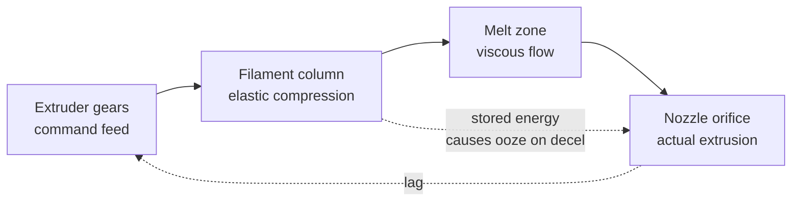
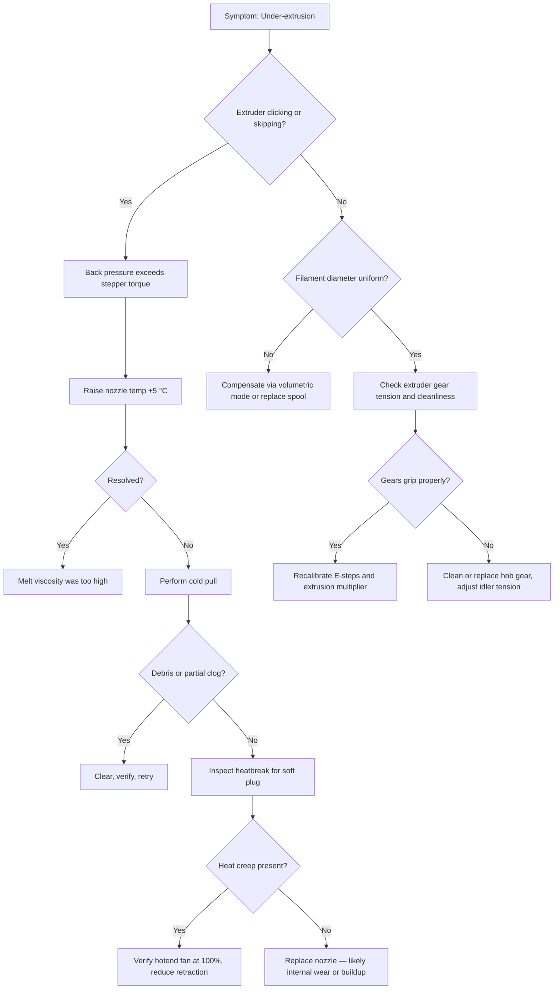

# Lesson 1: Extrusion Fundamentals

## 1. First-Principles Intuition & Invariants

The fused deposition modeling process is, at its mechanical core, a precision positive-displacement pumping problem. A stepper-driven gear pair grips a solid filament and forces it down a heated barrel, through a melt zone, and out a convergent orifice. Every quality issue the practitioner encounters—under-extrusion, stringing, oozing, corners that pull inward, surfaces that look moth-eaten, layer adhesion that fails a peel test—originates in the relationship between how much plastic the system was commanded to push and how much actually exited the nozzle, in what thermal state, under what residual pressure, and at what instantaneous flow rate. The slicer plans a trajectory assuming ideal behavior; the hardware departs from that ideal in systematic ways that the practitioner must understand to compensate for.

The mental model most beginners carry is that the nozzle is a "hot glue gun" whose output the toolhead steers around the build plate. This is misleading. The extrusion system is a closed fluid circuit with elastic compliance, viscous lag, and a thermal boundary layer. The controller—the slicer, the motion planner, and the firmware—makes real-time predictions about a system whose dynamics depend on polymer chemistry, nozzle geometry, and thermal inertia in ways that no closed-form equation fully captures. The practitioner's job is to understand enough of the underlying physics to bring the system's residual error within the tolerances the part demands, and to debug deviations methodically when they appear.

**Thermoplastic classes and their melt behavior.** FDM filaments fall into two rheological families that behave very differently in the hotend, and the distinction governs much of the temperature and retraction tuning that follows. Semi-crystalline polymers (PLA, PA, PEEK, PP) have a sharp melting transition: below the melting temperature $T_m$ they are leathery solids with measurable crystallinity, and above $T_m$ their viscosity drops by orders of magnitude within a narrow thermal band. PLA, for example, has a glass transition near 60°C and a melting point around 150–160°C, with practical extrusion temperatures of 190–220°C. Its viscosity curve is steep near the melt point, so a hotend running at 185°C may leave unmelted crystallites that jam the nozzle, while the same filament at 230°C drops in viscosity so far that oozing and stringing dominate the print.

Amorphous polymers (ABS, ASA, PETG, polycarbonate) soften gradually through their glass transition into a rubbery plateau and then a melt state, with no discrete crystalline melting point. ABS, with $T_g$ near 105°C, extrudes well across 230–260°C with relatively forgiving behavior: the softening zone is long and the viscosity changes smoothly with temperature. The tradeoff is that amorphous filaments begin to deform in the heatbreak earlier and over a longer thermal distance than semi-crystalline ones, which means they demand more aggressive retraction and more disciplined hotend cooling to prevent heat creep.

The single most important rheological property for FDM is shear thinning, the pseudoplastic behavior of polymer melts. At low shear rates the polymer chains entangle and resist flow; as shear rate increases, the chains align with the flow direction and the effective viscosity drops. The shear rate inside a 0.4 mm nozzle at typical print speeds falls in the range of 100–1000 s$^{-1}$, placing the process squarely in the shear-thinning regime. This is why a hotend that extrudes cleanly at 30 mm/s can stall at 150 mm/s: the volumetric demand has grown fivefold, the residence time in the melt zone has dropped proportionally, and the colder core of the filament meets the nozzle contraction as a semi-solid plug. The lower viscosity at higher shear rates helps, but it cannot compensate for the shorter heat soak. The practical consequence is that maximum flow rate scales sub-linearly with print speed, and the practitioner must know where the ceiling sits for each filament and hotend combination.

**The three invariants.** Three quantities are conserved across the entire extrusion chain, and they form the basis for every calibration and troubleshooting decision:

*Mass is conserved.* What enters as solid filament must exit as melt, minus a negligible vapor fraction. Any persistent discrepancy between commanded and delivered material is either measurement error, filament diameter variation, or a physical leak in the system—a PTFE tube backing out of the heatbreak, a nozzle thread that is not seated against the heater block, or a cracked heatbreak that bypasses the orifice.

*Volumetric flow is conserved through the nozzle.* The flow rate the slicer commands, expressed as the product of extrusion width, layer height, and print speed, must equal the flow the extruder delivers, expressed as filament cross-sectional area times filament feed rate. The firmware uses E-steps per millimeter to convert commanded extrusion volume into stepper rotation, assuming a nominal filament diameter of 1.75 mm. A diameter variation of $\pm 0.05$ mm on a 1.75 mm filament is a 5.7% cross-section error, and that error silently propagates into every line of every print. The slicer has no way to detect or correct it unless the user supplies a measured diameter or a sensor does.

*Pressure drop integrates across the flow path.* The total back pressure the extruder must overcome is the sum of contributions from the cold zone, where solid filament slides through the heatbreak tube; the transition zone, where a semi-soft plug squeezes through the convergent throat; and the melt zone, where viscous fluid flows through the nozzle land. Each contribution scales differently with temperature, flow rate, and geometry. The nozzle land contribution, approximated by the Hagen-Poiseuille relationship for laminar flow, scales as the fourth power of the orifice diameter:

$$\Delta P = \frac{128 \, \mu \, L \, Q}{\pi \, d^4}$$

where $\mu$ is the dynamic viscosity of the melt, $L$ is the land length, $Q$ is volumetric flow rate, and $d$ is the nozzle diameter. The $d^4$ dependence means that a 0.3 mm nozzle generates roughly 3.2 times the back pressure of a 0.4 mm nozzle at the same flow rate, and a 0.6 mm nozzle generates only 20% as much. This is why large nozzles print fast without strain and small nozzles demand careful temperature and speed management. The formula is a Newtonian approximation and polymer melts are not Newtonian, but it captures the dominant geometric scaling correctly and explains why nozzle diameter is the single strongest lever on extrusion force requirements.

These three invariants explain why the same printer produces excellent parts one day and failing parts the next. Any change in filament diameter, hotend temperature, print speed, or nozzle condition disturbs one or more of them, and the system has no closed-loop feedback to correct for the disturbance unless the user adds one—a filament diameter sensor, a flow sensor, or the calibrations described in Section 3.

## 2. Core Architecture & Mechanics

**The hotend as a thermal-fluid system.** A modern all-metal hotend—the E3D V6, Phaetus Rapido, Slice Engineering Mosquito, or newer high-flow variants—consists of a finned heat sink with a cooling fan, a heatbreak with a sharp thermal gradient, a heater block carrying a thermistor and a cartridge heater, and a nozzle threaded into the block. The design intent is to maintain a near-ambient temperature at the filament entrance and a controlled melt temperature at the nozzle exit, with a steep transition between them so that the filament does not soften until it is well within the heated region. The thermal gradient across the heatbreak is the single most important architectural feature of the hotend, because filament that softens too early forms a soft plug in the cold zone that increases back pressure, causes inconsistent extrusion, and eventually jams.

```
       ┌──────────────────────────────────────────┐
       │ Filament (solid, 1.75 mm)                │
       ▼                                           │
   ╔═══════════╗                                   │
   ║  Heat sink ║        Fan-cooled, 30–40 °C      │
   ║   (fins)   ║                                  │
   ╚════╤══════╝                                   │
        │ Heatbreak (thin-walled, ~2 mm bore)      │
        │ Thermal gradient:  40 °C → 200 °C        │
        │                   over ~10 mm axial       │
   ╔════╧═══════════════════╗                       │
   ║  Heater block          ║  Cartridge 40 W      │
   ║  Thermistor (≈220 °C)  ║                      │
   ╚════╤═══════════════════╝                       │
        │ Nozzle (convergent 60° → 0.4 mm bore)    │
        │ Land length: 1.0–2.0 mm                   │
        ▼                                           │
       Extrudate (0.45 mm wide × 0.20 mm layer)     │
```

The heatbreak achieves its gradient through a thin-walled section of stainless steel, whose low thermal conductivity (~16 W/m·K) compared to the brass or copper alloy of the heater block (~120–380 W/m·K) restricts heat flow upward. The cooling fan on the heat sink must run at full speed whenever the hotend is above 50°C; without it, conductive heat from the block creeps upward, the cold zone warms, and filament softens too early. This failure mode, called heat creep, is the most common cause of mid-print jams on Bowden and direct-drive systems alike, and it is almost always traceable to insufficient hotend cooling or excessive retraction pulling molten filament into the heatbreak.

**Nozzle internal geometry.** The nozzle's internal shape is not a simple cone. The standard geometry has a conical convergence region, typically with a 60° included angle (45° in some high-flow designs), that compresses the melt from the heatbreak bore diameter of roughly 2 mm down to the orifice, followed by a short cylindrical land at the exit diameter. The land length, typically 1.0–2.0 mm, is a critical design parameter. It is the section where the melt reaches its final pressure, where the velocity profile becomes fully developed, and where die swell is determined. A longer land produces more uniform exit velocity and lower die swell, but increases back pressure. The E3D Volcano and SuperVolcano nozzles extend both the land and the heated melt zone, allowing two to four times higher volumetric flow before the cold-core stall sets in, at the cost of a longer nozzle that reduces toolhead clearance.

The orifice itself is not always a clean cylinder after the nozzle enters service. Brass nozzles deform against the build plate on the first layer, particularly if the bed is too close. The bore wears when printing abrasive filaments—carbon fiber, glass-filled nylon, glow-in-the-dark (strontium aluminate pigment), and some metallic-filled compounds erode brass measurably within 50–100 g of material. A 0.4 mm nozzle that has worn to 0.45 mm will silently deliver approximately 14% more material than the slicer commands, which shows as over-extrusion ridges on flat surfaces and as fused support interfaces that will not separate. Hardened steel nozzles (E3D Nozzle X, Phaetus hardened series) resist this wear at the cost of lower thermal conductivity than brass, which typically requires a 5–10°C heater setpoint increase to maintain the same melt temperature. Ruby-tipped nozzles (Olsson Ruby) and tungsten carbide nozzles last indefinitely against abrasives and have thermal conductivity close to brass, but at substantially higher cost.

**Volumetric flow rate: the governing equation.** The slicer commands an extrusion flow rate that is the product of three geometric quantities:

$$Q = w \times h \times v_{\text{print}}$$

where $Q$ is the volumetric flow rate in mm³/s, $w$ is the extrusion width in mm, $h$ is the layer height in mm, and $v_{\text{print}}$ is the toolhead XY velocity in mm/s. The extrusion width is typically set to 1.0–1.25 times the nozzle diameter for outer walls and up to 1.5 times for sparse infill, where the wider bead improves inter-layer strength. Layer height is typically 0.25–0.5 times the nozzle diameter: below 0.25 times the nozzle diameter, the bead is too thin for the melt to spread and fuse properly; above 0.5 times, the circular cross-section of the extrudate cannot maintain contact with both the previous layer and the adjacent bead, and inter-layer adhesion suffers.

For a 0.4 mm nozzle printing a 0.45 mm wide, 0.20 mm high trace at 50 mm/s, the volumetric flow is:

$$Q = 0.45 \times 0.20 \times 50 = 4.5 \text{ mm}^3\text{/s}$$

The firmware translates this commanded flow into a filament feed rate by dividing by the filament cross-sectional area:

$$v_{\text{filament}} = \frac{Q}{\pi \times (d_{\text{filament}} / 2)^2} = \frac{4.5}{\pi \times 0.875^2} = \frac{4.5}{2.405} = 1.871 \text{ mm/s}$$

This filament advance is then converted to stepper motor steps via the E-steps per millimeter calibration:

$$\text{steps/mm} = \frac{\text{full\_steps\_per\_rev} \times \text{microsteps}}{d_{\text{hob}} \times \pi}$$

For a 1.8° NEMA 17 stepper with 16× microstepping and a 7 mm hob gear, this yields:

$$\text{steps/mm} = \frac{200 \times 16}{7 \times \pi} = \frac{3200}{21.99} = 145.5 \text{ steps/mm}$$

The E-steps calibration is performed by commanding 100 mm of filament extrusion with the hotend heated and the filament unloaded from the nozzle, measuring the actual advancement with calipers, and adjusting the firmware value by the ratio of commanded to actual distance. A correctly calibrated extruder places the cross-section relationship within ±1%, and any further discrepancy in the printed part traces to filament diameter variation, extrusion multiplier error, or filament slip under load.

**Pressure dynamics and the elastic compliance problem.** The filament column between the extruder gears and the nozzle orifice is not a rigid pushrod. It is a column with axial compliance: the cold section in the heatbreak compresses elastically under load, the softening transition zone deforms plastically, and the melt itself is a viscoelastic fluid with a storage modulus that absorbs and releases energy. When the extruder accelerates the filament forward at the start of an extrusion move, the column takes up some of that motion as compression before the melt begins to flow at the orifice. The system behaves like a stiff spring in series with a dashpot, and the result is flow lag: the actual volumetric flow at the nozzle trails the commanded flow by a time constant determined by the total compliance, the melt viscosity, and the geometry of the flow path.

When the extruder decelerates—at the end of a move, during a travel move when retraction is commanded, or at a corner where the toolhead slows—the stored elastic energy in the compressed filament column continues to push melt out of the nozzle even after the gears have stopped or reversed. This is the source of oozing, stringing, and the fat corners where deceleration at the end of a perimeter leaves a small but visible blob. The reverse problem occurs at the start of the next extrusion move: the filament must first re-compress the column before flow resumes, which causes under-extrusion at the beginning of a segment. On Bowden systems with a long PTFE tube between the extruder and the hotend, the compliance is dramatically higher—there may be 50–100 mm of filament in the tube acting as a spring—and the lag time constant is correspondingly longer.



Pressure advance, called Linear Advance in Marlin and pressure advance in Klipper, is the firmware's predictive correction for this elastic lag. The controller commands the extruder to lead or lag the motion planner by an amount proportional to the flow acceleration, so that the actual melt flow at the nozzle tracks the commanded XY motion with minimal phase error. The calibration constant, the K-factor, is the time constant of the extrusion system expressed in seconds. Typical values for direct-drive extruders with a short filament path fall in the range of 0.02–0.06 seconds. Bowden systems, with their longer and more compliant filament columns, typically require 0.04–0.10 seconds, with the value scaling roughly linearly with PTFE tube length. The K-factor is determined empirically by printing a set of test lines at varying K values and selecting the one whose corners are sharpest and whose start-of-segment under-extrusion has disappeared. Too low a K-factor leaves rounded corners and startup under-extrusion; too high a K-factor overcompensates, producing starved corners and a scalloped appearance on straight walls.

**Extrusion consistency mechanisms.** Maintaining consistent extrusion across a print requires that the extruder grip the filament reliably and that the filament diameter be either uniform or compensated. Dual-gear extruders such as the Bondtech BMG, LGX, and the Orbiter grip the filament on two opposite sides, doubling the contact area and significantly reducing slip and filament crushing compared to single-gear designs where a spring-loaded idler presses the filament against a single driven gear. The tradeoff is a slight increase in filament marking, which is usually invisible on the printed part but can create visible striations in translucent filaments where the gear teeth cold-work the surface. For flexible filaments (TPU, TPE), dual-gear extruders are effectively mandatory at print speeds above 15 mm/s, because the constrained filament path between the gears prevents the filament from buckling or deforming before it enters the hotend.

Filament diameter variation is the most underdiagnosed cause of inconsistent extrusion. Premium PLA is sold as 1.75 mm ±0.05 mm, but commodity filament can vary ±0.10 mm along the spool, which translates to ±11% cross-section variation. Some high-end setups measure filament diameter or flow rate directly and compensate in real time: the original Prusa XL uses a load cell under the toolhead to measure actual extrusion force, the Bambu X1C uses a nozzle-mounted Hall effect sensor to detect flow, and older DIY approaches used laser micrometers scanning the filament before it enters the extruder. Without such a sensor, the only mitigation is to buy higher-quality filament and, for parts where dimensional accuracy matters, to calibrate the extrusion multiplier against the specific spool.

**Volumetric extrusion mode.** Most modern firmware—Klipper, recent Marlin builds, RepRapFirmware—supports a volumetric extrusion mode in which the slicer specifies flow in cubic millimeters per millimeter of toolhead travel instead of millimeters of filament. This decouples the slicer's flow commands from the nominal filament diameter and lets the user change filament diameter in one place in the firmware without re-slicing. For a workshop running multiple materials with different diameter tolerances, this is a meaningful accuracy improvement, since the slicer no longer carries a hard-coded 1.75 mm assumption that silently produces error on out-of-spec filament.

## 3. High-Performance Optimization & Failure Modes

**Pushing volumetric flow limits.** The maximum volumetric flow rate a hotend can sustain is set by the rate at which the heater can deliver enough thermal energy to fully melt the filament, not by the extruder's mechanical ability to push. Above a critical flow rate, the filament core enters the nozzle contraction still semi-solid, back pressure rises sharply, and the print shows under-extrusion that the extruder cannot overcome without stripping the filament. The threshold depends on filament thermal conductivity, hotend melt zone length, heater power, and nozzle geometry.

Empirically, an E3D V6 with a 0.4 mm brass nozzle running PLA at 215°C sustains approximately 10–11 mm³/s before quality degrades. The E3D Volcano, with its extended melt zone, raises this to roughly 20–25 mm³/s. The SuperVolcano reaches approximately 35 mm³/s. CHT (Conical Heat Transfer) nozzles, which have internal fins that project into the melt to increase heat transfer surface area, raise the flow ceiling on standard hotends by 30–50% without the physical bulk of a Volcano. The Phaetus Rapido and Mosquito Magnum use short, wide melt zones and high-conductivity heater blocks to reach 30 mm³/s and above in a compact form factor.

To find the practical ceiling for a specific setup, run a manual flow test at the printer's console:

1. Heat the hotend to the working temperature and let it stabilize for two minutes.
2. Command 100 mm extrusions at progressively higher feed rates—5, 10, 15, 20, 25, 30 mm/s of filament advance—using the printer's console (e.g., `G1 E100 F300` for 5 mm/s, `G1 E100 F600` for 10 mm/s, and so on).
3. Observe the extrudate at each rate. At low rates it emerges as a smooth, glossy, straight vertical strand. As flow increases, the strand first develops a matte surface (incomplete melting at the core), then begins to curl (asymmetric solid skin forming on one side), then breaks or sputters (cold core hitting the orifice). The last feed rate at which the strand emerges smooth and straight is the practical limit.
4. Add a 10% safety margin. Convert the filament feed rate to volumetric flow: $Q_{\text{max}} = v_{\text{filament}} \times \pi \times (1.75/2)^2 = v_{\text{filament}} \times 2.405$ mm³/s. For example, 6 mm/s of filament advance yields $Q_{\text{max}} = 14.4$ mm³/s; with a 10% margin, set the slicer limit to 13 mm³/s.

In the slicer, enter this value as the maximum volumetric speed for the filament profile. PrusaSlicer and OrcaSlicer expose this as "Maximum volumetric speed" in the filament settings; Cura exposes it as "Maximum Flow Rate" in the experimental settings. The slicer will then automatically cap print speed at any layer or feature so that the commanded flow never exceeds the limit, eliminating the most common cause of speed-related print failure.

**Failure modes and their signatures.** The practitioner's debugging tree for extrusion failures proceeds from the observed symptom to the root cause, and a structured decision flow prevents the common error of changing multiple variables at once and losing track of which fix actually worked.



The decision flow above condenses a set of diagnostic paths that the practitioner should walk methodically, one variable at a time. The most common failure modes and their characteristic signatures deserve elaboration.

Under-extrusion with a clicking or thumping extruder indicates that the extruder is skipping steps because back pressure exceeds stepper torque. The causes, in order of likelihood, are nozzle temperature too low for the requested flow rate, a partial nozzle clog from degraded polymer or foreign material, a filament path obstruction such as a PTFE tube not seated in the heatbreak or a fragment of old filament stuck in the extruder body, or a worn or dirty hob gear with reduced tooth engagement. The first corrective step is to increase the nozzle temperature in 5°C increments. If the problem clears, the melt was too viscous for the flow rate demanded. If it does not, perform a cold pull at 140°C for PLA or 160°C for ABS: heat the hotend, push fresh filament through by hand, cool to the pull temperature, and pull the filament out hard. The cold pull should emerge with a clean impression of the nozzle interior. If it brings debris or a distorted tip, repeat. If the clog persists after two clean cold pulls, replace the nozzle.

Stringing between travel moves indicates residual pressure in the nozzle after the extrusion move ends, with gravity and capillary action pulling a thread of melt from the orifice during the travel. The mitigations, in order of preference, are to tune retraction distance and speed, to calibrate pressure advance, to lower nozzle temperature by 5°C, and to enable "Wipe while retracting" in the slicer, which coasts the nozzle along the just-printed line during retraction to consume the oozing filament. Typical direct-drive retraction is 0.4–0.8 mm at 35–40 mm/s; typical Bowden retraction is 3–5 mm at 35 mm/s. Increasing retraction distance beyond the Bowden tube's compliance threshold is counterproductive: very long retractions on Bowden printers push the filament so far back that it softens in the cold zone and jams on the next extrusion, producing a worse failure mode than the stringing it was meant to fix.

Oozing before the start of a print and under-extrusion at the beginning of a segment both stem from the same elastic compliance problem described in Section 2. The hotend dribbles during warm-up because the melt has no back pressure to hold it in, and the first few millimeters of an extrusion move show under-extrusion as the compressed filament column re-pressurizes. The mitigations are to calibrate pressure advance, to set an extra prime amount of 0.06–0.10 mm³ in the slicer to compensate for the retraction loss, and to use the slicer's prime line or brim feature to run the nozzle along a sacrificial line before the part begins, dumping the under-extruded startup material there rather than into the first layer of the part.

Inconsistent extrusion that varies with layer or position most commonly traces to filament diameter variation. Measure the filament at several points along the spool with calipers or a micrometer. If it varies by more than ±0.05 mm, switch to a higher-quality spool or use a filament diameter sensor. If the diameter is uniform but extrusion is still inconsistent, check the extruder gear tension: the spring-loaded idler should be tight enough that the gears grip reliably but not so tight that they crush the filament, which deforms the cross-section and changes the E-step relationship dynamically under load. On single-gear extruders, also inspect the gear teeth for accumulated filament dust, which reduces grip especially on soft filaments like TPU.

Heat creep and soft-plug jams occur when filament softens too far up the hotend, accumulates in the heatbreak, and forms a plug the extruder cannot push through. The print fails partway through, and disassembly reveals a swollen section of filament in the heatbreak, often with a rough, torn surface where the extruder stripped it. The causes are heatbreak cooling fan failure or under-speeding, retraction distance too long for the hotend design, hotend temperature set too high for the filament, or a PTFE tube in a lined hotend that is not seated against the nozzle, creating a gap that fills with melt and solidifies. The fixes are to ensure the hotend fan runs at 100% whenever the hotend is above 50°C, to reduce retraction distance to the minimum that eliminates stringing, and on PTFE-lined hotends to reseat the tube against the nozzle while the hotend is at temperature to eliminate any gap.

Nozzle wear on abrasive filaments erodes brass nozzles within 50–100 g of material. Carbon fiber, glass fiber, glow-in-the-dark filament (the strontium aluminate pigment is highly abrasive), and some metallic-filled compounds all fall in this category. The orifice enlarges progressively and the print shows gradual over-extrusion that worsens over the life of the nozzle. Switch to a hardened steel nozzle for these materials; the slightly lower thermal conductivity of steel compared to brass typically requires a 5–10°C heater setpoint increase to maintain the same melt temperature. For frequent abrasive use, ruby-tipped or tungsten carbide nozzles last indefinitely and have thermal conductivity close to brass, though at substantially higher cost.

**The extrusion multiplier calibration.** The extrusion multiplier—called "Flow" in Cura and "Extrusion multiplier" in PrusaSlicer—is the final fine-tuning parameter that accounts for the combined effect of filament diameter variation, E-step calibration residual error, die swell, and material-specific shrinkage. It is calibrated against a measured single-wall print:

1. Print a single-wall, hollow cube (20 mm × 20 mm × 20 mm) with the wall width set to the nozzle diameter (0.4 mm) and the multiplier at 1.00. Use 2 perimeters, 0% infill, 0 top layers.
2. Measure the actual wall thickness with calipers at three to four points and average. Measure on the flat faces, not at the corners where the bead transitions.
3. Calculate the new multiplier: $\text{new} = \text{old} \times (w_{\text{target}} / w_{\text{measured}})$. For a target of 0.40 mm and a measured 0.43 mm, the new multiplier is $1.00 \times (0.40 / 0.43) = 0.93$.
4. Re-print and verify. The result should fall within ±0.02 mm of the target width.

This calibration absorbs the residual system error that E-step calibration alone cannot address, since E-steps calibrate only the stepper-to-filament-feed relationship while the multiplier accounts for the entire system's deviation from the ideal model the slicer assumes.

**A workflow checklist for a new filament.** When switching to a new filament spool on a high-performance setup, the following sequence of checks prevents most extrusion problems before they reach the first print. It is not necessary to repeat the full sequence for every spool of the same material from the same manufacturer, but it should be run for any new material, any new hotend configuration, or whenever print quality degrades without an obvious cause.

First, measure the filament diameter at three points along the spool with calipers. If it deviates by more than ±0.05 mm from nominal, adjust the firmware's filament diameter setting if using volumetric extrusion mode, or note the average and adjust the extrusion multiplier accordingly.

Second, print a temperature tower spanning the expected extrusion range—for PLA, 190–230°C in 5°C steps; for ABS, 230–260°C in 5°C steps. Select the temperature at which stringing is minimal, overhang performance is clean, and layer adhesion passes a manual peel test of a thin section. A temperature 5°C above the minimum that produces acceptable results is usually the best choice, as it provides a margin for thermal lag during high-flow moves without pushing into the oozing regime.

Third, calibrate retraction distance with a tower—0.2 to 1.5 mm in 0.1 mm steps for direct drive, 2.0 to 6.0 mm in 0.5 mm steps for Bowden—at the chosen temperature. Select the lowest distance that eliminates visible stringing. Going lower saves filament path stress and reduces heat creep risk; going higher buys nothing and increases jam probability.

Fourth, calibrate pressure advance using the slicer's built-in test pattern (OrcaSlicer and Cura both provide one) or a manual pattern in Klipper using `TUNING_TOWER` with `SET_PRESSURE_ADVANCE`. The correct K-factor produces corners that are sharp without being starved and straight walls that are smooth without scalloping.

Fifth, run the single-wall calibration cube and adjust the extrusion multiplier as described above.

Sixth, set the maximum volumetric flow rate for the filament profile to 10% below the empirical ceiling measured with the manual flow test. This is the setting that allows the slicer to manage speed automatically across different layer heights, feature types, and line widths without the user having to hand-tune each one.

This sequence of calibrations, performed once per filament and once per hotend configuration, brings the extrusion system's three invariants—mass conservation, volumetric flow consistency, and pressure balance—into agreement with the slicer's model of the printer. Once they agree, the printer produces parts whose dimensions match the model, whose surfaces are clean, and whose layer adhesion is repeatable. The remaining variability comes from the thermal environment of the build chamber and the first layer, which is the subject of the next lesson.
