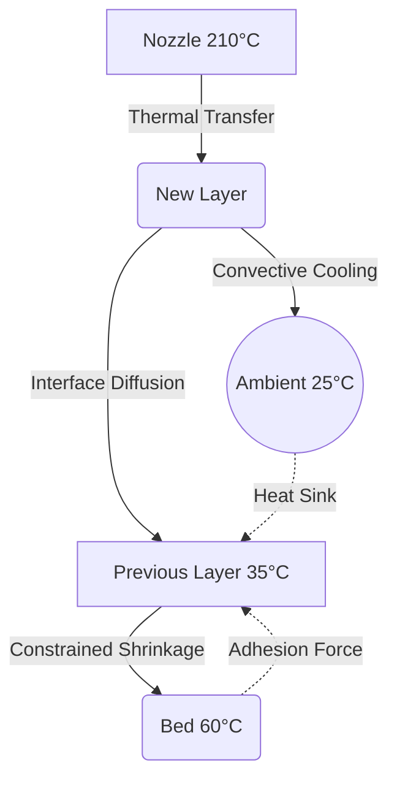
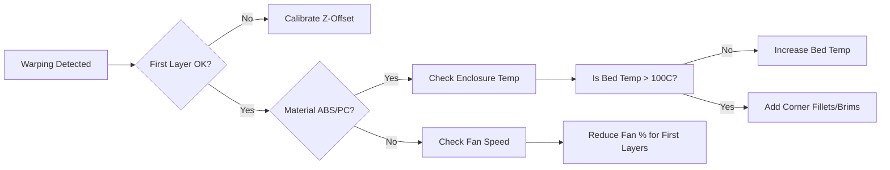

# Lesson 4: Material Layer Mechanics

## 1. First-Principles Intuition & Invariants

Fused Deposition Modeling is fundamentally a process of controlled thermal chaos. We force a polymer through a heated constriction, deposit it onto a substrate that is almost always significantly cooler than the melt, and demand that it hold a precise geometric shape while simultaneously fusing with the material beneath it. This contradiction—between rapid solidification for dimensional stability and prolonged heat retention for structural fusion—defines the mechanical reality of every 3D-printed part. The invariant we must accept is that FDM parts are anisotropic by design; they are not homogeneous isotropic solids like injection-molded parts. The Z-axis is governed by a phenomenon known as polymer chain diffusion, or "healing," which is distinct from the bulk melting that occurs within a single extruded line.

To understand layer adhesion, we must look at the glass transition temperature ($T_g$) and the melting temperature ($T_m$). When the nozzle deposits a new layer, the hot polymer must transfer enough thermal energy to the surface of the previous layer to raise its temperature above $T_g$. Only when both polymers are above $T_g$ do the long polymer chains gain sufficient mobility to entangle across the interface. This diffusion process follows Fickian kinetics, where the depth of chain penetration is proportional to the square root of time. The degree of healing—and thus the inter-layer tensile strength—is therefore a function of the interface temperature and the duration it remains above $T_g$ before convective cooling forces it below the threshold and freezes the chains in place. If the interface cools too rapidly, the chains never intermingle, leaving a distinct weld line that acts as a stress concentration point.

Dimensional accuracy in FDM is similarly at the mercy of thermal contraction. As the polymer transitions from a melt to a solid, it undergoes volumetric shrinkage dictated by its Coefficient of Thermal Expansion (CTE). This contraction is not uniform; the bottom of a layer is constrained by the cooler substrate beneath it, while the top is free to move. This differential creates residual stresses that accumulate throughout the build. The upper layers, as they cool and shrink, pull inward on the layers below. If the bed adhesion is insufficient to counteract this bending moment, the part warps. If the adhesion holds but the internal stress exceeds the inter-layer tensile strength, the part delaminates. We are not just printing shapes; we are managing a continuous battle against thermodynamics.

## 2. Core Architecture & Mechanics

The thermal profile of an FDM print is a stack of decaying temperature gradients. The nozzle acts as the primary heat source, but the bed provides secondary heating, and the ambient environment acts as the heat sink. The critical mechanism is the energy balance at the layer interface. When the nozzle moves over a previously deposited track, it deposits a bead of polymer at the extrusion temperature. The heat from this bead must flow into the previous layer, raising its surface temperature.

Consider a standard PLA print. The nozzle is at 210°C, the bed is at 60°C, and the ambient is 25°C. The previous layer might be at 35°C. When the new bead is placed, the interface temperature spikes. If the print speed is slow enough, or the layer height thin enough, this spike will push the interface above $T_g$ (approx. 60°C for PLA), allowing chain diffusion. If the print is too fast, or the fan too aggressive, the spike is too brief, and the diffusion depth is negligible.

The mechanics of shrinkage are equally critical. The linear shrinkage $S$ can be approximated by the change in length $\Delta L$ relative to the original length $L_0$, which is driven by the CTE $\alpha$ and the temperature difference $\Delta T$ from the melt to the solid state.

$$ \Delta L = L_0 \cdot \alpha \cdot \Delta T $$

For ABS, with a CTE of roughly $90 \times 10^{-6} \, \text{K}^{-1}$, cooling from 250°C to 25°C results in significant contraction. However, the bed constrains the bottom, creating a stress gradient through the Z-axis. This residual stress is the root cause of warping and the primary driver of failure in thick, flat geometries.



The diagram illustrates the competing forces. The nozzle provides the energy for diffusion, while the ambient environment quenches it. The bed provides the adhesion to resist the shrinkage forces, but if the bed is too hot, the bottom layers remain above $T_g$ and creep, causing the part to lose dimensional accuracy. The architecture of a successful print balances these thermal vectors to maximize the "sintering window"—the time the interface spends above $T_g$—without compromising the geometric stability of the overall mass.

## 3. High-Performance Optimization & Failure Modes

Optimizing layer mechanics requires manipulating the sintering window and managing residual stress through slicer parameters, firmware configurations, and physical environment controls. The goal is to maximize interface temperature and duration while maintaining geometric fidelity.

### 3.1 Thermal Profile Optimization

The most direct control we have over the sintering window is nozzle temperature. Printing hotter increases the energy transferred to the interface, extending the diffusion time. However, this is limited by material degradation. PLA begins to hydrolyze and degrade above 230°C, while ABS can degrade and emit volatile organic compounds if pushed too high. The optimal strategy is to determine the maximum nozzle temperature that does not cause visible stringing, oozing, or thermal degradation in a temperature tower.

Bed temperature is the second lever. A hotter bed keeps the bottom layers of the part above $T_g$ for a longer duration, allowing stress relaxation. This is particularly critical for ABS and Polycarbonate. However, a bed that is too hot for PLA can cause the bottom layers to remain soft, leading to "elephant's foot" where the bottom of the part bulges outward. The following table provides a baseline thermal profile for common materials, designed to maximize inter-layer bonding.

**Table 1: Thermal Profile Invariants for FDM Materials**

| Material | Tg (°C) | Nozzle Target (°C) | Bed Target (°C) | Max Cooling Fan (%) | Notes |
| :--- | :--- | :--- | :--- | :--- | :--- |
| PLA | 60 | 210-220 | 60 | 100 | High fan is acceptable for aesthetics; reduces Z strength slightly. |
| PETG | 80 | 240-250 | 80 | 50-100 | Fan helps stringing; too much hurts adhesion. |
| ABS | 105 | 245-260 | 100-110 | 0-20 | Enclosure mandatory. Zero fan for max strength. |
| Nylon | 70 | 240-280 | 80-100 | 0-30 | Dry material required. Enclosure highly recommended. |
| PC | 145 | 260-300 | 110-120 | 0 | Active enclosure required. |

### 3.2 Convective Cooling and the Sintering Window

The cooling fan is the most misunderstood tool in FDM. Its primary purpose is not simply to "cool" the part, but to manage the thermal gradient. For PLA, aggressive cooling solidifies the material rapidly, allowing for steep overhangs and fine details. This rapid quenching, however, limits the time for polymer chain diffusion, resulting in weaker Z-axis bonds. For ABS, the fan is actively detrimental to layer adhesion. Blowing room-temperature air onto a hot ABS layer creates a massive thermal shock, immediately freezing the interface before diffusion can occur.

The optimization workflow involves tuning the fan curve based on layer height and feature geometry. The slicer setting `cool_fan_full_at_height` should be used to delay fan activation for the first few layers, ensuring the bed has established a stable thermal foundation. For ABS, the fan should remain off or at a very low percentage (0-10%) only for minor cooling of small features that might otherwise overheat and deform. The following G-code snippet demonstrates a dynamic fan control strategy implemented via slicer post-processing to prioritize bonding over speed.

```gcode
; --- Thermal Management G-code: ABS Sintering Profile ---
; This script is intended for use in the 'Layer Change' script section of a slicer.
; It dynamically adjusts fan speed based on layer height to maximize diffusion time.

; Initialize variables on layer 0
{if layer_num == 0}
M106 S0 ; Force fan off for first layer
{endif}

; Ramp up fan slowly for small features but keep it minimal for mass
; This logic is illustrative for firmware that supports conditional G-code (e.g., Klipper, RepRap)
{if layer_num < 10}
M106 S0 ; No fan for first 10 layers (critical foundation)
{elsif layer_num < 50}
M106 S30 ; 10% fan for minor cooling, preserves heat
{else}
M106 S64 ; 25% fan max for tall structures to prevent warping
{endif}
```

### 3.3 Dimensional Accuracy and Shrinkage Compensation

Residual stress causes parts to shrink inward and warp upward. The most common failure mode is corner lifting on rectangular parts. This is mitigated by using a heated enclosure to lower the thermal gradient between the top of the print and the bottom. A passive enclosure can maintain 40°C, which is sufficient for PLA and PETG. For ABS and PC, an active enclosure reaching 60-70°C is necessary to prevent residual stress from exceeding the yield strength of the material.

Dimensional accuracy is managed in the slicer via the `material_shrinkage` or `horizontal_expansion` settings. If a part is consistently undersized, a horizontal expansion of +0.1mm can compensate for the expected contraction. However, this is a blunt instrument. The precise method is to measure the CTE of the specific filament batch and calculate the expected shrinkage for the geometry. For example, a 100mm ABS part cooling from 250°C to 25°C will theoretically shrink by approximately 0.8%. Slicers like SuperSlicer allow for material-specific shrinkage compensation, scaling the X/Y axes independently.

To diagnose shrinkage issues, print a calibration cube and measure the internal and external dimensions. If the external dimensions are correct but the internal holes are too small, the issue is not just shrinkage but also the "arc compensation" of the slicer, which often undercuts circular features due to the polygonal approximation of G-code paths.

### 3.4 Failure Mode Analysis: Delamination and Warping

Delamination is the catastrophic failure of the inter-layer bond. It occurs when the residual stress in the part exceeds the tensile strength of the weld line. The failure surface will appear smooth and glassy, indicating that the polymer chains never diffused. The corrective action is to increase the interface temperature (nozzle temp) or decrease the cooling rate (fan off). Increasing layer height can also help, as a thicker bead retains more heat mass, but this reduces resolution.

Warping is the elastic failure of bed adhesion. It is corrected by increasing bed temperature, using an adhesive (glue stick, ABS juice), or improving the surface texture of the build plate. Geometrically, warping is exacerbated by sharp corners. The mechanical solution is to add fillets to all corners in CAD to distribute the stress over a larger area.

The workflow for troubleshooting warping involves verifying the first layer adhesion. If the first layer is not translucent and fully squished into the bed texture, the nozzle is too high. If it is too high, the contact area is minimized, and the residual stress will easily peel it away. The nozzle Z-offset must be calibrated so the first layer is slightly compressed, maximizing the surface area of adhesion.



The ultimate optimization for layer mechanics is part orientation. The strength of an FDM part is not in the material spec sheet; it is in the orientation of the load relative to the layer lines. A part loaded in tension along the Z-axis will always fail at a lower stress than the same part loaded in tension along the X or Y axis. The master practitioner designs the part and orients it such that the primary load vectors are perpendicular to the layer lines, turning the anisotropic weakness into a non-issue. If this is impossible, the practitioner must use the thermal and slicer controls detailed above to maximize the sintering window, pushing the Z-axis strength as close to the bulk material strength as thermodynamically possible.
