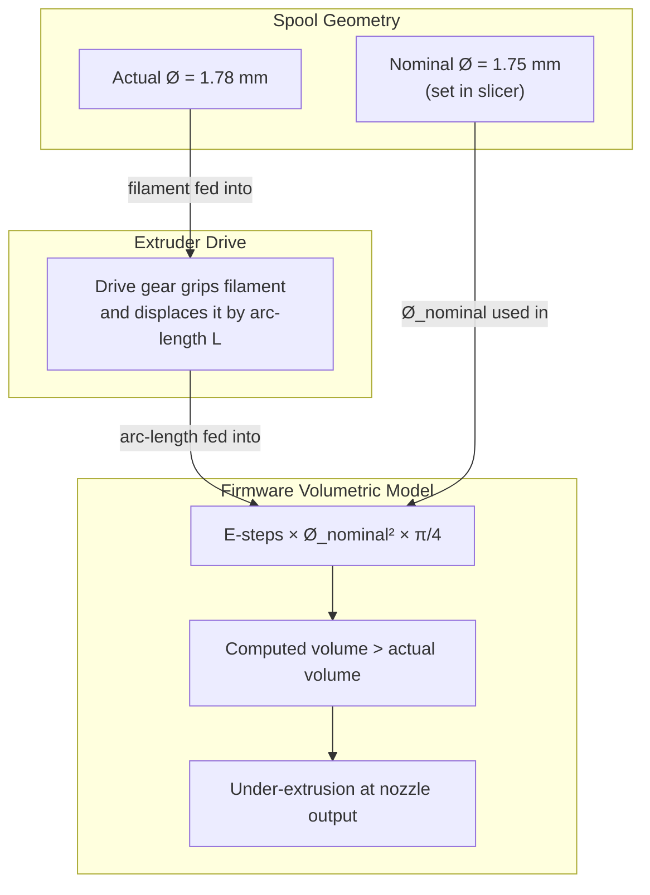
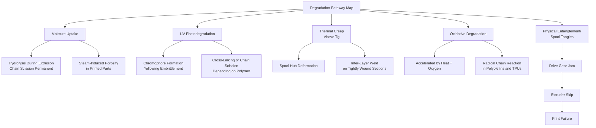

# Lesson 2: Filament Specifications, Standards, Storage

## 1. First-Principles Intuition & Invariants

Filament is the feedstock upon which every FDM print lives or dies, yet it remains among the most underspecified consumables in the desktop manufacturing workflow. Practitioners who tune PIDs to four decimal places and calibrate pressure advance with obsessive care will nonetheless load a spool of bargain filament without a second thought, then spend hours chasing layer adhesion failures and dimensional drift that originate entirely in the material itself. Understanding filament at the specification level is not an academic exercise; it is the prerequisite for reproducible, high-tolerance output.

The geometry of a filament strand is deceptively simple: a continuous cylinder, nominally 1.75 mm or 2.85 mm in diameter, wound on a spool. That simplicity is misleading. The drive gear in your extruder grips the filament and displaces a volume of plastic per unit rotation. The firmware calculates that volume using one number: the nominal diameter. When the actual diameter deviates from the nominal, the firmware's volume model is wrong, and every subsequent calculation downstream—layer height, extrusion width, infill density—propagates that error. This is the central invariant of filament geometry: *volumetric flow is the conserved quantity*, and diameter is the only input the slicer uses to compute it. A filament that averages 1.75 mm but oscillates between 1.72 mm and 1.78 mm does not average out to a correct print. The oscillation itself is the defect, because it creates rhythmic under- and over-extrusion that shows up as banding, weak layer bonds, and surface texture variation.

The ISO and ASTM standards governing filament quality exist precisely to formalize this intuition. ASTM F3049-14 provides standard guidance for characterizing properties of feedstock materials used in additive manufacturing, covering dimensional measurement methodology and reporting conventions. ISO/ASTM 52900 establishes the common vocabulary and classification framework. For dimensional tolerances specifically, the manufacturing consensus for premium filament has converged on ±0.03 mm for 1.75 mm stock, which represents a diameter variation window of roughly ±1.7 percent. Some manufacturers specify ±0.02 mm on high-precision engineering grades. The difference between ±0.05 mm commodity filament and ±0.02 mm precision filament is not marketing language—it is a direct multiplier on volumetric consistency, and for functional parts with tight tolerances, the choice of filament tier is as consequential as the choice of slicer settings.

Moisture is the other foundational variable, and it operates through a mechanism that most practitioners understand only vaguely. Thermoplastics used in FDM are, without exception, hygroscopic to some degree. The polymer chain structure contains polar functional groups that form hydrogen bonds with ambient water molecules. PLA has ester linkages that attract moisture moderately; nylon (PA) has amide groups with dramatically stronger affinity; PETG sits between them. Moisture does not merely sit on the filament surface. Given sufficient exposure time and relative humidity, water molecules diffuse through the amorphous regions between crystalline polymer domains, intercalating into the bulk material. This is not a surface phenomenon that can be reversed with a quick pass through a hot box; deep moisture uptake requires sustained drying at the appropriate temperature for the specific polymer.

The damage moisture causes during printing is twofold. First, thermolysis and hydrolysis: at extrusion temperatures, water reacts with the polymer backbone, breaking ester or amide bonds and reducing molecular weight. This is a permanent chemical degradation, not just a moisture issue. Lower molecular weight means lower melt viscosity, reduced mechanical properties in the finished part, and increased brittleness. Second, steam formation: water vaporizes explosively as the filament enters the melt zone, creating micro-bubbles in the melt stream. These manifest audibly as popping and crackling during printing, and visually as surface pitting, stringing, and foamy, rough surface texture. A strand of nylon left at 60 percent relative humidity for 48 hours will print with noticeably degraded surface quality and measurably reduced tensile strength in the finished part. The degradation is not hypothetical; it is quantifiable, and advanced practitioners should treat it as such.

The glass transition temperature (Tg) of a polymer defines the boundary between its brittle, glassy state and its rubbery, viscoelastic state—and it is directly relevant to storage. PLA has a Tg around 55–60°C, which means it softens at temperatures achievable in a hot car or a poorly ventilated enclosure. Storing PLA near heat sources or in direct sunlight will cause spool deformation and cross-layer bonding that makes the filament brittle and prone to snapping under extruder tension. PETG has a Tg around 80°C and is less susceptible to this, but far more susceptible to UV photodegradation over long-term storage. Each material has its own storage threat model, and the professional practitioner maintains one protocol per material class rather than a single generic approach.

---

## 2. Core Architecture & Mechanics

### The Diameter-to-Flow Pipeline

To reason precisely about how filament diameter error propagates into print quality, it helps to trace the signal path from raw filament geometry through the firmware's extrusion math to the deposited bead.

The firmware computes the extrusion volume as:

$$V = L \times \frac{\pi \cdot d_{\text{nominal}}^2}{4}$$

where $L$ is the length of filament driven by the extruder and $d_{\text{nominal}}$ is the diameter entered in the slicer profile. The actual delivered volume depends on $d_{\text{actual}}$:

$$V_{\text{actual}} = L \times \frac{\pi \cdot d_{\text{actual}}^2}{4}$$

The volumetric error ratio is therefore:

$$\varepsilon_V = \frac{d_{\text{actual}}^2}{d_{\text{nominal}}^2}$$

For a filament measuring 1.78 mm against a 1.75 mm nominal, this ratio is $(1.78/1.75)^2 = 1.034$, meaning the printer deposits 3.4 percent more material than intended. At 1.72 mm actual diameter, the ratio is $(1.72/1.75)^2 = 0.966$, a 3.4 percent deficit. When these conditions alternate along the same spool, the result is periodic over- and under-extrusion that no PID tune or pressure advance setting can fully correct, because the error is in the feedstock, not the motion system.

This is why some advanced workflows incorporate inline filament diameter sensing. Devices like the Mosaic Palette and experimental open-source sensors use contact or optical measurement to feed real-time diameter corrections back to the extrusion multiplier. For most practitioners the more pragmatic intervention is measurement at intake: use a micrometer to sample the incoming spool at ten points along a one-meter section, rotating 90 degrees between measurements at each point to catch out-of-round cross-sections as well as diameter variation along the length. If any measurement exceeds your tolerance budget, classify and segregate that spool.

### Moisture Absorption Mechanics and the Diffusion Model

Moisture uptake in polymers follows Fickian diffusion in its early stages. The concentration of absorbed water $C$ at depth $x$ from the filament surface evolves according to:

$$\frac{\partial C}{\partial t} = D \cdot \frac{\partial^2 C}{\partial x^2}$$

where $D$ is the diffusion coefficient, which is polymer- and temperature-dependent. For a cylindrical filament of radius $r$, equilibrium moisture content (EMC) is approached asymptotically, with the time constant scaling with $r^2 / D$. This has a direct practical consequence: a 1.75 mm filament reaches equilibrium moisture significantly faster than a 2.85 mm filament under identical humidity conditions, because the diffusion path is shorter. Thin-wall sections of a printed part absorb and release moisture faster than solid cross-sections for the same reason.

The table below provides reference values for equilibrium moisture content, minimum effective drying temperature, and recommended drying duration for common FDM materials:

| Material | Tg (°C) | Equilibrium MC at 60% RH | Drying Temp (°C) | Drying Duration |
|---|---|---|---|---|
| PLA | 55–60 | ~0.5% | 45–50 | 4–6 hours |
| PETG | 80 | ~0.2% | 65 | 4–6 hours |
| ABS | 105 | ~0.3% | 80 | 2–4 hours |
| Nylon PA12 | 46 | ~1.5% | 80 | 12–24 hours |
| Nylon PA6 | 50 | ~3.5% | 80–90 | 24–48 hours |
| TPU (95A) | −35 | ~0.4% | 50–60 | 4–8 hours |
| PC | 147 | ~0.3% | 110–120 | 6–8 hours |
| PVA (support) | ~73 | ~8–12% | 45 | 4–8 hours |

Note that drying PLA above 50°C risks annealing and deforming the spool geometry if the spool is itself PLA or a low-Tg polymer. Cardboard spools tolerate higher temperatures better than injection-molded PLA hubs.

### The Extrusion Rate Calculation

Volumetric flow rate through the nozzle is the unified quantity that ties print speed, layer height, extrusion width, and filament diameter together. The relationship is:

$$\dot{V} = v_{\text{print}} \times h_{\text{layer}} \times w_{\text{extrusion}}$$

where $v_{\text{print}}$ is linear print speed (mm/s), $h_{\text{layer}}$ is layer height (mm), and $w_{\text{extrusion}}$ is extrusion width (mm). The filament feed rate required to sustain this volumetric flow is:

$$\dot{L} = \frac{\dot{V}}{A_{\text{filament}}} = \frac{v_{\text{print}} \times h_{\text{layer}} \times w_{\text{extrusion}}}{\pi (d/2)^2}$$

Consider a typical wall perimeter: 60 mm/s print speed, 0.2 mm layer height, 0.45 mm extrusion width, 1.75 mm filament.

$$A_{\text{filament}} = \pi \times (0.875)^2 = 2.405 \text{ mm}^2$$

$$\dot{V} = 60 \times 0.2 \times 0.45 = 5.4 \text{ mm}^3/\text{s}$$

$$\dot{L} = \frac{5.4}{2.405} = 2.25 \text{ mm/s of filament feed}$$

At high-speed printing—say, a Voron running 150 mm/s perimeters with 0.3 mm layers and 0.6 mm width on a 0.4 mm nozzle—the volumetric demand rises to $150 \times 0.3 \times 0.6 = 27 \text{ mm}^3/\text{s}$. This exceeds the melt capacity of a standard brass V6 hotend (roughly 11–15 mm³/s) and requires a high-flow hotend such as a Volcano, Rapido HF, or Dragon HF. The filament's melt rheology—its viscosity profile as a function of temperature and shear rate—directly determines what volumetric ceiling is achievable before the melt zone becomes the bottleneck. This is a material specification, not merely a hardware specification, and premium engineering filaments specify it via melt flow index (MFI), measured in g/10 min under ASTM D1238 conditions.

### Storage Architecture

The degradation pathways for stored filament form a clear hierarchy by mechanism:

The practical response to this map is a layered storage system. The innermost layer is the individual filament bag: vacuum-sealed (or at minimum heat-sealed) with one or two 10-gram silica gel packets and a humidity indicator card. The intermediate layer is a sealable, rigid storage bin—a Gamma Seal lid on a standard 5-gallon bucket is a practitioner-proven solution—charged with a larger rechargeable desiccant brick (100–200 grams of silica gel, type B, indicating). The outermost layer is the ambient environment: a climate-controlled space away from direct sunlight, ideally below 25°C and 50 percent RH year-round.

Recharging silica gel is as important as the initial desiccant selection. Type B indicating silica gel turns from orange to green (cobalt-free formulations) or blue to pink (cobalt-containing) when saturated. Recharge at 120°C in a conventional oven for two hours, confirming the return to the dry color before repackaging. Cobalt-free indicating gels have become the professional standard due to cobalt chloride's regulatory status as a suspected carcinogen in several jurisdictions.

---

## 3. High-Performance Optimization & Failure Modes

### Diameter Measurement Protocol at Intake

The professional intake protocol for a new spool requires a calibrated digital outside micrometer with 0.001 mm resolution and a measurement force below 10 N to avoid deforming soft materials like TPU. Pull one meter of filament from the spool and measure at ten evenly spaced points. At each point, take two readings rotated 90 degrees apart to detect ellipticity—a common defect in lower-tier manufacturing where the extrusion die is slightly misaligned. Record all twenty values in a spreadsheet and compute the mean, standard deviation, and min/max range.

A spool passes incoming quality control if its mean diameter is within ±0.02 mm of nominal and its standard deviation is below 0.015 mm. A spool with a mean within ±0.03 mm and standard deviation below 0.025 mm is usable for non-critical prints with a manually adjusted flow multiplier. Calculate that multiplier as:

$$\text{Flow Multiplier} = \left(\frac{d_{\text{nominal}}}{d_{\text{measured mean}}}\right)^2$$

Enter this value in your slicer's filament profile as the extrusion multiplier. For a spool measuring 1.772 mm mean against a 1.75 mm nominal, the corrected multiplier is $(1.75 / 1.772)^2 = 0.9754$, applied as 97.54 percent flow. This corrects the mean error but cannot correct oscillation, which is why standard deviation matters as much as mean.

### Drying Verification Without Specialized Equipment

A Sunlu S2 or similar filament dryer provides a controlled, low-temperature convection environment and costs less than a failed nylon print on an engineering project. However, verification matters as much as the drying process itself. The simplest and most reliable verification method is the bend test for PLA and PETG: properly dried PLA snaps cleanly under a sharp bend; moisture-laden PLA bends white and deforms without snapping, indicating plasticization by absorbed water. For nylon, the bend test is less reliable because nylon is inherently tougher—the acoustic test is more informative: extrude a short length of filament into free air and listen for popping. Properly dried nylon extrudes with a faint hiss; wet nylon pops audibly and strings aggressively.

For quantitative verification, a moisture analyzer (also called a thermogravimetric moisture balance) heats a small sample to the polymer's drying temperature and measures mass loss. A 2-gram sample of properly dried nylon PA6 should show less than 0.2 percent mass loss after 10 minutes at 80°C. This instrument is standard in injection molding shops and increasingly accessible to serious FDM practitioners.

### Failure Mode: Hydrolysis and Permanent Degradation

Hydrolysis during extrusion is the failure mode that most practitioners misdiagnose as a slicer or printer problem. The symptoms are progressive: surface quality degrades, layer adhesion weakens, the printed part becomes more brittle than expected, and stringing increases despite retraction tuning. If drying the filament does not fully restore print quality, the polymer chains have been permanently shortened by hydrolysis and no process intervention will recover them. The correct response is to discard the spool and treat it as a process loss.

The prevention is straightforward: dry filament before the first use, print from a sealed dry box during the session, and never return filament to storage without re-sealing with fresh desiccant. A dry box constructed from an airtight 5-liter container with a PTFE tube through the lid and a silica gel bed inside the container achieves sub-10-percent RH at the filament during printing. This is not an optional refinement for engineering materials—it is a baseline requirement for nylon, PC, and PVA, all of which will degrade visibly within a 4-hour print session under ambient humidity conditions in many geographic regions.

### Failure Mode: Diameter-Driven Extrusion Instability

A specific and diagnostically tricky failure mode arises from filament with periodic diameter variation—sections of slightly larger diameter alternating with normal-diameter sections at regular intervals along the spool length. This manifests as a print that shows banding at a spatial frequency that does not correspond to any mechanical resonance of the printer and that persists across different print speeds. The diagnostic step is to unwind two meters of filament and measure at 50 mm intervals. Regular oscillation confirms manufacturing-origin diameter variation. No tuning intervention resolves this; the spool must be replaced, and the supplier should be notified for quality tracking.

### ASTM F3049-14 Compliance in a Practitioner Context

While few desktop practitioners will conduct formal ASTM F3049-14 compliance testing, understanding the standard's scope informs purchasing decisions and supplier evaluation. The standard specifies measurement of diameter and roundness using calibrated contact or optical measurement systems, minimum sampling frequency along spool length, reporting of statistical distribution rather than merely min/max values, and characterization of density, moisture content, and melt flow index. A filament data sheet that reports these values per ASTM methodology can be directly compared across manufacturers and across batches from the same manufacturer. Batch consistency is often the overlooked variable: a supplier whose nominal specification is excellent but whose batch-to-batch variation is high forces a full recalibration with every new spool, which is unacceptable in any production context.

For practitioners running production-equivalent workflows—print farms, iterative engineering prototyping, or multi-day continuous prints—the practical quality management response is to purchase filament in bulk from a single batch, verify the batch on intake with micrometer sampling and a short test print, and store the entire batch under controlled conditions until consumed. Switching between batches mid-project, even from the same manufacturer and same color, can introduce dimensional variation sufficient to shift a press-fit tolerance from snug to sloppy. Batch number tracking in your slicer profile notes is a ten-second habit that has prevented countless hours of troubleshooting.

### Optimizing Long-Term Storage for Engineering Materials

Polycarbonate and nylon deserve individual attention in any serious storage protocol because their degradation under combined heat, humidity, and UV is significantly more aggressive than commodity materials. Polycarbonate begins meaningful hydrolysis above 80°C, so its drying temperature is high but its storage temperature must be carefully managed. Store PC in vacuum-sealed bags with high-capacity silica gel in a dark, cool environment and limit the time between drying and printing to under two hours. Any PC spool that has been open to ambient air for more than 12 hours in a humid environment should be re-dried at 110°C for six hours before use, without exception.

Nylon's particular challenge is that even after thorough drying, it absorbs moisture from the ambient air at the print surface as the part cools. This is why nylon parts designed for dimensional stability should be stored in dry conditions post-print and measured after a 24-hour equilibration period in controlled humidity, not immediately after print removal. The printed nylon will continue to change dimensions for up to 72 hours as it reaches moisture equilibrium with the ambient environment. For structural components, this post-print dimensional drift is a specification-level concern that belongs in the design tolerance stack-up.

The discipline of treating filament as a precision-class consumable—tracked by batch, measured on intake, stored under quantified conditions, dried to verified dryness before use, and printed within a sealed moisture-controlled environment—is what separates practitioners who achieve consistent, predictable output from those who chalk dimensional failures up to printer variance or slicer mystery. The printer is often the least responsible component in the chain.
