# Lesson 1: Material Science Fundamentals for 3D Printing

## 1. First-Principles Intuition & Invariants

Every failure on the print bed, every warped corner, every delaminated layer, and every part that shatters under modest load traces back to a single root cause: the practitioner treated the material as a commodity rather than as a system of molecular decisions. Advanced 3D printing is, at its foundation, applied polymer physics. The slicer is just the interface. The real engineering happens at the nanoscale, in the entanglement of polymer chains, the organization of crystalline domains, and the thermodynamic boundary conditions imposed by your heated bed, enclosure, and cooling fan. To master materials is to gain causal control over every variable that matters.

### The Polymer Chain: Architecture of Printability

Polymers are long-chain molecules built by linking small repeating units called monomers through covalent bonds. The character of those bonds, the geometry of the backbone, and the chemical identity of pendant groups hanging off that backbone collectively determine almost everything a practitioner cares about: melt viscosity, interlayer adhesion strength, dimensional stability, and chemical resistance. Consider polylactic acid (PLA) versus acrylonitrile butadiene styrene (ABS). Both are thermoplastics, meaning they soften on heating and resolidify on cooling, a reversible phase transition that makes FDM possible in the first place. But their molecular architectures produce radically different printing experiences and end-use behaviors because their chain stiffness, polarity, and thermal response differ at the atomic level.

The two architectures that matter most for FDM printability are **amorphous** and **semi-crystalline**. In an amorphous polymer, chains are tangled in a disordered, glassy network. There is no long-range molecular order. PLA, ABS, PETG, ASA, and polycarbonate (PC) are predominantly amorphous. When you heat them above a critical threshold, they do not melt sharply; instead, they soften gradually through a rubbery transition region. This gradual softening is mechanically forgiving in a print head because the material flows predictably across a range of temperatures rather than demanding a precise melting point. Semi-crystalline polymers, by contrast, possess regions of tightly packed, ordered chain folding called crystallites, embedded within an amorphous matrix. Nylon (PA6, PA12), polyoxymethylene (POM/Delrin), polypropylene (PP), and high-density polyethylene (HDPE) are semi-crystalline. They exhibit a true melting point, a sharper liquid transition, and upon cooling they re-crystallize, releasing latent heat and contracting significantly as those crystalline domains reorganize. This crystallization shrinkage is the root cause of the severe warping that makes printing PP or POM without an actively heated enclosure nearly impossible.

### Glass Transition Temperature: The Practitioner's Critical Threshold

The glass transition temperature, $T_g$, is the most consequential single-number property in FDM material science. Below $T_g$, an amorphous polymer is in a glassy, rigid state: chains are kinetically frozen in place, molecular motion is limited to small-scale vibrations, and the material behaves as a stiff solid. Above $T_g$, chains gain enough thermal energy to undergo segmental motion, the material enters a rubbery or viscous state, and stiffness drops dramatically, often by several orders of magnitude within a narrow temperature range. For a printed part sitting on a dashboard in a parked car, or used as a bracket near a motor, $T_g$ is the hard ceiling on service temperature.

PLA has a $T_g$ of approximately 55–60 °C, which is why a PLA phone mount will catastrophically deform in a summer vehicle interior. ABS sits at 100–105 °C, PETG at 75–80 °C, polycarbonate at 147 °C, and PEEK at around 143 °C with a melting point of 343 °C. These are not abstract numbers: they are design constraints you must cross-reference against the thermal environment of every application before selecting a material. Critically, $T_g$ is not a fixed material constant. It shifts with molecular weight, the presence of plasticizers, moisture absorption (nylon's $T_g$ drops measurably when wet), and the degree of crystallinity. This is why printing conditions, particularly cooling rate and annealing protocols, can meaningfully alter the $T_g$ of your finished part.

The melting temperature $T_m$ applies to semi-crystalline polymers and represents the thermodynamic point at which crystallite domains disorder into the melt. For nylon 6, $T_m$ is approximately 220 °C; for nylon 12, it is around 178 °C; for PEEK, 343 °C. The processing window, the range between $T_m$ and the temperature at which thermal degradation begins, is narrow for high-performance polymers, which is why PEEK demands all-metal hotends, 500 °C capable heater blocks, and actively heated chamber temperatures of 90–120 °C.

### Molecular Weight, Melt Flow Index, and Viscosity

Polymer chains are not all the same length. A material's molecular weight is expressed as a distribution, and the number-average ($M_n$) and weight-average ($M_w$) molecular weights govern two competing practical demands. Higher molecular weight means longer chains, more entanglement, and therefore higher melt viscosity, greater toughness, and better interlayer adhesion because chains crossing the layer interface have more length available to interdiffuse. Lower molecular weight means lower viscosity, easier flow through small nozzles, and faster extrusion, but at the cost of brittleness. The melt flow index (MFI), measured in grams per 10 minutes under a standard load at a standard temperature, is the inverse proxy for viscosity that filament manufacturers publish. A high MFI material flows easily; a low MFI material requires higher extrusion temperatures or pressures to maintain throughput. High-flow PLA variants with MFI values around 20–30 g/10 min are engineered for speed printing at 300+ mm/s but sacrifice some layer adhesion compared to standard PLA at MFI 6–10.

### Hygroscopy: The Silent Print Failure Mechanism

Hygroscopic polymers absorb moisture from ambient air into the polymer matrix. At printing temperatures, that moisture instantly vaporizes, creating microbubbles in the melt that manifest as audible crackling, rough surface texture, foamy stringing, and catastrophically reduced part strength through internal porosity. Nylon 6 can absorb up to 9% of its weight in water at saturation. PA12 is more moisture-resistant at roughly 1.5%. Even PETG, often dismissed as non-hygroscopic, absorbs enough moisture after a few days of open storage to degrade surface finish noticeably.

The practical invariant is this: treat all hygroscopic filaments as perishable. PLA requires drying at 45–50 °C for 4–6 hours if exposed to humidity above 50% RH for more than 24 hours. ABS and ASA tolerate humidity somewhat better but still benefit from 60 °C drying for 2 hours. Nylon demands aggressive drying at 70–80 °C for 8–12 hours before printing and an active drybox during the print itself. Polycarbonate should be dried at 80–90 °C for a minimum of 8 hours, and because it absorbs moisture extremely rapidly, the gap between pulling it from the dryer and loading it into the printer should be measured in minutes, not hours.

---

## 2. Core Architecture & Mechanics

### The Thermal State Machine of FDM Extrusion

Understanding material behavior through a print requires thinking of the filament as passing through a precisely ordered sequence of thermal states. Each transition has mechanical consequences that the practitioner must manage.

```mermaid
flowchart TD
    A["RAW FILAMENT<br/>(solid, ~25°C)"]
    B["SOFTENING ZONE<br/>(Tg → Tm, 60–180°C)<br/>• Chain mobility increases<br/>• Filament loses rigidity; buckling risk if pressure is high<br/>• In bowden systems: this zone must stay short (heat creep)"]
    C["MELT ZONE<br/>(Tprocessing, 180–500°C)<br/>• Full viscoelastic flow<br/>• Chains partially disentangle<br/>• Melt viscosity governed by T and shear rate (shear thinning)"]
    D["EXTRUSION / SHEAR ZONE<br/>• High shear rate thins viscosity (pseudoplastic behavior)<br/>• Die swell: elastic recovery widens bead slightly after nozzle exit<br/>• Actual deposited width > nominal nozzle diameter by 10–20%"]
    E["WELDING / DIFFUSION ZONE<br/>(brief window above Tg)<br/>• Critical for interlayer adhesion<br/>• Chain segments diffuse across layer interface<br/>• Reptation time determines bond strength<br/>• Rapid quench by cooling fan freezes chains in place"]
    F["SOLIDIFICATION ZONE<br/>• Amorphous: vitrification below Tg (no latent heat)<br/>• Semi-crystalline: crystallization releases latent heat; shrinkage<br/>• Residual thermal stress builds as layers contract at different rates"]
    G["FINISHED PART<br/>(locked-in stress state, anisotropic microstructure)"]

    A -->|"Enters cold zone / PTFE liner"| B
    B -->|"Heater block"| C
    C -->|"Nozzle orifice"| D
    D -->|"Deposition onto substrate / previous layer"| E
    E -->|"Part cooling"| F
    F --> G
```

This state machine is not academic. Every slicer parameter you set is a direct intervention at a specific node in this chain. Print temperature governs melt viscosity and the duration of the welding window. Cooling fan speed controls quench rate and therefore both welding effectiveness and residual stress accumulation. Print speed determines shear rate in the nozzle and time available for interdiffusion at the layer interface. These variables do not operate independently; they are coupled, and optimizing one at the expense of others produces the classic failure modes documented in Section 3.

### Rheology: Why Polymers Flow the Way They Do

Polymer melts are non-Newtonian fluids. Unlike water, whose viscosity is constant regardless of flow rate, polymer melts exhibit shear thinning, also called pseudoplastic behavior. As shear rate increases (meaning as you push the melt through the nozzle faster), polymer chains align with the flow direction and disentangle locally, dramatically reducing viscosity. This is why high print speeds are mechanically possible at all: the melt flows more easily precisely when you demand it to flow fastest. The power-law relationship governing this is $\eta = K \dot{\gamma}^{n-1}$, where $\eta$ is apparent viscosity, $K$ is a material consistency index, $\dot{\gamma}$ is shear rate, and $n < 1$ for shear-thinning materials (typically $n = 0.3$–$0.6$ for common FDM polymers). The practical consequence is that the relationship between volumetric flow rate and extrusion pressure is nonlinear, which is precisely why linear advance / pressure advance calibration requires empirical tuning per material rather than a simple calculation.

Die swell compounds this. When the melt exits the nozzle orifice, the compressive stress imposed by the converging nozzle geometry releases elastically, and the bead swells perpendicular to the flow direction. For common FDM materials, die swell expands the deposited bead width by 10–20% beyond the nominal nozzle diameter, which is why a 0.4 mm nozzle does not produce 0.4 mm extrusion widths without accounting for this in the slicer's extrusion width settings.

### Interlayer Adhesion: Reptation and the Welding Window

Interlayer bond strength is governed by a process called reptation, the worm-like diffusion of polymer chain segments across the freshly deposited layer interface. The driving force is entropy: a chain confined near a surface has fewer available configurations than one in the bulk, so segments diffuse across the interface to maximize configurational entropy. The reptation time $\tau_{rep}$ scales strongly with molecular weight ($\tau_{rep} \propto M_w^3$) and decreases sharply with temperature above $T_g$. For strong interlayer adhesion, the deposited bead must remain above $T_g$ for long enough to allow significant chain interdiffusion before the cooling fan quenches it.

This creates a fundamental tension in FDM: aggressive cooling improves dimensional accuracy, reduces stringing, and allows faster bridging and overhang performance, but it simultaneously shortens the welding window and reduces interlayer adhesion. For structural parts demanding Z-axis strength, dialing cooling down to 20–40% and raising print temperature to the upper end of the material's processing range is often the correct trade-off. For fine-detail visual prints in PLA where Z strength is irrelevant, maximum cooling and modest temperatures are appropriate. The practitioner must consciously choose the trade-off based on end-use requirements.

### Crystallinity and Its Structural Consequences

The degree of crystallinity in a semi-crystalline polymer is not a fixed material property; it is a process variable. Slower cooling rates allow more time for chain folding and crystallite growth, increasing crystallinity, density, stiffness, and chemical resistance. Rapid quenching freezes chains in an amorphous-dominant state, producing a tougher but less stiff and chemically resistant part. For nylon and PET-based materials, controlled annealing of printed parts after fabrication can increase crystallinity significantly and raise the effective heat deflection temperature by 20–40 °C.

The specific volume change associated with crystallization is a contraction, and in a constrained printed geometry, this contraction generates internal stress. In polypropylene, volumetric shrinkage during crystallization is approximately 1–3%, which is why PP parts warp violently without bed adhesion strategies (PE glue stick, PP sheet surface, 80–100 °C bed temperature) and why the first layer must be deliberately oversquished to mechanically interlock with the surface before the material contracts away.

---

## 3. High-Performance Optimization & Failure Modes

### Calibrating Print Temperature Against Interlayer Strength: The Tower Protocol

The most rigorous way to establish the correct print temperature for a new material is the temperature tower, a vertical test print that changes temperature in discrete steps (typically 5 °C) over its height. But evaluating a temperature tower by visual inspection alone misses the point. Practitioners optimizing for structural parts should print two temperature towers, section each step horizontally with a razor blade or bandsaw, and perform a manual peel test: grip the layer interface and attempt to delaminate the layers. The correct print temperature for a structural material is the lowest temperature that produces cohesive failure (the material tears within the layer rather than cleanly at the interface). Adhesive failure at the interface indicates inadequate reptation. Beyond identifying the visual sweet spot for stringing, evaluate each step for matte versus glossy surface finish: a glossy interlayer surface indicates good fusion; a matte or powdery surface suggests the temperature is too low for adequate chain diffusion.

For PETG, the structural sweet spot commonly falls 10–15 °C higher than the temperature that produces the best visual surface, because PETG's low thermal conductivity and high melt viscosity both work against interlayer diffusion at conservative temperatures. Print PETG at 240–250 °C for structural applications, accept slightly more stringing, and tune retraction to compensate.

### Moisture Remediation in the Field

Detecting moisture-compromised filament is straightforward. Load the suspect filament, heat the nozzle to print temperature, and manually extrude a 100 mm length at a slow, steady rate by driving the extruder motor directly. Moisture-free filament produces a smooth, continuous strand with a consistent diameter. Wet filament produces audible popping or crackling, a foamy, rough-surfaced strand, and sometimes visible micro-bubbles in the extrudate. Weighing a 100 mm length of extrudate and comparing against the theoretical weight for that nozzle diameter and material density provides a quantitative measure of internal porosity.

Drying protocol by material class is as follows. PLA at 45–50 °C for 4–8 hours in a food dehydrator or filament dryer; avoid exceeding 55 °C, which approaches $T_g$ and will cause the filament to soften and fuse in the spool. PETG at 65 °C for 4–6 hours. ABS and ASA at 60–70 °C for 4–8 hours. Nylon (PA6/PA66) at 80 °C for 12–24 hours; PA12 at 70 °C for 8–12 hours. Polycarbonate at 85–90 °C for 8–12 hours. PEEK at 120–150 °C for 4–8 hours, using an industrial oven rather than a consumer filament dryer. After drying, store immediately in a sealed container with fresh desiccant (silica gel or molecular sieve) and print directly from a sealed drybox to prevent re-absorption during long prints.

### Warping, Residual Stress, and Enclosure Engineering

Warping is not a bed adhesion problem; it is a thermal gradient problem. When the lower layers of a print cool and contract while upper layers are still hot, differential shrinkage generates a bending moment that peels the part from the bed. Bed adhesion temporarily resists this force, but on large, flat parts with high-shrinkage materials (ABS, ASA, PC, nylon), the stress accumulates until it exceeds adhesion or cracks the part. The correct solution is to minimize the thermal gradient through the part's height, which requires enclosure engineering rather than stronger glue.

An enclosure temperature of 45–50 °C, achievable with a passively heated enclosure and the bed at 100–110 °C, reduces ABS warping dramatically because the ambient temperature keeps already-deposited layers above $T_g$ and therefore prevents them from rigidly locking in a contracted state before the part is finished. For ASA and PC, enclosure temperatures of 50–70 °C are necessary. For nylon with carbon fiber fill, an enclosure at 60–80 °C combined with a PEI or garolite surface at 70–90 °C provides the conditions for successful adhesion and minimal warp on flat geometries. Active temperature control via a thermostat and secondary heater is worth the investment for practitioners who regularly process engineering-grade materials.

### Annealing: Exploiting Post-Print Crystallization

Annealing is the controlled reheating of a printed part to a temperature above $T_g$ but below $T_m$, holding it for sufficient time to allow chain rearrangement and increased crystallinity, then cooling slowly. For semi-crystalline materials, this dramatically increases stiffness, chemical resistance, and heat deflection temperature. For PLA, annealing at 70–80 °C for 30–60 minutes in an oven packed in sand (to constrain warping during the softening phase) increases crystallinity from roughly 15–20% as-printed to 30–40%, raising the heat deflection temperature from approximately 52 °C to 90 °C or above. The trade-off is a small but measurable increase in brittleness as crystalline domains grow at the expense of the amorphous, toughness-providing matrix.

The sand-packing technique is worth emphasizing because annealing without dimensional support produces warped parts. Pack the part completely in dry silica sand (or fine salt as a low-cost alternative) in a container, ensuring all surfaces are supported. Place the container in a cold oven, ramp slowly to annealing temperature at no more than 10 °C per minute to avoid uneven softening, hold for the target duration, then allow the oven to cool naturally with the door closed. Attempting to anneal thin-walled PLA parts unsupported at 80 °C will produce elegant sculptures of unintended geometry.

### Failure Mode Reference: Causes and First-Principles Mitigations

Delamination and Z-axis fracture are almost always the product of insufficient interlayer adhesion, traceable to print temperature too low for the material, cooling fan too aggressive for the layer height, or moisture-compromised filament introducing internal porosity that acts as crack initiation sites. The diagnostic is a fracture surface examination under magnification: a clean, planar fracture that follows the layer boundary without tearing into the material indicates adhesive failure (temperature or moisture problem); a rough fracture surface that cuts through the material indicates cohesive failure, which is the target condition.

Stringing and ooze arise from insufficient retraction distance or speed, print temperature too high for the ambient conditions, or material with a low melt viscosity index that continues flowing under the residual pressure in the nozzle during travel moves. The underlying physics is that viscoelastic melt under nozzle pressure does not stop flowing instantaneously upon retraction because stored elastic energy in the melt continues to drive flow. Pressure advance (Klipper) or linear advance (Marlin) algorithms preemptively account for this by modulating extruder speed as a function of print speed change, applying retraction slightly before the end of a line and priming slightly before the start of the next. Calibrating pressure advance with a line width test at varying print speeds and measuring the resulting line width uniformity under a digital caliper is the correct protocol; printing a hollow square or the standard Marlin LA calibration pattern and reading the corner bulge visually is a faster but less precise alternative.

Layer adhesion failures in PEEK and high-performance semi-crystalline materials often trace to crystallization kinetics rather than reptation time. If PEEK cools too rapidly after deposition, it solidifies in a predominantly amorphous state that is dimensionally stable but misses the stiffness and chemical resistance benefits of a semi-crystalline microstructure. Achieving adequate PEEK crystallinity requires chamber temperatures of 90–120 °C, bed temperature of 120–160 °C on a PEI or garolite surface, and in some cases a secondary IR heater trained on the print surface to maintain the deposition zone above 150 °C during printing. These are not optional niceties for PEEK; they are process requirements written into the material's thermodynamic behavior.

The practitioner who internalizes these molecular mechanisms does not guess at print settings. Every adjustment becomes a targeted intervention in a known physical system: temperature governs viscosity and reptation rate, cooling governs the welding window and residual stress, speed governs shear rate and dwell time, and drying governs the difference between a structural component and a porous foam. Material science is not background knowledge for 3D printing. It is the primary discipline.
