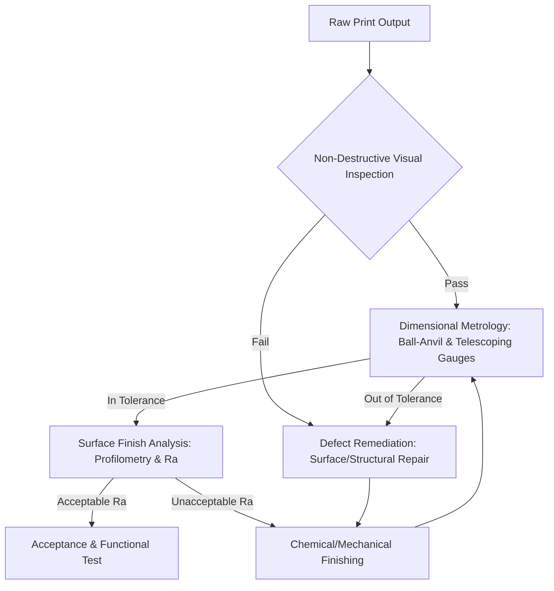

# Lesson 4: Quality Assessment and Defect Remediation

## 1. First-Principles Intuition & Invariants

To evaluate an additively manufactured part, the analyst must first discard the assumption that a 3D print is a monolithic solid. Fused Deposition Modeling (FDM) produces an anisotropic composite of thermally welded polymers, while Resin (SLA/MSLA) yields a cross-linked photopolymer network heavily dependent on the degree of post-cure conversion. The foundational invariant of quality assessment in 3D printing is recognizing that the manufacturing process dictates a specific microstructural topology. In FDM, the interlayer boundaries (the Z-axis) are inherently weaker than the continuous extrusion paths of the XY plane due to incomplete polymer chain entanglement across the thermal gradient. In SLA, unreacted monomer trapped within the matrix during the green state creates internal lubrication and dimensional instability until activated by secondary UV exposure. Therefore, post-processing and quality assessment are not merely cosmetic operations; they are the mechanical and chemical finalization of a semi-finished raw material. 

Understanding defect remediation requires building physical intuition around thermodynamics and polymer rheology. When an FDM part warps, the root cause is the asynchronous cooling and volumetric contraction of the polymer. The upper layers cool and shrink while the lower layers have already solidified and anchored to the build plate, generating immense internal tensile stress that eventually overcomes the bed adhesion or interlayer tensile strength. When a print exhibits extreme brittleness, particularly in SLA components, the root cause is typically photopolymer over-cure or incomplete monomer washout, which drives the glass transition temperature ($T_g$) too high, eliminating the material's ability to yield under load. Quality assessment methodologies must therefore target both the geometric macroscale—checking for dimensional conformity against the CAD source—and the microscale, probing the structural integrity of the weld lines, the surface roughness ($R_a$), and the density of the matrix. Acceptance criteria cannot rely on a single metric; a part may exhibit flawless surface finish but fail under torsional load due to poor infill adhesion or inadequate wall line count.

## 2. Core Architecture & Mechanics

The architecture of a robust post-processing inspection pipeline operates sequentially, moving from non-destructive macroscopic evaluation to targeted dimensional metrology, and finally to surface and structural analysis. Visual inspection initiates the loop. Here, the technician utilizes angled, high-intensity directional lighting to cast micro-shadows across the layer topology. This reveals anomalies invisible under flat ambient lighting: the microscopic striations of Z-axis banding, the pitting of under-extrusion, or the glossy, smooth bulges characteristic of localized overheating. For functional prints, dye-penetrant testing offers a rapid, non-destructive method to detect sub-surface micro-fractures. A low-viscosity fluorescent dye is applied to the surface, allowed to seep into any interlayer delamination via capillary action, and then wiped clean. Under UV inspection, any residual dye bleeding from the matrix indicates a structural void or fracture plane.

Dimensional inspection transitions the process from subjective observation to objective metrology. Standard digital calipers are insufficient for precision validation because their flat jaws can bridge the peaks of layer lines, yielding inaccurate average measurements. For FDM components, a ball-anvil micrometer is required. The spherical anvil contacts only a single peak of the tessellated surface, allowing the technician to measure the true minimum wall thickness without the averaging effect of a flat anvil. For internal bores and overhangs, telescoping gauges and split-ball gauges capture the internal diameter, which can then be measured externally with a micrometer. Go/No-Go gauges are essential for threaded interfaces and press-fit bearing seats; a 3D printed hole that fits a caliper perfectly is likely undersized for a standard bearing due to the accumulation of layer artifacts and polymer shrinkage.

Remediation mechanics address the inherent artifacts of the additive process. When dimensional non-conformance is detected, such as a bore diameter printing 0.15 mm undersized due to filament shrinkage, thermal reaming is often superior to mechanical drilling. A heated brass rod or dedicated thermal reamer, matched to the desired bore diameter, is inserted while rotating. The localized heat melts the polymer precisely to the interface without inducing the tearing or delamination often caused by a cutting tool biting into the interlayer boundaries. For surface defects like voids or delaminated corners, capillary-action cyanoacrylate (CA) applied with an accelerator creates a structural bridge. The low-viscosity CA flows into the micro-voids of the FDM matrix, polymerizing rapidly into an acrylic-ABS composite that restores structural continuity. For SLA components, gap filling is achieved using UV-curable resin applied directly to the defect and exposed to a 405 nm UV penlight, though this introduces a secondary exotherm that requires careful heat management to avoid localized warping.

Tolerancing principles in 3D printing must account for anisotropic shrinkage. A part designed with a 20.00 mm nominal dimension in PLA will typically shrink by 0.3%, rendering a final dimension of 19.94 mm. If the part requires a sliding fit with a mating component, the CAD model must compensate by expanding the dimension by an empirical shrinkage factor plus the desired clearance, typically 0.20 mm for a snug sliding fit, resulting in a printed dimension of 20.24 mm. Press fits require a different approach; the clearance is set to 0.00 mm in CAD, but the interference is generated by designing the internal bore slightly undersized (e.g., 19.85 mm) to force polymer compression upon insertion, relying on the material's elastic modulus to maintain friction.

## 3. High-Performance Optimization & Failure Modes

Optimizing the post-processing workflow requires categorizing part surfaces according to functional priority, mirroring the Class A/B/C surface methodologies used in automotive injection molding. A Class A surface is a cosmetic, visible exterior where surface finish is the primary acceptance criterion. A Class C surface is a hidden internal structural member where dimensional accuracy and infill density matter, but surface roughness is irrelevant. By defining these classes before printing, the technician prevents wasted labor sanding internal pockets that will never be seen, focusing effort strictly on the critical interfaces. For Class A FDM surfaces, mechanical finishing begins with wet sanding using silicone carbide paper, progressing from 400-grit to 2000-grit, utilizing a water block to prevent the heat of friction from melting the polymer. High-performance finishing utilizes vapor smoothing, particularly for ABS and ASA. Submerging the part in a sealed chamber with acetone vapor at room temperature (cold smoothing) prevents the aggressive surface degradation of boiling vapor, gradually dissolving the outer 0.1 mm of the print into a glossy, homogeneous glass-like surface while preserving structural geometry.

Failure modes in post-processing are predominantly driven by thermodynamic mismanagement. When utilizing a thermal reamer to open a bore, excessive rotational speed or prolonged contact generates frictional heat that exceeds the polymer's glass transition temperature, causing the surrounding material to swell and actually close the bore further, resulting in a seized tool and a destroyed part. Similarly, during UV post-curing of SLA prints, technicians frequently over-cure parts in an attempt to maximize hardness. This drives the cross-link density to a point where the internal polymer chains are locked in a rigid, highly stressed state. The failure mode here is catastrophic shattering under impact rather than yielding, as the material's elongation at break approaches zero. The remedy is a calibrated post-cure schedule, utilizing a turntable inside a 405 nm UV chamber with precise thermal control, limiting exposure to the specific energy dose required to achieve the target tensile strength without pushing the material into embrittlement.

A critical failure mode in SLA post-processing is the incomplete removal of uncured resin during the wash phase. If isopropyl alcohol (IPA) saturation exceeds 20% resin content, the solvent loses its polarity and begins to deposit a thin, uncured resin film across the entire part surface during the final rinse. When this part enters the UV cure chamber, the surface film cross-links into a brittle, opaque crust that crazes and peels away, ruining the Class A surface. The acceptance criteria for SLA washing dictate that the wash bath must be actively monitored with a hydrometer or refractometer to track resin contamination, and the final rinse must occur in a separate, clean IPA bath. By adhering to strict process windows and utilizing precision metrology to validate dimensional and structural integrity, the technician elevates the 3D printed part from a weak, anisotropic prototype into a mechanically robust, dimensionally precise functional component.
