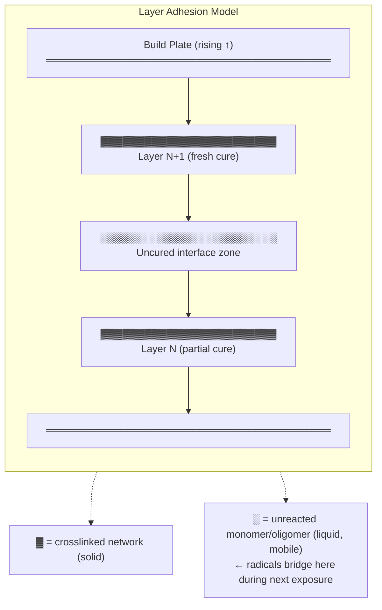
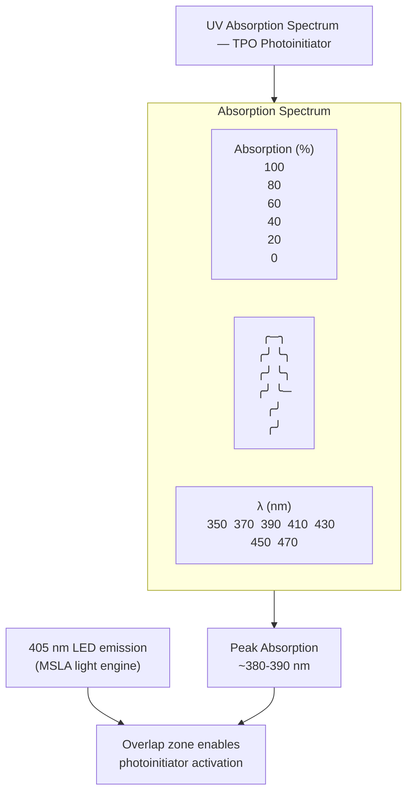

# Lesson 1: Photopolymer Chemistry, Curing Mechanics, Layer Adhesion

## 1. First-Principles Intuition & Invariants

Every resin print is a controlled chemical reaction happening inside a vat, one layer at a time. Unlike filament-based deposition, where material is already polymerized and merely re-melted into a new shape, MSLA and SLA printing build objects by synthesizing the polymer network from liquid monomers and oligomers in real time. That distinction matters because it means the mechanical properties of a finished resin part are not fixed by the manufacturer's data sheet. They are determined by how completely you drive the reaction, how much energy you deliver to each layer, how you manage the interface between layers, and how you post-cure the result. Two prints from the same bottle of resin can differ by a factor of two in tensile strength depending on exposure, layer thickness, and post-cure protocol.

A photopolymer resin is a formulation of four primary components: monomers, oligomers, photoinitiators, and additives. Monomers are low-molecular-weight molecules with one or more reactive double bonds — typically acrylate or methacrylate groups — that act as the chain-building blocks. They are the smallest and most mobile species in the resin, and their low viscosity is what makes the resin flow back over the build plate between layers. Common monomers include isobornyl acrylate (IBOA), 2-phenoxyethyl acrylate, and trimethylolpropane triacrylate (TMPTA). Oligomers are larger, pre-polymerized chains capped with reactive end groups. They provide the backbone of mechanical performance: urethane acrylates give toughness and flex, epoxy acrylates give rigidity and heat resistance, and silicone acrylates provide flexibility. The ratio of monomer to oligomer in a formulation controls the viscosity of the resin and the crosslink density of the cured part. A resin heavy in monomers will be thin and fast-curing but brittle; one heavy in oligomers will be viscous, tougher, and slower to penetrate UV light fully.

The photoinitiator is the trigger. When a photoinitiator molecule absorbs a photon of the correct wavelength, it cleaves into free radicals — highly reactive species with unpaired electrons that attack the double bonds in monomers and oligomers, initiating a chain reaction called free-radical polymerization. The most common photoinitiators in consumer resins are cleavage-type initiators like TPO (diphenyl(2,4,6-trimethylbenzoyl)phosphine oxide) and BAPO (bis(2,4,6-trimethylbenzoyl)-phenylphosphine oxide), and abstraction-type initiators like the camphorquinone/amine systems used in dental resins. The distinction is critical for print tuning: TPO absorbs strongly at 365–380 nm and has excellent through-cure depth, making it the dominant initiator in modern MSLA resins designed for 405 nm LED light engines. BAPO offers a broader absorption profile and is often blended with TPO to balance surface cure with depth cure.

The fourth component — additives — encompasses pigments, dyes, UV absorbers, oxygen scavengers, flexibilizers, and adhesion promoters. Pigments and dyes do more than color the part; they compete with the photoinitiator for photons. A heavily pigmented resin requires longer exposure times because the pigment absorbs or scatters light before it reaches the photoinitiator. UV absorbers are deliberately added to limit cure depth, preventing light from over-curing the layer below and causing dimensional overshoot. This is why transparent resins tend to have higher penetration depths and require shorter exposures, while opaque pigmented resins need significantly more exposure time per layer.

The invariant that governs all of this is the Beer-Lambert law, which describes how light intensity diminishes as it passes through an absorbing medium:

$$E(z) = E_0 \cdot e^{-\alpha \cdot z}$$

where $E(z)$ is the light energy reaching depth $z$, $E_0$ is the surface exposure energy, and $\alpha$ is the absorption coefficient of the resin (a function of photoinitiator concentration, pigment loading, and wavelength). The cure depth — the thickness of resin that reaches the gel point — follows directly from this relationship. For a given resin, there is a critical exposure $E_c$ below which polymerization does not occur at all, and a penetration depth $D_p$ beyond which light energy drops below the threshold for meaningful curing. The working curve, expressed as:

$$C_d = D_p \cdot \ln\left(\frac{E_0}{E_c}\right)$$

tells you exactly how deep your resin will cure for a given exposure energy. This equation is the single most important relationship in resin printing because it links the software parameter you control — exposure time — to the physical outcome you care about — cured layer thickness. When you increase exposure by 20%, you do not get 20% more depth; you get a logarithmic increase. This is why overexposure produces bloated dimensions and underexposure produces delamination, and why the relationship is not linear and cannot be corrected by simply scaling exposure proportionally.

## 2. Core Architecture & Mechanics

### Polymerization Kinetics and the Gel Point

When the photoinitiator generates free radicals, three sequential phases of the polymerization reaction unfold. The first is inhibition, where the free radicals are consumed by oxygen dissolved in the resin rather than by monomer double bonds. Oxygen is a diradical in its ground state, meaning it reacts with growing polymer chains and free radical intermediates to form stable peroxy species that terminate the chain reaction. This is oxygen inhibition, and it is the reason the surface of an uncured resin print in contact with air remains tacky even after full exposure. In a vat of resin exposed to atmosphere, the top 10–50 microns may remain partially uncured due to oxygen dissolved in the surface layer.

The second phase is propagation, where radicals attack monomer and oligomer double bonds, extending chains and forming crosslinks. The reaction is exothermic — it releases heat — and as crosslinks form, the viscosity of the resin rises sharply. At a certain conversion percentage, the system reaches the gel point: the percolation threshold where an infinite polymer network first spans the entire volume. Below the gel point, the resin is a viscous liquid; above it, the resin is a crosslinked solid that can no longer flow. For typical diacrylate and triacrylate systems, the gel point occurs at 20–40% double-bond conversion, meaning that the moment a layer appears solid on the build plate, less than half of its reactive bonds have actually reacted.

The third phase is post-gelation, where crosslinking continues at a slower rate as mobility becomes restricted. The growing polymer network physically traps unreacted monomers and oligomers, limiting their diffusion to reactive sites. This is why post-curing is not optional — a freshly printed resin part may have only 40–60% conversion at the surface and less in the bulk. Thermal or UV post-curing drives the remaining reactions to completion, pushing conversion to 80–95% and dramatically increasing mechanical properties.

The crosslink density — the number of crosslinks per unit volume — determines the final mechanical behavior. High crosslink density produces a rigid, heat-resistant, chemically resistant part with low elongation at break. Low crosslink density produces a flexible, tough part with higher elongation but lower modulus and lower glass transition temperature. Triacrylate monomers contribute three reactive sites per molecule and increase crosslink density; monoacrylates contribute one and act as chain extenders or reactive diluents that decrease it.

### The Layer Adhesion Mechanism

Layer adhesion in resin printing is fundamentally different from FDM. In FDM, you are bonding a hot polymer melt to a partially cooled substrate, and adhesion depends on thermal interdiffusion across the interface. In resin printing, adhesion is chemical: the new layer and the previous layer are copolymerized into a single continuous network because the previous layer still contains unreacted double bonds at its surface.

The mechanism works as follows. When the build plate lifts and allows fresh resin to flow over the previously cured layer, that previous layer's surface is partially uncured due to oxygen inhibition and incomplete conversion during the initial exposure. When the next exposure fires, UV light penetrates through the new resin layer and into the top few microns of the previous layer. Free radicals generated in the new layer and at the interface propagate into the unreacted surface of the previous layer, forming crosslinks that bridge the two layers. The result is not a mechanical bond or an adhesive joint — it is a covalent continuation of the same polymer network. A well-printed resin part has no discernible interlayer boundary under a microscope; the interface is chemically seamless.

The implication is that exposure time must be sufficient to cure the new layer fully AND to drive radicals into the previous layer's surface, but not so long that it over-cures the previous layer and causes dimensional swelling. The optimal exposure creates a cure depth slightly greater than the layer thickness — typically 1.2× to 1.5× the layer height. For a 50-micron layer, you want a cure depth of 60–75 microns. This overlap ensures the interface is fully bonded without bloating the part.

If exposure is too low, the new layer does not fully cure and the interface zone has insufficient radical penetration into the previous layer. The result is delamination — layers peel apart under stress because the covalent bridge was never fully formed. If exposure is too high, light penetrates deep into the previous layer, over-curing it and causing it to expand. This produces elephant footing at the base of each layer and dimensional overshoot. The working curve makes this tuning non-obvious: a 50% increase in exposure does not produce a 50% increase in cure depth, but it does produce a significant increase in unwanted depth cure.

### Wavelength Matching and Light Engine Characteristics

Most MSLA printers use 405 nm LED arrays. This is not arbitrary — it reflects the absorption peak of TPO-based photoinitiators, which absorb strongly between 365 and 410 nm. A 405 nm LED produces photons at 3.06 eV, sufficient to cleave the acylphosphine oxide bond in TPO (bond dissociation energy approximately 2.8 eV). The emission spectrum of the LED must overlap with the absorption spectrum of the photoinitiator for efficient radical generation.

A resin formulated for 405 nm will underperform on a 385 nm printer and vice versa, because the photoinitiator package is tuned for a specific wavelength window. Some industrial printers (notably the Asiga series) use 385 nm LEDs, which offer higher photon energy and can cure some resins faster, but require resins specifically formulated with photoinitiators that absorb efficiently at that wavelength. Using a 405 nm resin on a 385 nm printer typically results in slow curing or partial curing; using a 385 nm resin on a 405 nm printer can result in over-curing because the photoinitiator may absorb broadly enough that the higher intensity causes excessive radical generation.

## 3. High-Performance Optimization & Failure Modes

### Determining the Working Curve for Your Resin

Every bottle of resin has a working curve, but manufacturers rarely publish $E_c$ and $D_p$ values. You must determine them empirically. The standard method is the exposure ladder: print a series of flat rectangles at increasing exposure times, measure their cured thickness with a micrometer, and plot the natural log of exposure versus cure depth. The slope of the resulting line is $D_p$ and the x-intercept (where cure depth equals zero) gives $\ln(E_c)$.

Print a single-layer flat test coupon at exposures of 1.0s, 1.5s, 2.0s, 3.0s, 4.0s, 6.0s, 8.0s, and 12.0s. Use the resin at room temperature (23°C) with your printer's actual light engine. After printing, wash briefly in IPA (no more than 30 seconds to prevent swelling), blot dry, and measure thickness with a calibrated micrometer at three points. Plot $C_d$ versus $\ln(E_0)$. The relationship should be linear; deviations from linearity at high exposures indicate that the resin is absorbing nonlinearly, which happens when pigment loading causes scattering at greater depths.

From this data, you can calculate the optimal exposure for any layer thickness. For a 50-micron layer with a target cure depth of 70 microns (1.4× overlap):

$$E_0 = E_c \cdot e^{C_d / D_p}$$

Typical values for a standard grey acrylate resin on a 405 nm MSLA printer are $E_c \approx 8$–$12\text{ mJ/cm}^2$ and $D_p \approx 0.10$–$0.15\text{ mm}$. For a 405 nm printer delivering approximately 20 mW/cm² at the build plate, a 50-micron layer typically requires 1.5–2.5 seconds of exposure. Transparent resins with higher $D_p$ values may need as little as 0.8–1.2 seconds; heavily pigmented resins may need 4–8 seconds.

### Managing Oxygen Inhibition

Oxygen inhibition is both your enemy and your friend. It is your enemy when it prevents layer adhesion: if the interface between the build plate and the first layer has too much dissolved oxygen, the first layer will not adhere to the plate, causing the print to detach. It is your friend because it prevents resin in the vat from polymerizing when it should not — oxygen in the vat's atmosphere inhibits surface curing, keeping the top of the resin pool liquid.

For first-layer adhesion, the standard approach is to increase bottom-layer exposure to 5–10× the normal layer exposure. This overdrives the reaction past the inhibition zone, ensuring that enough radicals survive oxygen scavenging to initiate polymerization at the build plate surface. Bottom-layer count — the number of layers that receive this boosted exposure — should be set so that the bottom exposure extends through the entire burn-in region, typically 4–8 layers depending on layer height.

If first-layer adhesion fails consistently despite high bottom exposure, the likely cause is a worn or contaminated build plate. Sand the build plate surface with 400-grit wet-dry sandpaper in a crosshatch pattern to refresh the surface texture, clean with IPA, and re-level. The plate surface should be uniformly rough to provide mechanical keying in addition to chemical bonding.

For the resin vat, oxygen inhibition at the film surface is desirable. If your printer uses a PFA film (as most modern MSLA printers do), the film is oxygen-permeable, which helps maintain an oxygen-rich layer at the release surface and reduces peel force. If you notice resin polymerizing on the film surface between prints, the film may be degraded or the vat may have been left in light. Replace PFA films after 40–60 print hours, or when visible clouding or fogging appears.

### Failure Mode: Delamination

Delamination presents as layers separating visibly at the interface, often visible as a white line at the layer boundary. The cause is always insufficient radical penetration across the interface. The diagnostic tree is straightforward. First, check exposure time: if it is below the working-curve minimum for your layer height, increase it in 0.2-second increments until adhesion improves. Second, check resin temperature: cold resin (below 18°C) has higher viscosity, which slows monomer diffusion and reduces radical mobility at the interface. Warm the resin to 25–30°C before printing. Many resins, especially tough and flexible formulations, become dramatically more reliable when printed warm.

Third, check lift speed. If the build plate lifts too quickly between layers, the fresh resin may not fully fill the gap before the next exposure, leaving voids at the interface. Reduce lift speed to 60–80 mm/min for viscous resins, and ensure the rest time after lowering the plate is at least 1–2 seconds to allow resin to settle. For large cross-sections, increase the rest time to 3–4 seconds.

### Failure Mode: Over-Cure Blooming

When exposure is too high, each layer cures beyond its intended boundary, expanding laterally and vertically. The result is dimensional overshoot: holes shrink, pins grow, and flat surfaces develop elephant foot at the base. The fix is to reduce exposure, but the working curve means you cannot simply halve it — you must measure the actual cure depth and adjust based on the logarithmic relationship.

A practical test: print a calibration cube (20 mm) at your current exposure and measure it with calipers. If the cube is 20.3 mm, you are over-curing. Reduce exposure by 10–15% and reprint. Continue until the cube measures 20.00 ± 0.05 mm. This dimensional calibration is your resin's working exposure for that layer height; record it, because it will drift as the resin ages.

### Failure Mode: Warping and Curl

Warping in resin prints is caused by differential shrinkage. Photopolymerization shrinkage occurs because the van der Waals distance between monomer molecules (approximately 3.4 Å) is replaced by a shorter covalent bond (approximately 1.5 Å), reducing the volume of the material by 5–8%. When one layer shrinks while bonded to a layer that has already shrunk, internal stress develops. If the stress exceeds the adhesion strength of the interface or the rigidity of the support structure, the part curls.

To mitigate warping, hollow large parts and add drain holes to reduce the cross-sectional area of each layer. Large flat surfaces are the worst offenders; tilt them 15–20 degrees to distribute shrinkage stress across multiple layers rather than concentrating it at one interface. Increase support density at the base of large flat areas, and use a raft with a 0.5–1.0 mm gap to decouple the part from the build plate's thermal mass. Heavy supports on the raft base anchor the part firmly; lighter supports at the top prevent the part from lifting during peel.

### Post-Cure Protocol

Post-curing is where the part reaches its final mechanical properties. A freshly printed and washed part has 40–65% double-bond conversion. Post-cure drives this to 80–95%. The two mechanisms are thermal and photochemical. UV post-cure chambers use 405 nm LEDs at 20–40 mW/cm² for 2–10 minutes per side, depending on part geometry. Thermal post-cure ovens heat the part to 60–80°C for 15–60 minutes, increasing molecular mobility and allowing trapped radicals to find unreacted double bonds.

The most effective protocol combines both: a UV post-cure with a heated chamber. For standard acrylate resins, 5 minutes per side at 60°C under 405 nm UV at 30 mW/cm² is a reliable baseline. For tough or engineering resins, consult the manufacturer's post-cure specification — some require specific temperature plateaus (e.g., 80°C for 30 minutes for Siraya Tech Build, or 70°C for 60 minutes for Phrozen TR250) to develop full mechanical properties. Under-cured parts are soft, tacky, and have poor chemical resistance; over-cured parts become brittle and yellowed. The correct endpoint is a hard, dry surface with no residual tack, verified by pressing a fingernail into a non-critical surface — the resin should not indent.

Wash parts in two stages: a first wash in dirty IPA (90%+ concentration) to remove bulk resin, and a second wash in clean IPA to remove residual monomer. Allow parts to dry completely before post-curing — residual IPA on the surface during UV exposure causes blushing (a white, cloudy surface defect from solvent-induced micro-foaming). Air-dry for 15–30 minutes or use a gentle fan. Never post-cure a wet part.
