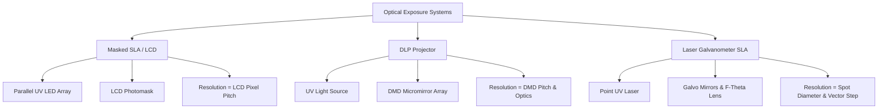

# Lesson 2: Optical Systems, Exposure Control, Resolution Limits

## 1. First-Principles Intuition & Invariants

At its core, resin additive manufacturing is the spatial and temporal control of a photopolymerization reaction. We are not mechanically extruding material or sintering powder; we are directing photon flux into a photosensitive monomer bath to force a localized phase change from liquid to solid. Every architectural decision in a resin printer, from the light source to the optical masking system, exists to manage the energy delivered to the resin. To master these machines, the practitioner must understand the invariants of photopolymerization: penetration depth and cure dose, governed fundamentally by the Beer-Lambert law.

When light strikes the surface of a photosensitive resin, the intensity decays exponentially as it travels deeper. The depth at which the light intensity drops to $1/e$ (roughly 36.8%) of its surface value is the critical penetration depth, denoted as $D_p$. The energy required to cross the gelation threshold, the point where the polymer transitions from a viscous liquid to a solid cross-linked network, is the critical exposure dose, or $E_c$. The relationship between these variables defines the cured layer thickness ($C_d$) through the equation $C_d = D_p \ln(E_{max} / E_c)$, where $E_{max}$ is the peak exposure energy delivered by the optical system. 

This theoretical foundation dictates every physical outcome on the build plate. If we apply a massive dose of energy to achieve strong interlayer adhesion, the exponential tail of the light penetration extends further into the resin, over-curing the geometry laterally and vertically. This lateral light scatter is the primary source of the "blooming" effect, where sharp edges swell and fine details vanish into a featureless mass of cured polymer. Conversely, if we starve the resin of photons to achieve microscopic surface detail, we risk delamination, as the cure depth fails to penetrate deeply enough into the previous layer to establish a continuous chemical bond.

The challenge is therefore an optical and mechanical balancing act. The resolution of a resin print is never determined by a single variable. It is the intersection of the optical system's pixel pitch, the resin's photoreactive chemistry, the Z-axis mechanical precision, and the software's ability to modulate photon delivery. Understanding these invariants allows the fabricator to move beyond default slicer settings and treat exposure time, layer height, and mask geometry as a tightly coupled control system.

## 2. Core Architecture & Mechanics

The optical architectures dominating modern resin printing fall into three distinct categories, each manipulating light through different physical mechanisms. The practitioner's approach to slicing, support generation, and tolerance compensation changes entirely depending on which architecture sits under the vat.

**Masked Stereolithography (MSLA / LCD)** uses a UV light-emitting diode array positioned beneath a liquid crystal display panel. The LCD acts as a dynamic photomask, selectively blocking or transmitting light from the uniform LED backlight. The resolution of this system is strictly defined by the pixel pitch of the LCD panel. A 4K monochrome LCD with a 6.06-inch diagonal yields an XY resolution of approximately 35 microns. Because the entire layer is cured simultaneously, MSLA offers significant speed advantages for large, dense builds. However, the LCD panel itself absorbs a portion of the UV energy, requiring higher LED intensities and generating heat that degrades the panel over time.

**Digital Light Processing (DLP)** replaces the LCD with a Digital Micromirror Device (DMD) chip. A dedicated UV light source illuminates the DMD, and millions of microscopic mirrors physically tilt to either direct light through the projection optics or dump it into a heat sink. DLP systems offer superior optical efficiency compared to MSLA, as the mirrors reflect nearly all the UV light when in the "on" state. The pixel resolution is determined by the DMD chip density and the projection optics, allowing DLP printers to achieve extreme XY resolutions (often below 30 microns) with crisp, high-contrast light edges. The tradeoff is build volume; projecting a high-resolution image over a large area requires exceptionally expensive optics, restricting DLP systems to small, high-precision dental and jewelry applications.

**Laser Galvanometer (SLA)** steers a single, highly focused UV laser beam across the resin surface using a pair of rapidly oscillating mirrors. Unlike the parallel exposure of MSLA and DLP, SLA draws the layer vector by vector. The XY resolution is defined not by a pixel grid, but by the laser spot diameter and the galvanometer stepping accuracy. Because the laser can be focused to an exceptionally small spot size, SLA achieves the smoothest surface finishes and sharpest internal corners. However, the vector-based drawing speed scales inversely with cross-sectional area, making SLA significantly slower for dense, bulk geometries.

Regardless of the optical architecture, vertical precision relies entirely on the Z-axis mechanical stack. A stepper motor drives a lead screw, lifting the build plate away from the vat floor. The theoretical layer height is set in the slicer, but the physical reality is dictated by the mechanics. Backlash in the lead screw nut, Z-axis rod deflection under heavy peel forces, and micro-stepping accuracy all introduce variance. High-end machines mitigate this using anti-backlash nuts, linear rails with heavy preloads, and ball screws instead of trapezoidal lead screws to minimize mechanical slop.

## 3. High-Performance Optimization & Failure Modes

Operating these optical systems at their theoretical limits requires precise calibration of exposure times and strategic application of antialiasing. The transition from a functional print to a high-precision, dimensionally accurate part relies on taming the edge cases of light bleed and mechanical peel forces.

### Exposure Time Calibration

Default resin profiles are intentionally conservative to ensure print success across varied hardware. To achieve dimensional accuracy, the practitioner must dial in the exposure time for their specific resin, printer, and environmental temperature. The most reliable method is printing a calibration matrix, such as the Cones of Calibration or the XP Finder. 

These tests rely on a physical geometric threshold. A cone is printed unsupported, standing on a narrow base and tapering upward. If the exposure time is too high, light blooming causes the cone to over-cure, fusing it to a specific diameter that exceeds the designed geometry. If the exposure is too low, the cone fails to form and collapses. The practitioner tunes the exposure time until the printed cone matches the exact CAD-specified diameter.

1. Clean and level the build plate, ensuring the FEP film is taut and free of clouding.
2. Shake the resin vigorously for two minutes to ensure pigment and photoinitiators are fully homogenized.
3. Slice the calibration model at your target layer height (e.g., 0.05mm) with the default exposure time.
4. Print the model, wash it in isopropyl alcohol for six minutes, and allow it to air dry completely before measuring.
5. If the measured dimensions are larger than designed, reduce the normal exposure time by 0.2 seconds and reprint. 
6. If the dimensions are undersized or the supports fail, increase the exposure time by 0.3 seconds.

### Antialiasing Strategies

Because MSLA and DLP systems cure resin in a binary pixel grid, any geometry not perfectly aligned to the X/Y axes will exhibit stair-stepping on its outer walls. Antialiasing mitigates this by modulating the intensity of individual pixels during the exposure cycle. 

In a standard exposure, a pixel is either fully on (blocking no light, in the case of an LCD) or fully off. Antialiasing introduces grayscale values. By slightly powering on the edge pixels at 25%, 50%, or 75% intensity, the total photon flux delivered to the resin at the boundary is reduced. The exponential decay of the light fails to reach the gelation threshold, leaving a micro-layer of uncured resin that is washed away during post-processing, resulting in a smoother physical surface.

Slicer antialiasing typically operates across two axes. XY antialiasing smooths the outer perimeter of the layer. Z-axis antialiasing, often called "blur," slightly varies the exposure of edge pixels across adjacent layers, smoothing the vertical stair-step effect on angled faces. The practitioner must balance this carefully. Excessive antialiasing reduces edge mechanical strength and can cause dimensional inaccuracy, as the under-cured boundary pixels are physically washed away.

| Parameter | Function | Tuning Impact |
| :--- | :--- | :--- |
| **X/Y Resolution** | Pixel pitch of the masking system | Unchangeable hardware limit. Set minimum feature size. |
| **Layer Height** | Z-axis step per exposure | Dictates vertical resolution and print time. Range: 0.01mm - 0.1mm. |
| **Normal Exposure** | Time UV light is active per layer | Too high causes blooming; too low causes delamination. |
| **Off Time** | Delay after Z-axis lift | Allows resin to reflow under the build plate. Critical for low-viscosity resins. |
| **AA Blur** | Z-axis antialiasing intensity | Smooths vertical steps. High values cause loss of fine vertical details. |
| **AA XY** | Edge pixel grayscale modulation | Smooths curved surfaces. High values reduce perimeter strength. |

### Light Uniformity and Failure Mitigation

Even with perfectly tuned exposure times, optical failure modes persist. Light uniformity across the vat floor is a critical variable. In MSLA systems, the LED array can develop hotspots or dead zones over time. A hot spot delivers higher photon flux, causing localized blooming, thickened supports, and premature failure of the FEP film due to excessive curing. Practitioners must periodically run a screen test, displaying a fully white image and inspecting the naked LCD for brightness gradients. If a hot spot is detected, the printer’s firmware uniformity compensation settings must be adjusted, or the LED array must be replaced.

Finally, the blooming effect must be managed mechanically as well as optically. When the build plate lifts to separate the cured layer from the FEP film, it generates immense peel forces. If the exposure time is slightly too high, the cured layer bonds too aggressively to the FEP. The subsequent violent separation can warp the printed part, pulling microscopic cured material away from the intended geometry and depositing it as stray cured fragments in the vat. Optimizing the lift distance, lift speed, and employing a light-off delay—allowing the build plate to rest for a second before the next exposure—gives the resin time to flow back into the gap, preventing vacuum formation and mitigating the mechanical side of blooming.
