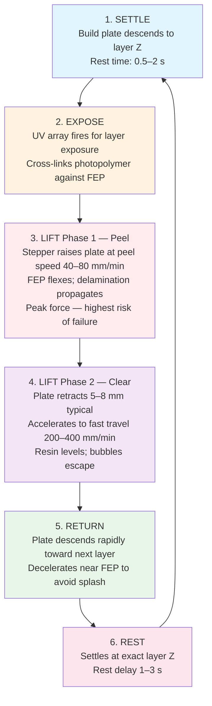
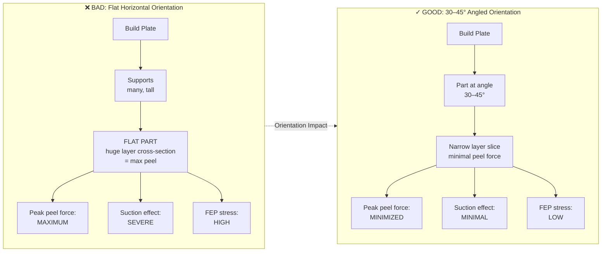

# Lesson 3: Build Plate Mechanics, Support Strategies, Failure Modes

## 1. First-Principles Intuition & Invariants

Resin printing is, at its mechanical core, an exercise in controlled separation. Every layer you produce requires the cured photopolymer to be pulled away from the FEP film at the bottom of the vat, re-adhered to the growing part suspended above it, and then repositioned with micron-level precision before the next exposure. That sequence sounds deceptively straightforward, but the forces operating across a single 50-micron layer boundary are large enough to tear supports from rafts, shear fine features off a part, or peel the entire print from the build plate entirely. Understanding why these forces exist, and how to route them through your design rather than against it, is the difference between a practitioner who gets reliable results and one who blames the resin.

The fundamental tension in MSLA and SLA printing is the opposition between two adhesion relationships: the bond between the cured layer and the FEP release film must be weaker than the bond between the cured layer and the previous layer of the print. If that hierarchy inverts even briefly — because the FEP has stiffened with age, because the exposure time is too long, because the cross-sectional area of a single layer is very large — the print fails. This is not a software problem or a parameter-tuning problem in isolation; it is a physics problem rooted in surface energy, viscoelastic behavior, and pressure differentials, and fixing it requires you to reason from those first principles before you touch a slicer.

### Peel Force and the Physics of Separation

When the UV array exposes a layer, photopolymer monomers cross-link into a solid polymer network bonded to the FEP surface below them. The FEP — fluorinated ethylene propylene — is chosen specifically because its surface energy is very low (approximately 18–20 mN/m), which limits adhesion. But "limits" does not mean "eliminates." The cured polymer still contacts the FEP across the full exposed area, and when the build plate lifts to begin the peel cycle, it must break that contact. The force required to do so is the peel force, and it scales directly with exposed cross-sectional area. A layer covering 1 cm² might require 10–30 N of separation force on a typical FEP film; a dense, broad cross-section covering 20 cm² can demand upward of 200 N, which is enough to rip a support tree from a raft or introduce microcracking in brittle resins.

The peel mechanism also creates a vacuum effect that compounds the adhesion problem. As the build plate lifts, the cured layer and FEP momentarily form a sealed cavity across the exposed footprint. Atmospheric pressure — 101 kPa bearing down on roughly 1 cm² — adds approximately 10 N of holding force to that cavity before the seal breaks. For small cross-sections this suction contribution is negligible; for large flat surfaces printed parallel to the build plate, it becomes the dominant failure force. This is why large flat objects — bases, shields, broad mechanical flanges — must never be oriented horizontally. A 10 cm × 10 cm face oriented parallel to the FEP generates both maximum adhesion contact area and maximum suction, and no resin or FEP chemistry will make that combination reliable.

The practical invariant that follows from this analysis is one of the most important in all of resin printing: **minimize the cross-sectional area of any single layer exposed to the FEP**. Everything else in orientation planning, support placement, and raft design flows from this rule.

### FEP Film Tension and Its Role in Print Reliability

FEP film is not a rigid surface. It is a thin membrane — typically 100–200 μm — mounted under controlled tension across the vat frame, and that tensioning profoundly affects how the peel event propagates. A properly tensioned FEP film peels from the cured layer in a progressive wave rather than releasing all at once. When you imagine tearing a Post-it note off a glass surface versus pulling a suction cup off the same glass, you are imagining the difference between peeled separation and direct tensile separation. The FEP, because it is flexible, enables a peeled separation: the film begins to separate from the cured resin at one edge of the footprint and the delamination front propagates across the area. This propagation effect dramatically reduces the peak force required because you are only separating along a narrow front at any given instant, not across the full area simultaneously.

A FEP film that is too slack loses this mechanical advantage. The film sags toward the LCD without adequate tension, allowing liquid resin to creep under it, trapping air bubbles that distort exposure, and changing the geometry of the peeling event unpredictably. A film that is over-tightened becomes semi-rigid, losing its ability to flex and peel progressively; it then acts more like a rigid release layer, maximizing peak peel force and dramatically increasing the chance of print failure on large cross-sections. Manufacturers specify corner-bolt torque values for FEP replacement, typically in the range of 0.4–0.6 N·m using a torque screwdriver in a star pattern, specifically to achieve this elastic middle ground. After 20–30 hours of print time the film UV-hazes and micro-scratches accumulate, raising its surface energy and reducing UV transmission; replacement at that interval is not optional maintenance but a mechanical prerequisite for consistent results.

nFEP and gFEP films offer lower surface energy alternatives that reduce peel force by 30–50% over standard FEP. ACF (anti-crystal film) variants reduce suction further by introducing microscopic surface texture that breaks the hydraulic seal before full separation occurs. These materials are worth using on machines printing large cross-sectional geometries, but they do not eliminate the need for correct orientation and support design — they simply widen the margin.

### The Adhesion Hierarchy at the Build Plate

The first several layers of any resin print occupy a unique mechanical position. They must adhere strongly enough to the build plate to survive every subsequent peel cycle — potentially hundreds of them, each delivering a shock load through the support structure into the raft and into the plate interface. At the same time, they must cure correctly without over-exposure artifacts that distort dimensional accuracy in the lower sections of the print.

Bottom layers (typically the first 4–8 layers) are exposed for 2–8× the normal layer exposure time to guarantee deep penetration into the anodized aluminum or coated steel surface of the build plate. This over-exposure burns resin into micro-pits and scratches on the plate surface, maximizing mechanical interlocking. The tradeoff is that heavy over-exposure swells these bottom layers outward — a phenomenon called "elephant foot" — producing a flared base that can render dimensionally critical lower features unusable. A transition zone of 2–4 layers at an intermediate exposure time (sometimes called "transition layers" in Chitubox, Lychee, and UVtools) ramps down from bottom exposure to normal exposure and reduces elephant foot substantially. Setting 6 bottom layers at 40 s and 4 transition layers stepping down at 32 s, 24 s, 16 s, 8 s to reach a nominal 3 s layer exposure is a typical professional workflow.

The build plate surface itself matters as much as the exposure parameters. A freshly sandblasted or 400-grit sanded plate provides dramatically better adhesion than a smooth machined surface, because the mechanical interlocking area is larger. Wiping the plate with 99% isopropyl alcohol immediately before a print, then air-drying it completely, removes release agents, skin oils, and cured resin debris that act as a parting layer between the new print and the metal.

---

## 2. Core Architecture & Mechanics

### The Layer Cycle: Signal Path from Exposure to Repositioning

To optimize peel mechanics, you must understand the complete sequence of events that the printer executes per layer. Each cycle is not merely "expose and lift" — it is a phased mechanical sequence where timing decisions at every step affect forces, cure quality, and dimensional accuracy.

The peel speed in Step 3 is one of the most consequential parameters you can tune. A slow peel (40–60 mm/min) gives the FEP film time to flex progressively, keeping peak force low. A fast peel (120+ mm/min) attempts to snap the FEP film faster than the cured resin can follow, which works for extremely small cross-sections but fails catastrophically on large ones. ELEGOO, Phrozen, and Anycubic all support variable lift speed sequences — sometimes called "TSMC" lift in community firmware — where the first 1–3 mm of lift executes at slow peel speed and the remaining retract distance executes at fast travel speed. This achieves the minimum peak force while keeping overall cycle time reasonable.

The rest delay at the bottom of the stroke is equally important and frequently undertweighted by practitioners optimizing for speed. When the build plate returns to layer position, the resin beneath it has been displaced by the plate's descent. It needs time to flow back to a uniform thickness across the layer area. Insufficient rest time results in starvation voids — areas where the resin film is thinner than one layer height — which appear as weak inter-layer bonds and horizontal delamination lines visible after washing. A rest delay of 1 s is acceptable for small, open cross-sections; large flat prints benefit from 3–5 s to allow complete resin recovery.

### Support Architecture: Geometry, Contact Points, and Load Path

A support structure in resin printing serves three distinct mechanical functions simultaneously, and failing to design for all three is the root cause of most support-related failures.

The first function is gravitational load bearing during the print. As layers accumulate above a support attachment point, the growing mass of the print must transfer its weight through the support tree and raft into the build plate. This load path must be continuous and structurally adequate, with support stems thick enough to resist column buckling under their own slenderness ratio. A support with a 0.6 mm diameter stem and a 10 mm unsupported height is operating near its buckling limit for even moderately dense resins; a 0.8 mm stem for the same height provides roughly 2.3× the buckling resistance (Euler buckling load scales with the fourth power of radius). Most slicers default to tip diameter settings of 0.3–0.4 mm and stem diameters of 0.6–1.0 mm, which is adequate for general use but should be increased for heavy prints or prints with large unsupported spans.

The second function is resisting peel forces transmitted through the part. Every peel cycle applies a sharp tensile load through the print's attachment to the build plate. This load travels down through every layer, through every support contact point, and into the FEP interface. A support contact tip that is too large in diameter bonds too strongly to the part surface, requiring significant force to remove and leaving deep witness marks. A contact tip that is too small detaches from the part during peel cycles rather than maintaining stable attachment. The optimal contact tip diameter depends on resin brittleness and layer exposure time; standard ABS-like resins work well with 0.3–0.4 mm tips, flexible resins require 0.5–0.6 mm tips for secure bonding, and brittle ceramic-filled resins need 0.25 mm or smaller tips to allow clean removal without chipping the part surface.

The third function is preventing in-plane lateral drift. During the peel cycle, as the film springs back after separation, there is a lateral impulse component along the FEP surface. Fine features, tall thin features, and insufficiently braced support trees can rack sideways under this impulse, producing layer-shift artifacts that appear as a horizontal step or shear line in the print. Cross-bracing supports — connecting adjacent stems laterally with horizontal bars — reduces this racking. Lychee Slicer's "dense support with cross bracing" mode and Chitubox Pro's "reinforced" support tree type both implement this, though they do not always place cross-bracing optimally; manual placement at mid-height of tall stems is often worth the additional setup time.

Support density is not a single parameter but an interaction between three factors: overhang angle, local cross-sectional mass, and distance from the nearest existing support. The classic rule — support all overhangs beyond 45° from vertical — is a reasonable starting heuristic but becomes inadequate for resin printing's specific failure modes. Because each layer is exposed independently and must cure before the next, an overhang that is merely sagging rather than fully unsupported can still cure with a drooping geometry if the cured layer deforms before the exposure of the next layer locks it in position. For detailed surfaces and mechanical fits, 35° from vertical is a safer overhang threshold, particularly in the direction parallel to the longest axis of the print (which typically sees the greatest peel force component).

### Raft Design: Distributing the Foundation Load

The raft is the first structural element to cure against the build plate, and it must accomplish two opposing tasks: it must adhere strongly enough to survive hundreds of peel cycles, and it must release from the build plate cleanly when the print is finished without damaging the part above it.

A solid raft accomplishes the adhesion requirement effectively but fails at release — the large contact area makes it very difficult to separate from the plate without flexing the raft, which transmits stress into the support-raft junction. A perforated raft with a grid or honeycomb pattern reduces contact area by 40–60%, making it substantially easier to release, while maintaining adequate adhesion through the remaining solid regions. The minimum raft thickness for mechanical stability is typically 1.0–1.5 mm; below this, the raft flexes under peel load and the support roots can lift out of it.

The raft-to-support junction geometry also matters. A sharp 90° junction between support stem and raft creates a stress concentration; the raft flares or tapers into the stem base distribute load over a larger area. Lychee Slicer implements a conical base flare option that widens the bottom 0.3–0.5 mm of each support stem into a broader footprint — this is mechanically superior to a flat-bottom junction and significantly reduces root failure.

Raft size should extend at least 2–4 mm beyond the outer footprint of the support tree's lowest points. This margin prevents the edge of the raft from peeling up under tensile load; without it, the raft edge lifts like a sticker corner, progressively reducing effective adhesion until the print fails mid-job.

### Orientation Strategy: Cross-Section, Angle, and Feature Priority

Optimal orientation for a given part emerges from weighing four competing considerations: minimizing peak layer cross-section (to reduce peel force), minimizing total support contact marks on critical surfaces, aligning layer lines perpendicular to the primary stress direction of the finished part (since inter-layer bonds are weaker than intra-layer bonds), and distributing unsupported spans to avoid long horizontal bridges.

For most figurative and mechanical parts, a 30–45° angle off the build plate along the part's longest axis satisfies all four criteria reasonably well. At this angle, the layer slice through any flat surface becomes an elongated diagonal strip rather than the full face, reducing cross-section dramatically. The supports concentrate on the underside of the part, away from visually or mechanically important surfaces.

Hollow forms — miniature figures, decorative shells, large enclosures — require drain holes in addition to correct orientation. A sealed hollow print traps liquid resin inside during printing; that resin continues to absorb UV energy during exposure, creating internal pressure from thermal expansion and outgassing. This pressure can crack or delaminate the outer shell. Two drain holes of 2–4 mm diameter, placed at the lowest and highest points of the hollow relative to the print orientation, allow liquid resin to escape during printing and wash solvent to reach the interior during post-processing.

---

## 3. High-Performance Optimization & Failure Modes

### Delamination: Causes, Diagnosis, and Cure

Delamination — the separation of one or more layers from the print — is the most common and most misdiagnosed failure mode in resin printing. Practitioners frequently attribute it to "wrong exposure settings" and iterate exposure time blindly, when the root cause is mechanical rather than photochemical.

Mechanical delamination occurs when the peel force on a given layer exceeds the inter-layer bond strength of the cured resin stack. The bond strength between successive layers depends on the degree of cure achieved in the lower layer before the upper layer is exposed; a layer that is under-exposed remains partially uncross-linked at its top surface, reducing the chemical interpenetration zone where the new layer bonds. But mechanical delamination due to excessive peel force can shear even a fully cured bond if the cross-sectional area is large and the lift speed is too aggressive. The diagnostic distinction matters: if delamination occurs consistently at a certain height in the print — typically where the cross-section suddenly increases as a wider feature begins to build — the cause is mechanical, not photochemical.

Photochemical delamination, by contrast, produces horizontal separation lines distributed through the print in a pattern correlated with under-cured layers, not with geometry changes. This happens when UV output has degraded (aging lamp, dirty FEP reducing transmission), when pigmented or filled resins absorb too much UV before it penetrates the full layer depth, or when the exposure calibration was done with a different FEP film than is currently installed. Measuring UV irradiance at the build plate surface with an inexpensive 405 nm UV meter — typically 1.5–3.5 mW/cm² for MSLA machines — before major print jobs detects lamp degradation before it compromises prints.

The third form of delamination is thermal. Resin has a glass transition temperature, and freshly cured layers are still near the low end of their mechanical property range. A print environment below 20°C significantly increases resin viscosity, reducing FEP release kinetics and raising peel force simultaneously while also reducing the cured resin's toughness. Printing below 15°C produces brittle, poorly bonded layers even with correct exposure settings. An enclosure with a space heater or heat mat maintaining 25–28°C resolves cold-room failures that resist all other diagnosis.

### Adhesion Optimization: The Complete Build Plate Protocol

Building reliable adhesion is a systematic procedure, not a matter of simply increasing bottom exposure time until the print "sticks." Excessive bottom layer exposure causes its own failure mode: the over-cured bottom layers bond so strongly to the build plate that separating the finished print damages either the raft or the plate surface itself. The correct approach optimizes both initial adhesion and subsequent release.

Begin with plate preparation. Sand the build plate surface with 400-grit wet/dry sandpaper in a cross-hatch pattern, creating a uniform micro-texture across the full plate area. This takes approximately 90 seconds and lasts for 20–30 print cycles before the texture becomes polished by repeated raft adhesion and removal. Wipe the sanded plate with 99% IPA on a lint-free cloth, wiping in one direction only to avoid re-depositing contamination. Allow to air-dry for 60 seconds — forced drying with breath adds moisture from expired air, which is counterproductive.

Traming the build plate — ensuring it is precisely parallel to the FEP surface — eliminates adhesion variation across the build area. A plate that is 0.1 mm lower on the left side than the right applies 0.1 mm more compression on the left, potentially over-squishing early layers on that side while under-squishing on the right. The paper-method tramming (sliding a sheet of 80 g/m² printer paper under the plate at zero position and adjusting until resistance is uniform at all corners) is adequate for most machines. For high-precision work on machines with adjustable build plates, a 0.001" dial test indicator sweeping from corner to corner at the plate surface provides quantitative confirmation.

Bottom layer count and exposure time interact with raft geometry. A solid raft needs only 4–6 bottom layers because the large contact area provides sufficient total adhesion force even at modest per-unit adhesion. A lightweight perforated raft may need 6–8 bottom layers because the reduced contact area requires higher per-unit adhesion to achieve the same total force. The transition layer count (2–4 layers) is consistent across both raft types.

### Support Failure Modes and Their Signatures

Support failures manifest in predictably distinct ways, and reading the failed print tells you which parameter to address.

When support tips detach from the part mid-print, leaving the support tree hanging from the raft while the part sags or falls, the contact point diameter is too small relative to the peel force on that layer. Increase tip diameter from 0.3 mm to 0.4–0.5 mm, or increase the tip exposure time ratio in slicers that support it (Lychee Slicer's "support contact" cure compensation parameter). Alternatively, add more support points to distribute the peel force across a larger number of contacts.

When support roots pull out of the raft, leaving clean sockets in the raft surface, the raft is under-thick or the bottom layer count is insufficient. The root flares mentioned earlier help, but if the raft is under 1.0 mm thick, it flexes under peel load and root extraction follows. Increase raft thickness to 1.2–1.5 mm and add root flares of 0.5–0.8 mm radius.

When the raft itself delaminates from the build plate cleanly across its full area — the raft releases as a unit with the print attached — the build plate preparation has failed or the bottom exposure time is insufficient. This is unambiguously a plate adhesion problem; re-sand the plate, clean with IPA, and increase bottom exposure by 10–20% increments.

When the print shows a lateral step or shear line at a consistent height, the support tree is racking under peel impulse. Add cross-bracing at mid-height of the support stems, or reduce the peel speed for the first 2 mm of lift. This is distinct from the similarly-appearing Z-banding artifact, which produces step lines at every layer rather than at a single height.

### High-Throughput and High-Precision Workflow Integration

For practitioners running production volumes — dental labs, casting studios, rapid-iteration engineering teams — the layer cycle parameters must balance reliability against print time efficiency. The overhead per layer accumulates across hundreds of layers; a print requiring 400 layers at 2 s rest per layer accumulates 13 minutes of pure rest time. Reducing rest to 1 s saves 6.5 minutes but introduces starvation risk on dense prints.

The practical resolution is geometry-adaptive timing, which Chitubox Pro and UVtools support through per-layer parameter overrides. Export your slicer file, run it through UVtools' print analysis, identify the layers with the five largest cross-sectional areas, and assign elevated rest delays and reduced lift speeds specifically to those layers. All other layers run at aggressive parameters. This concentrates caution where geometry demands it and recovers print time everywhere else.

After-print UV curing is the final step in the mechanical property development of the resin. Fresh-off-the-plate resin is typically at 70–80% of maximum cure depth; a post-cure cycle of 2–5 minutes in a UV curing station at 405 nm and 60°C completes cross-linking and raises tensile strength, hardness, and thermal resistance substantially. Under-cured prints are dimensionally inaccurate and mechanically brittle; over-cured prints become excessively rigid and prone to surface chalking. The manufacturer's recommended cure time is a starting point; the correct endpoint is a surface that no longer feels tacky under IPA washing, with no soft flex on features that should be rigid.

Mastery of resin printing is ultimately mastery of force management: routing peel forces through geometry and support architecture rather than fighting them, maintaining the adhesion hierarchy that keeps the print on the plate rather than on the FEP, and reading the failure evidence that every unsuccessful print provides with enough mechanical literacy to respond correctly rather than iterating blindly. Every parameter — orientation angle, support density, lift speed, rest delay, raft thickness, bottom exposure count — is a force management decision. Treat it as such, and the machine's behavior becomes predictable.
