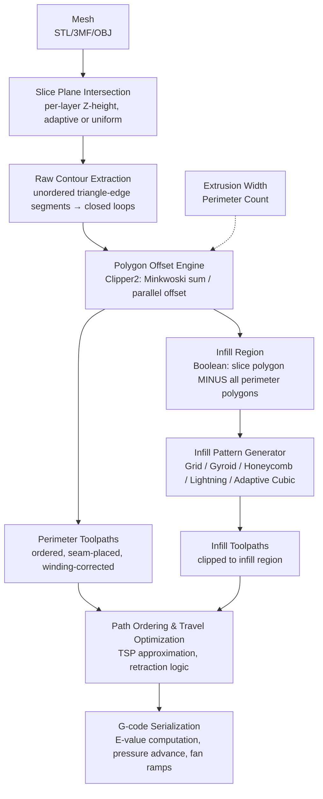

# Lesson 2: Contour Generation, Infill Strategies, Perimeter Logic

## 1. First-Principles Intuition & Invariants

Every object you send to a 3D printer begins its mechanical life as a closed polygon soup — a mesh of triangles that describes surface geometry but says nothing about how material should be deposited. The slicer's job is to transform that geometry into a sequence of machine-executable toolpaths, and the foundation of that transformation is contour generation: the process of intersecting the mesh with a horizontal plane, extracting the resulting loop or loops of line segments, and then offsetting those loops inward to build a shell of material that faithfully replicates the designed surface. What looks like a simple geometry operation from the outside is, in practice, a cascade of numerically sensitive polygon computations that determine whether your part has crisp external faces or a fuzzy, over-extruded wall, whether a thin rib survives as a solid feature or vanishes because the inward offsets collide and cancel, and whether the internal skeleton — the infill — actually transfers load to the perimeter walls in the direction the stress demands.

The core invariant that governs all of this is deceptively simple: material must be deposited along paths that are always at least one nozzle-radius away from the designed surface, and those paths must be closed, ordered, and free of self-intersections. Violate the first condition and your surface either overhangs into air or crowds against itself, producing blobs and seam artifacts. Violate the second and the firmware encounters an open polyline in the middle of a move, drops the extrusion state, and you get a gap. Violate the third and you get the classic "inner perimeter crosses outer perimeter" defect where the nozzle tries to extrude material inside already-deposited walls, creating a pressure surge that blows out the adjacent line. All slicer perimeter logic, from the simplest single-shell vase-mode path to a twelve-perimeter structural print, is an engineering effort to satisfy these three invariants simultaneously, at every layer, across arbitrarily complex geometry.

Understanding why this is hard requires thinking about what polygon offsetting actually does to real geometry. When you offset a convex polygon inward by distance *d*, every vertex traces a bisector path and the edges move parallel to themselves. For a convex shape this is well-behaved: the result is a smaller, similarly shaped polygon. But real part cross-sections are almost never purely convex. They contain concavities, narrow channels, internal voids, re-entrant corners, and features whose width is close to or smaller than the nozzle diameter. At a re-entrant (inward-pointing) corner, the offset polygon must generate a new vertex where two receding edges would otherwise intersect outside the material boundary, and this vertex can land far from the original corner depending on the included angle. At very sharp inward corners the offset polygon can self-intersect, producing a "bowtie" loop that represents a region of negative area — a geometrically impossible extrusion path. The slicer must detect these self-intersections and prune them, a process called offset clipping or winding-number culling, before the path is safe to execute. Clipper2, the dominant polygon clipping library used in PrusaSlicer, SuperSlicer, Bambu Studio, and Orca Slicer, implements this using the Sutherland-Hodgman and Vatti algorithms extended to handle degeneracies, but even Clipper2 will produce artefact loops on geometry with near-zero-width features if floating-point tolerances are not tuned carefully.

The nozzle diameter sets the atomic unit of this entire system. A 0.4 mm nozzle depositing at a standard 0.45 mm extrusion width (the customary 1.125× diameter multiplier, chosen to slightly over-squish the bead for inter-layer adhesion) means every perimeter offset step moves inward by 0.45 mm. The first perimeter sits 0.225 mm (half the extrusion width) inward from the nominal surface, so that the outer edge of the bead aligns with the designed boundary. The second perimeter sits a further 0.45 mm inward, and so on. This arithmetic seems straightforward until you encounter a wall that is, say, 1.2 mm wide. Two full 0.45 mm perimeters consume 0.9 mm, leaving a 0.3 mm gap that is narrower than one extrusion width. The slicer must decide: insert a narrow third perimeter and risk over-extrusion, skip the gap and leave a void, or fill it with an infill path that uses a narrower extrusion width for that region only. PrusaSlicer's "thin wall" detection handles exactly this case by identifying regions where the offset produces a collapsed polygon and substituting a centerline path computed via medial axis transform, though this introduces its own numerical fragility on curved narrow features.

The relationship between perimeter count, wall thickness, and structural performance is not linear. For parts loaded in bending — a bracket arm, a mounting tab, a snap-fit clip — the outer fibers carry the highest stress (tension on one face, compression on the other), and those outer fibers are your perimeter shells. A part printed with four perimeters and 15% infill will almost always outlast a part printed with two perimeters and 40% infill in bending, because the extra infill adds mass to the low-stress neutral plane while the extra perimeters deposit material exactly where the stress is highest. This is an elementary consequence of the second moment of area: stiffness scales with the cube of the distance from the neutral axis, so perimeter material is geometrically leveraged. The practical invariant is that for structural parts you should solve for perimeter count first, treat infill density as a mass and print-time dial, and reserve high-density infill for isotropic compressive applications like press-fit receptacles and load-spreading pads.

---

## 2. Core Architecture & Mechanics

The slicer pipeline processes each layer in a strict sequence, and understanding the data transformations at each stage lets you intervene precisely when something goes wrong. The pipeline begins with the slice plane intersection, moves through contour generation and offsetting, then branches into the perimeter ordering engine and the infill region computation, and finally converges on a G-code serializer that sequences all paths with appropriate travel moves and extrusion values.

### Polygon Offset Mathematics in Practice

The mathematical foundation of contour offsetting is the Minkowski sum: offsetting a polygon *P* by a disk of radius *r* produces the Minkowski sum of *P* and the disk, which is geometrically equivalent to translating every edge outward by *r* and replacing every convex vertex with a circular arc of radius *r*. In slicer implementations, that arc is approximated by a chord polygon with a configurable resolution (typically 2–4° per segment), which is why very fine curved surfaces at high perimeter counts exhibit a slight faceting that is not present in the original mesh. The resolution of this arc approximation lives in Clipper2's `miterLimit` and `arcTolerance` parameters; PrusaSlicer exposes this indirectly through "resolution" settings, but you can directly observe its effect by examining SVG layer exports at high zoom.

For inward offsets specifically, the numerically critical operation is the handling of vertices where the bisector direction becomes nearly parallel to an edge — a configuration that arises at angles close to 180°, meaning nearly collinear vertices. Here the offset vertex can be displaced by a large multiple of *r* along the bisector, creating a spike that punctures the material polygon. Clipper2 addresses this with miter limit clamping: if the offset vertex displacement would exceed `miterLimit × r`, the spike is clipped to a bevel join instead. The default miter limit of 3.0 in most slicers means spikes up to 3× the offset distance are preserved; for extreme concavities you may need to lower this, which you can test by deliberately printing a sharp inward star geometry and examining whether the inner perimeters show spike artifacts in the layer preview.

### Shell Thickness Computation and Perimeter Ordering

Once the offset engine produces *n* nested polygon rings, the perimeter engine must decide the order in which to print them. The two fundamental strategies are outside-in and inside-out. Outside-in means the outer wall is printed first, then each successive inner perimeter is deposited against already-solidified material. This produces the best dimensional accuracy on the outer surface because the first path is deposited against air and can position precisely, but it means the outer wall is re-heated and potentially displaced by the inner walls printing against it. Inside-out prints the innermost perimeter first and works outward; this buries seam artifacts in the interior but means the outer wall is deposited last against a surface that has had time to cool and stabilize. PrusaSlicer defaults to inside-out for the outer perimeter as the final path, which is why its `external_perimeter_extrusion_width` parameter is separately tunable — you want slightly less width on that final pass to avoid the bead squishing outward beyond the design boundary.

The seam is the point where a closed perimeter loop starts and ends, and it always leaves a small artifact: a slight over-extrusion blob as the nozzle completes the loop and transitions to a travel move. Slicer seam placement strategies range from simple "nearest point" (minimizes travel distance, scatters seams randomly) to "aligned" (places all seams at the same X/Y coordinate, creating a straight vertical line visible on the part but easy to sand) to "rear" or "sharpest corner" (hides the seam in a re-entrant concavity where it is geometrically recessed and visually minimized). For structural parts the seam location matters mechanically as well: a seam is a micro-crack initiation site. Place seams in regions of minimum stress — away from stress concentrations at holes, fillets, and load application points.

### Infill Pattern Mathematics

The infill occupies the region that remains after all perimeter polygons are subtracted from the slice polygon. This region is then filled by one of several mathematically distinct patterns, each with different structural and material-usage properties.

**Grid infill** is the simplest: two sets of parallel lines, one at 0° and one at 90°, offset each layer by an optional rotation angle (default 45°/135° in most slicers to distribute anisotropy). The line spacing is determined by density: at 20% infill with 0.45 mm line width, the pitch is 0.45 / 0.20 = 2.25 mm between line centers. Grid infill is generated by clipping an infinite set of parallel line segments to the infill polygon using the same Clipper2 library, then connecting adjacent endpoints with short bridge segments to form continuous extrusion runs. The resulting paths are highly efficient to print — long, straight moves at maximum speed — but grid infill has strong orthotropic structural behavior: it resists compression well along the grid axes but shears easily at 45°.

**Gyroid infill** is a triply periodic minimal surface (TPMS) described by the implicit equation sin(*x*)cos(*y*) + sin(*y*)cos(*z*) + sin(*z*)cos(*x*) = 0. When a slicer intersects this surface with a horizontal plane at a given Z-height, the intersection is a sinusoidal wave that varies continuously with Z. What makes gyroid infill structurally exceptional is that the wave phase shifts with each layer, so the infill paths in adjacent layers are neither parallel nor perpendicular but continuously rotating — the structure is genuinely isotropic in the XY plane and nearly so through Z, meaning it resists shear stress from any direction. Practically, gyroid infill at 15% density provides superior specific stiffness (stiffness per unit mass) compared to grid at the same density in applications involving torsion or multi-axis loading. The computational cost of gyroid path generation is significantly higher than grid because the slicer must evaluate the implicit surface intersection numerically for each layer rather than simply clipping line segments, but on modern multi-core slicer engines (PrusaSlicer's parallel slicing, Bambu Studio's layered threading) this cost is absorbed invisibly on most parts.

**Honeycomb infill** generates hexagonal cells by computing a 2D hexagonal tiling, projecting it into the infill polygon, and then alternating the phase of the honeycomb between layers to create a 3D interlocking structure. The hexagonal geometry distributes in-plane compressive load efficiently because each cell wall is loaded primarily in compression or tension rather than bending — this is why natural honeycombs are mass-efficient structural materials, and the same principle applies to FDM. However, standard 2D honeycomb (as opposed to 3D honeycomb or cubic infill) does not interlock vertically, so for thin parts under Z-axis compression it is weaker than grid. OrcaSlicer and SuperSlicer implement "3D honeycomb" which staggers the cell walls through Z to address this, at the cost of more complex toolpath geometry.

**Density calculation** ties directly to the pitch formula: for any infill pattern, the volume fraction of deposited material is approximately (extrusion width × layer height) / (pitch × pitch) for 2D rectilinear patterns, and the slicer works backward from your specified density percentage to compute the pitch. For gyroid and other continuous surface patterns the density is computed by integrating the volume enclosed by the surface at the specified isovalue offset, which is why gyroid infill density settings are less directly translatable to a simple geometric formula — the relationship between the isovalue parameter and the volume fraction is empirical and slicer-specific. PrusaSlicer's gyroid implementation normalizes this internally and exposes only the percentage; if you need to verify the actual deposited volume at a given density, the best tool is the sliced filament-length report combined with a known part volume.

### Structural Stress Distribution Mechanics

The interaction between infill and perimeters is not merely geometric: it determines the mechanical integrity of the internal bond structure. Infill paths terminate against the innermost perimeter, and that termination point is a potential delamination site because the infill extrusion hits a cold perimeter wall and must fuse with it before the nozzle moves away. The infill overlap parameter — typically expressed as a percentage of the extrusion width, default 15–25% in PrusaSlicer — controls how far the infill path nominally intrudes into the perimeter region, pressing the extrusion bead against the inner perimeter wall to maximize bonding area. Too little overlap and you get visible separation between infill and walls on the top surface (the "pillowing" pre-cursor where the top skin has insufficient support). Too much overlap and the infill over-extrudes into the wall, pushing the wall outward and causing dimensional error on the outer surface.

For parts under flexural loading, infill geometry also acts as a shear web, transferring load between the top and bottom shells of the part. A bracket printed horizontally (flat on the bed) with its neutral axis in the XY plane will have its top and bottom faces acting as tension/compression flanges, and the infill transfers shear between them like the web of an I-beam. Gyroid infill performs this shear-web function better than rectilinear because its continuous, angle-varying geometry provides shear paths in all directions through the XY plane. For parts loaded in a known, single direction, however, you can outperform isotropic infill by using rectilinear infill rotated to 45° relative to the load axis, which puts the infill lines in pure tension/compression rather than shear — a trick used in functional RC aircraft ribs and UAV frame inserts.

---

## 3. High-Performance Optimization & Failure Modes

### Calibrating Extrusion Width for Perimeter Fidelity

The single most impactful tuning decision for perimeter quality is extrusion width, and most practitioners leave it at the slicer default without understanding what it controls. The 0.45 mm default width for a 0.4 mm nozzle produces a bead aspect ratio (width/height) of about 1.5 at 0.3 mm layer height, which is a good general-purpose balance between inter-layer adhesion and feature resolution. For structural parts where you want maximum perimeter bonding, increase width to 0.5–0.55 mm: the flatter, wider bead has more contact area with adjacent paths and the layer below, increasing tensile strength across the bond plane. For fine-featured cosmetic parts, reduce width to 0.35–0.38 mm to allow narrower channels and smaller radii to print without collapse, accepting slightly lower inter-layer adhesion in exchange for geometric fidelity.

The external perimeter width should almost always be set separately from internal perimeter width. Set external perimeter extrusion width to exactly the nozzle diameter (0.4 mm for a 0.4 mm nozzle) or even 0.38 mm: this produces the crispest, most dimensionally accurate outer surface. Set internal perimeters to 0.45–0.5 mm for structural benefit. In PrusaSlicer this is `Print Settings → Width → External perimeters` and `Perimeters`, two distinct fields that are frequently left coupled but should not be for precision work.

### Minimum Feature Width and Thin-Wall Failure

The most common perimeter failure on complex parts is the disappearance of features narrower than one extrusion width. When the slice polygon in a thin region is narrower than the extrusion width, the offset polygon collapses to nothing — zero area — and the slicer silently drops it, leaving a void in the wall. You will not see an error; the layer preview simply won't show any path in that region, and you discover the problem after printing when the wall has a hole or the feature is absent.

The diagnostic workflow is to export the sliced layer SVG (PrusaSlicer: `File → Export → Export SVG`) and inspect the problem layer in a vector editor like Inkscape. If the outer perimeter polygon exists but no inner perimeter appears, you have a thin-wall suppression. The fix is either to redesign the feature to be at least 2× your extrusion width wide (0.9 mm for a 0.45 mm width) so it accommodates one full inner perimeter plus the outer and inner walls, or to enable thin-wall detection, which uses medial axis computation to substitute a single centerline path for regions that cannot accommodate a full offset. PrusaSlicer's `Detect thin walls` checkbox enables this; note that the medial axis paths are generated at a reduced extrusion rate because the channel is narrower than nominal width, and the slicer computes the volumetric correction automatically.

### Infill Anchoring and Top-Surface Pillowing

Pillowing — the bubbled, uneven texture on top flat surfaces — is the most common infill-related failure and almost always has a compound cause. The proximate mechanism is that the top skin paths span across infill gaps rather than bridging from perimeter to perimeter, and the unsupported spans sag between infill contact points, creating a dimpled surface. The slicer's infill density and the number of top solid layers interact: at 15% infill with a 0.3 mm pitch, the spanning distance between infill lines can exceed 1.8 mm — far beyond the 0.5–0.6 mm safe bridging distance for most FDM materials at standard temperatures. The correct response is not to increase infill density (which fixes pillowing but wastes material and time) but to increase the number of top solid layers and to enable the "top solid infill" ironing feature.

Ironing runs an additional low-extrusion pass over the top surface after the standard top skin, dragging the nozzle across the surface at approximately 10–15% of normal flow rate. The nozzle remelts the top skin peaks and redistributes material into the valleys, producing a surface roughness that approaches injection-molded quality for materials like PLA and PETG. The critical ironing parameter is the spacing between ironing passes: too coarse (above 0.15 mm) and you see parallel ridges; too fine (below 0.05 mm) and over-heat causes surface bubbling. For PLA at 215°C, 0.08–0.10 mm ironing spacing at 50% of normal print speed is the reference starting point.

### Gyroid Infill Resonance and Print Speed

Gyroid infill has an underappreciated failure mode on direct-drive printers: because the toolpath direction is continuously varying — unlike the long straight runs of grid infill — the gantry must decelerate and re-accelerate frequently, and the cornering behavior at the sinusoidal inflection points generates input shaping demands that are higher than for rectilinear patterns. On printers without resonance compensation (input shaping / ADXL345-calibrated Klipper firmware or equivalent), printing gyroid at high speed produces visible ringing artifacts in the perimeters on that layer because the gantry vibration from gyroid path direction changes propagates into the perimeter print of the same layer. The mitigation is to enable "infill first, perimeters second" ordering if your slicer supports it on a per-layer basis (SuperSlicer does; standard PrusaSlicer does not without script-level modification), which allows the gantry to settle between the infill and perimeter phases of each layer. Alternatively, reduce gyroid print speed to 60–80% of the perimeter speed, which is the more practical solution for most practitioners.

### Seam Welding and Z-Hop Strategy

The seam artifact is a pressure management problem as much as a geometry problem. When the nozzle completes a closed perimeter loop, the Bowden or extruder drive is still under pressure from the extrusion, and that pressure releases slightly as the nozzle transitions to a travel move, depositing a small blob at the loop-close point. Linear advance (Marlin) and pressure advance (Klipper) firmware features compensate for this by backing off the extruder drive slightly before the loop-close point, allowing the in-nozzle pressure to dissipate before the seam forms. Calibrating pressure advance is therefore directly coupled to seam quality: an over-tuned pressure advance value backs off too early and leaves a gap before the seam; an under-tuned value does not bleed off enough pressure and the blob is too large. The diagnostic print is a simple large-diameter cylinder: print it, examine the seam line under raking light, and tune pressure advance until the seam is a hairline. The reference range for PLA on a direct-drive system is typically 0.03–0.07 mm; Bowden systems run 0.4–1.0 mm due to the larger compliance volume.

Z-hop — a small Z-axis lift before travel moves — prevents the nozzle from dragging across deposited perimeters during travel, which is particularly important for perimeters on tall, narrow parts where any drag force can shear the part off the bed. However, indiscriminate Z-hop on every travel move has two costs: it adds print time (the Z axis is typically the slowest axis on a Cartesian printer) and it retracks the filament on each lift, contributing to stringing and ooze if retraction is not perfectly tuned. The professional approach is to enable Z-hop only when traveling over printed material, not when the travel moves entirely within air above the current layer. PrusaSlicer and Orca Slicer both implement smart Z-hop that checks whether the travel path crosses any previously printed extrusion, lifting only when necessary. Enable this and set the hop height to 0.2–0.4 mm — just enough to clear the current layer, not more.

### Advanced: Variable-Width Perimeters and Arachne

PrusaSlicer 2.5 and later, along with OrcaSlicer and Bambu Studio, implement the Arachne perimeter generator — a variable-width wall filling algorithm derived from academic research at TU Delft. Where the classic offset-based perimeter engine produces fixed-width shells that leave gaps in narrow regions, Arachne computes a skeleton of the wall region using a weighted Voronoi diagram (the medial axis of the wall polygon) and then fills the wall by depositing paths whose widths vary continuously between a configurable minimum and maximum (typically 50–200% of the nozzle diameter). The result is that walls of varying thickness are filled completely without voids or over-extrusion artifacts — a 0.7 mm wall that would straddle awkwardly between one and two classic perimeters is instead filled by a single path that varies from 0.4 mm to 0.6 mm in width as the geometry demands, with the slicer computing the volumetric flow rate change in real time.

For precision parts with multiple wall thicknesses on the same layer — a mounting flange that transitions from a 1.6 mm main wall to a 0.8 mm snap-fit arm — Arachne produces dramatically better results than classic perimeter offsetting. Enable it as the default for all structural printing. The only context where classic perimeter generation outperforms Arachne is ultra-high perimeter-count cosmetic prints (8+ perimeters on a fully solid wall) where the variable-width path planning occasionally produces extrusion-width transitions at seam locations that are visible on the outer surface; in that specific case, switching to classic perimeter generation with thin-wall detection produces a more uniform outer face.

Mastery of contour generation and infill strategy is ultimately mastery of the slicer as a stress-analysis tool. The polygon offset engine is not a renderer — it is the mechanical design system that determines where every cubic millimeter of material in your part sits, and by extension, how that part will respond to load. Working at this level of understanding lets you depart entirely from the slicer's defaults and compose the internal architecture of a print the way a structural engineer composes a cross-section: perimeter count for bending stiffness, infill type for shear isotropy, density for compressive reserve, seam placement for fatigue life, and extrusion width for inter-layer bond strength. That is the precision fabricator's relationship to the slicer.
