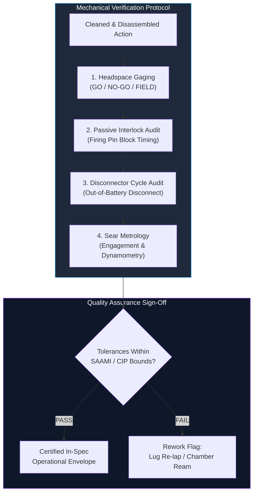
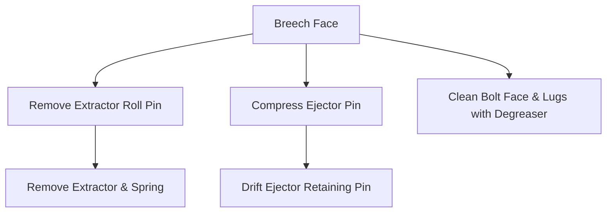

# Operational Verification Labs: Mechanical Firearms Engineering

## Objective & Lab Bench Setup

This laboratory guide provides systematic engineering procedures for auditing the mechanical tolerances, safety interlocks, and dimensional integrity of modern mechanical firearms platforms. Modern armorers and firearms manufacturing engineers verify dimensional compliance to SAAMI / C.I.P. standards using calibrated physical metrology rather than visual estimation.

The verification program validates four critical mechanical boundaries:
1. **Chamber Headspace Compliance**: Measuring breech-to-datum dimensional bounds to eliminate the risk of case head separation or out-of-battery failure.
2. **Passive Interlock Functionality**: Verifying positive firing pin block engagement and disconnector timing across the full kinematic cycle.
3. **Trigger Weight & Sear Engagement**: Auditing sear engagement overlap and pull weight consistency using calibrated digital dynamometry.
4. **Bore & Throat Erosion Profiling**: Inspecting rifling leade wear and gas port boundary degradation using optical borescopes.

### Metrology Suite & Tooling

The verification bench requires precision metrology equipment calibrated to national standards (NIST / DAkkS):

- Precision ground SAAMI chamber gauges (**GO**, **NO-GO**, and **FIELD**) for target caliber
- Digital mechanical force gauge / trigger dynamometer ($0.05\text{ N}$ resolution)
- Depth micrometers and dial indicators ($0.001\text{ mm}$ resolution) with magnetic arm bases
- Digital optical borescope ($1080\text{p}$, $0.20\text{ mm}$ focal depth)
- High-pressure dummy verification cartridges (inert weighted cycling rounds)
- Non-marring brass punches and torque-limiting drivers

---

## Exercise 1: Chamber Headspace Verification & Lug Engagement

Headspace establishes whether a chamber securely supports a cartridge during firing without excessive axial play or binding.

### Step 1.1: Stripping the Breechface

Before inserting headspace gauges, the bolt must be completely stripped of its extractor claw and spring-loaded ejector. An installed ejector pin exerts forward spring pressure against the gauge, masking the subtle tactile resistance of full lockup.

### Step 1.2: Executing the Three-Gauge Protocol

1. **GO Gauge Verification**:
   - Insert the calibrated GO gauge into the clean, dry chamber.
   - Gently guide the stripped bolt forward into battery.
   - Rotate the bolt or push the slide into lockup using finger pressure only.
   - **Acceptance Criterion**: The mechanism must close smoothly and completely into battery with zero binding.

2. **NO-GO Gauge Verification**:
   - Clean the chamber and insert the NO-GO gauge ($+0.10\text{ mm}$ over GO).
   - Gently guide the bolt forward into battery.
   - **Acceptance Criterion**: The bolt must NOT close or rotate into full battery. If the bolt rotates fully closed on a NO-GO gauge in a new or rebuilt assembly, headspace is excessive; the barrel must be set back or the bolt replaced.

3. **FIELD Gauge Verification**:
   - In field maintenance evaluations, if a mechanism closes on a NO-GO gauge, test with a FIELD gauge ($+0.18\text{--}0.25\text{ mm}$ over GO).
   - **Safety Boundary**: Any mechanism that closes on a FIELD gauge is condemned from service due to risk of case head separation.

---

## Exercise 2: Passive Safety Interlocks & Disconnector Timing Audit

Modern semi-automatic platforms must reliably disconnect the trigger bar during cycling and physically arrest the striker under drop shocks.

### Step 2.1: Firing Pin Block Positive Engagement Audit

1. Field-strip the slide or bolt carrier assembly.
2. With the firing pin block plunger in its resting position (un-depressed), apply firm forward finger pressure to the rear of the firing pin.
3. Observe the breech face under magnification:
   - **Acceptance Criterion**: The firing pin tip must NOT protrude past the breech face hole. The internal plunger must positively arrest firing pin travel.
4. Fully depress the plunger into the slide body and press the firing pin forward:
   - **Acceptance Criterion**: The firing pin must travel smoothly forward, with the spherical tip protruding $1.25\text{--}1.50\text{ mm}$ beyond the breech face.
5. Release the plunger and release the firing pin:
   - Verify that the firing pin spring retracts the firing pin, and the plunger resets immediately under spring tension.

### Step 2.2: Disconnector Kinematic Decoupling Verification

1. Reassemble the firearm and ensure the chamber and magazine well are completely clear.
2. Cock the action into full battery.
3. Pull the trigger and maintain continuous rearward finger pressure on the trigger shoe (simulating follow-through).
4. Retract the slide/bolt rearward by $3\text{ mm}$ (bringing the action slightly out of battery):
   - **Acceptance Criterion**: The trigger bar must be cammed downward out of engagement with the sear.
5. Cycle the slide fully rearward to eject an inert dummy round and allow the action to return to battery while maintaining trigger pull:
   - **Acceptance Criterion**: The hammer or striker must remain cocked and arrested by the sear. It must NOT fall forward.
6. Slowly release the trigger forward until an audible and tactile click occurs:
   - **Acceptance Criterion**: The trigger bar resets forward and re-indexes under the disconnector step, ready for the subsequent pull.

---

## Exercise 3: Trigger Pull Metrology & Optical Bore Inspection

### Step 3.1: Trigger Dynamometry Protocol

1. Secure the receiver in a padded bench vise with the bore horizontal.
2. Position the roller hook of a calibrated digital force gauge at the geometric center of the trigger shoe curve.
3. Pull rearward parallel to the bore axis at a uniform rate ($10\text{ mm/s}$) until the sear releases.
4. Record five consecutive release force measurements and calculate mean and standard deviation:
   $$\bar{F} = \frac{1}{5} \sum_{i=1}^{5} F_i, \quad \sigma = \sqrt{\frac{1}{4} \sum_{i=1}^{5} (F_i - \bar{F})^2}$$
5. **Acceptance Thresholds**:
   - Duty / Service actions: $20.0\text{ N} \le \bar{F} \le 30.0\text{ N}$, with $\sigma \le 1.5\text{ N}$.
   - Match / Precision actions: $10.0\text{ N} \le \bar{F} \le 15.0\text{ N}$, with $\sigma \le 0.8\text{ N}$.

### Step 3.2: Borescope Leade & Gas Port Inspection

1. Insert the $90^\circ$ optical probe into the chamber throat.
2. Slowly advance the probe past the cartridge neck into the rifling leade (forcing cone).
3. Inspect the land origins for:
   - **Heat Checking**: Micro-crazing of the steel surface from hot gas exposure.
   - **Throat Erosion**: Forward advancement of the rifling origin beyond $1.0\text{ mm}$ of factory specification.
   - **Gas Port Wire-Drawing**: Check the edge of the gas port hole for gas-cutting erosion or burrs.

---

## Summary & Verification Matrix

| Quality Audit Domain | Metrology Instrument | Inspection Command / Action | Acceptance Threshold |
|:---|:---|:---|:---|
| **Headspace** | SAAMI GO Gauge | Insert stripped bolt on GO gauge | Must fully close with zero binding |
| **Headspace Ceiling** | SAAMI NO-GO Gauge | Insert stripped bolt on NO-GO gauge | Must NOT close into battery |
| **Drop Safety** | Optical breech check | Press firing pin with plunger released | Zero pin protrusion beyond breech face |
| **Disconnector** | Controlled cycle test | Retract slide $3\text{ mm}$ with trigger held | Sear must remain cocked upon reset |
| **Trigger Consistency**| Digital dynamometer | 5-pull rearward force pull | $\sigma \le 1.5\text{ N}$ across sample series |
| **Bore Degradation** | Digital borescope | Visual scan of rifling leade | Zero structural throat crazing $> 1\text{ mm}$ |
