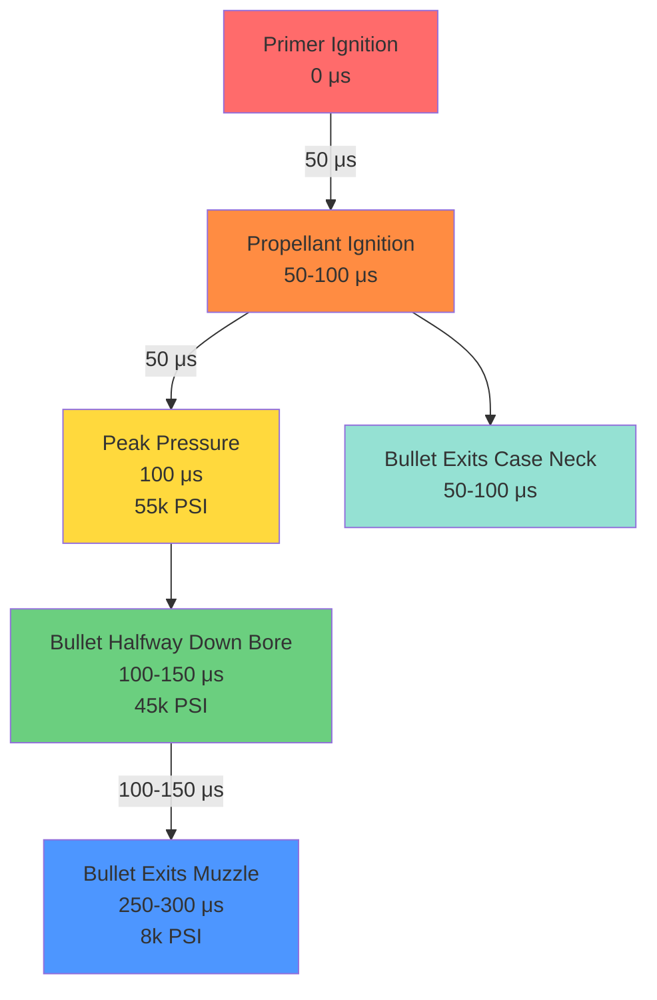

# Lesson 2: Internal Ballistics, External Ballistics, Terminal Ballistics

## 1. First-Principles Intuition & Invariants

The firing of a cartridge transforms chemical potential energy into kinetic energy through three distinct phases, each governed by different physical laws and constrained by measurable engineering boundaries. Internal ballistics concerns itself with the conversion of propellant into gas pressure and the acceleration of the projectile down the bore. External ballistics describes the flight of the projectile from muzzle to target, dominated by gravitational acceleration and aerodynamic drag. Terminal ballistics examines energy transfer upon impact, encompassing penetration mechanics, material deformation, and wound channel formation. These three domains are coupled through conserved quantities—momentum, energy, and angular momentum—but each operates in a distinct physical regime with its own failure modes and optimization strategies.

Internal ballistics begins the instant the primer compound detonates. The primer flash ignites the propellant granules, which burn progressively from their surface inward, producing high-temperature combustion gases that expand rapidly within the confined volume of the cartridge case and chamber. This is not an explosion in the detonation sense; propellants are classified as deflagrating materials, meaning they burn subsonic to the flame front, producing a controlled pressure rise rather than a shock wave. The pressure curve as a function of time and bore position is the central artifact of internal ballistics analysis. Peak chamber pressure typically occurs when the bullet has traveled only a few millimeters into the bore, often within the first microseconds after ignition, and then decays as the expanding gas volume increases and the bullet accelerates toward the muzzle.

The shape of the pressure curve is determined by propellant burn rate, grain geometry, loading density, and the pressure-dependent burning behavior of the propellant itself. Single-base propellants composed primarily of nitrocellulose burn at rates sensitive to pressure; as pressure rises, burn rate accelerates in a nonlinear feedback loop. Double-base propellants add nitroglycerin to flatten this pressure sensitivity, while modern deterrent-coated extruded powders achieve progressive burn profiles by controlling surface-to-volume ratios through geometry. A spherical propellant grain burns progressively more slowly as it shrinks, because surface area decreases with the cube of radius. A cylindrical grain with a central perforation burns progressively faster, because the inner perforation expands as the outer diameter shrinks, increasing total surface area. Propellant chemists exploit this geometry to tailor pressure curves: fast pistol powders produce sharp pressure spikes suited to short barrels, while slow rifle powders sustain pressure over longer barrel lengths to maximize muzzle velocity without exceeding the yield strength of the chamber and barrel steel.

Chamber pressure is measured in pounds per square inch (PSI) or copper units of pressure (CUP), an older piezoelectric standard. Modern SAAMI maximum average pressure specifications range from 21,000 PSI for subsonic pistol cartridges like the .45 ACP to 65,000 PSI for high-intensity rifle cartridges such as the .300 Winchester Magnum. The chamber and barrel must contain these pressures with a safety margin, typically requiring alloy steels with tensile strengths exceeding 120,000 PSI. The hoop stress in the chamber wall is given by the thin-walled pressure vessel approximation, $\sigma = \frac{P \cdot r}{t}$, where $P$ is internal pressure, $r$ is the internal radius, and $t$ is wall thickness. This equation governs chamber dimensions and explains why magnum revolver cylinders are conspicuously thick-walled and why overbore cartridges like the .264 Winchester Magnum earned reputations for short barrel life—the combination of high pressure and large bore diameter concentrates stress and accelerates erosion.

Projectile acceleration down the bore is governed by Newton's second law, $F = ma$, where the force is the product of chamber pressure and the bullet's base area. As the bullet moves, the volume behind it expands, reducing pressure, but the propellant continues burning, adding new gas mass and thermal energy. The interplay between these competing effects produces a pressure curve that peaks early and decays exponentially. The work done by the expanding gas equals the integral of pressure over the swept volume, $W = \int P \, dV$, and this work is converted almost entirely into the bullet's kinetic energy, $\frac{1}{2} m v^2$, with small losses to barrel friction, heat conduction into the steel, and the kinetic energy of the propellant gas itself, which exits the muzzle at high velocity as muzzle blast.

The ratio of propellant energy converted into bullet velocity versus wasted as muzzle blast and heat is determined by barrel length. A longer barrel allows the gas to do work over a greater distance, extracting more energy before the bullet exits. However, pressure decays with distance, and beyond a certain length, the bullet encounters more frictional resistance than it gains from residual gas pressure. The optimal barrel length depends on the propellant burn rate: fast powders are exhausted in short barrels, making them ideal for pistols and carbines, while slow magnum rifle powders require 24 to 26 inches to achieve complete combustion and maximum efficiency. Cutting a rifle barrel shorter than the propellant's design length not only reduces velocity but increases muzzle flash and blast, as unburned powder ignites in open air.

Friction between the bullet and the rifling is a persistent loss mechanism. The bullet must engrave into the lands, shearing a thin layer of jacket material and generating heat. Copper fouling accumulates in the bore over hundreds of rounds, altering friction coefficients and shifting point of impact. The engraving force depends on jacket hardness, rifling depth, and the number of lands. Traditional six-groove rifling with deep lands creates more friction than modern polygonal rifling, which uses shallow, rounded grooves to minimize engraving resistance and improve velocity by 20 to 50 feet per second for the same pressure. The downside is that polygonal bores generate less spin stability margin and are intolerant of cast lead bullets, which can strip rather than engage cleanly.

The invariant of internal ballistics is that chamber pressure, barrel time, and muzzle velocity are tightly coupled through the propellant's burn rate and the bullet's mass. A heavier bullet creates more resistance, raising peak pressure and extending barrel time. A faster powder raises peak pressure but exhausts sooner, producing lower muzzle velocity in long barrels. Handloaders exploit these relationships to tune loads for specific applications: maximum velocity for long-range shooting, reduced recoil for training, or subsonic velocities for suppressed fire. The danger lies in exceeding pressure limits. An overcharged case or a bullet seated too deeply into the powder column can produce a detonation-like pressure excursion that ruptures the case head, bulges the chamber, or destroys the firearm. Pressure signs include flattened primers, ejector marks on the case head, sticky extraction, and in extreme cases, cratered primers or separated case heads. Experienced handloaders approach maximum loads incrementally, measuring velocity with a chronograph and inspecting fired cases for deformation.

## 2. Core Architecture & Mechanics

Internal ballistics operates as a coupled thermodynamic and kinetic system. The propellant burn rate is modeled by Vieille's law, $r = \beta P^n$, where $r$ is the linear burn rate, $\beta$ is the burn rate coefficient, $P$ is pressure, and $n$ is the pressure exponent, typically between 0.7 and 0.9 for modern propellants. This power-law relationship captures the autocatalytic nature of propellant combustion: as pressure rises, burn rate accelerates, generating more gas and further raising pressure. The system is stabilized by the expanding volume behind the accelerating bullet, which provides a pressure relief mechanism and prevents runaway detonation.

The pressure-volume-time relationship is computed through numerical integration of the gas generation rate and the bullet's equation of motion. The instantaneous pressure is determined by the ideal gas law, $P V = n R T$, modified for real gas behavior at high densities through virial corrections. The mass of gas generated per unit time is proportional to the burning surface area and the burn rate. For a spherical grain, the surface area decreases as $A(t) = 4\pi r(t)^2$, where $r(t)$ is the remaining radius. For a cylindrical grain with a central perforation, the inner and outer surfaces burn simultaneously, and the total area can increase if the perforation dominates. The bullet's acceleration is $a = \frac{P A_b}{m_b}$, where $A_b$ is the bullet's base area and $m_b$ is its mass. Integrating acceleration yields velocity, and integrating velocity yields displacement down the bore.

A simplified ASCII representation of the internal ballistics timeline illustrates the sequence:

The pressure peak occurs very early, often before the bullet has traveled even 10% of the barrel length. By the time the bullet reaches the muzzle, residual pressure may have dropped to 5,000 PSI or less, depending on barrel length and propellant burn rate. The muzzle blast is the supersonic expansion of this residual gas into ambient air, producing the characteristic report and muzzle flash.

Barrel dynamics introduce a second-order mechanical complexity. The barrel is not a rigid tube but a cantilevered beam that flexes and vibrates under the impulse of firing. High-speed video and strain gauge measurements reveal that the barrel whips in a transverse mode, deflecting upward or sideways as the pressure wave propagates. The muzzle position at the instant the bullet exits determines the bullet's departure angle and therefore point of impact downrange. This is the principle behind barrel tuning: by adjusting muzzle devices, barrel length, or load characteristics, shooters can time the barrel vibration such that bullets exit at a consistent node of the whip cycle, minimizing dispersion.

The phenomenon is governed by the Euler-Bernoulli beam equation, which predicts that a cantilevered beam's fundamental frequency is $f = \frac{\lambda_n^2}{2\pi L^2} \sqrt{\frac{E I}{\rho A}}$, where $L$ is length, $E$ is the elastic modulus, $I$ is the second moment of area, $\rho$ is density, and $A$ is cross-sectional area. Heavier, stiffer barrels vibrate at higher frequencies with smaller amplitudes, improving accuracy. Bull barrels and fluted barrels are designed to maximize stiffness-to-weight ratios. Suppressors and muzzle brakes alter the effective length and damping characteristics, shifting the harmonic nodes and sometimes degrading accuracy if not properly tuned.

External ballistics begins at the muzzle, where the bullet transitions from a constrained, guided flight inside the bore to free flight governed by gravity and aerodynamic forces. The bullet's initial conditions—muzzle velocity, spin rate, and departure angle—are set by internal ballistics. The trajectory is then determined by the interplay of gravitational acceleration, $g = 9.81 \, \text{m/s}^2$, and aerodynamic drag, which is modeled by the drag force $F_d = \frac{1}{2} \rho v^2 C_d A$, where $\rho$ is air density, $v$ is velocity, $C_d$ is the drag coefficient, and $A$ is the cross-sectional area.

The drag coefficient is not constant but varies with velocity, particularly across the transonic regime where shock waves form and dissipate. Bullets are characterized by their ballistic coefficient, $BC = \frac{m}{C_d A}$, a dimensionless figure of merit that combines mass, diameter, and aerodynamic efficiency. Higher BC values indicate less drag per unit mass, resulting in flatter trajectories and less wind drift. Modern long-range match bullets achieve BC values exceeding 0.700 (G1 standard) through boat-tail base designs, secant ogive nose profiles, and optimized meplat diameters. The G1 standard references a flat-base projectile model; the G7 standard, based on a boat-tail spitzer, provides more accurate drag predictions for modern high-BC bullets.

The trajectory equation in vacuum is trivial: horizontal distance $x = v_0 \cos(\theta) \, t$ and vertical distance $y = v_0 \sin(\theta) \, t - \frac{1}{2} g t^2$, where $\theta$ is the departure angle. In air, drag decouples the horizontal and vertical components, and the equations become nonlinear differential equations requiring numerical integration. The velocity vector decays exponentially in the absence of lift, and the bullet's path curves increasingly steeply as velocity drops. The time of flight to a given range increases nonlinearly, and the bullet arrives at a steeper angle than it departed, a phenomenon called the angle of fall.

Stability in flight is ensured by gyroscopic precession imparted by the rifling. The spin rate is determined by the rifling twist rate, $\omega = \frac{v}{T}$, where $T$ is the twist rate in inches per revolution. A 1:8 twist means the bullet completes one full revolution every 8 inches of barrel length. The required twist rate is predicted by the Miller stability formula, $T = \frac{30 m}{C_d \rho d^3 l \left(1 + l^2 \right)}$, where $m$ is mass in grains, $d$ is diameter in inches, $l$ is the length-to-diameter ratio, and $C_d$ is a shape factor. Longer, heavier bullets require faster twist rates to remain stable. Over-stabilization is rarely a problem, but under-stabilization causes the bullet to tumble, producing keyhole impacts and catastrophic loss of accuracy.

Wind drift is the lateral displacement caused by crosswinds. The bullet does not simply blow sideways; rather, the wind changes the bullet's angle of attack, introducing a yaw angle that generates a side force. The magnitude of drift is proportional to time of flight and wind speed, and inversely proportional to BC. A 10 mph crosswind can displace a low-BC bullet by several feet at 600 yards, while a high-BC bullet may drift only 18 inches. Wind drift is the dominant source of error in long-range shooting, and skilled marksmen learn to read wind indicators—mirage, vegetation movement, and feel—to estimate wind speed and direction at multiple points along the trajectory.

Spin drift is a secondary lateral displacement caused by the Magnus effect and gyroscopic precession. The spinning bullet generates a side force perpendicular to both the spin axis and the velocity vector, causing a rightward drift for right-hand twist and leftward drift for left-hand twist. Spin drift accumulates with range and is independent of wind, making it a predictable correction. At 1,000 yards, spin drift for a typical .308 Winchester load may be 6 to 10 inches, small compared to wind drift but significant for precision shooting.

The Coriolis effect, caused by the Earth's rotation, introduces an additional drift component that depends on latitude, azimuth, and time of flight. For north-south shots, the effect is vertical; for east-west shots, it is horizontal. At mid-latitudes and 1,000 yards, Coriolis drift may be 3 to 5 inches, negligible for most applications but relevant for extreme long-range shooting and artillery. Modern ballistic solvers incorporate Coriolis corrections automatically.

Terminal ballistics begins at impact, where the bullet's kinetic energy is transferred to the target through deformation, penetration, and fragmentation. The energy available for transfer is $E = \frac{1}{2} m v^2$, and the rate of energy transfer depends on the bullet's construction and the target material. A non-deforming solid projectile, such as a full metal jacket bullet or armor-piercing penetrator, transfers energy slowly by displacing material along a narrow wound channel. A rapidly expanding hollow-point bullet transfers energy more quickly by increasing the frontal area and creating hydraulic pressure in soft tissue.

Penetration mechanics are governed by the material strength of the projectile and the target. For metals, the Recht-Ipson model predicts that perforation velocity is $V_p = \sqrt{a + b t}$, where $t$ is target thickness and $a$ and $b$ are empirical constants determined by material properties. For soft targets like ballistic gelatin or tissue, penetration depth is roughly proportional to the bullet's sectional density, $SD = \frac{m}{d^2}$, and inversely proportional to the drag coefficient. A heavier, narrower bullet penetrates more deeply than a lighter, wider bullet at the same velocity.

Hollow-point bullets are designed to expand upon impact, increasing frontal area and creating larger temporary and permanent wound cavities. Expansion is driven by hydraulic pressure in the hollow cavity, which forces the jacket petals outward. Reliable expansion requires a minimum impact velocity, typically 1,400 to 1,800 feet per second, and is inhibdered by intermediate barriers such as clothing, drywall, or glass, which can clog the cavity and prevent expansion. Bonded-core bullets use a chemical or mechanical bond between the lead core and copper jacket to prevent core-jacket separation during expansion, ensuring deep penetration even after expansion.

Fragmenting bullets, such as the M855A1 or Mk262 Mod 1, are designed to break apart upon impact, creating multiple wound channels and transferring energy more rapidly. Fragmentation is velocity-dependent and occurs reliably only above a threshold velocity, typically 2,400 to 2,700 feet per second for 5.56 NATO bullets. Below this threshold, the bullet penetrates as a solid, reducing wounding potential. This velocity dependence creates a performance gap at extended ranges, where impact velocity has decayed below the fragmentation threshold.

Wound ballistics in soft tissue is dominated by the temporary cavity, a radial expansion of tissue caused by the supersonic shock wave and the displacement of tissue by the bullet. The temporary cavity can be ten times the diameter of the permanent crush cavity, but its wounding potential depends on tissue elasticity. Elastic tissues like muscle and skin stretch and rebound with minimal permanent damage, while inelastic tissues like liver and brain are disrupted. The permanent wound channel is the volume of tissue directly crushed by the bullet's passage and is the primary determinant of lethality.

The NATO standard for terminal ballistics testing uses calibrated 10% ordnance gelatin, a tissue simulant with mechanical properties approximating muscle. Penetration depth, expansion diameter, and retained weight are measured to assess bullet performance. A typical defensive handgun bullet penetrates 12 to 18 inches and expands to 1.5 to 2 times its original diameter. A rifle bullet may penetrate 18 to 24 inches with less expansion due to higher velocity and thicker jackets designed to withstand higher launch stresses.

Energy transfer is quantified by the bullet's residual velocity after exiting the target, if it perforates. The energy absorbed by the target is $E_{\text{absorbed}} = \frac{1}{2} m \left(v_{\text{impact}}^2 - v_{\text{exit}}^2\right)$. Complete energy transfer, where the bullet stops inside the target, maximizes the energy absorbed but may not maximize wounding, because a bullet that stops too quickly may not reach vital structures. The optimal terminal performance balances penetration depth and energy transfer, a compromise encoded in bullet design through jacket thickness, core hardness, and cavity geometry.

## 3. High-Performance Optimization & Failure Modes

Optimizing internal ballistics for maximum velocity requires matching propellant burn rate to barrel length, selecting bullets with low engraving resistance, and maximizing case capacity without exceeding pressure limits. Handloaders achieve this through iterative load development, starting at published minimum loads and incrementing powder charge by 0.5 grains while monitoring velocity and pressure signs. A chronograph is essential for measuring muzzle velocity and computing standard deviation, a metric of consistency. Single-digit standard deviations indicate excellent load uniformity; standard deviations above 20 feet per second suggest inconsistent ignition, variable powder metering, or neck tension problems.

Primers are often overlooked but critically influence pressure and velocity. Magnum primers produce hotter, longer-duration sparks suited to slow propellants and cold temperatures, while standard primers are optimized for moderate burn rates. Substituting a magnum primer into a load developed with standard primers raises peak pressure by 3,000 to 5,000 PSI, potentially exceeding safe limits. Conversely, using a standard primer with a slow magnum powder can produce incomplete ignition and squib loads, where the bullet lodges in the bore—a catastrophic failure mode if a second round is fired.

Bullet seating depth affects pressure by changing the initial volume available for gas expansion. Seating a bullet deeper into the case reduces case capacity, raising peak pressure. Seating a bullet farther out increases the jump to the rifling, potentially degrading accuracy, but reduces pressure. The optimal seating depth balances pressure, accuracy, and magazine length. Precision shooters often experiment with seating depth in 0.005-inch increments, measuring group size at 100 yards to identify nodes of accuracy that correlate with barrel vibration harmonics.

External ballistics optimization focuses on maximizing BC and minimizing velocity loss over range. This is achieved through bullet selection, twist rate optimization, and velocity management. Long-range competitors favor bullets with secant ogive profiles and boat-tail bases, which delay transonic transition and reduce drag. The trade-off is that secant ogives are sensitive to seating depth and throat erosion, requiring careful tuning. Tangent ogives are more forgiving but have slightly lower BC values.

Velocity management involves selecting a propellant and charge weight that delivers consistent velocity across temperature extremes. Temperature-stable propellants, such as Hodgdon's Extreme series, minimize velocity shifts between summer and winter, preserving zero and reducing the need for dope adjustments. Temperature-sensitive propellants can shift velocity by 50 to 100 feet per second across a 60-degree temperature range, altering drop and wind drift at long range.

Transonic transition is a critical failure mode in external ballistics. As the bullet decelerates through Mach 1.2 to 0.9, shock wave formation and dissipation create turbulent pressure distributions that destabilize flight. Bullets with marginal gyroscopic stability may tumble during transonic transition, producing wild dispersion. Ensuring an adequate stability margin, typically $S_g > 1.5$ using the Miller formula, mitigates this risk. Bullets designed for subsonic flight, such as those used with suppressors, are often heavier and longer to maintain stability at velocities below 1,100 feet per second, where gyroscopic stiffness is reduced.

Wind call errors dominate long-range shooting performance. A 1 mph error in wind estimation produces 1 to 2 inches of drift per 100 yards at typical rifle velocities. Mitigating this requires practice reading environmental indicators and maintaining a range card or ballistic solver with accurate BC and atmospheric data. Kestrel handheld weather meters measure wind speed, temperature, pressure, and humidity, feeding this data into ballistic calculators that output firing solutions in MOA or MIL adjustments.

Terminal ballistics failures occur when bullets fail to expand, over-expand, or fragment prematurely. Hollow-point bullets that fail to expand due to low velocity or barrier clogging behave like full metal jacket bullets, penetrating deeply with narrow wound channels. Over-expansion occurs when thin-jacketed bullets encounter high-velocity impacts, causing jacket petals to shear off and the core to separate, resulting in shallow penetration. Bonded-core and monolithic copper bullets address these failure modes by maintaining structural integrity across a wider velocity range.

Barrier performance is tested using FBI protocols, which require bullets to penetrate 12 to 18 inches of gelatin after passing through heavy clothing, drywall, plywood, and automotive glass. Bullets that excel in bare gelatin often fail after barrier impacts, either clogging and failing to expand or fragmenting excessively. Barrier-blind designs use polymer-filled cavities or petals reinforced with skives to initiate expansion mechanically rather than relying solely on hydraulic pressure.

Suppressor use alters internal ballistics by increasing back pressure as the bullet exits the muzzle. The suppressor acts as a secondary expansion chamber, retaining gas longer and doing additional work on the bullet, often increasing velocity by 10 to 30 feet per second. However, increased back pressure raises chamber pressure slightly and accelerates barrel fouling, particularly with direct-impingement gas systems in AR-15 platforms. Tuning gas systems with adjustable gas blocks or using low-pressure ammunition mitigates these effects.

Long-barrel wear is accelerated by high-volume fire, particularly with hot, over-bore cartridges that push large volumes of gas through small bores. Throat erosion is concentrated in the first few inches ahead of the chamber, where gas temperatures exceed 3,000 degrees Fahrenheit. Erosion manifests as roughening, cracking, and gradual enlargement of the throat, which increases the bullet's jump to the rifling and degrades accuracy. Barrel life for high-intensity cartridges like the .264 Winchester Magnum may be only 800 to 1,200 rounds, while moderate cartridges like the .308 Winchester can exceed 5,000 rounds. Stainless steel barrels resist erosion better than chrome-moly steel, and nitrided or chrome-lined bores offer additional protection at the cost of slightly reduced accuracy potential.

Overpressure events are the ultimate failure mode in internal ballistics. Double-charged cases, incorrect propellant selection, or obstructed bores produce catastrophic pressure excursions that rupture cases, destroy receivers, and injure shooters. The key mitigation is strict adherence to published load data, incremental load development, and vigilant inspection of components. Progressive reloading presses must be operated with care to prevent double charges, and powder measures should be verified with a scale for each powder type. Visual inspection of charged cases under a strong light reveals double charges and ensures consistency. When switching propellants, the powder hopper must be emptied completely to prevent contamination, because even a small quantity of fast powder mixed with slow powder can produce dangerous pressure spikes.
