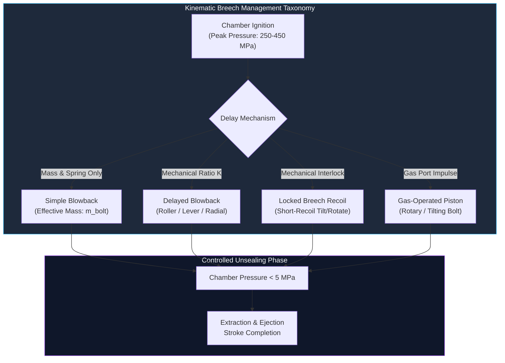
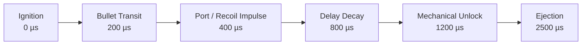

# Lesson 3: Mechanical Classification & Kinematic Action Taxonomies

## 1. First-Principles Intuition & Invariants

Mechanical firearms design is governed by the conservation of momentum and energy under extreme transient pressures. Every operating system is an energy-management apparatus designed to solve a single kinematic problem: allow chemical propellants to burn within a sealed pressure vessel at 200–450 MPa (30,000–65,000 psi), accelerate a projectile down a rifled bore, and extract and eject the spent casing only after internal chamber pressure has decayed to safe atmospheric levels.

The governing physical invariant is momentum equilibrium across the breech interface:

$$\int_{0}^{t_{\text{bore}}} P(t) A_{\text{bore}} \, dt = m_{\text{bullet}} v_{\text{bullet}} + m_{\text{gas}} v_{\text{gas}} = m_{\text{breech}} v_{\text{breech}}$$

If breech unsealing occurs prematurely while $P(t) > 5\text{ MPa}$, the cartridge case wall loses radial support from the steel chamber wall, resulting in violent hoop stress rupture and hot gas escape into the receiver.

Classification taxonomies in mechanical firearms engineering categorize platforms according to their kinematic mechanism of breech delay, locking interface geometry, and primary energy transmission pathway:
1. **Inertia-Delayed (Simple Blowback)**: Breech mass and recoil spring stiffness solely resist chamber pressure. Restricted by Newtonian scaling ($m_{\text{bolt}} \propto P_{\text{max}} A_{\text{bore}}$) to low-impulse cartridges ($\le 9\times19\text{mm}$ Corto / $.380\text{ ACP}$).
2. **Mechanical Delay (Delayed Blowback)**: Employs kinematic mechanical disadvantage (rollers, levers, radial cams, or gas hesitation rings) to multiply the effective bolt inertia by factor $K = 3\text{--}6$, permitting higher-pressure cartridges without excessive breech mass.
3. **Locked-Breech Recoil Systems**: Barrel and bolt remain rigidly mechanically interlocked for the initial $2\text{--}5\text{ mm}$ of rearward travel until a cam or link tilts or rotates the barrel, releasing the bolt after bullet exit.
4. **Gas-Operated Piston Systems**: Taps expanding propellant gas through a barrel port to drive an internal piston (long-stroke, short-stroke, or internal expansion chamber) to rotate a multi-lug bolt out of battery.



---

## 2. Core Architecture & Kinematic Mechanics

### 2.1 Kinematic Action Architectures

The four primary kinematic paradigms exhibit distinct force transmission and dynamic timing profiles:



#### A. Roller-Delayed Blowback (Vorgrimler Mechanism)
The breech mechanism comprises a two-piece bolt assembly: a bolt head carrying two symmetrical cylindrical rollers and an angled locking wedge attached to a heavier bolt carrier. The angle $\alpha$ of the wedge faces (typically $45^\circ\text{--}65^\circ$) transforms rearward barrel-recoil forces into lateral displacement of the rollers into receiver recesses. The kinematic multiplication ratio is defined as:

$$R_{\text{carrier/head}} = 1 + \frac{1}{2 \tan\alpha \tan\beta}$$

Where $\beta$ is the roller recess ramp angle. The carrier moves rearward at $3\text{--}4\times$ the velocity of the bolt head, absorbing impulse in kinetic energy while the bolt head moves fractions of a millimeter until pressure drops.

#### B. Short-Recoil Tilting Barrel (Browning Mechanism)
The barrel and slide are locked together by radial locking lugs or by fitting the barrel chamber hood directly into the ejection port window. Both components recoil together for approximately $3\text{ mm}$. A lower barrel lug engages an angled kidney-shaped cam or link pinned to the frame, forcing the breech end of the barrel to pivot downward out of engagement with the slide. The slide continues rearward alone with residual momentum.

#### C. Gas-Operated Rotating Bolt
High-pressure rifles tap combustion gas through a port drilled in the barrel wall at a point where bullet travel has established reliable gas volume. Gas enters a cylinder, acting upon a piston face. The piston rod forces a bolt carrier rearward; an internal helical cam track in the carrier acts upon a cam pin on the bolt body, rotating the bolt lugs (typically $2\text{--}7$ symmetrical lugs) out of mating recesses in the barrel extension.

---

## 3. Engineering Standards & Cartridge Headspace Geometry

Dimensional interchangeability and safety depend upon international standardization bodies: **SAAMI** (Sporting Arms and Ammunition Manufacturers' Institute) in the United States and **C.I.P.** (Commission Internationale Permanente) in Europe.

### 3.1 Cartridge Headspacing Datums

Headspace is the linear distance from the breech face (bolt face) to the feature of the chamber that arrests forward cartridge seating:

```
Rimmed:          [Bolt Face] |===================| [Cartridge Rim Front Edge]
Rimless (Rifle): [Bolt Face] |===================| [Shoulder Datum Line Diameter]
Rimless (Pistol):[Bolt Face] |===================| [Cartridge Case Mouth]
Belted Magnum:   [Bolt Face] |===================| [Belt Forward Shoulder]
```

1. **Rimmed Cases** (e.g., $7.62\times54\text{mmR}$): Headspace measures from bolt face to the rear barrel face that supports the forward edge of the rim ($1.60\text{--}1.75\text{ mm}$).
2. **Rimless Bottleneck Cases** (e.g., $5.56\times45\text{mm}$, $7.62\times51\text{mm}$): Headspace measures from bolt face to a specified datum diameter on the conical chamber shoulder (e.g., $9.144\text{ mm}$ datum circle for $5.56\text{mm}$ NATO).
3. **Rimless Straight Cases** (e.g., $9\times19\text{mm}$, $.45\text{ ACP}$): Headspace seats on the sharp edge of the case mouth against a matching shoulder reamed in the chamber wall.

### 3.2 Pressure vessel tolerances & Headspace Gaging

Chamber dimensions are audited with precision ground steel gages:
- **GO Gauge**: Represents maximum allowable cartridge length plus minimum chamber headspace. A correctly cut chamber must close fully on a GO gauge with zero binding.
- **NO-GO Gauge**: Represents maximum recommended headspace for a newly manufactured firearm ($+0.10\text{ mm}$ over GO). A new mechanism must not close on a NO-GO gauge.
- **FIELD Gauge**: Represents absolute maximum safe working headspace ($+0.18\text{--}0.25\text{ mm}$ over GO). Exceeding FIELD headspace risks catastrophic case head separation.

---

## 4. Summary & Kinematic Comparison Matrix

| Operating Mechanism | Delay Principle | Typical Pressure Ceiling | Kinematic Efficiency | Mechanical Complexity |
|:---|:---|:---|:---|:---|
| **Simple Blowback** | Bolt Mass + Recoil Spring | $\le 200\text{ MPa}$ | Low (High bolt mass required) | Minimal (1 moving part) |
| **Roller-Delayed** | Roller mechanical disadvantage | $\le 430\text{ MPa}$ | High (Lightweight carrier absorption) | Medium (Toleranced roller/wedge gaps) |
| **Short-Recoil Tilt** | Cammed barrel drop | $\le 300\text{ MPa}$ | High (Compact slide envelope) | Moderate (Slide/barrel lug fitting) |
| **Gas Rotating Bolt** | Port-driven piston + cam rotation | $\le 450\text{ MPa}$ | Maximum (Tunable gas port diameter) | High (Multi-piece carrier/bolt/cam) |
