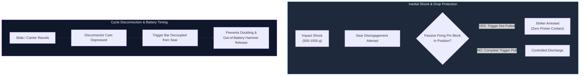
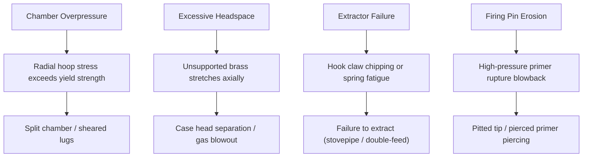

# Lesson 4: Passive Safety Interlocks & Mechanical Failure Modes

## 1. First-Principles Intuition & Invariants

A modern firearm is a dynamic mechanical system subject to severe shock, vibration, and thermal cycling. Accelerations during handling, holster retention, vehicle transport, or unintended impact (e.g., dropping onto concrete) can generate transient inertial loads exceeding $500\text{--}1500\text{ g}$. Under such shocks, mechanical components (triggers, sears, strikers, hammers) experience inertial forces $F = m \cdot a$ capable of overcoming spring preloads and triggering uncommanded discharge unless counteracted by positive mechanical interlocks.

The primary engineering invariant of modern firearms safety design is **the positive interlock principle**:

> *The ignition train (striker or firing pin) must be physically blocked from contacting the cartridge primer by a solid mechanical barrier at all times, EXCEPT when the trigger is deliberately pulled through its full operational stroke.*

Safety architectures are broadly categorized into **manual safeties** (requiring deliberate user lever actuation) and **passive / internal safeties** (operating autonomously via internal kinematic links). In contemporary engineering, passive safeties represent the primary defense against inertial failure modes:

1. **Drop Safety / Firing Pin Block**: A spring-loaded plunger physically obstructs the firing pin channel, preventing forward firing pin travel even if the sear slips under severe impact.
2. **Transfer Bar / Hammer Block**: A movable steel bar that must be held in position between hammer and firing pin by active trigger pull; in resting state, the hammer strikes an immovable frame stop.
3. **Trigger Bar Disconnector**: A cammed lever that mechanically decouples the trigger bar from the sear whenever the slide or bolt carrier moves rearward out of full battery, preventing automatic doubling or out-of-battery ignition.
4. **Out-of-Battery Interlock**: Geometric blocking that prevents firing pin protrusion or hammer release until locking lugs have rotated or seated into full engagement.

---

## 2. Core Architecture & Interlock Mechanisms

### 2.1 Passive Safety Subsystems

#### A. Plunger-Type Firing Pin Block
A cylindrical hardened steel plunger (Rockwell C 50–54) passes vertically through the slide, perpendicular to the firing pin channel. The firing pin features an annular notch or cutout. In the resting state, an internal spring forces the plunger downward, positioning a solid sector of the plunger across the firing pin shoulder. 

When the trigger is pulled, a vertical lifting cam or secondary lever on the trigger bar pivots upward, depressing the plunger flush with the channel wall. Only during this window of positive trigger engagement can the firing pin travel forward under spring or hammer momentum.

#### B. The Trigger Bar Disconnector
In semi-automatic actions, firing a single shot must never cause continuous cyclic firing. The disconnector is a vertical link interfacing between the trigger bar and the sear. The top of the disconnector bears against a cam track cut into the underside of the reciprocating slide or bolt carrier:
- **In Battery**: The slide recess aligns with the disconnector tip, allowing it to spring upward into engagement with the trigger bar and sear.
- **During Recoil Stroke**: As the slide moves rearward by as little as $1.5\text{ mm}$, the solid lower surface of the slide cams the disconnector downward. This forces the trigger bar down out of engagement with the sear, allowing the sear to re-catch the hammer or striker under spring pressure before the bolt closes.
- **Trigger Reset**: To fire the next shot, the operator must release the trigger forward. The trigger bar slips forward until it re-indexes under the disconnector step, restoring the mechanical circuit.

---

## 3. Mechanical Failure Modes & Metallurgical Degradation

Firearm components undergo dynamic cyclic fatigue, abrasive carbon fouling, hot gas erosion, and localized impact peening. Rigorous failure analysis categorizes structural breakdown into distinct engineering failure modes:

### 3.1 Common Failure Mechanisms

1. **Case Head Separation**: Occurs when excessive chamber headspace allows a rimless cartridge to move forward under striker impact, creating an axial gap between case web and bolt face. Upon ignition, internal pressure seals the thin front case walls against the chamber while the case head is driven backward against the bolt face, causing circumferential tensile necking and catastrophic fracture.
2. **Out-of-Battery Ignition (OOB)**: If primer detonation occurs before locking lugs are fully rotated or seated into their receiver recesses, the breech mechanism cannot support the full combustion pressure. Catastrophic gas expansion ruptures the receiver and ejects fragments through the magazine well.
3. **Breech Face / Firing Pin Erosion**: High-velocity hot gas venting from pierced primers cuts micro-channels into the hardened breech face steel via localized thermal ablation and nitriding embrittlement.

---

## 4. Failure Modes & Effects Analysis (FMEA)

| Subsystem | Potential Failure Mode | Root Cause Mechanism | Preventive Design Interlock |
|:---|:---|:---|:---|
| **Firing Train** | Inertial drop discharge | High-g drop disengages sear | Passive spring-loaded firing pin block plunger |
| **Trigger Mechanism** | Uncontrolled cyclic doubling | Disconnector hook rounded or spring seized | Disconnector over-travel cam track on bolt carrier |
| **Locking System** | Out-of-battery rupture | Debris in chamber prevents full lockup | Firing pin shroud / hammer block prevents strike until full rotation |
| **Chamber / Barrel** | Case rupture / gas blowout | Extreme chamber headspace or barrel obstruction | SAAMI GO/NO-GO gauge tolerance limits & proof testing |
