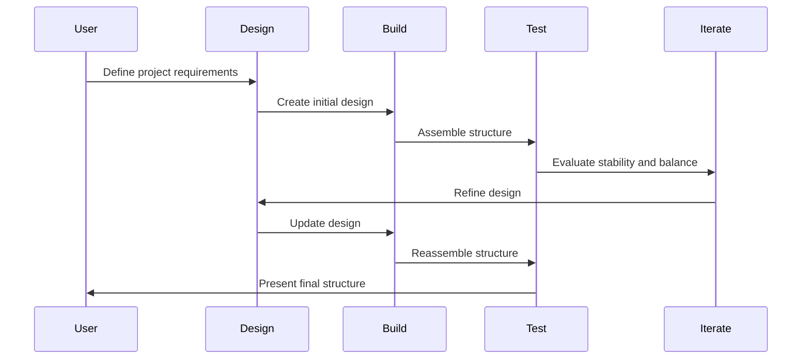

# Foundation: Architecture
## 1. Conceptual Mental Model (First principles, historical context, and fundamental paradigm shifts)

### First Principles
Architecture in the context of Lego construction involves the systematic design and assembly of structures that are both functional and aesthetically pleasing. At its core, Lego architecture is a form of modular construction where each piece serves a specific purpose and interacts with others to create a stable, coherent whole. The fundamental principles include balance, stability, and the efficient use of space. These principles are rooted in the physical properties of the Lego bricks, such as their interlocking design, which allows for a wide range of configurations while maintaining structural integrity.

### Historical Context
Lego was introduced in 1932 by Ole Kirk Christiansen, a Danish carpenter, and toy manufacturer. The name "Lego" is derived from the Danish words "leg godt," meaning "play well." Initially, Lego bricks were made of cellulose acetate, but in 1963, the company switched to a more durable plastic, polyethylene. This change marked a significant paradigm shift, as it allowed for greater durability and a wider range of colors, enabling more complex and detailed constructions.

### Fundamental Paradigm Shifts
One of the most significant paradigm shifts in Lego architecture occurred with the introduction of the "System Lego" in 1958. This system introduced a standardized set of bricks that could interlock with each other, allowing for the construction of more complex and diverse structures. This shift from individual pieces to a modular system enabled a new level of creativity and functionality in Lego construction.

## 2. Essential Terminology & Taxonomy (Comprehensive architectural definitions)

### 1. **Stud**
A stud is the raised element on the top surface of a Lego brick. It is the primary feature that allows bricks to interlock with each other. Mathematically, a stud can be defined as a cylindrical protrusion with a diameter of 4.8 mm and a height of 1.8 mm.

### 2. **Tub**
A tub is the recessed area on the bottom surface of a Lego brick that allows it to fit over the studs of another brick. It is defined as a cylindrical depression with a diameter of 5.0 mm and a depth of 1.8 mm.

### 3. **Plate**
A plate is a flat Lego piece that is typically one stud thick. It is used to create floors, walls, and other flat surfaces. The dimensions of a standard plate are 32 mm x 32 mm x 3.2 mm.

### 4. **Beam**
A beam is a long, flat Lego piece that is used to create structural supports and frameworks. Beams can be defined by their length, width, and height. For example, a 1x4 beam has a length of 32 mm, a width of 8 mm, and a height of 9.6 mm.

### 5. **Brick**
A brick is a standard Lego piece that is two studs thick. It is the most common type of Lego piece and is used to create walls, towers, and other structures. The dimensions of a standard brick are 32 mm x 16 mm x 9.6 mm.

### 6. **Module**
A module is the basic unit of measurement in Lego construction. It is defined as the distance between the centers of two adjacent studs, which is 8 mm. All Lego pieces are multiples of this module, allowing for precise and consistent construction.

### 7. **Balance**
Balance in Lego architecture refers to the distribution of weight and force within a structure. It is achieved by ensuring that the center of gravity is within the base of support, preventing the structure from tipping over. Mathematically, balance can be defined as the equilibrium of forces acting on a structure, where the sum of the moments about any point is zero.

### 8. **Stability**
Stability in Lego architecture refers to the ability of a structure to resist external forces and remain upright. It is achieved by using strong, interlocking connections and a wide base of support. Mathematically, stability can be defined as the resistance of a structure to deformation under external loads, where the structure remains within its elastic limit.

## 3. Architecture & Core Workflow (Detailed ASCII and Mermaid diagrams with step-by-step dataflow)

### ASCII Diagram
```
+-------------------+
|       Roof        |
+-------------------+
|       Walls       |
+-------------------+
|       Floor       |
+-------------------+
|       Base        |
+-------------------+
```

### Mermaid Sequence Diagram


## 4. Common Misconceptions & Mental Traps (Subtle edge cases and flawed mental models)

### Misconception 1: More Pieces Always Mean a Stronger Structure
One common misconception is that using more Lego pieces always results in a stronger structure. In reality, the strength of a Lego structure depends on the quality of the connections and the distribution of weight. A well-designed structure with fewer pieces can be stronger than a poorly designed structure with many pieces.

### Misconception 2: Stability is Only About the Base
Another common misconception is that stability is only about the base of a structure. While a wide base is important, stability also depends on the distribution of weight throughout the structure. A structure with a narrow base but a well-distributed weight can be more stable than a structure with a wide base but a poorly distributed weight.

### Misconception 3: Symmetry Always Leads to Balance
Symmetry is often associated with balance, but it is not always the case. A symmetrical structure can be unbalanced if the center of gravity is not within the base of support. Balance is achieved by ensuring that the center of gravity is within the base of support, regardless of the symmetry of the structure.

### Misconception 4: Larger Structures are Always More Stable
Larger structures are not always more stable than smaller structures. In fact, larger structures can be more prone to instability due to the increased weight and the need for more complex connections. Stability depends on the quality of the connections and the distribution of weight, not the size of the structure.

## 5. Socratic Discussion Starters (Advanced questions for deep Socratic exploration)

### Discussion Question 1
How does the concept of balance in Lego architecture relate to the principles of structural engineering? Can you provide examples of how the principles of balance and stability in Lego construction can be applied to real-world structures?

### Discussion Question 2
What are the trade-offs between using a wide base and a narrow base in Lego architecture? How does the choice of base affect the stability and balance of a structure? Can you provide examples of structures that benefit from a wide base and structures that benefit from a narrow base?

### Discussion Question 3
How does the use of different types of Lego pieces (e.g., plates, beams, bricks) affect the stability and balance of a structure? Can you provide examples of how the use of different types of pieces can be used to achieve specific design goals, such as creating a stable tower or a balanced bridge?
