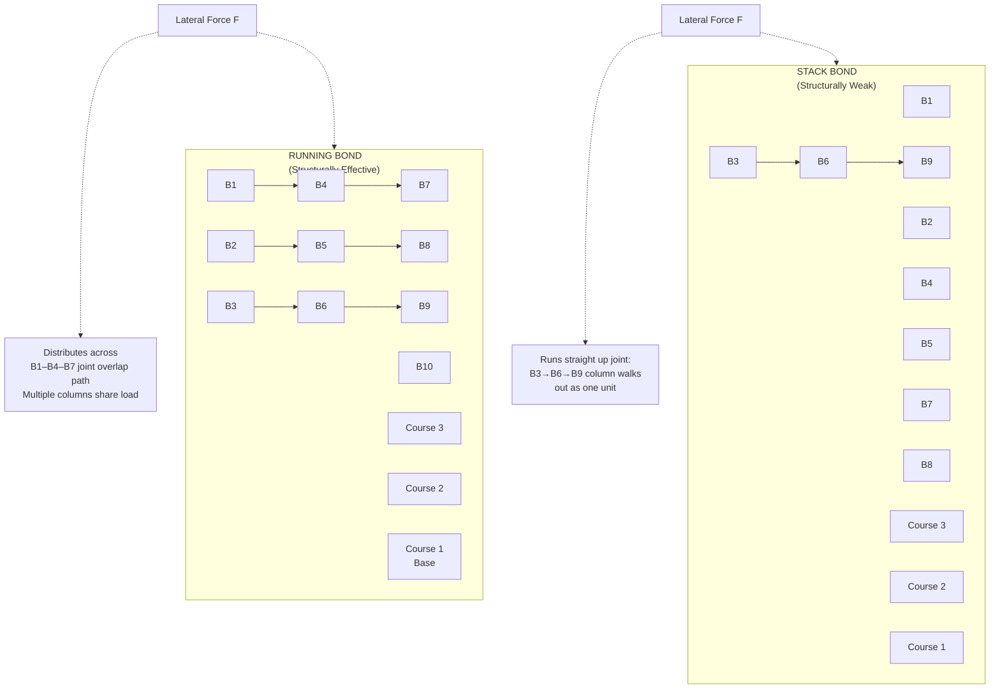

# Lesson 1: Structural Primitives of LEGO Systems

## 1. First-Principles Intuition & Invariants

Every architectural ambition in LEGO begins with the same question that confronts any structural engineer: how does force move through a system, and where does it go when the system resists it? The answer, in LEGO as in steel-frame construction, lives in the geometry of the connections. Before you can build a convincing cantilever, a load-bearing arch, or a multi-story facade that holds its own weight without racking, you need to understand the stud-and-tube joint at a level most builders never bother to reach. It is not a toy snap. It is a precisely engineered interference fit, and its mechanical behavior governs everything you will ever build.

The classic LEGO stud is a hollow cylinder with an outer diameter of 4.8 mm. The tube on the underside of an adjacent brick has an inner diameter of 4.8 mm as well, but the dimensional relationship is not a clearance fit — it is a slight interference, designed to generate a clamping friction force of approximately 4.8 N per stud-to-stud connection under laboratory conditions. TLG (The LEGO Group) has held this tolerance to within ±0.002 mm across billions of parts manufactured since the patent of 1958, which is a machining standard more typical of aerospace fasteners than consumer products. What this means structurally is that the joint derives its holding strength entirely from hoop stress in the tube walls: when the stud is pressed in, the tube expands radially, and the elastic recovery of the ABS material generates a continuous inward clamping pressure around the stud's circumference. The joint is not a snap fit in the engineering sense, because there is no mechanical undercut locking the parts together; it is purely a friction-based press fit, which has significant implications for the direction of loads it can resist.

A single stud-tube joint resists axial separation — the force required to pull two bricks apart vertically — with that ~4.8 N clamping force, multiplied by the number of studs in contact. A standard 2×4 brick has eight studs engaged, giving you approximately 38 N of axial resistance, enough to support several kilograms of dead load in a purely compressive stack. But the joint is far weaker in shear — the lateral force that tries to slide one brick across the face of another — because shear resistance depends on friction between the flat underside of the upper brick and the top face of the lower brick, plus the stiffness of the stud shafts acting as tiny cantilevered pins. This shear strength is significantly lower than the axial clamping force, and it degrades further when the bricks are loaded in a direction perpendicular to the stud rows, because the rectangular footprint of the brick creates asymmetric stud engagement geometry in that axis.

Understanding this asymmetry is the first invariant of LEGO architecture. Pure vertical stacking is structurally efficient because it loads the joints in their strong axis — compression transmitted through the stud-tube interface, distributed across the full footprint of the brick. Lateral loads, by contrast, must be managed through interlocking course patterns, cross-bonding, and geometric triangulation, not through individual joint strength. A wall built in running bond — each course offset by half a brick length from the one below, exactly as a bricklayer offsets courses of masonry — transfers lateral loads by routing shear force through multiple stud columns simultaneously. A wall built in stack bond, with every vertical joint aligned, is dramatically weaker in shear because a single lateral impulse can walk entire columns of bricks sideways off their lower course. This is not theoretical; it is immediately observable when you try to rack a stack-bonded wall by hand. The running bond wall resists your push; the stack-bonded wall collapses like a deck of cards.

The second invariant concerns the material itself. LEGO bricks are injection-molded from acrylonitrile butadiene styrene — ABS — a terpolymer whose mechanical properties are unusually well-matched to the demands of a precision friction-fit building system. ABS has a Young's modulus of approximately 2.0–2.5 GPa, which places it in a useful middle range: stiff enough to maintain dimensional accuracy under load, but not so brittle that the tube walls crack when the stud is inserted. The butadiene rubber phase dispersed through the styrene-acrylonitrile matrix is specifically responsible for the material's impact toughness — it absorbs crack propagation energy through rubber particle crazing — which is why ABS bricks survive being dropped on a hard floor without shattering, while brittle polystyrene would not. The glass transition temperature of LEGO ABS is approximately 105°C, well above any realistic ambient building condition, so thermal softening is not an architectural concern indoors. However, UV exposure degrades the styrene phase over years, causing the characteristic yellowing and slight embrittlement seen in vintage bricks, which does measurably reduce the clamping force of old stud-tube joints due to slight shrinkage and stiffness changes in the tube wall.

The third invariant is dimensional. LEGO geometry is built on a Cartesian grid with a horizontal pitch of 8 mm (center-to-center stud spacing) and a vertical pitch where one standard brick height equals 9.6 mm (3.2 mm plate + 6.4 mm standard brick body, minus plate). Three standard plates stack to exactly the height of one standard brick, giving a plate height of 3.2 mm. The critical ratio for LEGO architecture is the relationship between horizontal and vertical pitch: five plates equal 16 mm in height, and two studs equal 16 mm in horizontal span. This 5:2 ratio — five plates high, two studs wide — is the fundamental aspect ratio that makes SNOT (Studs Not On Top) construction geometrically coherent. When you turn a brick on its side and stud it into a vertical surface using a bracket or hinge plate, the stud grid of the sideways brick must align with the stud grid of the surrounding structure. It does, because the 8 mm horizontal pitch of the sideways brick corresponds exactly to 2.5 plates of vertical rise in the surrounding wall — and by composing the surrounding wall of mixed plate and brick courses to hit the target height precisely, every SNOT surface can be made to integrate seamlessly. Mastery of SNOT geometry is ultimately mastery of this single ratio, applied recursively in all three axes.

---

## 2. Core Architecture & Mechanics

The load path through a LEGO structure can be visualized as a network of force vectors, each vector finding its lowest-resistance route from the point of application to the point of support. In a purely vertical stack — say, a column built from 2×2 bricks — the load path is trivially direct: compressive force travels straight down through the stud-tube interfaces, through the brick bodies, to the baseplate. The brick body itself contributes meaningfully here. The hollow interior of a standard LEGO brick is not a structural liability; the ABS tube walls that form the internal cavity create a thin-shell structure with high compressive stiffness relative to its mass. The wall thickness of a standard brick is approximately 1.5 mm, and the internal cross-bracing provided by the central anti-rotation tube of a 2-stud-wide brick adds further resistance to lateral buckling under compressive load. The effective column of a 2×2 stack can support well over 4,000 N before the ABS begins to yield — far beyond any architectural model's demands — which means compressive failure is never the design constraint in LEGO architecture. The design constraint is always lateral stability and joint shear.

The mechanics of lateral load resistance are worth examining in structural detail, because they determine every major design decision in a large LEGO architectural model.

Consider what happens when a lateral force is applied to the top course of each wall. In the running bond wall, the offset course pattern means that every brick straddles a joint in the course below it. The lateral force, trying to slide course 3 across course 2, encounters stud columns that are rooted in both the left and right halves of bricks in course 2. It cannot slide course 3 without also bending the stud shafts of multiple bricks in course 2, and to do that, it must simultaneously overcome the friction coupling of those bricks to course 1. The load distributes diagonally through the wall thickness. In the stack-bonded wall, the aligned vertical joints create continuous planes of weakness running full-height; the lateral force simply slides the top course along its interface with the bottom course, and the entire wall folds. The structural difference is not subtle — it is dramatic enough to feel with two fingers.

For architectural practitioners, the practical synthesis of these load-path mechanics resolves into a small set of execution rules. Exterior walls should be built in running bond with a minimum offset of one stud (8 mm) per course, applied alternately or in a Flemish pattern. Interior partition walls that meet exterior walls must be physically interlocked — the partition bricks should course into the exterior wall at every other layer, not simply butted against it. A butted partition transfers no lateral load into the exterior wall; an interlocked partition ties the two planes into an L-section or T-section beam, which resists racking in both the wall-parallel and wall-perpendicular axes. This is exactly the same principle that makes masonry toothing joints — the deliberate leaving of alternating projecting bricks at a wall end — structurally essential in full-scale construction.

The SNOT geometry, introduced in the previous section as a dimensional relationship, also has direct structural consequences. When a tile-clad SNOT surface is built using sideways bricks on bracket assemblies, the attachment of the SNOT layer to the structural core must route loads back through the bracket connection points. A bracket connecting a SNOT facade to a vertical stud-up wall creates a moment arm equal to the bracket depth, which amplifies the peel load at the attachment studs when the facade is pushed inward or outward. For large facade panels, this means the bracket spacing must be kept tight — no more than every two courses — and the structural core behind the facade must itself be well-bonded, or the core wall will rack at the bracket attachment points under facade loads.

The vertical load path in multi-story architectural models introduces one more structural consideration: column versus bearing-wall behavior. A thick exterior wall acts as a bearing wall, distributing floor loads broadly across its full length. A thin partition wall or a SNOT facade panel is not a bearing wall; it carries only its own weight and must not be loaded from above. In practice, this means that the floor plates connecting two exterior walls must span between those walls without bearing on intervening SNOT panels or decorative columns. The load path must be traceable from every floor plate, through the bearing walls, down to the base. When you model a floor plate using a grid of Technic bricks (for their hollow-axle beam stiffness) or a dense tile layer on plate, you are creating a horizontal diaphragm that transfers the floor's self-weight and any superimposed load laterally to the two walls it spans between. If the walls themselves are not plumb and well-bonded all the way to the base, the floor diaphragm will push the walls outward and the model will barrel.

---

## 3. High-Performance Optimization & Failure Modes

Practitioners building at architectural scale — models in the 10,000- to 50,000-part range, or any model taller than roughly 60 studs — encounter a set of failure modes that never appear in small builds, because they emerge from the cumulative behavior of thousands of slightly imperfect joints and slightly flexible brick bodies interacting under sustained load. Understanding these failure modes, and the workflows that prevent them, is what separates a structurally durable large-scale model from one that slowly deforms, splays, or collapses over months of display.

The first failure mode is **creep deformation under sustained compressive load**. ABS is a viscoelastic material, which means it exhibits time-dependent strain under constant stress — it slowly flows. Under the sustained compression of a tall column of bricks, the stud-tube joints will very gradually compress, reducing the total column height by a measurable fraction of a millimeter per year. For most models this is inconsequential, but for a tall tower or spire loaded at the top (by a minifigure, a flag assembly, or an antenna), the compressive creep at lower courses can eventually produce visible lean if the load is not perfectly centered on the column axis. The mitigation is straightforward: keep tall decorative spires structurally hollow, loading only the outer walls, never stack mass at the top of a compression column, and use a central Technic axle running vertically through tall slender towers to provide a secondary tensile spine that resists lean before it becomes visible.

The second failure mode is **thermal racking**. Even indoors, a large model placed near a window or heat source will experience differential temperature gradients across its footprint. ABS has a coefficient of thermal expansion of approximately 70–90 µm/m·°C. A model one meter wide subjected to a 15°C thermal gradient between its sun-facing and shadow-facing sides will experience approximately 1.1 mm of differential expansion across its width. That sounds trivial, but in a wall with no expansion accommodation, it manifests as a lateral shear force at every course — exactly the load that running bond resists through joint friction. Models that use stack-bond courses for aesthetic reasons (uniform horizontal groove lines, common in modernist architectural styles) are particularly vulnerable to thermal racking: the aligned vertical joints provide no shear resistance, and after several thermal cycles the walls will visibly shear along those joint planes. The mitigation in architecturally styled models is to introduce hidden running-bond courses at every fourth or fifth layer, using tiles on the visible face to maintain the clean horizontal aesthetic while the structural bond is provided by standard brick coursing on the rear leaf of a double-leaf wall construction.

The third failure mode is **baseplate anchor failure**, and it is the one most likely to cause total structural collapse. The model's connection to its baseplate is the highest-stressed joint in the entire structure, because it must resist every lateral load applied to the model — a bump, a vibration during transport, a child leaning on the display table. Standard LEGO baseplates are 1.6 mm thick injection-molded ABS sheet, with no internal reinforcement. Under the sustained lateral load of a tall heavy model, the baseplate will flex upward at its edges, reducing the clamping force of the stud connections at the base course perimeter. As those connections loosen, the base course bricks develop play — small rotational freedom — which allows the entire wall above to rack. The professional mitigation is to mount all large architectural models on a rigid MDF or acrylic sub-board to which the baseplates are themselves secured with double-sided tape or countersunk screws through the baseplate holes (which exist on 48×48 baseplates for exactly this purpose). The structural core should additionally be pinned to the rigid sub-board using 1×2 Technic bricks with their axle holes threading onto headless pins glued into the sub-board, providing a mechanical connection that bypass the baseplate flex entirely.

The fourth failure mode is **SNOT facade delamination**. It presents progressively: first as a barely visible outward bow in a large flush tile surface, then as individual tiles popping free, and finally as bracket connections failing in peel. The root cause is almost always inadequate attachment density — large SNOT panels built on too few brackets, with too many unsupported plate courses spanning between attachment points. The correct construction workflow begins by computing the panel's self-weight (roughly 1–2 g per stud of panel area, depending on tile density), then ensuring that the bracket attachment grid provides enough clamping force to hold that weight against the moment arm created by the panel's offset from the structural core. In practice, this means no SNOT panel section should span more than 4 studs horizontally or 5 plates vertically between bracket attachment points, with the brackets themselves engaged on a fully bonded course of the structural core wall rather than on a single plate layer.

The optimized workflow for a structurally durable large-scale LEGO architectural model therefore follows a strict build sequence. The structural core is built first, entirely in running bond, to full height, with all floor diaphragms installed and all partition walls interlocked, before any decorative elements are added. The core is then tested for plumb using a small spirit level on the internal wall faces, and any racking corrected by inserting thin plate shims at the base course. Only after the structural core passes plumb inspection are SNOT brackets, facade bricks, and decorative tile surfaces added. This sequence matters because adding mass to an already-racked core amplifies the racking moment and makes correction progressively more destructive. Building facade-first and core second — a common workflow among builders who prioritize the visual face of the model — produces models that look correct on the front but hide structural problems internally, and those problems manifest months later when the facade loads finally cause the inadequately built core to yield.

The final optimization worth internalizing concerns **color-consistent structural planning**. In architectural models, the structural bricks are almost always hidden behind a tile or SNOT facade, which means the builder is free to use any available color in the structural core. The professional workflow takes advantage of this by using the highest-quality, tightest-tolerance bricks (typically recent TLG production in common colors: dark bluish gray, light bluish gray, tan) for the structural core, reserving rare or vintage bricks exclusively for the visible facade surface. Vintage bricks — particularly pre-1990 ABS and all Modulex parts — have measurably looser tolerances from decades of mold wear and material aging, and they should not be placed in the structural core where joint tightness directly controls wall stability. Reserve them for decorative tiles, where their only mechanical function is to remain seated on a stud, a job that even a worn old brick can perform reliably for years.
