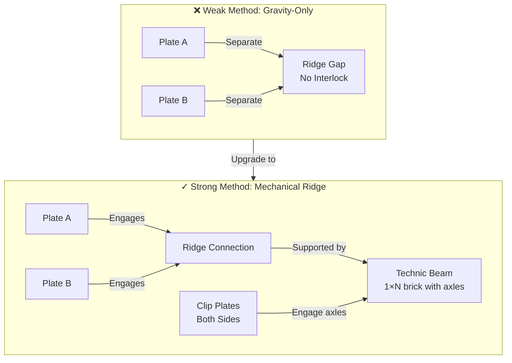

# Lesson 3: Architectural Scaling and Proportional Design

## 1. First-Principles Intuition & Invariants

The fundamental challenge of architectural scaling in Lego construction emerges not from aesthetic ambition but from the ruthless physics of material stress distribution and geometric constraint propagation. When a builder transitions from a microscale vignette occupying sixteen studs square to a modular building spanning forty-eight studs in depth, they confront a nonlinear escalation of structural demands that cannot be solved by simple multiplication of components. The cantilever moment arm extending from a facade detail scales quadratically with distance from the support point, while the available cross-sectional area of standard beams and plates increases only linearly with their nominal size designation. This mismatch between load growth and material capacity defines the central tension in all large-scale Lego architecture.

At the heart of proportional design lies the concept of structural modularity as distinct from aesthetic modularity. A builder may achieve visual rhythm through repeating window patterns or cornice details, but structural modularity requires that load paths remain coherent and redundant across module boundaries. The standard thirty-two by thirty-two stud baseplate enforces a fundamental quantum of architectural space, yet its perimeter offers only thirty-two discrete connection points along each edge. When multiple baseplates join to form a contiguous foundation, the interface between them becomes a critical failure plane where shear forces concentrate and vertical loads seek the path of least resistance toward the ground plane.

The mechanical behavior of ABS polystyrene under sustained load introduces time-dependent failure modes absent from steel or concrete construction. Creep deformation accumulates in heavily loaded bricks and plates over weeks and months, causing gradual sagging in unsupported spans and permanent compression at high-stress contact points. The glass transition temperature of ABS sits near sixty degrees Celsius, well within reach of direct sunlight through a window or proximity to heating vents. At elevated temperatures, the modulus of elasticity drops precipitously, transforming once-rigid assemblies into flexible structures that bow under their own weight. Advanced builders account for these material realities by designing defensive redundancy into critical load paths and avoiding configurations where a single connection point bears concentrated force.

The stud-and-tube interference fit that provides Lego's legendary clutch power also imposes strict geometric constraints on architectural freedom. Every connection demands perpendicular alignment between mating surfaces, with tolerances measured in hundredths of millimeters. When multiple constraints act simultaneously on a single element, the system becomes overconstrained, and assembly stress locks into the structure even before external loads apply. This phenomenon manifests most acutely in corner assemblies where plates meet at ninety-degree angles and in complex roof geometries where multiple slopes converge at ridge lines. The builder must recognize when geometric idealization conflicts with physical reality and introduce relief mechanisms—hinge plates, clip connections, or deliberate gaps—that permit micro-adjustments during assembly.

Proportional scaling further complicates matters through the tyranny of integer dimensions. Real-world architectural elements follow continuous geometric relationships: a classical column might exhibit a height-to-diameter ratio of eight to one, and a pediment's pitch angle might measure precisely twenty-two degrees. Lego's discrete unit system permits only integer stud multiples in horizontal dimensions and plate-height increments in vertical dimensions, with one brick height equaling five plate heights but 1.2 stud units. Achieving convincing proportions at small scales often requires creative interpretation rather than literal translation, while larger scales permit greater fidelity at the cost of increased part count and structural complexity.

The concept of scale itself bifurcates into absolute scale (the physical size of the model) and relative scale (the ratio between model dimensions and real-world referent). A minifigure-scale building attempts to maintain consistent proportions relative to the standardized minifigure height of four bricks, yielding door openings of approximately six to seven bricks tall and floor-to-floor heights of nine to eleven bricks. Microscale architecture abandons human reference entirely, representing entire buildings as compact forms where a single brick might symbolize a full story. Each scale regime demands different structural strategies: minifigure scale must accommodate interior access and vertical circulation, while microscale prioritizes external massing and silhouette legibility.

## 2. Core Architecture & Mechanics

The load-bearing skeleton of any substantial Lego architectural model begins with foundation design that addresses both gravitational loads and lateral stability. A simple baseplate provides adequate support for lightweight structures but deflects visibly under concentrated loads exceeding five hundred grams per square decimeter. Advanced foundation systems employ double-thickness baseplate layers with perpendicular orientation, creating a rigid grid that resists both bending and torsional deformation. The junction between foundation and vertical elements requires careful attention to connection density: a sixteen-stud-wide wall section should engage no fewer than twelve studs along its base to prevent tipping under lateral loads from accidental impacts or seismic disturbance during transport.

```text
Foundation Cross-Section (Side View, 1 unit = 1 plate height):

Ground Level ═══════════════════════════════════
             ┌─────────────────────────────────┐
Plate 1      │█████████████████████████████████│ 32×32 Baseplate (Primary)
             └─────────────────────────────────┘
             ┌─────────────────────────────────┐
Plate 2      │█████████████████████████████████│ 32×32 Baseplate (Rotated 90°)
             └─────────────────────────────────┘
             ┌───┬───┬───┬───┬───┬───┬───┬───┐
Plates 3-4   │ 2×├───┤ 2×├───┤ 2×├───┤ 2×├───┤ Perpendicular 2×N Plates
             │ 16│   │ 16│   │ 16│   │ 16│   │
             └───┴───┴───┴───┴───┴───┴───┴───┘

Effective Rigidity: ~4× single baseplate
Torsional Stiffness: ~6× single baseplate
```

Vertical structural systems must transition from the two-dimensional foundation plane into three-dimensional space while maintaining continuous load paths from roof to ground. The naive approach of stacking bricks directly atop one another creates weak planes at every horizontal joint where shear capacity depends solely on friction between stud tops and tube interiors. Robust wall construction alternates header and stretcher courses in a running bond pattern, exactly analogous to masonry practice. A header brick spans perpendicular to the wall face, tying front and back wythes together, while stretcher bricks run parallel to the wall length. This pattern ensures that no continuous vertical joint extends more than one brick height, distributing stress across multiple elements.

The structural capacity of a Lego wall scales with its thickness and the arrangement of internal cavities. A single-wythe wall composed of two-stud-deep bricks provides minimal lateral rigidity and remains vulnerable to buckling under vertical loads exceeding two kilograms per linear meter of length. A double-wythe wall with interleaved headers achieves roughly four times the load capacity through composite action, where the two wythes act as a unified section rather than independent layers. The introduction of internal cross-bracing through perpendicular plates at regular intervals—typically every eight to sixteen studs—further stiffens the assembly against out-of-plane deflection and provides mounting points for interior details.

Complex architectural features such as arched openings, flying buttresses, and cantilevered balconies concentrate stress at geometric singularities where intuitive construction methods often fail. Consider the semicircular arch: the geometry demands that each voussoir element angle slightly toward the arch center, yet standard bricks and plates meet only at perpendicular angles. The builder must approximate the curve through a stepped profile, accepting that each step introduces a stress concentration at the corner where compressive forces redirect abruptly. The true structural depth of the arch must extend through the wall thickness, with multiple layers of offset elements distributing the load across a volume rather than a single surface. A semicircular arch spanning sixteen studs requires a minimum structural depth of six studs (two brick widths) to prevent progressive collapse under sustained load.

Cantilever mechanics govern the design of overhanging elements from bay windows to roof eaves. The cantilever moment $M$ at the fixed support equals the applied load $P$ multiplied by the lever arm distance $L$: $M = P \cdot L$. For a uniformly distributed load such as the self-weight of a cantilevered balcony, the maximum moment occurs at the root and equals $M = \frac{wL^2}{2}$, where $w$ represents load per unit length. Lego plates exhibit measurable deflection under their own weight when cantilevered beyond six studs, and visible sagging becomes pronounced beyond ten studs. Reinforcement strategies include upward pre-cambering through slight upward bends in assembly, underslung support brackets that provide upward reaction forces, or concealed tension elements such as Technic liftarms anchored to the interior structure.

The rotational joint between angled roof sections exemplifies the challenge of maintaining structural continuity through geometric transitions. A gabled roof meeting at a forty-five-degree ridge requires that plates or slopes on opposing sides connect along a diagonal line offset by one-half stud from the rectangular grid. Standard construction resolves this through alternating overlap, where plates from each side take turns extending across the ridge line. However, this creates a weak zone where opposing roof planes do not mechanically interlock but merely rest against one another. A structurally superior approach employs a central ridge beam—typically a 1×N Technic brick with perpendicular axles—that provides a rigid spine to which both roof planes attach via clip plates or modified brackets.



Modularity at the architectural scale introduces interface compatibility challenges absent from smaller constructions. When individual modules—representing rooms, building sections, or entire structures—must connect to form larger compositions, the designer faces competing demands of structural continuity and assembly practicality. A rigid connection across module boundaries provides optimal load sharing but requires precise alignment during assembly and complicates disassembly for storage or transport. A looser connection through Technic pins or clip hinges permits easier handling but allows differential movement that accumulates into visible gaps and misalignments.

The baseplate edge represents a particularly troublesome interface zone. Standard baseplates provide studs across their upper surface but present smooth sidewalls without attachment points. Connecting two baseplates edge-to-edge requires either a foundation layer beneath both (a lower baseplate or plate array) or specialized edge trim pieces that grip the baseplate perimeter. The latter approach introduces asymmetric stress distributions, as the trim connection cannot match the distributed attachment of studs across the full baseplate area. For truly modular architectural systems, builders abandon standard baseplates in favor of plate-built foundations that expose studs on all edges, enabling four-directional connectivity at the cost of increased part count and assembly complexity.

## 3. High-Performance Optimization & Failure Modes

The transition from competent to exceptional architectural scaling demands systematic analysis of load paths under realistic conditions. A formal structural audit begins with identification of primary load-bearing elements—walls, columns, and beams that carry vertical loads to the foundation—and secondary elements that provide lateral bracing and distribute concentrated loads. The builder then traces load paths from roof to foundation, verifying that no single element carries disproportionate stress and that redundant paths exist for critical regions. A useful heuristic suggests that removing any single brick should not precipitate progressive collapse; structures meeting this criterion exhibit robust damage tolerance.

Stress concentration at connection points represents the most common failure mode in scaled Lego architecture. The standard stud-tube connection distributes force across approximately twenty square millimeters of contact area, yielding an allowable tensile load around two to three newtons before clutch power degrades irreversibly. When multiple bricks stack vertically, compressive forces accumulate additively, but the connection between bottom brick and baseplate must sustain the entire column weight. A ten-brick-tall column weighs roughly eighty grams, imposing compressive stress near thirty kilopascals at the base connection—manageable for ABS. However, lateral loads from wind or handling introduce bending moments that generate tension on the leeward connection points. A horizontal force of just five newtons applied at column top produces sufficient moment to lift the windward edge if the column base engages fewer than eight studs.

Thermal expansion presents insidious scaling challenges rarely encountered in small models. ABS exhibits a linear thermal expansion coefficient of approximately $8 \times 10^{-5}$ per degree Celsius. A forty-eight-stud-long wall (384 millimeters) elongates by 0.15 millimeters when temperature increases by five degrees—half the width of a typical stud-tube clearance. In a constrained assembly where both ends attach rigidly to perpendicular walls, this expansion generates internal stress that manifests as buckling in the wall plane or cracking sounds as connections yield microscopically. Defensive design introduces expansion joints through clip hinges or friction-pin connections at intervals no greater than sixty-four studs, permitting thermal movement without load path disruption.

The aspect ratio of vertical elements governs their susceptibility to buckling failure under axial loads. Euler's buckling equation predicts critical load $P_{cr} = \frac{\pi^2 EI}{(KL)^2}$, where $E$ represents material stiffness, $I$ denotes cross-sectional moment of inertia, $L$ indicates unsupported length, and $K$ accounts for end conditions. For a slender column built from 2×2 bricks, the moment of inertia remains fixed by the brick geometry, and the critical buckling load decreases with the square of height. A sixteen-brick-tall column buckles at roughly one-third the load capacity of an eight-brick column, making height-to-width ratio a crucial design parameter. Practical limits suggest maximum unsupported heights of twenty-four bricks for 2×2 columns and thirty-two bricks for 4×4 columns before lateral bracing becomes essential.

Interior floor systems in multi-story buildings demand careful attention to spanning capacity and deflection limits. A simple plate floor spanning between parallel walls deflects according to $\delta = \frac{5wL^4}{384EI}$ for uniformly distributed load $w$ and span $L$. At sixteen studs (128 millimeters), a single-layer plate floor deflects visibly under its own weight and becomes unusable beyond twenty-four studs. Practical floor systems employ either double-thickness plate layers with perpendicular orientation (analogous to foundation design) or introduce intermediate support beams at eight to twelve stud intervals. These beams, constructed from stacked 1×N bricks or Technic liftarms, reduce effective span by a factor of two or three, decreasing deflection by factors of sixteen or eighty-one respectively.

The integration of Technic elements into primarily System brick architecture offers powerful optimization opportunities at the cost of aesthetic compromise. Technic beams provide exceptional tensile strength and stiffness compared to standard bricks, making them ideal for concealed spines within walls or as structural cores for tall towers. A 1×15 Technic liftarm can span twenty-four studs with minimal deflection when properly supported at ends, while a comparable System brick assembly would require double thickness to achieve similar performance. The friction-pin connection between liftarms permits angular adjustments that accommodate geometric complexities difficult to achieve with perpendicular brick connections. However, the exposed pinholes and utilitarian appearance of Technic elements necessitate careful concealment behind facade layers or integration into architectural details where mechanical expression enhances rather than detracts from the design intent.

Transport and handling impose dynamic loads far exceeding static gravitational forces. When a builder lifts a modular building section, acceleration forces during the initial motion can double or triple the effective weight momentarily. Lateral swaying during transport generates oscillating loads that excite structural resonances and fatigue weak connections through repeated stress cycling. Professional builders design for a handling safety factor of at least three, ensuring that the structure remains intact when subject to accelerations equal to three times gravitational acceleration. This margin accounts for inevitable handling accidents and provides confidence during exhibition transport. Practical measures include installing concealed handles at the center of gravity, reinforcing attachment points where fingers or hands will grip the model, and conducting lift tests with gradual acceleration before committing to full transport.

Failure mode analysis extends beyond structural collapse to include aesthetic degradation and functional compromises. A wall that remains standing but bows outward by two studs over its height fails aesthetically even if structurally sound. Window frames that rack out of square due to inadequate diagonal bracing undermine architectural intent despite retaining load-bearing capacity. The advanced builder recognizes that structural adequacy represents a necessary but insufficient condition for successful scaling; the structure must also maintain geometric fidelity under all anticipated loads and environmental conditions.

Iterative testing protocols formalize the optimization process. Begin with a representative section—a single facade bay, a corner assembly, or a floor-to-floor vertical segment—and subject it to controlled loading. Apply vertical loads through calibrated weights placed at critical points, measuring deflection with a precision ruler or dial indicator. For lateral load testing, apply horizontal forces at the top of the section while monitoring displacement at multiple heights to detect flexural deformation modes. Record load-displacement curves to identify the elastic limit beyond which permanent deformation occurs. These empirical measurements validate analytical predictions and reveal unforeseen weaknesses before committing to full-scale construction.

Documentation of successful structural solutions builds institutional knowledge that accelerates future projects. Maintain a personal library of proven connection details, spanning techniques, and reinforcement strategies with annotated photographs showing internal structure revealed through partial disassembly. Quantify performance through measured load capacities and deflection limits rather than subjective assessments. When a design fails, document the failure mode with equal care—these lessons often prove more valuable than successes. Over time, this knowledge base enables rapid design iteration where new challenges find solutions through recombination of established principles rather than laborious experimentation.

The ultimate expression of architectural scaling mastery lies in designing structures that appear effortless in their proportions and serene in their execution, yet embody sophisticated understanding of material limits and structural mechanics beneath the surface. The facade presents clean lines and harmonious relationships while the internal skeleton distributes loads with the efficiency of natural bone or the redundancy of Gothic stonework. This duality—aesthetic refinement married to structural rigor—distinguishes competent building from true architectural achievement in the medium of Lego, where geometric constraints and material properties demand equal respect alongside creative vision.
