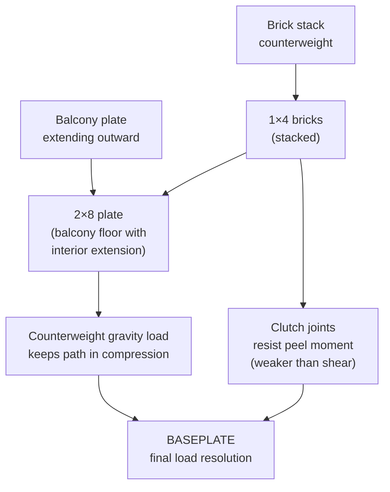

# Lesson 4: Advanced Systems Integration and Performance Optimization

## 1. First-Principles Intuition & Invariants

Every LEGO architectural model, no matter how visually intricate, resolves to a single engineering problem: the management of load paths through discretized elements held together by friction and geometric interlock. The brick itself is a marvel of injection-molded precision — each standard 2×4 element carries eight axial hollow studs atop a rectilinear shell with internal stiffening ribs, and the tube columns in the base interlock with those studs at a pitch of 8.0 millimeters. The clutch force between a single stud and its receiving tube is approximately 0.12 newtons of separation resistance when parts are new, though this degrades over hundreds of mating cycles due to microscopic abrasive wear on the ABS polymer surface. When you stack one hundred bricks in a column, you are not building a monolithic pillar; you are building a friction-dependent stack whose integrity depends on every interface maintaining its clutch pressure under gravitational shear, lateral vibration, and thermal expansion. Understanding this fundamental reality — that every LEGO structure is a granular assembly, not a continuum — is the first invariant of advanced architectural integration.

The second invariant concerns dimensional harmony. The LEGO system's genius lies in its unit geometry: one stud in width equals 5 plates in height, yielding the foundational aspect ratio that enables SNOT (Studs Not On Top) construction. A 1×1 brick occupies 8.0 mm × 8.0 mm × 9.6 mm. A single plate occupies 8.0 mm × 8.0 mm × 3.2 mm. Five plates stacked reach exactly 16.0 mm in height, which equals two stud-pitches in width. This 5:2 ratio is the master key of the entire system, and every advanced architectural technique — from curved facades to seamless tile cladding to half-stud-offset detailing — derives from manipulating this relationship. When you break this ratio, you introduce gaps, misalignments, and structural weakness. When you exploit it, you can rotate the entire coordinate system of your build by ninety degrees and still achieve perfect registration.

The third invariant is that real-world architectural loads translate to LEGO at a nonlinear scale. A flying buttress on a Gothic cathedral resolves lateral thrust from a stone vault into an external pier through a half-arch. In LEGO, the same principle applies, but the resolution medium changes: instead of compressive stone, you have interlocking ABS plastic whose shear resistance at the stud interface is the limiting factor. A LEGO arch built from 1×6 arch bricks (Part 3307) carries compressive load along its curve beautifully — the geometry of the voussoir distributes force radially outward into the abutments — but the same arch fails catastrophically if the abutments themselves are not anchored against outward spread. The thrust line must remain within the thickness of the arch ring at every point. In stone, this is a function of the ring's mass and geometry. In LEGO, it is additionally a function of clutch power at each joint, because a single slipped stud redirects the thrust line out of the ring and into collapse.

Multi-material composition introduces a fourth invariant. Modern advanced LEGO architecture rarely uses ABS alone. Translucent elements are polycarbonate (PC), which has different elastic modulus (approximately 2.0–2.4 GPa versus ABS at 2.1 GPa, but with notably different notch sensitivity and surface hardness). Flexible elements — hinges, snake tubes, flex tubes — use softer thermoplastic elastomers. Technic liftarms and connectors in the newer generations increasingly use modified polyamide for higher flexural strength. When you combine these in a single load path, you create a composite structure where differential thermal expansion, varying clutch wear rates, and mismatched flexural responses become real engineering concerns. A transparent polycarbonate panel locked between two ABS structural walls will crack before the ABS yields, because polycarbonate has lower elongation at break under the concentrated point loads that stud connections create.

## 2. Core Architecture & Mechanics

### The Load Path as Spatial Geometry

In conventional architecture, load flows downward through columns, walls, and foundations. In advanced LEGO architecture, the load path is a three-dimensional network that traverses studs, tubes, plates, pins, and Technic connectors in directions that can include significant horizontal and even upward components. The builder's task is to trace every major load from its point of application to the baseplate and verify that every element along that path can carry the imposed force without exceeding its clutch or flexural limit.

Consider a cantilevered balcony projecting from the third floor of a modular building. The balcony's dead weight creates a moment arm about the wall connection point. In real construction, this moment is resolved by a steel beam embedded into the concrete floor slab, transferring the bending load into tension in the upper flange and compression in the lower flange, with the slab acting as a counterweight. In LEGO, the analogous mechanism requires that you build the balcony floor as a plate layer extending several studs into the interior of the building, so that the interior mass provides the counterbalancing weight. The critical failure mode is not the balcony itself breaking — a plate layer is strong in bending — but rather the connection between the balcony plate and the interior floor separating under the rotational moment. The solution is to anchor the interior extension with vertical bricks stacked atop it, converting the interior weight into a downward force that the clutch joints must resist in peel rather than in shear. Peel resistance at a stud joint is roughly one-third of shear resistance, so you need proportionally more interior anchoring surface than the balcony projection would suggest.

The following diagram traces the load path through a typical cantilevered architectural element:

### SNOT Integration and Facade Systems

The architectural facade is where most advanced builders spend the majority of their design effort, and it is where the 5-plates-equals-2-studs invariant becomes the operative constraint. A SNOT facade attaches to the structural wall via brackets, headlight bricks (Part 4070), or Technic pin-and-beam assemblies, and presents a studless outward face using tiles, curved slopes, or textured plates. The critical geometric calculation is the offset between the SNOT face and the structural wall.

The standard SNOT bracket (Part 36841, the 1×2 modified plate with side stud) places the side-mounted stud at exactly 2.5 plates offset from the mounting surface. When you attach a 1×1 tile to this side stud, the tile's face sits 2.5 plates (8.0 mm) outboard of the wall surface. To make this flush with a wall built from bricks stacked in the conventional orientation, you need to account for the fact that a brick face is 3 plates deep from its outer surface to the back of its stud cavity. The 2.5-plate offset is half a plate shy of flush, which is why experienced builders interleave a tile layer or use the 1×1 modified plate with clip (Part 30246) that provides a 3-plate offset for perfect flush mounting.

For curved facades, the geometry becomes more demanding. A cylindrical tower wall built from 1×2 curved slope bricks (Part 43857 and variants) achieves a radius determined by the element's arc angle and the number of segments per revolution. The standard 1×2 curved slope subtends approximately 22.5 degrees, meaning sixteen segments complete a full circle. The outer radius of this circle is approximately 2.5 studs (20 mm). To connect this curved shell to a square structural core, you need a transition layer — typically 1×2 jumpers or modified brackets arranged radially — that bridges the curved geometry to the rectilinear stud grid. The load path here is primarily compressive (the curved wall's weight transfers downward through each ring to the ring below), but wind loads or handling forces create lateral shear that the radial connectors must resist. The weakest point is always the joint between the curved element and the transition bracket, because this joint transmits shear across a single stud interface oriented perpendicular to the lateral force.

### Kinetic Subsystem Integration

Advanced architectural models frequently incorporate kinetic elements: operable doors, drawbridges, rotating sections, elevators, and expanding mechanisms. Each kinetic subsystem introduces a load path that changes geometry during operation, meaning the structural analysis must cover the full range of motion, not just the static display configuration.

A hinged door in a LEGO architectural model typically uses a 1×2 hinge plate assembly (Part 3936/3937, the hinge plate pair). The hinge axis sits at 0.5 stud offset from the mounting surface, which means a door built as a 1×6 brick wall on this hinge will swing through an arc whose radius is 0.5 studs plus the wall thickness. The critical constraint is not the hinge itself — the metal pin in the hinge assembly is more than strong enough for any reasonable door mass — but rather the clearance between the door's swing path and the adjacent wall structure. A door wall built four studs wide will sweep an arc of approximately 32 mm radius, requiring at least 4 studs of clearance on the hinge side for the door to open ninety degrees without collision. This clearance must be designed into the floor plan from the earliest stages, because retrofitting it after the structural walls are built usually requires dismantling and rebuilding the hinge-side wall.

The following table summarizes common kinetic subsystems and their critical integration parameters:

| Subsystem | Primary Element | Hinge/Pivot Axis | Load Concern | Clearance Requirement |
|-----------|----------------|-----------------|--------------|----------------------|
| Single door | 3936/3937 hinge plate | 0.5 stud offset | Door sag from mass | 4 studs hinge side |
| Double door | Two 3936/3937 pairs | 0.5 stud offset each | Synchronization of leaves | 4 studs each side |
| Drawbridge | Technic pin + liftarm | Pin center, 1 stud | Bridge deck weight + counterweight | Full arc of bridge length |
| Elevator | Technic axle + bushings | Axle centerline | Cable/chain tension + car weight | Vertical shaft, 1 stud clearance |
| Rotating section | Turntable 92906/48452 | Center of turntable | Torque on drive + bearing load | Full rotation diameter |

For elevators, the most reliable mechanism in LEGO architecture is a chain-driven or string-driven platform guided by Technic liftarm rails. The drive element is typically a Technic chain (Part 3711) running over 8-tooth sprockets (Part 87082) at the top and bottom of the shaft. The platform attaches to the chain at a single point and is kept level by guide rails — usually two parallel Technic 1×16 liftarms (Part 32524) spaced one stud apart, with the platform sliding between them. The critical failure mode is the platform binding in the guide rails due to side play. The solution is to build the platform with a 0.5-stud-narrower width than the rail spacing, achieved by using 1-wide liftarms or half-stud-offset plates that reduce the platform width from an even number of studs to an odd number with half-stud centering.

### Real-World Principles in LEGO Scale

The translation of real architectural principles into LEGO requires understanding both the principle and the scale at which LEGO geometry can represent it. Consider the flying buttress: in Gothic architecture, it is a half-arch that carries the outward thrust of a rib vault across an aisle and down into a pinnacle-topped buttress pier. The structural principle is that the thrust line must be kept within the masonry at every point along its path from vault to pier.

In LEGO, the flying buttress can be modeled at minifig scale using 1×3 or 1×4 arch bricks for the half-arch, supported by a column of 1×1 or 1×2 bricks for the pier, and topped with a small cone or pyramid element for the pinnacle (which in real architecture adds compressive preload to keep the thrust line within the pier). The structural challenge is that the half-arch in LEGO is not a continuous compression member — it is a segmented arc of discrete elements, each held by clutch power. The thrust line analysis still applies, but the failure mode is different: instead of the stone crushing or the mortar failing, the LEGO arch fails when a joint opens due to the thrust line exiting the cross-section of an individual segment. To prevent this, the arch segments should be under sufficient compressive preload from the weight of the structure above (the nave wall) that the thrust line never crosses the intrados (inner edge) of any segment.

This is achieved in practice by ensuring that the nave wall above the spring point of the flying buttress carries enough mass — typically at least four to six brick courses of solid construction — to maintain compressive preload on the arch. The buttress pier itself should be at least 2×2 studs in cross-section at minifig scale, tapering upward, and should extend at least two courses above the arch's spring point to provide the counterweight that keeps the thrust line within the pier. The pinnacle mass can be simulated with a 1×1 cone or round brick, though its structural contribution at LEGO scale is minimal compared to the pier's own weight.

Dome construction presents a different challenge. A hemispherical dome in real architecture works in compression, with hoop forces circling the dome's latitude and meridional forces running from crown to base. The base of the dome experiences outward thrust that must be contained by a tension ring — in concrete domes, this is steel reinforcement; in masonry domes, it is often an iron chain embedded in the base course. In LEGO, a dome built from concentric rings of curved slope elements will experience the same outward thrust at its base, but unlike masonry, the clutch joints between rings are weak in hoop tension. The dome will tend to spread at its base under its own weight, separating the lowest ring from the supporting drum.

The solution is to embed a Technic tension ring at the dome's base course. This can be a loop of Technic flex cable (Part 53087) threaded through the Technic holes of 1×1 Technic bricks (Part 2780) built into the base ring, or a ring of 1×4 Technic liftarms connected end-to-end with friction pins. The tension ring absorbs the outward thrust that would otherwise rely on stud clutch power, which is insufficient for domes exceeding approximately 12 studs in diameter. For smaller domes — under 8 studs diameter — the clutch power of the curved elements is generally adequate, and no tension ring is needed.

## 3. High-Performance Optimization & Failure Modes

### Structural Stress Testing Methodology

A rigorous stress-testing protocol for LEGO architecture follows a sequence from individual element verification through subsystem testing to full-assembly validation. The first level is element verification: before incorporating any modified or unusual element into a load path, confirm that its clutch engagement with standard bricks meets the expected 0.12 N per stud threshold. This can be tested qualitatively by pressing the element onto a standard brick and noting whether the engagement feels firm and clicks into place with the characteristic snap, or whether it rocks, slides, or fails to fully seat. Elements that have been heavily used, exposed to UV light, or chemically cleaned may have degraded clutch surfaces. Transparent polycarbonate elements, in particular, develop surface micro-cracking over time that reduces clutch power by as much as 40 percent compared to new ABS.

The second level is subsystem testing. Each major structural subsystem — a wall section, an arch, a cantilever, a dome — should be built and tested in isolation before integration into the full model. The test protocol for a wall section is to build it to its intended height on a baseplate, then apply a lateral force at the top proportional to the expected handling load. A wall eight courses high, four studs thick, and sixteen studs long should resist at least 2 newtons of lateral force at the top without visible separation of the base course from the baseplate. If the base course separates, the wall needs a wider footprint or a mechanical anchor — typically a 1×2 plate with handles (Part 41740) secured to the baseplate with adjacent bricks.

For arches, the test is to build the arch on its abutments, then press down on the keystone with gradually increasing force while watching the abutments. If the abutments spread outward even fractionally — visible as a gap opening between the abutment base and the supporting structure — the abutment mass is insufficient. The remedy is to increase abutment weight by stacking additional bricks on top of the abutment columns, or to widen the abutment footprint to increase the base friction.

The third level is full-assembly validation. Once all subsystems are verified, the complete model is assembled and subjected to three handling tests. The lift test: can the model be lifted from the baseplate by its upper structural elements without any section separating? If not, the model is too heavy for its clutch-based connections and requires a Technic frame or a solid core column. The transport test: place the assembled model on a flat surface and slide it gently sideways. If the model flexes or ratchets (elements shifting by small increments with each movement), the base layer needs stiffening — typically by adding a plate layer beneath the base course to create a continuous shear-resistant foundation. The vibration test: tap the baseplate firmly with a finger and observe whether any elements shift or fall. Minor settling (elements compressing one plate-height further into their clutch) is acceptable; separation or displacement is not.

### Common Failure Modes and Mitigation

The most common structural failure in advanced LEGO architecture is progressive delamination, where a wall section separates from its neighbor along a vertical joint under repeated handling. This occurs when the vertical joint between two wall sections is a single-stud-wide interface — for example, two 1×8 walls meeting at a common edge with only the stud clutch holding them together. The mitigation is to stagger the joint: rather than building two walls side by side with a clean vertical seam, build the wall as overlapping courses where every other course bridges the seam with a 1×2 or 1×4 plate that spans both wall sections. This converts the vertical shear joint into a stepped interface that resists separation through the plate's bending stiffness in addition to clutch power.

A second common failure is corner separation, where two walls meeting at a right angle pull apart at the corner. This is particularly prevalent in tall structures where the walls carry significant vertical load and the corner joint must resist both the shear from each wall's weight and the rotational moment from any eccentric loading. The standard solution is corner bracing with 1×1 modified plates with vertical clip (Part 2555) or 1×1 SNOT brackets (Part 4733) at every fourth course, which tie the corner together across the joint. For structures exceeding twelve courses in height, a Technic 1×1 beam (Part 2780) column at each corner, linked by cross-beams every four courses, provides a rigid internal frame that the brick cladding attaches to.

Thermal expansion failure is rare but does occur in models displayed in environments with significant temperature variation. ABS has a coefficient of linear thermal expansion of approximately 73 × 10⁻⁶ per degree Celsius. Over a model one meter long (approximately 125 studs), a 10°C temperature swing produces a dimensional change of approximately 0.73 mm — less than one stud pitch, but enough to introduce stress at rigid connection points. Models that incorporate long Technic liftarm spans (over 32 studs) rigidly connected at both ends can experience buckling or joint separation under thermal cycling. The mitigation is to design one end of long spans as a sliding joint — a Technic pin in an oversized hole, or a stud-on-plate interface with a single point of attachment — allowing thermal expansion to be absorbed by the joint's play rather than by structural deformation.

### Design Iteration Workflow

The most effective iteration workflow for advanced LEGO architecture follows a three-phase cycle: sketch, prototype, validate.

In the sketch phase, the design is laid out in plan and elevation using graph paper at 1:1 stud scale (one graph square equals one stud). This allows the builder to verify dimensional constraints before committing physical elements. Every wall is drawn as a double line representing its thickness, with stud-grid registration marks every four studs to verify alignment. Door and window openings are drawn at their actual stud dimensions, and the header course above each opening is specified — typically a 1×4 or 1×6 plate spanning the opening, backed by a brick course above for compressive load transfer. Arches are drawn as arcs with their spring points, keystone position, and abutment dimensions marked.

In the prototype phase, the design is built in sections at reduced scale — typically at half the intended height — to verify structural behavior before committing the full element inventory. The half-scale prototype reveals load-path failures that are not visible in the sketch: a wall that is too thin relative to its height will topple at half scale, confirming that it will fail at full scale. An arch whose abutments are too light will spread at half scale. A cantilever whose counterweight is insufficient will sag visibly at half scale. The prototype phase is also where the builder verifies parts inventory: if a specific element is needed in quantities beyond what is available, the design must be modified before full-scale construction.

In the validate phase, the full-scale model is built and subjected to the stress-testing protocol described above. Failures are documented with photographs and annotations specifying the failure location, the load that caused it, and the mitigation applied. The design is then revised and the affected subsystem is rebuilt and retested. This cycle continues until the model passes all three handling tests (lift, transport, vibration) without any structural separation.

A key principle of this workflow is that iteration cost increases dramatically with model scale. A failure discovered in the sketch phase costs minutes to fix. A failure in the prototype phase costs an hour. A failure in the validate phase, after the full model is built, can cost many hours of disassembly and rebuilding. The experienced builder therefore invests heavily in the sketch and prototype phases, treating the full-scale build as a confirmation of already-validated design decisions rather than an experiment.

### Multi-Material Integration in Practice

When combining ABS structural elements with polycarbonate windows, rubber seals, and Technic load-bearing members, the integration sequence matters. The structural frame — the load-carrying skeleton of Technic beams, liftarms, and load-bearing brick columns — is built first and tested for rigidity. The infill walls — brick and plate layers that fill between the structural frame — are added second, keyed into the frame via stud connections or Technic pin joints. The facade elements — tiles, slopes, transparent panels, and decorative textures — are applied last, after all structural and infill layers are verified, so that the facade is never disturbed by structural adjustments.

Transparent panels deserve particular attention. Polycarbonate elements in LEGO — the transparent 1×2×2 window pane (Part 6233), the transparent 1×4×3 window (Part 3854), and the various transparent tiles and plates — are brittle compared to ABS. They should never be used in a load-bearing capacity or placed in a position where structural flex will transfer stress into the panel. The mounting frame for a transparent panel should have at least 0.5 stud of clearance on all sides, achieved by leaving one stud position empty adjacent to the panel or by using a frame of 1-wide elements that creates a slight gap. This clearance accommodates the differential flex between the ABS frame and the polycarbonate panel, preventing the panel from cracking under structural movement.

Rubber elements — the small rubber bands used for kinetic mechanisms, the soft tire elements sometimes repurposed as bearings or dampeners, and the rubber Technic bushings — have a useful but limited role in architectural models. Their primary function is as dampeners between moving parts, absorbing vibration and reducing rattle in kinetic subsystems. They should not be relied upon for structural connection, because rubber creep under sustained load will cause the connection to loosen over time. A rubber band holding a door mechanism in the closed position will, after months of sustained tension, stretch and lose its holding force. The replacement interval for rubber elements in load-carrying kinetic mechanisms is approximately 18 to 24 months under normal display conditions, sooner if the model is handled frequently or stored in warm environments.

The integration of Technic structural members into a primarily System-brick architectural model is the hallmark of advanced construction. Technic liftarms provide the bending stiffness that stacked bricks cannot — a 1×16 Technic liftarm (Part 32524) in bending resists approximately 15 newtons at midspan before significant deflection, compared to a stack of 1×16 plates which deflects noticeably at 5 newtons. When a long horizontal span is needed — a bridge, a wide doorway, a cantilevered floor — embedding a Technic liftarm within the plate stack (by building the plate layer around the liftarm, which occupies 1 stud width and 1 brick height) creates a reinforced composite beam that combines the liftarm's bending stiffness with the plate layer's compressive and shear capacity. The liftarm should extend at least 4 studs beyond each end of the span into the supporting structure, anchored with friction pins or by being trapped between brick courses that prevent it from sliding out under load.

This composite beam approach is the single most powerful structural technique in the advanced builder's repertoire, and it deserves explicit calculation. For a 24-stud clear span carrying the weight of a two-story wall section above it (approximately 2.5 kg of bricks), the bending moment at midspan is 0.74 N·m. A single 1×16 Technic liftarm has a section modulus of approximately 24 mm³, giving a bending stress of approximately 31 MPa at this load — well within the flexural strength of polyamide liftarm material (approximately 70 MPa). Two liftarms, one near each face of the wall, halve the stress to 15.5 MPa, providing a safety factor of approximately 4.5. This is the kind of calculation that should accompany every long-span design decision, even if performed as a rough estimate rather than a formal analysis. The builder who develops this habit — of mentally estimating loads, calculating stresses, and verifying that the chosen elements carry adequate safety margin — will produce structures that stand without separation, transport without damage, and endure as models worthy of the architectural principles they represent.
