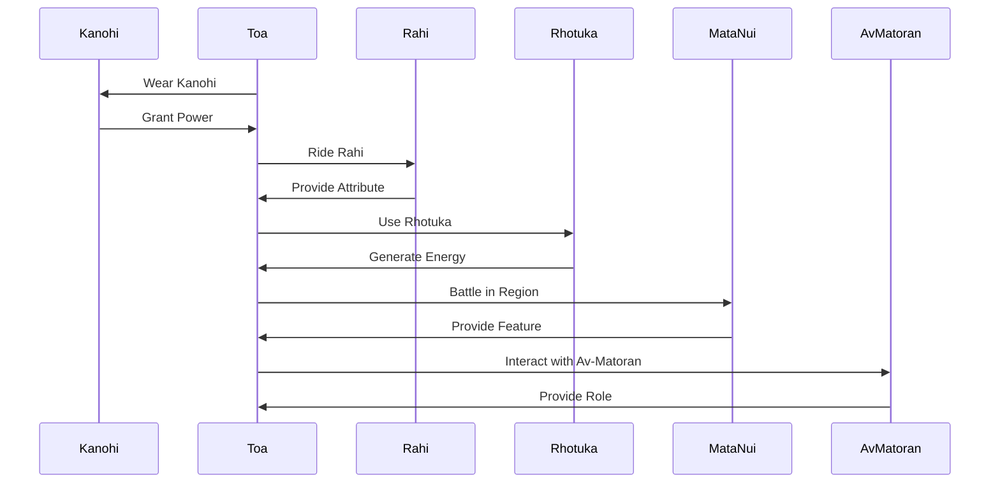

# Foundation: Bionicle
## 1. Conceptual Mental Model (First principles, historical context, and fundamental paradigm shifts)

### First Principles
Bionicle is a Lego-themed universe that combines elements of science fiction, mythology, and action-adventure. It is built upon the foundational concept of "Kanohi" (masks) and "Rhotuka" (discs), which are integral to the storytelling and gameplay mechanics. The universe is structured around the idea of a world where beings can transform into vehicles and machines, and where the balance of power is maintained through a series of complex and interconnected systems.

### Historical Context
Bionicle was introduced in 2001 as a spin-off from the popular Lego Technic line. The concept was developed by Greg Farshtey, who envisioned a universe where Lego could explore themes of mythology, adventure, and transformation. The introduction of Bionicle marked a significant shift in Lego's product line, moving away from simple construction sets and towards a more narrative-driven, immersive experience.

### Fundamental Paradigm Shifts
- **Transformation Mechanics:** Bionicle introduced the concept of transformation, where characters can change into vehicles or machines. This paradigm shift expanded the possibilities of Lego play, allowing for more dynamic and engaging storytelling.
- **Narrative Integration:** Unlike traditional Lego sets, Bionicle integrates a rich narrative into the play experience. This shift emphasizes the importance of storytelling and character development in Lego play.
- **Thematic Consistency:** Bionicle maintains a consistent theme across all products, including sets, video games, and animated series. This thematic consistency enhances the immersive experience for players.

## 2. Essential Terminology & Taxonomy (Comprehensive architectural definitions)

### Kanohi
**Definition:** Kanohi are mystical masks that grant their wearers unique abilities. Each Kanohi is associated with a specific power and is represented by a distinct symbol.
**System-Level Definition:** Kanohi can be modeled as a set of discrete objects, each with a unique set of properties and behaviors. The set of all Kanohi can be represented as a finite set \( K \) where each element \( k \in K \) has a power function \( P(k) \) and a symbol function \( S(k) \).

### Rhotuka
**Definition:** Rhotuka are spinning discs that serve as weapons and power sources. They are typically attached to the arms or legs of characters and can be used to generate energy or attack.
**System-Level Definition:** Rhotuka can be modeled as a set of rotating objects, each with a specific rotational speed and energy output. The set of all Rhotuka can be represented as a finite set \( R \) where each element \( r \in R \) has a speed function \( V(r) \) and an energy function \( E(r) \).

### Rahi
**Definition:** Rahi are mythical creatures that inhabit the Bionicle universe. They are often used as mounts or companions by characters and can possess unique abilities.
**System-Level Definition:** Rahi can be modeled as a set of living entities, each with a specific set of attributes and behaviors. The set of all Rahi can be represented as a finite set \( H \) where each element \( h \in H \) has an attribute function \( A(h) \) and a behavior function \( B(h) \).

### Toa
**Definition:** Toa are the main characters in the Bionicle universe. They are warriors who possess unique abilities and are tasked with protecting the universe from evil forces.
**System-Level Definition:** Toa can be modeled as a set of characters, each with a specific set of powers and abilities. The set of all Toa can be represented as a finite set \( T \) where each element \( t \in T \) has a power function \( P(t) \) and an ability function \( A(t) \).

### Mata Nui
**Definition:** Mata Nui is the central island in the Bionicle universe. It is the home of the Toa and the site of many key battles and events.
**System-Level Definition:** Mata Nui can be modeled as a geographical entity, consisting of various regions and landmarks. The set of all regions in Mata Nui can be represented as a finite set \( M \) where each element \( m \in M \) has a feature function \( F(m) \) and a location function \( L(m) \).

### Av-Matoran
**Definition:** Av-Matoran are the inhabitants of the Bionicle universe. They are small, humanoid creatures that serve as the everyday citizens of Mata Nui.
**System-Level Definition:** Av-Matoran can be modeled as a set of characters, each with a specific set of attributes and roles. The set of all Av-Matoran can be represented as a finite set \( V \) where each element \( v \in V \) has an attribute function \( A(v) \) and a role function \( R(v) \).

## 3. Architecture & Core Workflow (Detailed ASCII and Mermaid diagrams with step-by-step dataflow)

### ASCII Diagram
```
+-------------------+       +-------------------+       +-------------------+
|     Kanohi        |<------>|     Toa           |------>|     Rahi          |
+-------------------+       +-------------------+       +-------------------+
| Power: X          |       | Power: Y          |       | Attribute: Z      |
| Symbol: A         |       | Ability: W        |       | Behavior: Q       |
+-------------------+       +-------------------+       +-------------------+
          |                           |                           |
          |                           |                           |
          v                           v                           v
+-------------------+       +-------------------+       +-------------------+
|     Rhotuka       |<------>|     Mata Nui      |------>|     Av-Matoran    |
+-------------------+       +-------------------+       +-------------------+
| Speed: V          |       | Region: M         |       | Attribute: N      |
| Energy: E         |       | Feature: F        |       | Role: O           |
+-------------------+       +-------------------+       +-------------------+
```

### Mermaid Sequence Diagram


## 4. Common Misconceptions & Mental Traps (Subtle edge cases and flawed mental models)

### Misconception: Kanohi and Rhotuka are interchangeable
**Flawed Mental Model:** Some practitioners believe that any Kanohi can be used with any Toa and that any Rhotuka can be used with any Toa.
**Correct Understanding:** Kanohi and Rhotuka are specifically designed for certain Toa and have unique properties that are tailored to their abilities.

### Misconception: Rahi are always loyal to Toa
**Flawed Mental Model:** Some practitioners assume that Rahi will always follow and protect Toa.
**Correct Understanding:** Rahi have their own attributes and behaviors, and their loyalty to Toa can vary based on the specific Rahi and the situation.

### Misconception: Mata Nui is a static environment
**Flawed Mental Model:** Some practitioners believe that Mata Nui remains unchanged throughout the Bionicle universe.
**Correct Understanding:** Mata Nui is a dynamic environment with various regions and features that can change over time, affecting the gameplay and story.

### Misconception: Av-Matoran are passive characters
**Flawed Mental Model:** Some practitioners assume that Av-Matoran play no significant role in the Bionicle universe.
**Correct Understanding:** Av-Matoran have unique attributes and roles that contribute to the story and gameplay, and they can interact with Toa in meaningful ways.

## 5. Socratic Discussion Starters (Advanced questions for deep Socratic exploration)

### Discussion Question 1
How does the transformation mechanics in Bionicle relate to the concept of modular design in engineering? Can you provide examples of how this concept is applied in real-world engineering systems?

### Discussion Question 2
The narrative integration in Bionicle is a significant departure from traditional Lego sets. How does this approach to storytelling impact the player's engagement and immersion in the Lego experience? Can you compare this to other media that integrate storytelling with gameplay?

### Discussion Question 3
The thematic consistency in Bionicle is a key aspect of its design. How does this consistency contribute to the overall coherence of the universe? Can you provide examples of how thematic consistency is achieved in other fictional universes?
