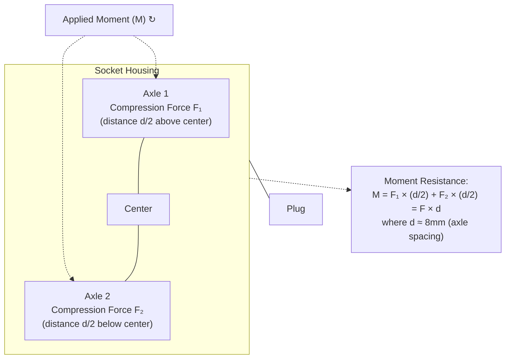

# Lesson 1: Construction System Fundamentals

## 1. First-Principles Intuition & Invariants

The Bionicle construction system represents one of the most sophisticated intersections of character articulation, structural engineering, and modular play in the Lego portfolio. Unlike traditional brick-based construction where compression and stud-tube interference provide stability, Bionicle demands an entirely different mechanical vocabulary: one built upon cantilever load paths, rotational joint tolerance, and the marriage of ball-and-socket spherical kinematics with the rectilinear precision of Technic pin connections. To master Bionicle construction at an advanced level requires understanding not merely how pieces connect, but why certain joint architectures succeed under dynamic loading while others catastrophically fail when subjected to repeated articulation cycles or gravitational moment arms extending beyond critical thresholds.

The genesis of Bionicle's mechanical language lies in the 2001 introduction of Generation 1 (G1) components, which borrowed heavily from the earlier Throwbots and Slizer lines. These early sets established the foundational principle that would define all subsequent Bionicle engineering: the **ball-and-socket joint as the primary articulation primitive**. This spherical joint topology offers three rotational degrees of freedom within geometric constraints defined by the socket's cup geometry, providing far greater posability than simple hinge or pin joints which restrict motion to a single rotational axis. The original Mata hand-foot socket pieces featured a hemispherical cup with an entrance diameter of approximately 9.5 millimeters and a retention lip that created mechanical interference with the Technic ball joint element—a perfect sphere measuring 10 millimeters in diameter, mounted on a short stub axle compatible with standard Technic brick connection points.

The mechanical elegance of this system derives from the elastic deformation properties of ABS plastic. When a ball joint is pressed into a socket, the socket walls expand elastically by roughly 0.25 to 0.35 millimeters, creating a radial interference fit. The retention lip provides an undercut feature that generates a mechanical snap-lock once the ball's equator passes beyond it. This interference geometry creates sufficient retention force to maintain joint position under static loading while still permitting deliberate repositioning through applied torque. The friction coefficient between ABS surfaces (approximately 0.4 to 0.5 for clean, dry contact) combined with the normal force generated by elastic compression produces a holding torque typically ranging from 0.08 to 0.15 Newton-meters for a fresh joint. This holding torque degrades over repeated articulation cycles as microscopic wear occurs at high-stress contact points on both ball and socket surfaces, a phenomenon that advanced builders must account for when designing display models expected to maintain poses over months or years.

The second foundational element in Bionicle's mechanical vocabulary is the **Technic pin connection standard**, which provides rigid structural connectivity between elements. Unlike ball joints which permit spherical rotation, Technic pin connections establish either a fixed rigid connection (friction pins with longitudinal ribs) or a single-axis hinge connection (smooth pins without ribs). The standard Technic pin measures 4.8 millimeters in diameter along its smooth sections and approximately 5.0 millimeters across the friction rib peaks, designed to fit into Technic pin holes measuring 4.85 millimeters in diameter. This creates an interference fit of 0.15 millimeters on friction pins, generating axial retention forces sufficient to resist tensile pull-out under typical handling loads while permitting disassembly with deliberate force.

The critical insight for advanced Bionicle construction is recognizing that **ball joints carry articulation duties while pin connections carry structural loads**. This division of mechanical labor represents the core invariant around which all successful Bionicle models must be architected. Attempting to route primary structural loads through ball-and-socket joints results in joint creep over time as the constant stress causes plastic cold flow and progressive loosening. Conversely, attempting to create highly articulated figures using only pin connections results in limited posability and often requires fragile cantilevered assemblies that concentrate bending stress in narrow sections of the Technic beam elements.

The evolution to the Character and Creature Building System (CCBS) in 2011 fundamentally altered this mechanical landscape while maintaining backward compatibility with G1 principles. CCBS introduced a new connection standard centered on the **dual-axle socket**, a large rectangular housing measuring approximately 16 millimeters wide by 12 millimeters tall containing two parallel Technic axle holes spaced 8 millimeters apart on center. This dual-axle topology dramatically increased the moment resistance of joint assemblies by distributing rotational loads across two parallel constraint points rather than the single-point contact of traditional ball joints. A standard CCBS limb element features a dual-axle plug on one end (with two parallel protruding axle stubs) and a dual-axle socket on the other, creating a modular chain where each joint possesses significantly higher bending stiffness than G1 equivalents.

The mechanical advantage of CCBS becomes apparent when analyzing cantilever bending under gravitational loading. Consider a G1 Toa arm assembly consisting of an upper arm element attached to a shoulder ball joint, with the forearm and hand extending outward, creating a moment arm of approximately 120 millimeters from the shoulder joint to the hand's center of mass. If we attach a weapon or shield massing 40 grams, the gravitational force of 0.39 Newtons acting at 120 millimeters generates a moment of 47 Newton-millimeters at the shoulder joint. This moment must be resisted entirely by the friction force at the ball-socket interface. With a 10-millimeter ball radius, this requires a tangential friction force of 4.7 Newtons—often exceeding the holding capacity of a worn ball joint and resulting in the characteristic gradual droop that plagues many G1 display builds.

The CCBS dual-axle joint distributes this same moment across two parallel axle points spaced 8 millimeters apart vertically. The moment resistance comes not from friction but from the elastic bending of the ABS axle stubs themselves and the bearing reaction forces at the socket walls. This configuration creates a mechanically superior joint that exhibits minimal creep under sustained loading and maintains its position across years of display without the progressive loosening endemic to G1 ball joints. However, CCBS joints sacrifice some of the spherical freedom of motion inherent to ball joints, restricting rotation primarily to a single axis perpendicular to the dual-axle pair. This trade-off between holding strength and articulation freedom represents the central design tension in advanced Bionicle construction.

Understanding pin compatibility across the Bionicle ecosystem reveals additional subtleties. While standard Technic friction and smooth pins work universally across both G1 and CCBS elements, the **Bohrok eye stalk pin** (also called the "ball joint pin" or "long friction pin with ball") creates a unique hybrid connection point. This element features a standard ball joint on one end and a friction pin stub on the other, measuring approximately 16 millimeters in total length. Its utility lies in converting standard Technic pin holes into ball-joint connection points, enabling the attachment of G1 socket elements to locations otherwise accessible only via axle or pin connections. The mechanical behavior of these hybrid pins under loading requires careful analysis—while the pin interface provides a rigid structural connection, the ball joint introduces a spherical degree of freedom that can create unexpected articulation where none was intended, potentially compromising structural rigidity if not properly constrained.

## 2. Core Architecture & Mechanics

To analyze the mechanical architecture of Bionicle construction systems with appropriate rigor, we must dissect the force transmission paths that govern structural integrity and articulation behavior. The fundamental building block of any Bionicle model is the **articulated rigid body chain**: a sequence of rigid elements (bones, shells, armor plates) connected by rotational joints (ball sockets, pin hinges, CCBS dual-axles) that permits controlled deformation of the overall assembly while maintaining structural integrity within each element.

The G1 skeleton assembly provides the canonical example. A typical Toa torso consists of a central chest plate featuring multiple ball-joint sockets positioned at biomechanically relevant locations—shoulders, neck attachment, and sometimes lateral hip connections. The chest plate itself functions as the ground reference for the kinematic chain, analogous to the base coordinate frame in robotic kinematics. Each limb extends outward from this central reference as an open kinematic chain, typically consisting of three or four segments: upper arm (or thigh), lower arm (or shin), hand (or foot), and sometimes additional connector segments for proportional adjustment.

```
Kinematic Chain Topology (G1 Arm Assembly):

  Torso Socket (Ground)
         |
    [Ball Joint]  ← 3-DOF spherical rotation (shoulder)
         |
   Upper Arm Bone (rigid body)
         |
    [Pin Hinge]  ← 1-DOF rotation about pin axis (elbow)
         |
   Lower Arm Bone (rigid body)
         |
    [Ball Joint]  ← 3-DOF spherical rotation (wrist)
         |
   Hand/Weapon Socket (end effector)
```

Each ball joint in this chain introduces three rotational degrees of freedom (DOF) constrained by geometric limits imposed by socket cup depth and interference with adjacent elements. A hemispherical socket typically permits approximately 90 degrees of rotation along any axis passing through the ball's center before the socket rim contacts the mounting stub of the ball element. Pin hinges contribute a single rotational DOF about the pin axis, with typical range of motion between 90 and 180 degrees depending on the beam geometry surrounding the pin hole. The cumulative DOF for a G1 arm assembly as diagrammed above equals seven degrees (3 + 1 + 3), providing more than sufficient articulation space to reach arbitrary positions within the arm's workspace volume.

The critical failure mode in such chains is **moment-induced joint creep at the proximal joints**. Because gravitational and inertial forces act on the mass of all distal segments, the moment loading at any given joint equals the sum of all forces acting on segments outboard of that joint multiplied by their respective moment arm distances. The shoulder joint therefore experiences the highest loading, as it must resist the cumulative weight of the entire arm assembly. This mechanical reality explains why competition-grade Bionicle MOCs (My Own Creations) frequently reinforce shoulder joints through redundant load paths—adding Technic pin connections that run parallel to the ball joint, creating a composite joint topology where the ball provides articulation and the pin carries the structural shear and bending loads.

CCBS architecture fundamentally alters this load distribution through its dual-axle joint topology. The mechanical behavior of a dual-axle connection under applied moment can be modeled as a simply supported beam subjected to transverse loading. Consider the axle stubs as two parallel cantilever beams fixed at the plug element and bearing against the socket walls. When a bending moment attempts to rotate the joint, one axle experiences compression against the upper socket wall while the opposite axle experiences compression against the lower socket wall, creating a couple that resists the applied moment.



The mechanical advantage becomes apparent when comparing equivalent loading scenarios. For a G1 ball joint with 10-millimeter diameter, a given frictional holding force F at the ball surface creates moment resistance M = F × 5mm (the ball radius). For a CCBS joint with 8-millimeter axle spacing, the same bearing force magnitude at each axle creates moment resistance M = F × 8mm, providing a 60% improvement in moment capacity from geometric factors alone. Additionally, the bearing contact mode (compression of plastic against rigid cylindrical axle) exhibits less wear and plastic deformation over time compared to the sliding friction contact at ball-socket interfaces, accounting for the superior long-term stability of CCBS joints in sustained cantilever applications.

Pin compatibility mapping reveals the interoperability matrix that governs hybrid construction techniques combining G1 and CCBS elements. Standard Technic friction pins measuring approximately 18 millimeters in length (the 3L friction pin) fit universally into any Technic pin hole across all Bionicle generations, providing rigid connections with friction retention. The 2L friction pin (12 millimeters) offers similar functionality in constrained spaces. Smooth pins of equivalent lengths create single-axis hinges where rotational friction derives primarily from the elastic normal force of the pin hole walls rather than mechanical interference from longitudinal ribs.

The **axle-to-pin adapter** ecosystem enables conversion between axle-based connections (where a shaped axle with cruciform or plus-shaped cross-section engages a complementary axle hole) and pin-based connections. The most common adapter is the pin connector with axle hole (part 6562), which features a friction pin on one side and an axle hole on the opposite side, effectively translating between connection standards. These adapters become essential when integrating CCBS elements (which predominantly use axle-based connections) with G1 elements (which rely heavily on pin holes in Technic beam bones).

Structural load distribution in complex Bionicle assemblies demands attention to **primary load paths** versus **secondary stabilization paths**. The primary load path consists of the minimum set of structural connections required to transfer gravitational and handling loads from extremities back to the support base (typically the model's feet or display stand). Secondary paths provide redundancy and distribute loads more evenly, preventing stress concentration at single points. A properly engineered large-scale Bionicle MOC features triangulated structural frames within the torso, where multiple Technic beams form closed-loop geometric shapes that distribute compressive and tensile loads across multiple members rather than creating single-point failure dependencies.

The principle of triangulation derives from the fundamental geometric invariant that a triangle remains rigid under vertex loading while quadrilaterals and higher-order polygons can deform through shearing at the joints unless diagonally braced. Within Bionicle construction, this manifests as the practice of connecting three or more Technic beams in triangular arrangements using pins at their vertices, creating a rigid structural truss within the torso cavity that resists bending and torsional loads imposed by heavy limbs or weapon elements. The classic Toa Mata torso provides an elegant example: the chest plate, back plate, and lateral beam elements form an approximately equilateral triangular prism that efficiently resists loads from any direction without requiring excessive mass or part count.

## 3. High-Performance Optimization & Failure Modes

Achieving structural excellence in advanced Bionicle construction requires systematic attention to joint optimization, load path efficiency, and proactive mitigation of common failure modes that compromise long-term display stability or handling durability. The practitioner must develop a working knowledge of how material properties, geometric tolerances, and assembly techniques interact to produce either robust structures capable of withstanding years of display and handling or fragile assemblies that fail catastrophically under minimal provocation.

Joint friction optimization begins with understanding the tribological behavior of ABS plastic in ball-socket interfaces. Fresh ball joints exhibit consistent holding torque, but this degrades predictably with articulation cycles as surface asperities wear down at molecular scales. For display models requiring sustained pose maintenance, the solution lies not in tightening joints (which accelerates wear) but in **reducing the moment arm** between the joint and the system's center of mass. Repositioning heavy elements like weapons or armor plates closer to the torso dramatically reduces the gravitational moment experienced at shoulder and hip joints, often permitting stable poses that would otherwise be impossible with distal mass placement.

When geometric constraints prevent moment arm reduction, introduce **parallel load paths** that bypass ball joints for structural duties while preserving them for articulation. The technique involves running a Technic beam from the torso, parallel to the limb assembly, with pin connections at strategic points along its length. The beam acts as a structural buttress carrying bending loads while the ball joints provide rotational freedom for posing. This composite architecture combines the articulation benefits of ball joints with the load-bearing capacity of pin-connected rigid elements. The implementation requires careful attention to pin placement—the beam must connect at points that constrain the limb in the desired pose without over-constraining the joint and creating binding or stress concentration.

CCBS joint stiffness tuning exploits the elastic deformation characteristics of the dual-axle interface. New CCBS elements fit snugly, sometimes requiring significant insertion force. If joints are too stiff, gently flexing the socket housing outward by 0.2 to 0.3 millimeters (applying careful pressure to the exterior walls with thumb and forefinger) reduces the interference fit without compromising structural integrity. Conversely, loose CCBS joints can be tightened by introducing thin shims—a single layer of paper or thin plastic film wrapped around one or both axle stubs increases their effective diameter by approximately 0.1 millimeters, restoring friction fit characteristics. Advanced builders sometimes apply a microscopic amount of medium-viscosity cyanoacrylate adhesive to worn axle stubs, allowing it to cure fully before inserting into the socket; this builds up worn surfaces and restores joint tightness, though it creates a permanent or semi-permanent connection that may complicate future disassembly.

The **cantilever length limit** represents a hard physical constraint governing maximum limb extension from the torso. For G1 ball-jointed limbs with standard Bionicle bone elements, practical cantilever limits without reinforcement fall between 100 and 140 millimeters from the torso attachment point to the distal end effector, depending on the mass of attached weapons or armor. Exceeding this threshold without introducing secondary support structures results in progressive joint droop, typically manifesting within hours to days of display as plastic creep accumulates under sustained loading. CCBS extends this limit to approximately 180 to 220 millimeters due to superior moment resistance, enabling taller, more proportionally accurate humanoid figures without structural reinforcement.

When building beyond these cantilever limits, the practitioner must implement **external support structures** or **internal skeletal reinforcement**. External supports include transparent Technic beams or clear acrylic rods extending from the torso to the distal limb segments, effectively reducing the effective cantilever length by introducing an intermediate ground reference. Internal reinforcement involves routing a continuous Technic axle through the hollow core of limb bones, extending from the torso connection point through multiple segments to the distal end. The axle creates a continuous rigid element that carries bending loads in tension and compression rather than routing all loads through intermediate joints. This technique proves particularly valuable in creating extended wings, tails, or weapon assemblies where aesthetic considerations prohibit visible external supports.

Color-matching constraints intersect with structural engineering when specific geometric configurations require elements not available in the desired color palette. Advanced builders maintain a comprehensive inventory of connection elements—ball joints, sockets, pins, axles—in neutral colors (black, dark gray) specifically for internal structural applications where color visibility is minimal. This permits optimal structural design unconstrained by color availability, with colored armor shells and exterior elements selected independently for aesthetic purposes. The separation of structural skeleton from decorative skin mirrors vertebrate anatomy and produces superior results compared to attempting to serve both structural and aesthetic functions with a single layer of colored elements.

Failure mode taxonomy for Bionicle assemblies includes several characteristic patterns. **Ball joint creep** manifests as gradual droop of limbs over hours to days under sustained gravitational loading, resulting from plastic cold flow at high-stress contact points in the socket. Mitigation requires moment arm reduction, parallel load paths, or replacement of worn joints with fresh elements. **Pin hole wallowing** occurs when repeated insertion and removal cycles enlarge pin holes through mechanical abrasion, reducing friction fit and permitting unwanted rotation or looseness. Prevention demands careful handling during disassembly—rotate pins gently while pulling rather than applying pure tensile force, and limit assembly-disassembly cycles for display models.

**Technic beam bending** appears in long unsupported spans subjected to transverse loading, where the beam element itself plastically deforms rather than joint failure occurring. ABS plastic exhibits a yield strength of approximately 40 to 50 megapascals, beyond which permanent deformation occurs. Technic beams with long unsupported spans (greater than 10 to 12 module lengths) subjected to transverse loads approaching 5 to 8 Newtons risk permanent bending. The solution involves either shortening unsupported spans through intermediate pin connections, doubling beams in parallel to increase section modulus, or replacing standard beams with liftarms which exhibit higher bending stiffness due to their perpendicular orientation and often greater thickness.

**Armor plate stress cracking** develops at connection points on thin-walled shell elements subjected to repeated flexing or high insertion forces on tight-fitting ball joints. The thin ABS surrounding ball sockets concentrates stress, particularly in older elements that have become slightly brittle through UV exposure or thermal cycling. Minimize risk by supporting shell elements from multiple connection points rather than cantilevering them from a single ball joint, and avoid excessive force during assembly—if a ball joint requires extraordinary insertion force, identify whether the socket is undersized or contaminated rather than forcing assembly and risking crack propagation.

The principle of **graceful degradation** guides robust design for long-term reliability. Rather than creating assemblies where single-point failure causes catastrophic collapse, distribute structural duties across multiple redundant paths such that progressive wear or individual joint failure results in gradual performance reduction rather than sudden structural failure. A well-designed large-scale Bionicle MOC tolerates the complete failure of any single ball joint without collapse, as adjacent joints and structural beams maintain overall integrity until repair can be performed. This redundancy costs additional parts and complexity but proves invaluable for display models or handling-intensive applications like photography or convention transport.

Advanced builders develop systematic inspection protocols for high-value or complex builds, checking joint tightness and structural integrity weekly during initial display phases and monthly thereafter. Early detection of joint loosening or stress cracking permits timely intervention before minor issues propagate into structural failures requiring extensive disassembly and reconstruction. Documentation of known stress points and wear patterns across multiple builds creates an empirical database informing future design decisions, progressively refining structural strategies toward optimal performance within the constraints of the Bionicle construction system.
