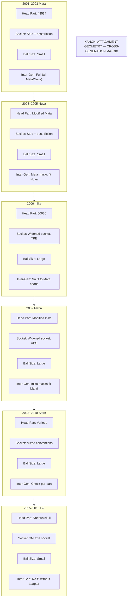

# Lesson 2: Part Taxonomy, Functionality, Constraints

## 1. First-Principles Intuition & Invariants

To build with Bionicle is to work at the intersection of two engineering traditions that rarely meet: the kinematic logic of a ball-and-socket skeleton, and the aesthetic language of a character-driven object. Every part in the Bionicle system exists because it had to solve a problem that System bricks and Technic liftarms could not — not primarily a structural problem, but a representational one. The question LEGO engineers were answering in 1999 and 2000 was deceptively hard: how do you build a figure that reads as organic, as asymmetric, as alive, while remaining a construction toy whose parts snap together repeatably? The answer became a part taxonomy unlike anything else in the LEGO catalog.

The invariant that governs everything in Bionicle construction is the **ball-joint hierarchy**. Where Technic uses holes and axle connections to create rigid pin-and-beam linkages, Bionicle uses a continuous chain of ball sockets and ball cups to create joints that resolve force in three dimensions simultaneously. A Technic pin connection is essentially a revolute joint: it rotates cleanly around one axis and is mechanically overconstrained in every other degree of freedom. A Bionicle ball joint is a spherical joint: it allows rotation around all three axes up to the mechanical limits imposed by the geometry of the socket housing. This distinction is not cosmetic. It means every Bionicle limb segment is simultaneously a structural member and a posable kinematic link, and the engineering of each part has to satisfy both requirements at once.

The second invariant is the **shell-and-frame duality**. Every Bionicle figure, from the original 2001 Toa Mata through the 2015 Toa Master, is built on a distinction between structural frame parts and decorative armor shells. The frame carries load, transmits torque, and provides the attachment points for the kinematic chain. The shell clips over or pins to the frame and carries visual mass, color, and character. Getting this duality wrong — treating shells as structural, or trying to make frames carry visual weight alone — is the most common failure mode a practitioner encounters. Understanding why each part belongs to one category or the other is the foundation of fluent Bionicle building.

The third invariant, often invisible until it causes a problem, is **generation-specific compatibility**. Bionicle parts were not designed as a single coherent system across its full 2001–2010 run, let alone across the 2015–2016 reboot. Each design generation introduced new socket sizes, new pin geometries, and new shell attachment conventions that partially overlap with and partially exclude the previous generation's vocabulary. A practitioner who treats the entire Bionicle part library as a flat, interchangeable pool will encounter incompatibilities that feel arbitrary until they are understood through the lens of the specific engineering revision that caused them.

---

## 2. Core Architecture & Mechanics

### The Skeletal System: Bone Parts and Their Hierarchy

The structural backbone of any Bionicle figure is built from what collectors and practitioners commonly call **bone parts** — elongated, asymmetric injection-molded components with ball cups at both ends, often with additional axle holes, pin holes, or clip sockets distributed along their length. The canonical example is the **Technic Bionicle Rahkshi Leg / Shoulder** (part 47894 and its variants), a curved arm with a ball socket at each terminus and a 3M axle hole midshaft. The curvature is not purely aesthetic: it positions the distal socket slightly off the axis of the proximal socket, which produces a natural limb silhouette when two bones are connected in series and allows the shell cladding to follow the curve cleanly.

The hierarchy of bones in a standard Toa-class figure proceeds from the torso outward. The torso itself is the rigid core, typically a fixed-geometry part like the **Inika Torso** (part 51870, introduced 2006) or the HF-era torso carried forward into 2015. From the torso, shoulder bones connect to upper arm bones, which connect through an elbow ball joint to lower arm bones, which terminate in a hand or weapon attachment point. The leg chain mirrors this: hip socket, upper leg bone, knee ball joint, lower leg bone, foot attachment. The critical practitioner insight here is that the **length ratio between upper and lower limb segments** determines the figure's gestural range far more than the number of joints. A lower leg that is significantly longer than the upper leg — common in the Inika generation — produces a digitigrade silhouette that reads as alien and powerful. Equal-length segments produce a more humanoid proportion. Neither is wrong, but the choice must be deliberate.

### Ball Joints: Sizes, Tolerances, and the Friction Spectrum

Bionicle uses two distinct ball sizes across its history, and confusing them is the fastest route to a figure that cannot hold a pose. The **small ball joint**, used throughout 2001–2007 and again in 2015–2016, has a ball diameter of approximately 7.5 mm. The **large ball joint**, introduced with the Inika wave in 2006 and carried through the Glatorian era, has a ball diameter of approximately 10 mm. Both sizes exist in the parts library simultaneously from 2006 onward, and a socket designed for the large ball will accept the small ball with enough slop to be functionally useless as a posable joint, while a socket designed for the small ball will not accept the large ball at all.

Friction in ball joints is a function of three variables: the material stiffness of the socket housing (ABS deflects predictably under load), the degree of socket undercut (how far the socket lip wraps past the equator of the ball), and the surface finish of both mating parts. New parts from factory production will typically be slightly stiffer than the specified nominal feel because mold release compounds have not fully been cleaned off and the ABS has not yet experienced any fatigue cycling. After a figure has been assembled and disassembled ten or fifteen times, the socket will relax slightly toward its design-intent friction level. If a joint becomes too loose to hold a pose under gravity loading, the standard practitioner remedy is a small amount of clear acrylic floor polish (commonly sold as "Future" or "Pledge FloorCare") applied to the ball surface and allowed to cure for thirty minutes before reassembly. This deposits a thin, hard film that marginally increases the effective ball diameter and restores friction without permanently altering the part. Avoid silicone-based lubricants entirely: they reduce friction and accelerate stress crazing in ABS under joint compression.

### Mask Types: The Kanohi System as a Parts Matrix

The Kanohi mask is simultaneously the most iconic and the most systematically complex element in Bionicle taxonomy. From a pure parts-engineering standpoint, a Kanohi mask is a contoured shell with a standardized inner geometry designed to mate with a specific head or skull part. The attachment convention changed significantly between generations.

In the **2001–2003 system**, the mask attaches via a friction-fit over a stud-and-post combination on the head part. The inner geometry of all Kanohi from this period is derived from a common template, which is why masks from different sets and characters are cross-compatible: Tahu's Hau will fit on Kopaka's head because both heads use the same attachment post geometry. This deliberate interchangeability was a design decision, not an accident — it enabled the mask-collection play pattern central to the original Bionicle concept. Practitioners building MOCs (My Own Creations) in this generation's vocabulary have full freedom to mix masks across characters, constrained only by aesthetic coherence.

The **Inika and Mahri generations (2006–2007)** introduced molded rubber masks and modified the inner socket geometry to include a wider central opening, breaking backward compatibility with the original stud-post heads. The rubber masks were designed to simulate a "living" texture and were produced in a TPE (thermoplastic elastomer) compound rather than standard ABS. TPE masks cannot be primed or painted with standard lacquer-based hobby paints without cracking along flex points; practitioners finishing these parts for display or custom builds must use flexible acrylic paints formulated for fabric or latex, applied in thin coats with a wide, soft brush rather than sprayed.

The **2015–2016 reboot** introduced the CCBS (Character and Creature Building System) skull/mask convention, in which the mask plugs into a 3M axle socket on a purpose-molded skull part rather than capping over a post. This is a one-way compatibility break: 2015 masks will not fit 2001–2010 heads without a bridge adapter, and 2001–2010 masks will not fit 2015 skulls directly. However, several practitioners in the MOC community have designed 3D-printable adapter rings (typically printed in PLA at 0.1 mm layer height for surface quality) that press-fit onto a classic mask's inner cavity and expose a 3M axle receptor, enabling cross-generation mask mounting.



### Armor Shells: Clip Types, Shell Back Geometry, and Coverage Logic

Armor shells are the vocabulary through which a Bionicle figure projects mass, texture, and character, but they are functionally inert — they carry no load and transmit no torque. Their attachment to the frame uses one of three mechanisms: **ball cup snap-fit**, **clip-on-bar**, or **pin socket**. Understanding which mechanism each shell uses determines what bone or frame geometry it requires as a substrate and therefore constrains your build architecture.

Ball cup shells — by far the most common type — have a recessed socket on their inner face that snaps over a ball stud protruding from a bone part. The ball stud in this context is typically a half-ball protrusion rather than a full connector ball: it is not intended to rotate freely but to allow the shell to be positioned at a slight angle for alignment before final seating. The snap depth on these sockets is shallower than a full structural joint, which means armor shells will detach at lower extraction forces than limb connections. This is intentional; a shell that pops free in play is preferable to a bone joint that pops free, because it does not destabilize the figure's pose.

The **coverage logic** that governs shell selection for a given limb segment follows a simple spatial rule: the shell's longest dimension should not exceed approximately 110% of the bone segment's visible length, and the shell should not impede the full range of motion of either ball joint that the bone segment connects. Practitioners violating the second rule produce figures with beautiful armor in static poses that lock up completely when the limb is moved. The standard diagnostic is to build the bare skeletal chain first, verify the full articulation range at every joint, then add shells one at a time, verifying articulation after each addition. Any shell that reduces the range of an adjacent joint by more than roughly 25% is a compatibility failure, not a stylistic choice.

### Gear Functions and the 2001 Toa Mata Activation System

The original 2001 Toa Mata introduced one of Bionicle's most distinctive mechanical features: the **back-mounted gear activation system**. Each Toa Mata figure has a large 20-tooth gear mounted on the dorsal face of the torso. Rotating this gear drives a bevel gear transmission into one of the figure's arms, producing a swinging strike action. This is not an accessory — the gear train is structurally integrated into the torso assembly, and the arm's range of active motion is entirely a function of the gear's sweep angle and the transmission ratio.

The transmission itself uses a **1:1 bevel gear pair** (two matching 12-tooth bevel gears from the standard Technic catalog, part 6589), which changes the axis of rotation by 90 degrees without altering the angular velocity. The practical result is that one full rotation of the thumb-driven back gear produces one full rotation of the arm drive axle, which through the arm's geometry produces approximately 60–70 degrees of arm sweep depending on the specific Toa figure. The key practitioner constraint here is that the driving gear must not be loaded with excessive friction from the torso housing, because the thumb-force available to rotate it is small. If you are rebuilding or modifying a Toa Mata torso and the gear binds, check first for misaligned axle holes (straighten any bent axles before assembly), then check that the bevel gears are meshed at the correct tooth-depth: too deep and they bind, too shallow and they skip under load.

```
TOA MATA GEAR ACTIVATION — TRANSMISSION DIAGRAM

[Thumb Drive Gear]        [Bevel Input]       [Bevel Output]       [Arm Drive Axle]
   20T Spur Gear    →→→   12T Bevel Gear  →   12T Bevel Gear  →→→   Arm Swing
   (dorsal torso)          (axle-driven)       (90° axis change)    ~60-70° sweep

Gear Ratio: 20T input / 20T effective arm gear = 1:1 at bevel pair
Axis change: Input axis = horizontal (left-right) → Output axis = vertical (up-down)
```

The Rahkshi (2003) and Bohrok-Kal variants of this system replace the single bevel pair with a more complex routing that drives **two simultaneous limb actions** — head rotation and arm swing — from a single back gear input, using a split axle running through the torso with a bevel gear at each junction. The timing between the two actions is fixed by the axle geometry and cannot be adjusted without replacing the torso frame.

### Weapon Assemblies: Attachment Conventions and Load Paths

Bionicle weapons are attached to figures via three principal conventions across the full generation range. In the Mata/Nuva era (2001–2003), weapons are almost universally **clip-on-bar** assemblies: the weapon has a bar of 3.18 mm diameter (the standard LEGO System bar dimension) projecting from its grip, and the figure's hand part has a clip socket that closes over the bar. The holding force is entirely from the clip's elastic deformation, which means heavily asymmetric weapons — those with significant mass far from the grip bar — will droop under gravity once the clip fatigues. The practitioner fix is to route a secondary clip-on-bar contact point through a hole or cross-axle in the weapon body back to the forearm bone, distributing the torque load across two contacts rather than cantilevering it from one.

In the Inika/Mahri era (2006–2007), weapons shifted to **axle socket** attachment: the weapon has a 5M or 6M beam with a cluster of axle holes, and the figure's hand/forearm interface has a matching axle pin receiver. This is a structurally superior attachment because it constrains rotation around the bar axis (a degree of freedom that the clip-on-bar system leaves free), producing weapons that hold their angle as well as their position. The tradeoff is that axle-socket weapons cannot be quickly hot-swapped in play the way clip-on weapons can.

The 2015–2016 CCBS weapon system returned to a clip-and-bar convention, but with a refinement: the grip part now has two clip points separated by approximately 2 studs, one above and one below the bar, which eliminates the rotation degree of freedom without requiring an axle socket. This dual-clip grip convention is the most swap-friendly and structurally adequate of the three systems for weapons of moderate mass, and it is worth retrofitting into earlier-generation MOCs using modern CCBS hand parts as the grip anchor.

---

## 3. High-Performance Optimization & Failure Modes

### Maximizing Articulation Range Without Sacrificing Structural Integrity

The central tension in advanced Bionicle building is between pose range and load-bearing integrity. A joint with wider range is geometrically a joint whose socket undercut is shallower — the lip wraps less far past the ball equator, so it allows greater angular deflection before the socket edge contacts the bone segment. But shallower undercut also means lower extraction force: the joint pops free under lower tensile loads. The practitioner working to maximize pose range must therefore compensate for reduced joint retention through **secondary constraint geometry** — routing a second contact point, usually an axle pin through the distal bone into a hole or slot in the frame, that catches the load before it reaches the ball joint's extraction threshold.

This technique is visible in official set engineering if you examine the Toa Nuva leg assemblies carefully. The upper leg bone connects to the torso hip socket via a large ball joint, but a secondary Technic pin runs through the bone midshaft and anchors into a hole in the torso's hip frame. The ball joint provides the pose range; the pin provides the load path under gravity loading of the full leg-and-foot assembly. Remove the pin and the figure becomes floppy at the hip even with a new, tight socket, because the ball joint alone was never designed to carry that bending moment.

For MOC builders pushing beyond official part configurations, the optimal approach is to treat articulation planning as a **constraint satisfaction problem** with three variables per joint: desired angular range, minimum retention force under expected load, and secondary constraint availability in the surrounding geometry. Sketch the joint in side profile before building it, mark the arc of motion you need, then verify that no bone segment or shell falls within that arc. This paper-and-pencil step takes three minutes and prevents the most common failure: a beautiful joint design that locks up when the adjacent armor is added.

### Stress Crazing and Long-Term Part Fatigue

ABS under sustained tension will develop a network of fine surface cracks called **stress crazing**, which appears first as a whitish milkiness around socket lips and pin holes. This is not cosmetic damage — it is the visible signature of the ABS polymer chains disentangling under load, and it precedes brittle fracture by anywhere from a few days to several months depending on load magnitude and temperature cycling. Bionicle ball sockets are particularly prone to this failure mode because they maintain a constant hoop stress around the socket lip throughout the figure's assembled life, unlike a snap-fit that is only stressed during assembly and disassembly.

The mitigation strategy has two components. First, do not leave figures assembled in highly posed (high joint angle) configurations for extended periods. The hoop stress in a ball socket is highest when the ball is at maximum angular deflection, stretching one side of the socket lip. Store posed figures in neutral, anatomically upright poses where every joint is near its midrange. Second, avoid chemical exposure: solvents in spray paints, model cements, and many common mold release sprays will attack ABS and dramatically accelerate crazing. If you are painting Bionicle parts for a custom build, prime with a water-based acrylic sandable primer (Vallejo Surface Primer is a reliable choice), never with solvent-based rattle-can primers, and allow full cure before assembling primed parts into ball sockets. Solvent residue trapped at the socket interface is a reliable crazing initiator.

### Cross-Generation Compatibility: Bridging Strategies for Mixed-Era MOCs

The practitioner working with a mixed-generation part library will encounter three specific incompatibility classes repeatedly, and having a prepared strategy for each one eliminates the trial-and-error that otherwise consumes build sessions.

The **small-to-large ball size mismatch** is the most frequent problem when combining 2001–2005 parts with 2006–2010 parts. The standard bridge is a **ball joint adapter**, a small part that accepts a small ball on one face and presents a large ball socket on the other, or vice versa. Part 32176 (Technic Ball Joint with Axle) can serve as an intermediate, but the most elegant solution is part 90609 (Ball Cup with Axle Hole) chained with the appropriate ball stud part to present the needed size at each interface. When no official part provides the right bridge, a custom adapter in PLA printed at 0.15 mm layer height on a well-calibrated FDM printer will achieve the dimensional tolerance needed for a functional friction fit: target an inner diameter of 7.4 mm for the small ball socket (0.1 mm undersize for press interference with the ABS ball) and 9.9 mm for the large.

The **mask attachment mismatch** between G1 and G2 Bionicle is best solved not by adapters but by choosing a build vocabulary and committing to it. If the design uses primarily 2015–2016 skull and torso geometry, source 2015–2016 masks and accept the cleaner integration. G1 mask aesthetics can be approximated using the broader CCBS parts vocabulary and do not require literal G1 mask parts to achieve a Bionicle-fluent result.

The **shell back geometry mismatch** that emerges when trying to use Inika/Mahri armor shells on Mata-generation bone parts is the subtlest problem. Inika shells were designed for the larger, more rounded bone profile of the 2006 skeleton system; their back cavity clearance is too generous for the thinner 2001 bones, causing the shell to rock on the attachment ball stud rather than seating flush. The fix is a 1–2 plate thickness shim (a small LEGO plate or tile used as a standoff) inserted behind the ball stud attachment point to bring the shell's inner cavity into full contact with the bone surface. This eliminates the rocking and produces a secure, rattle-free fit without requiring any modification to either part.

### Failure Diagnosis Tree for Common Bionicle Build Problems

When a build fails to perform as expected, systematic diagnosis proceeds faster than intuitive troubleshooting. A joint that will not hold a pose under gravity is almost always a friction problem, not a geometry problem: check socket wear first (replacement socket parts are inexpensive), then check for contamination (clean both ball and socket with isopropyl alcohol on a cotton swab, allow full evaporation, reassemble). A joint that holds a pose but produces a crunching sensation under rotation is a geometry problem: the socket is torquing on an axis outside the ball's design range, usually because an adjacent shell is forcing the joint to operate at the extreme of its angular travel. Identify and relocate or remove the offending shell.

A weapon or accessory that droops over hours of display is a clip fatigue problem. Standard LEGO clip-on-bar parts are rated for a finite number of flexion cycles before the clip spring force degrades permanently. For display applications, replace fatigued clips with new parts; for play applications, re-route the weapon's load path through an axle socket interface as described in the weapon assembly section above. A torso gear train that binds is almost always either a bent axle (replace it) or a bevel gear meshed too deeply (adjust the axle's lateral position in its hole by one half-tooth increment and test again). A mask that keeps falling off in play is an indication that the head part's attachment post has worn below its design friction diameter; the acrylic floor polish treatment described for loose ball joints applies equally well here, applied to the post rather than the socket.

The practitioner who internalizes this taxonomy — bone, socket, shell, mask, weapon, gear — not as a catalog of parts but as a vocabulary of **functional roles** will find that Bionicle building becomes a fluent language rather than a puzzle of incompatible pieces. Every decision in a Bionicle build is downstream of understanding what a part is for, which generation it belongs to, and what load it is or is not expected to carry. That understanding is what separates a figure that holds its pose and reads as designed from one that collapses under its own weight the moment you set it on the shelf.
