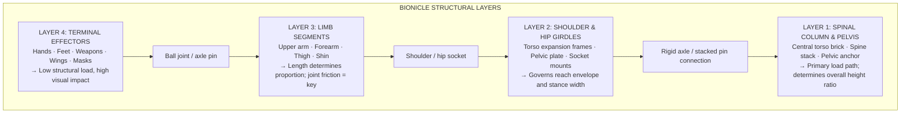

# Lesson 3: Biomechanical Design Theory

## 1. First-Principles Intuition & Invariants

There is a peculiar design challenge at the heart of every Bionicle build that has no clean parallel elsewhere in the Lego system: the figure must simultaneously convince the eye that it is *alive* and convince the hands that it is *solid*. This duality is not merely aesthetic. It is structural. When you hold a System-brick castle or a Technic crane, the form follows the function in a legible, mechanical way — the crane looks like it lifts things because it does. A Bionicle MOC, by contrast, must look like it could breathe, sprint, or strike, while being made entirely of injection-molded ABS and held together by ball joints and axle friction. That gap between biological implication and mechanical reality is where biomechanical design theory lives.

The original LEGO designers who developed the Bionicle system in the late 1990s solved this problem by working from the skeleton outward, a methodology borrowed directly from industrial character design and stop-motion armature construction. The skeletal framework is not decorative scaffolding hidden beneath armor — it is the primary load-bearing and articulation system, exposed and celebrated. This is the first invariant of Bionicle design: **the skeleton is the form**. Unlike a minifigure, whose body is a hollow shell with articulation bolted on, a Bionicle figure's visual mass comes almost entirely from the structural members themselves. The Rahkshi spine, the Toa Metru limb bones, the CCBS (Character and Creature Building System) shells introduced in Hero Factory and carried forward through later Bionicle generations — all of these are structural elements that also define surface geometry. When you place a CCBS shell onto a bone piece, you are not covering a structure; you are completing it.

The second invariant is **bilateral symmetry as a default, broken deliberately**. Vertebrate biology, which Bionicle draws on most heavily, is bilaterally symmetric along the sagittal plane. Left mirrors right. This gives the builder a powerful organizational heuristic: construct one side completely, verify its proportion and range of motion, then mirror it. Deviations from this symmetry — an asymmetric shoulder cannon, an oversized claw on one hand, a cape or wing assembly on a single side — carry enormous visual weight precisely because the symmetric baseline makes them read as *intentional*. A figure that is asymmetric without that baseline reads as incomplete or structurally failed. Understanding this lets you treat symmetry as a design variable rather than a constraint.

The third invariant concerns the physics of static display versus dynamic posability, and it is worth dwelling on because practitioners routinely sacrifice one for the other without realizing the trade-off is a choice. A figure engineered for maximum posability — every joint loose enough to hold a pose without snap-fitting — will sag over days as friction decreases with use, and will exhibit what experienced builders call **joint creep**: the slow collapse of a dramatic pose into an undignified slump. A figure engineered for rigid display will be visually convincing on a shelf but feel dead and brittle in the hands. The optimal solution is not a compromise between these but a structural hierarchy: the spine and hip assembly should be as rigid as the build allows, treating them as the primary load-bearing skeleton from which all other forces propagate, while the extremities — wrists, ankles, neck — carry lighter loads and can tolerate more compliance. This maps directly to actual vertebrate biomechanics, where the axial skeleton (spine, pelvis, ribcage) is structurally stiff and the appendicular skeleton (limbs) provides the degrees of freedom. Building with this principle in mind is not biology-inspired aesthetics — it is genuine structural engineering applied to polymer assemblies.

The CCBS system, which replaced the classic Technic-pin-and-socket Bionicle system in later generations, deserves particular attention because it changed the design grammar fundamentally. Classic Bionicle (2001–2010) relied on purpose-molded parts: the Toa torso shell, the Metru limb pieces, the Inika build's rubber-over-skeleton construction. Each set existed as its own self-contained biomechanical vocabulary, and MOC builders who wanted to deviate from canon had to work around the strong visual opinions of those purpose-built shells. CCBS introduced modular bone pieces and shells that snap onto them, creating a system where length, armoring density, and silhouette are all independently variable. A CCBS bone piece is essentially a structural axle with ball-socket endpoints; the shells that overlay it determine its visual character. This separation of structure from surface is architecturally cleaner and gives the advanced builder far more control over proportion, but it also removes the visual shorthand that the classic system provided. When you use a classic Toa torso, the figure immediately reads as a Toa. CCBS gives you nothing for free — every proportion decision is yours.

## 2. Core Architecture & Mechanics

The biomechanical architecture of any Bionicle figure can be decomposed into four functional layers: the spinal column and pelvis assembly, the shoulder and hip girdles, the limb segments, and the terminal effectors (hands, feet, weapons, wings). Each layer has distinct structural requirements and each interfaces with the adjacent layers through specific joint geometries. Understanding these layers and their interactions is the analytical framework that separates purposeful design from accumulated improvisation.

The spinal column is where most MOC failures originate, and yet it receives the least design attention because it will be entirely hidden by armor panels. The classic Bionicle build uses a single Technic brick or beam as the central spine, with the torso shell clipped around it. For small figures (roughly 20–24 studs tall), this single-element spine is structurally adequate. For larger MOCs — the Titan-class builds, the Makuta-scale constructions that push 35–40 studs — a single Technic beam will exhibit visible flex when the arms are extended and loaded, particularly at the connection point between torso and pelvis. The solution is to treat the spine as a compression column rather than a cantilevered beam. Stack two parallel Technic liftarms or beams offset by one stud, joined at regular intervals by perpendicular pin connections, creating a truss rather than a monolith. This I-beam analog increases resistance to bending forces along both the anterior-posterior and lateral axes, which is precisely where arm extension and head weight apply their loads.

The pelvis assembly deserves equivalent rigor. In the standard Inika-build Toa (the dominant MOC template from roughly 2006 onward), the pelvis is a single torso-lower shell piece that accepts the two hip ball joints directly. This works for a figure whose legs hang straight down, but the moment you pose the figure with one leg forward and one back — the most basic dynamic stance — the hip joints carry a significant lateral shear load from the leg's gravitational moment. The fix is to anchor the hip socket piece not just to the pelvic shell but to a secondary Technic pin that passes through both the socket housing and the spinal beam above it. This pin acts as a shear key, transferring the hip load directly into the spine rather than relying solely on the friction of the shell-to-spine connection. It adds two parts and prevents the characteristic pelvis-wobble that plagues large Bionicle MOCs.

The shoulder girdle operates on a different mechanical logic because, unlike the hip, the shoulder must support loads in multiple directions simultaneously — the arm hangs down from it under gravity, extends forward to hold a weapon, and raises laterally during posed combat stances. The conventional approach is to mount shoulder ball joints directly to the sides of the torso frame, which works for arms at rest but creates unacceptable play when the arm is extended with any appreciable terminal mass (a large shield, a claw assembly, a sword held out horizontally). A more robust solution borrows from Technic chassis design: mount a short liftarm extending laterally from the torso, pin-locked at both its inner and outer endpoints, and place the shoulder socket at its outer end. This turns the shoulder mounting from a cantilevered socket into a supported beam, dramatically reducing the lever arm through which the arm's weight acts on the torso connection. The lateral extension also increases shoulder width relative to torso depth, pushing the figure's silhouette toward the inverted-triangle body language that reads as powerful and heroic — a visual benefit that emerges directly from the structural decision.

Limb segment design is primarily a question of proportion and joint hierarchy. The human body's most visually legible proportional relationship is that the upper arm and forearm are approximately equal in length, with the hand adding roughly one-seventh of total arm length. For Bionicle figures, which trend toward exaggerated heroic proportions, the forearm is typically 10–15% shorter than the upper arm, and the hand is enlarged relative to biological scale to carry weapons credibly. In CCBS construction, the builder controls this through bone piece selection: the standard short bone, medium bone, and long bone pieces provide a discrete length vocabulary. A well-proportioned CCBS arm for a standard Toa-scale figure uses a medium bone for the upper arm, a short bone for the forearm, and a small CCBS hand or custom terminal effector. The critical measurement is not the limb length in isolation but the ratio of arm length to torso height. If the fingertips reach below the mid-thigh when the arm hangs at rest, the arms are proportionally too long and the figure will look simian rather than heroic. If the fingertips reach only to the hip socket, the arms are too short and the figure reads as stocky or juvenile.

The joint friction problem is mechanical and can be addressed with physical precision. CCBS ball joints and classic Bionicle socket joints both rely on the elastic deformation of ABS to maintain their friction. New parts hold poses reliably; heavily used parts do not. For display-quality MOCs that will be posed once and photographed, fresh parts are simply the correct choice. For MOCs that will be frequently handled and re-posed — a MOC built for play or for a demonstration build — the builder should use a small amount of Loctite Threadlocker Blue (or equivalent) applied to the ball of the joint with a toothpick, allowing it to cure for 24 hours before assembly. This microscopically fills the surface voids in the ABS, increasing effective contact area and restoring friction. The joint remains re-posable but resists the gravity-driven creep that causes pose degradation. This technique is non-destructive at the quantities used and reversible with gentle heat from a hobby heat gun.

## 3. High-Performance Optimization & Failure Modes

The highest-leverage optimization available to a Bionicle MOC builder is what might be called **proportion anchoring**: establishing the head-to-body ratio before committing to any other dimension. The head in Bionicle aesthetics is functionally a helmet-and-mask assembly, and because Kanohi masks are fixed-geometry pieces, their apparent size relative to the torso communicates the figure's visual age, power, and style category more strongly than any other single decision. A mask that reads as large relative to the torso produces a juvenile or creature-like character. A mask that reads as small produces a titan or heavily armored warrior archetype. The practitioner should therefore select the mask and primary armor-color combination before building the torso, mock up the torso at intended height, and hold the mask against it to verify the size relationship before proceeding. This costs five minutes and prevents the most common proportional failure in large MOCs, which is a torso built to satisfy some internal structural requirement that then turns out to be visually mismatched to the mask in scale.

The second major optimization concerns **the center of mass and its relationship to the foot contact polygon**. Static stability in a posed figure requires that the vertical projection of the center of mass fall within the polygon defined by the figure's feet. For a figure standing upright with feet parallel and hip-width apart, this condition is trivially satisfied. For a figure in a dramatic lunge — one foot forward, weight shifted, weapon arm extended — the center of mass may project well outside the foot polygon, and the figure will fall forward. The conventional response is to add a display stand, but this is aesthetically limiting. The more elegant solution is to actively manage mass distribution: keep the weapon arm lighter than it would be in a neutral pose (using hollow or partial-filled terminal effectors), shift a heavy accessory like a backpack or wing assembly rearward to counterbalance the forward lean, and widen the rear foot's stance angle to extend the contact polygon backward. These are the same principles a theater prop designer uses when weighting a puppet to hold dramatic poses under gravity — Bionicle is, in a real sense, articulated sculpture, and it benefits from exactly that design philosophy.

Ankle joint design is the single most underengineered aspect of Bionicle MOC construction, and its failure mode is by far the most visually damaging because it occurs at the lowest point of the figure, where the eye naturally terminates its scan. A classic Bionicle foot piece — the flat CCBS foot shell, the Metru foot plate, or any custom foot construction — connects to the shin through a single ball joint. Under the figure's full weight in a stable vertical stance, this joint holds reliably. Under the eccentric load of a lateral lean or a wide stance, the same joint is asked to resist a torque it was not designed for, and the figure's ankle collapses inward in the characteristic failure that builders call **ankle rollover**. The fix is to extend the foot plate rearward and forward relative to the ankle joint, increasing the foot's moment arm and thereby reducing the angular deflection that any given lateral force can induce. A foot plate that extends at least two stud-lengths forward and one stud-length aft of the ankle joint center creates a geometry that resists rollover without requiring a secondary joint. If the aesthetic requires a narrow or blade-like foot, run a Technic axle horizontally through the ankle assembly and attach two small plates on either side as lateral stabilizers — they can be armored over invisibly but contribute meaningfully to the ankle's resistance to lateral collapse.

Color blocking is an optimization that practitioners frequently treat as a final decorating step, but it is most effectively used as a structural communication system. The BIONICLE color language established by the official sets uses color to demarcate functional regions: the primary armor color identifies the character's elemental alignment, the secondary color identifies structural or mechanical systems, and metallic accents (silver, gunmetal, gold) identify high-value mechanical joints and weapon edges. When a MOC follows this hierarchy, the eye parses the figure's anatomy immediately because color and function are co-registered. When a MOC uses color decoratively, the anatomy becomes ambiguous — the viewer cannot determine where the torso ends and the shoulder begins, where the limb is armored versus exposed, where the weapon connects to the hand. For large builds with complex silhouettes, maintaining strict color-region discipline is not an aesthetic preference; it is the mechanism by which visual legibility is preserved at distance.

The most common structural failure in advanced MOC builds is the **torso-to-pelvis shear failure**, and understanding its mechanical cause enables prevention. When a figure is posed with both legs angled forward — a seated or crouching pose — the full weight of the torso, head, and arm assemblies is transferred into the pelvis as a forward shear force. This force acts to slide the torso forward relative to the pelvis, stressing the connection points between them. Classic Bionicle builds use a single Technic pin or axle to make this connection, which provides adequate shear resistance in upright poses but fails progressively under sustained crouched poses. The mitigation is to use at minimum a two-pin connection between torso and pelvis, with the pins oriented perpendicular to the anticipated shear direction. If the figure will be displayed in a crouched pose permanently, consider running a liftarm as a diagonal brace from the lower posterior torso to the rear pelvis — hidden under back armor — which converts the shear load into a compression load along the brace's axis, a geometry that plastic parts handle far more reliably than pure shear.

One failure mode that belongs entirely to the advanced practitioner's domain is **kinematic overconstrain**: the condition where adding joints to increase posability actually reduces it by creating mechanical interference between adjacent moving members. This occurs most often at the hip-to-thigh-to-knee chain when a builder adds a thigh-rotation joint (a ball joint or axle pivot at the mid-thigh) to allow both forward/backward and lateral leg movement. If the thigh rotation joint is placed too close to either the hip socket or the knee joint, rotating the thigh causes the shin to swing into the torso or into the adjacent leg. The builder discovers this during the first posing attempt and responds by constraining the thigh rotation range, which defeats the purpose. The correct solution is to extend the thigh segment until the thigh rotation joint is at least 1.5 times the thigh radius distance from both the hip socket center and the knee joint center — giving the rotation sufficient geometric clearance to operate without interference across the intended pose range. Mapping this out with a rough sketch before building, noting the swept volumes of each limb segment at its extremes of rotation, is the kind of pre-build analysis that separates builds that realize their design intent from builds that compromise it during assembly.
