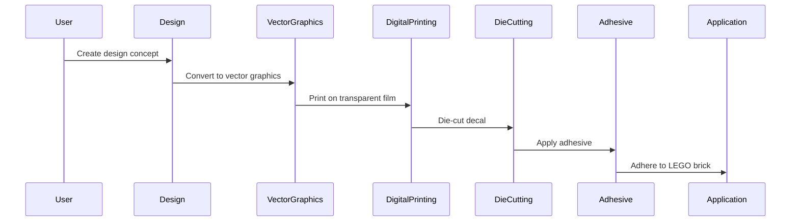

# Foundation: Custom Decals
## 1. Conceptual Mental Model (First principles, historical context, and fundamental paradigm shifts)

### First Principles
Custom decals in LEGO building serve as a means to enhance the visual and thematic authenticity of LEGO models. The principle underlying custom decals is the application of printed or digital images onto a transparent or semi-transparent material, which is then adhered to the surface of LEGO bricks. This process allows for the precise placement of detailed images, logos, or patterns, thereby transforming a generic LEGO creation into a highly customized and personalized artifact.

### Historical Context
The concept of custom decals in LEGO building has evolved alongside advancements in digital printing technology and the increasing demand for personalized and themed LEGO sets. Initially, LEGO enthusiasts would use hand-drawn or printed stickers to decorate their models. Over time, the advent of digital printing technology enabled more precise and detailed designs, leading to the creation of custom decals that could be tailored to specific themes or designs.

### Fundamental Paradigm Shifts
A significant paradigm shift in the use of custom decals occurred with the introduction of digital printing technology. This shift allowed for the creation of highly detailed and accurate decals, which could be printed on a variety of materials, including transparent films. The ability to create custom decals using digital printing technology has democratized the process, enabling LEGO enthusiasts to produce high-quality decals without the need for specialized equipment or skills.

## 2. Essential Terminology & Taxonomy (Comprehensive architectural definitions)

### Decal
A decal is a printed or digital image that is adhered to the surface of a LEGO brick. Decals can be made from a variety of materials, including transparent films, and are used to enhance the visual and thematic authenticity of LEGO models.

### Digital Printing
Digital printing is a process that uses a digital printer to create printed images on a variety of materials, including transparent films. Digital printing allows for the creation of highly detailed and accurate decals, which can be tailored to specific themes or designs.

### Transparent Film
A transparent film is a material that is used to create decals. Transparent films allow for the precise placement of detailed images, logos, or patterns on the surface of LEGO bricks.

### Vector Graphics
Vector graphics are a type of digital image that is composed of mathematical equations that define the shape and appearance of the image. Vector graphics are ideal for creating custom decals because they can be scaled up or down without losing quality.

### Resolution
Resolution refers to the level of detail in a digital image. Resolution is typically measured in dots per inch (DPI) and is an important factor in the quality of custom decals. Higher resolution images will result in more detailed and accurate decals.

### Adhesive
An adhesive is a substance that is used to adhere a decal to the surface of a LEGO brick. Adhesives can be made from a variety of materials, including water-based adhesives and solvent-based adhesives.

### Die-cutting
Die-cutting is a process that is used to cut a decal from a larger sheet of material. Die-cutting allows for the precise placement of decals on the surface of LEGO bricks.

## 3. Architecture & Core Workflow (Detailed ASCII and Mermaid diagrams with step-by-step dataflow)

### ASCII Diagram
```
+-------------------+
|  Design Concept   |
+-------------------+
          |
          v
+-------------------+
|  Vector Graphics  |
+-------------------+
          |
          v
+-------------------+
|  Digital Printing |
+-------------------+
          |
          v
+-------------------+
|  Die-cutting      |
+-------------------+
          |
          v
+-------------------+
|  Adhesive         |
+-------------------+
          |
          v
+-------------------+
|  Application      |
+-------------------+
```

### Mermaid Sequence Diagram


## 4. Common Misconceptions & Mental Traps (Subtle edge cases and flawed mental models)

### Misconception: Higher resolution always results in better quality decals
While higher resolution images will result in more detailed and accurate decals, there is a point of diminishing returns. Extremely high resolution images can result in longer print times and increased material costs, without a significant improvement in the quality of the decal.

### Misconception: Any adhesive can be used to adhere decals to LEGO bricks
Not all adhesives are suitable for adhering decals to LEGO bricks. Water-based adhesives are generally preferred because they are less likely to damage the surface of the LEGO brick and can be easily removed if necessary.

### Misconception: Die-cutting is always necessary for precise placement of decals
Die-cutting is not always necessary for precise placement of decals. In some cases, decals can be manually cut to size using scissors or a craft knife. However, die-cutting can provide more precise and consistent results, especially for complex designs.

### Misconception: Custom decals are only useful for themed LEGO sets
Custom decals can be used to enhance the visual and thematic authenticity of any LEGO model, not just themed sets. Custom decals can be used to add personal touches to generic LEGO sets, or to create unique and personalized models.

## 5. Socratic Discussion Starters (Advanced questions for deep Socratic exploration)

### Discussion Question 1
How does the choice of material for the decal (e.g., transparent film, paper) affect the final appearance of the LEGO model? What are the trade-offs between different materials?

### Discussion Question 2
What are the advantages and disadvantages of using digital printing technology to create custom decals? How does the quality of the decal compare to hand-drawn or printed stickers?

### Discussion Question 3
How does the resolution of the digital image affect the quality of the decal? What is the optimal resolution for creating custom decals, and how does this vary depending on the size and complexity of the design?
