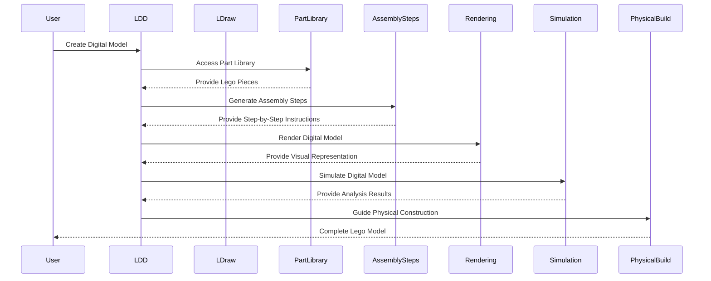

# Foundation: Digital Design
## 1. Conceptual Mental Model (First principles, historical context, and fundamental paradigm shifts)

### First Principles
Digital design in the context of Lego construction involves the systematic creation of digital representations of Lego models. This process leverages digital tools to simulate, analyze, and optimize Lego builds before physical construction. The foundational principle is the translation of physical Lego pieces into digital components that can be manipulated and assembled in a virtual environment.

### Historical Context
The concept of digital design in Lego construction emerged with the advent of computer-aided design (CAD) software. Early Lego enthusiasts began using CAD tools to create detailed plans and designs for complex Lego models. This practice evolved with the development of specialized Lego design software, such as Lego Digital Designer (LDD) and LDraw, which provided more intuitive and powerful tools for digital Lego design.

### Fundamental Paradigm Shifts
1. **From Physical to Digital:** The shift from physical Lego construction to digital design allows for more precise planning and visualization of complex models. Digital tools enable designers to experiment with different configurations and materials without the constraints of physical space and time.
2. **Iterative Design:** Digital design facilitates iterative design processes, where designers can quickly make changes and test different scenarios. This iterative approach leads to more refined and optimized Lego models.
3. **Collaboration and Sharing:** Digital design platforms enable collaboration among designers from around the world. Designers can share their work, receive feedback, and build upon each other's ideas, fostering a vibrant community of Lego enthusiasts.

## 2. Essential Terminology & Taxonomy (Comprehensive architectural definitions)

### 1. **Digital Model:**
A digital representation of a Lego model created using specialized software. It consists of virtual Lego pieces that can be manipulated and assembled in a virtual environment. A digital model serves as a blueprint for the physical construction of the Lego model.

### 2. **Lego Digital Designer (LDD):**
A proprietary software tool developed by the Lego Group for designing Lego models. LDD provides a user-friendly interface for creating and assembling digital Lego models. It includes a comprehensive library of Lego pieces and features tools for precise placement and alignment.

### 3. **LDraw:**
An open-source file format and software ecosystem for creating and sharing Lego models. LDraw uses a standardized file format to represent Lego pieces and models, allowing for interoperability between different software tools. It includes a large library of Lego pieces and supports advanced features such as custom parts and animations.

### 4. **Part Library:**
A collection of digital Lego pieces available for use in digital design. Part libraries are essential for creating accurate and detailed digital models. They include a wide range of Lego pieces, from basic bricks to specialized components.

### 5. **Assembly Instructions:**
A set of step-by-step instructions for assembling a Lego model. Digital design tools can generate assembly instructions from digital models, providing a clear and concise guide for physical construction. Assembly instructions typically include images and diagrams to illustrate each step.

### 6. **Rendering:**
The process of generating a visual representation of a digital Lego model. Rendering tools can create high-quality images and animations of Lego models, allowing designers to visualize their creations in detail. Rendering is essential for creating promotional materials and sharing designs with others.

### 7. **Simulation:**
The process of testing and analyzing a digital Lego model to ensure its structural integrity and functionality. Simulation tools can simulate the behavior of Lego models under various conditions, such as weight and stress. Simulation is essential for identifying potential issues and optimizing designs.

### 8. **Layering:**
The process of organizing digital Lego pieces into layers to create a structured and organized model. Layering is essential for creating complex Lego models and ensuring that pieces are placed in the correct order. Layering tools allow designers to view and manipulate individual layers of a model.

## 3. Architecture & Core Workflow (Detailed ASCII and Mermaid diagrams with step-by-step dataflow)

### ASCII Diagram
```
+-------------------+
|   Digital Model   |
+-------------------+
          |
          v
+-------------------+
|   Part Library    |
+-------------------+
          |
          v
+-------------------+
|  Assembly Steps   |
+-------------------+
          |
          v
+-------------------+
|    Rendering      |
+-------------------+
          |
          v
+-------------------+
|   Simulation      |
+-------------------+
          |
          v
+-------------------+
|   Physical Build  |
+-------------------+
```

### Mermaid Sequence Diagram


## 4. Common Misconceptions & Mental Traps (Subtle edge cases and flawed mental models)

### Misconception 1: Digital Design is a Substitute for Physical Construction
**Flawed Mental Model:** Some practitioners believe that digital design can completely replace physical construction. However, digital design is a tool that enhances the physical construction process by providing precise planning and visualization. Physical construction is still necessary to bring digital designs to life.

### Misconception 2: Digital Design is Only for Complex Models
**Flawed Mental Model:** Another common misconception is that digital design is only useful for complex models. In reality, digital design can be beneficial for models of all sizes and complexities. Even simple models can benefit from the precision and organization provided by digital design tools.

### Misconception 3: Digital Design is Time-Consuming
**Flawed Mental Model:** Some practitioners believe that digital design is time-consuming and adds unnecessary complexity to the design process. However, digital design can actually save time by reducing errors and allowing for iterative design processes. The time invested in digital design can lead to more efficient and effective physical construction.

### Misconception 4: Digital Design is Limited to Lego Digital Designer
**Flawed Mental Model:** Many practitioners are unaware of the existence of alternative digital design tools, such as LDraw. LDraw offers more advanced features and greater flexibility than Lego Digital Designer, making it a valuable tool for experienced designers.

### Misconception 5: Digital Design is Only for Individual Use
**Flawed Mental Model:** Some practitioners believe that digital design is a solitary activity. In reality, digital design can be a collaborative process. Designers can share their work, receive feedback, and build upon each other's ideas, fostering a vibrant community of Lego enthusiasts.

## 5. Socratic Discussion Starters (Advanced questions for deep Socratic exploration)

### Discussion Question 1
How does the use of digital design tools impact the creative process in Lego construction? In what ways does digital design enhance creativity, and in what ways does it constrain it?

### Discussion Question 2
What are the ethical implications of using digital design tools to create Lego models? How does the use of digital design tools impact the authenticity and originality of Lego models?

### Discussion Question 3
How can digital design tools be used to promote inclusivity and diversity in the Lego community? What steps can be taken to ensure that digital design tools are accessible to people of all ages, backgrounds, and abilities?
