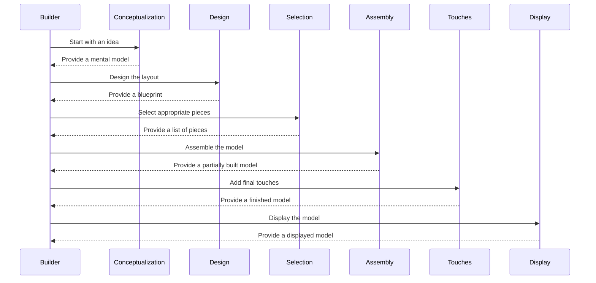

# Foundation: Display Techniques
## 1. Conceptual Mental Model (First principles, historical context, and fundamental paradigm shifts)

### First Principles
Display techniques in Lego construction are rooted in the principles of balance, symmetry, and structural integrity. Lego pieces are designed to interlock, allowing for the creation of complex structures. The foundational principle is that each piece must be placed with consideration for the overall stability and aesthetic of the final model. This principle is not just about the physical construction but also about the visual and conceptual representation of the model.

### Historical Context
Lego was invented in 1932 by Ole Kirk Christiansen in Denmark. The name "Lego" comes from the Danish words "leg godt," meaning "play well." Initially, Lego bricks were made from wood, but in 1947, the company switched to plastic, which allowed for mass production and greater durability. The introduction of the plastic Lego brick marked a significant paradigm shift, enabling the creation of more intricate and detailed models. Over the years, Lego has expanded its product line to include specialized pieces for various themes, such as space, pirates, and superheroes, each requiring unique display techniques.

### Fundamental Paradigm Shifts
One of the most significant paradigm shifts in Lego display techniques occurred with the introduction of themed sets. Prior to themed sets, Lego models were often abstract or generic. The introduction of themed sets introduced a new level of detail and specificity, requiring builders to consider not just the physical construction but also the thematic consistency of the model. This shift emphasized the importance of context and narrative in Lego display techniques.

## 2. Essential Terminology & Taxonomy (Comprehensive architectural definitions)

### 1. **Stability Ratio (SR)**
   - **Definition:** The Stability Ratio is a measure of the structural integrity of a Lego model. It is defined as the ratio of the total weight of the model to the total surface area in contact with the ground. Mathematically, \( SR = \frac{W}{A} \), where \( W \) is the total weight and \( A \) is the total surface area in contact with the ground.
   - **System-Level Definition:** A lower Stability Ratio indicates a more stable model, as the weight is distributed over a larger surface area.

### 2. **Symmetry Index (SI)**
   - **Definition:** The Symmetry Index is a measure of the symmetry of a Lego model. It is defined as the ratio of the number of symmetrical elements to the total number of elements in the model. Mathematically, \( SI = \frac{N_s}{N_t} \), where \( N_s \) is the number of symmetrical elements and \( N_t \) is the total number of elements.
   - **System-Level Definition:** A higher Symmetry Index indicates a more symmetrical model, which can enhance visual appeal and structural balance.

### 3. **Modular Connectivity (MC)**
   - **Definition:** Modular Connectivity is a measure of the interconnectivity of Lego pieces within a model. It is defined as the ratio of the number of connections between pieces to the total number of pieces. Mathematically, \( MC = \frac{N_c}{N_p} \), where \( N_c \) is the number of connections and \( N_p \) is the total number of pieces.
   - **System-Level Definition:** Higher Modular Connectivity can enhance the stability and complexity of a model, but it can also increase the difficulty of construction.

### 4. **Thematic Consistency (TC)**
   - **Definition:** Thematic Consistency is a measure of how well a Lego model adheres to its thematic elements. It is defined as the ratio of the number of thematic elements to the total number of elements in the model. Mathematically, \( TC = \frac{N_t}{N_e} \), where \( N_t \) is the number of thematic elements and \( N_e \) is the total number of elements.
   - **System-Level Definition:** Higher Thematic Consistency can enhance the narrative and visual appeal of a model, but it can also limit the creativity of the builder.

### 5. **Aesthetic Balance (AB)**
   - **Definition:** Aesthetic Balance is a measure of the visual harmony of a Lego model. It is defined as the ratio of the number of visually balanced elements to the total number of elements in the model. Mathematically, \( AB = \frac{N_b}{N_e} \), where \( N_b \) is the number of visually balanced elements and \( N_e \) is the total number of elements.
   - **System-Level Definition:** Higher Aesthetic Balance can enhance the visual appeal of a model, but it can also limit the complexity of the model.

### 6. **Structural Integrity (SI)**
   - **Definition:** Structural Integrity is a measure of the overall stability and durability of a Lego model. It is defined as the ratio of the number of stable connections to the total number of connections. Mathematically, \( SI = \frac{N_s}{N_c} \), where \( N_s \) is the number of stable connections and \( N_c \) is the total number of connections.
   - **System-Level Definition:** Higher Structural Integrity can enhance the longevity and stability of a model, but it can also increase the complexity of construction.

### 7. **Visual Complexity (VC)**
   - **Definition:** Visual Complexity is a measure of the intricacy and detail of a Lego model. It is defined as the ratio of the number of detailed elements to the total number of elements in the model. Mathematically, \( VC = \frac{N_d}{N_e} \), where \( N_d \) is the number of detailed elements and \( N_e \) is the total number of elements.
   - **System-Level Definition:** Higher Visual Complexity can enhance the visual appeal of a model, but it can also increase the difficulty of construction.

### 8. **Thematic Accuracy (TA)**
   - **Definition:** Thematic Accuracy is a measure of how accurately a Lego model represents its theme. It is defined as the ratio of the number of accurately themed elements to the total number of elements in the model. Mathematically, \( TA = \frac{N_a}{N_e} \), where \( N_a \) is the number of accurately themed elements and \( N_e \) is the total number of elements.
   - **System-Level Definition:** Higher Thematic Accuracy can enhance the narrative and visual appeal of a model, but it can also limit the creativity of the builder.

## 3. Architecture & Core Workflow (Detailed ASCII and Mermaid diagrams with step-by-step dataflow)

### ASCII Diagram
```
+-------------------+
|   Conceptualize   |
+-------------------+
          |
          v
+-------------------+
|   Design Layout   |
+-------------------+
          |
          v
+-------------------+
|   Select Pieces   |
+-------------------+
          |
          v
+-------------------+
|   Assemble Model  |
+-------------------+
          |
          v
+-------------------+
|   Final Touches   |
+-------------------+
          |
          v
+-------------------+
|    Display Model  |
+-------------------+
```

### Mermaid Sequence Diagram


## 4. Common Misconceptions & Mental Traps (Subtle edge cases and flawed mental models)

### Misconception 1: More Pieces Always Mean a Better Model
- **Flawed Mental Model:** Builders often believe that using more pieces will automatically result in a better model. However, this is not always the case. The quality of a model depends on the balance, symmetry, and structural integrity of the pieces, not just the quantity.
- **Correct Understanding:** A well-designed model with fewer pieces can be more visually appealing and structurally sound than a model with more pieces that are poorly placed.

### Misconception 2: Symmetry is Always Necessary
- **Flawed Mental Model:** Builders often believe that symmetry is necessary for a good model. However, this is not always the case. Asymmetry can create unique and interesting visual effects.
- **Correct Understanding:** Symmetry can enhance the visual appeal of a model, but asymmetry can also create unique and interesting visual effects.

### Misconception 3: Thematic Consistency is More Important than Creativity
- **Flawed Mental Model:** Builders often believe that thematic consistency is more important than creativity. However, this is not always the case. Creativity can enhance the visual appeal and narrative of a model.
- **Correct Understanding:** Thematic consistency can enhance the narrative and visual appeal of a model, but creativity can also enhance the visual appeal and narrative of a model.

### Misconception 4: Stability is More Important than Aesthetic Balance
- **Flawed Mental Model:** Builders often believe that stability is more important than aesthetic balance. However, this is not always the case. Aesthetic balance can enhance the visual appeal of a model.
- **Correct Understanding:** Stability is important for the longevity and durability of a model, but aesthetic balance can enhance the visual appeal of a model.

## 5. Socratic Discussion Starters (Advanced questions for deep Socratic exploration)

### Discussion Question 1
- **Question:** How does the concept of balance in Lego construction relate to the principles of physics, and how can builders use this understanding to create more stable models?
- **Purpose:** This question encourages builders to think about the physical principles underlying Lego construction and how they can apply this knowledge to improve their models.

### Discussion Question 2
- **Question:** How does the concept of symmetry in Lego construction relate to the principles of art, and how can builders use this understanding to create more visually appealing models?
- **Purpose:** This question encourages builders to think about the artistic principles underlying Lego construction and how they can apply this knowledge to improve their models.

### Discussion Question 3
- **Question:** How does the concept of thematic consistency in Lego construction relate to the principles of storytelling, and how can builders use this understanding to create more engaging models?
- **Purpose:** This question encourages builders to think about the storytelling principles underlying Lego construction and how they can apply this knowledge to improve their models.
