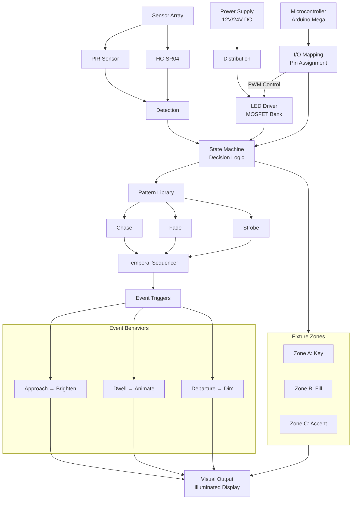

# Lesson 4: Exhibition Design and Advanced Techniques

## 1. First-Principles Intuition & Invariants

The transition from individual display to curated exhibition represents a fundamental shift in architectural thinking. Where a single model commands attention through isolated compositional excellence, an exhibition must orchestrate spatial flow, perceptual hierarchy, and narrative progression across multiple vantage points and temporal engagement windows. The exhibition designer operates simultaneously as lighting engineer, spatial choreographer, and psychological manipulator—directing the viewer's attention through luminance gradients, sightline geometry, and cognitive pacing strategies that transform passive observation into active exploration.

At the heart of exhibition design lies the **perceptual attention budget**—the finite cognitive and temporal resources each visitor brings to the viewing experience. Human visual attention operates through a cascade of pre-attentive filtering (processing edge detection, color contrast, and motion within 200–500 milliseconds) followed by focused attention (requiring 1.5–3 seconds per fixation point). An exhibition that exhausts the attention budget through uniform stimulation creates cognitive fatigue; one that provides insufficient variety induces disengagement. The master curator walks this tightrope by establishing **rhythm through contrast**: alternating between high-density showcases and negative space rest zones, between kinetic elements and static contemplation points, between warm-spectrum intimate lighting and cool-spectrum analytical illumination.

The physics of light propagation establishes immutable constraints on exhibition design. Photons obey inverse-square law decay—doubling the distance from a point source quarters the illuminance. This fundamental relationship dictates that **luminaire placement geometry** cannot be arbitrary. A spotlight positioned 30 cm from a model delivers 16× the illuminance of the same fixture at 120 cm. For Lego constructions with highly reflective ABS surfaces, this creates specular highlights that can overpower diffuse color information if the incident angle approaches the normal. The solution lies in compound lighting architectures: key lights positioned at 30–45° elevation angles to establish primary form-revealing shadows, fill lights at lower intensities to reduce contrast ratios below the 8:1 threshold where detail crushing occurs, and rim or backlight accents at grazing angles (5–15° from horizontal) to separate figures from backgrounds through edge luminance.

Material interaction between light and ABS plastic follows wavelength-dependent scattering principles. Translucent Lego elements—particularly in trans-clear, trans-orange, and trans-light-blue colorways—exhibit **subsurface scattering** where photons penetrate 1–3 mm into the polymer matrix before re-emerging at adjacent surface points. This produces the characteristic internal glow visible when such elements are backlit. The effect intensifies when multiple translucent elements stack with air gaps between them, creating optical coupling that channels light through the structure via total internal reflection at the ABS-air interfaces. Exhibition lighting that exploits this phenomenon positions LEDs beneath or behind translucent assemblies, using the bricks themselves as light-guide architectures. A trans-clear tower built from 2×4 bricks becomes a luminous column when a 3W cool-white LED sits at its base; the same structure under ambient lighting appears merely transparent.

Temporal staging introduces the fourth dimension into exhibition design. Static displays present a single frozen narrative state, but interactive or programmable elements allow the exhibition to **evolve through viewer engagement or autonomous cycles**. The simplest implementation uses mechanical linkages—a hidden Technic motor driving a camshaft that produces reciprocating motion in a displayed mechanism, revealing the internal gear train through staged animation. More sophisticated installations employ addressable LED strips (WS2812B or SK6812) controlled by microcontrollers running temporal pattern generators: chase sequences that draw the eye along architectural features, breathing effects that simulate organic life, or reactive patterns triggered by proximity sensors that respond to viewer approach. The temporal design must respect the **dwell time distribution** observed in museum studies: median viewing duration for individual exhibits ranges from 8–15 seconds for casual browsers to 45–90 seconds for engaged learners. An animated sequence longer than 60 seconds will rarely be observed in its entirety by spontaneous visitors.

Curatorial principles derived from museum practice establish **spatial grammar rules** that guide exhibition layout. The **primacy and recency effects** from cognitive psychology dictate that entrance and exit positions receive disproportionate attention and memory encoding. High-impact hero pieces—the exhibition's flagship builds—should occupy these terminal positions, with the entrance piece establishing thematic expectations and the exit piece providing satisfying closure or provocative questions. The intervening space follows one of three archetypal flows: **linear progression** (forcing a single path that tells a chronological or logical story), **hub-and-spoke radial** (central anchor piece with satellite displays viewable in any order), or **grid matrix** (uniform density allowing free exploration). Each grammar encodes different viewer agency and cognitive load characteristics.

The **visual cone of attention** defines the comfortable viewing envelope. Human binocular vision spans approximately 120° horizontal by 90° vertical, but detailed feature resolution compresses to a 30° central cone. Displays placed outside this cone during typical approach angles become peripheral context rather than focal subjects. For waist-height plinths (75–90 cm) viewed from standing position (eye level 150–170 cm), this geometry establishes a critical distance range: closer than 40 cm forces uncomfortable neck flexion; farther than 180 cm pushes fine detail below the resolvable angular threshold (approximately 1 arcminute for normal vision, corresponding to 0.5 mm features at 1.7 m distance). The exhibition designer must therefore construct viewing positions where this optimal standoff distance aligns naturally with circulation paths, using floor markers, lighting pools, or physical barriers to guide viewer positioning.

## 2. Core Architecture & Mechanics

The mechanical architecture of a sophisticated Lego exhibition begins with the **plinth and riser system**—the physical interface between models and viewers. Commercial acrylic risers provide clean aesthetics but suffer from electrostatic dust attraction and visible fingerprint oils. Purpose-built plinths from 13 mm Baltic birch plywood, finished with matte black or white spray lacquer, offer superior visual neutrality. The plinth height hierarchy encodes importance: hero pieces at 90–110 cm (eye level for seated viewers or children), secondary displays at 75 cm (standard table height allowing comfortable leaning), and tertiary context pieces at 45–60 cm (requiring deliberate crouch engagement that filters for high-interest viewers). Each plinth incorporates internal cable management channels routed with 25 mm diameter holes at rear corners, allowing power and control wiring to descend hidden from view angles greater than 30° from plinth normal.

Lighting fixtures for exhibition work divide into three functional categories. **Spotlights**—typified by PAR20 or MR16 form factors with 15–40° beam angles—deliver focused key light from track-mounted positions. For permanent installations, line-voltage tracks (120/240V AC) provide flexibility but require qualified electrical work; for temporary or portable exhibitions, low-voltage DC track systems (12V or 24V) fed from centralized power supplies offer safer DIY installation. The critical specification is **color rendering index (CRI)**: consumer LED spots frequently exhibit CRI values of 80–85, which render saturated Lego colors (particularly reds and blues) with noticeable spectral holes. Professional photography and museum-grade fixtures specify CRI ≥95, reproducing color with accuracy approaching ideal blackbody sources. The secondary specification is **color temperature**: 3000K warm white evokes intimate, nostalgic viewing moods; 4000K neutral white provides balanced visibility; 5000K–6500K cool white simulates daylight analytical conditions.

**Strip lighting**—using flexible PCB-mounted LED arrays—provides architectural accent and indirect fill. COB (chip-on-board) strips with densities exceeding 480 LEDs per meter produce continuous glowlines without visible individual hotspots, essential for smooth gradient washes. Installation requires aluminum channel extrusions with frosted diffuser covers that stretch the point sources into linear sources through polycarbonate scattering. The extrusions also function as heat sinks, critical for maintaining LED junction temperatures below 85°C where phosphor conversion efficiency begins degrading. For RGB color-changing capability, addressable LED strips receive digital control signals encoding per-pixel hue, saturation, and brightness. The WS2812B chipset has become the de facto standard, though its 400 kHz data rate limits cable runs to approximately 5 meters before signal integrity degrades; the newer SK6812 operates at 800 kHz with improved noise immunity.

**Projection mapping** represents the bleeding edge of exhibition lighting, transforming physical Lego surfaces into dynamic canvases. A DLP or LCD projector positioned at calculated standoff (determined by throw ratio and desired image size) casts computer-generated content onto white or light-gray builds. The technique requires precise **geometric calibration**—mapping projector pixel coordinates to 3D model surface positions—accomplished through photogrammetry alignment software (e.g., MadMapper, Resolume Arena, or open-source lpmt). For Lego applications, projection works best on large-format architectural models where plate and tile surfaces provide continuous mapping targets. Studded surfaces create challenging micro-geometry: projector pixels smaller than stud pitch (8 mm) produce interference patterns as light falls into stud recesses with different intensity than top surfaces. Mitigation strategies include building facade overlays using tile elements or accepting the stud texture as intentional visual grain.

The electrical power distribution architecture for multi-fixture installations demands careful planning to avoid ground loops, voltage sag, and thermal overload. A **star topology** with home runs from each fixture zone to a central power distribution board minimizes cross-coupling and allows individual circuit protection. For 12V DC systems powering LED strips and low-voltage spots, voltage drop becomes critical beyond 5-meter cable runs: 1.5 mm² (16 AWG) copper wire exhibits approximately 13 mΩ/m resistance, producing 0.26V drop per meter at 2A load. At 10 meters, this accumulates to 2.6V loss—a 22% reduction that shifts color temperature and dims output unacceptably. The solution employs either heavier gauge wire (2.5 mm²/13 AWG for runs beyond 8 meters) or distributed power injection—additional supply connections at mid-run points that locally compensate for voltage drop.

Interactive elements integrate sensing and actuation through microcontroller coordination. The Arduino platform dominates hobby-grade exhibition control, with the Nano or Mega form factors providing sufficient I/O for typical installations. Sensor integration follows modular patterns: **passive infrared (PIR) motion sensors** detect viewer approach within 3–7 meter cones, triggering lighting sequences or motor activation via relay modules. **Ultrasonic rangefinders** (HC-SR04 modules) measure precise distances to 4 meters with ~3 mm resolution, enabling graduated response—lights that brighten as viewers approach, or animations that accelerate based on proximity. **Capacitive touch sensors** embedded beneath conductive materials (copper tape or foil) register fingertip contact without mechanical switches, allowing invisible interaction points on display surfaces.

Actuation for kinetic displays employs Lego-native Technic motors or third-party alternatives. The Lego Powered Up system provides M-motor (weak torque, high speed) and L-motor (moderate torque, moderate speed) options controllable via Bluetooth from smartphone apps or custom Python scripts using the pylgbst library. For applications requiring precise positioning, hobby-grade servo motors (e.g., TowerPro MG996R) deliver 9–15 kg·cm stall torque with 180° travel controlled by PWM signals. Integration with Technic elements requires custom adapter brackets—3D-printed mounts that mate standard servo horn patterns to Lego cross-axle geometry. The mechanical load calculation ensures motor selection matches requirements: a vertical lift actuator raising a 500g model through 15 cm requires at least 7.4 J of work (mgh), which a 12V motor at 80% efficiency and 10-second rise time must supply via 9.2W power delivery—well within the 15W thermal dissipation limits of typical hobby motors but requiring current supply capability exceeding 0.8A.

Environmental sensing extends exhibition intelligence beyond simple presence detection. **Ambient light sensors** (TSL2561 or similar I²C digital devices) measure illuminance from 0.1 to 40,000 lux, allowing exhibitions to auto-adjust lighting intensity based on room conditions—compensating for daylight flooding near windows or dimming to preserve atmosphere in darkened spaces. **Temperature and humidity sensors** (DHT22 modules) monitor environmental conditions that affect long-term Lego stability: ABS plastic exhibits coefficient of thermal expansion near 90 µm/(m·K), meaning a 2-meter tall structure undergoes 1.8 mm height change across a 10°C temperature swing. While this rarely compromises structural integrity, monitoring allows correlation of observed loosening or color changes with environmental excursions.

The mechanical staging of interactive displays requires **kinematic planning**—ensuring moving elements follow collision-free paths at velocities compatible with viewer safety and mechanical wear limits. A rotating turntable displaying a model must accelerate smoothly (maximum jerk below 5 m/s³ to avoid viewer discomfort), reach cruising angular velocity (typically 3–8 RPM for comfortable viewing), and incorporate soft-start/soft-stop profiles that prevent impulsive loads on drivetrain components. For linear actuators, trapezoidal motion profiles dominate: initial acceleration phase (occupying 15–25% of total travel), constant velocity cruise, and deceleration phase mirrored to the acceleration. Position feedback from rotary encoders or Hall-effect sensors closes the control loop, allowing microcontroller PID algorithms to compensate for load variations and maintain precise timing.

## 3. High-Performance Optimization & Failure Modes

Performance optimization in exhibition design operates across three coupled domains: optical efficiency (maximizing useful light delivery per watt), spatial efficiency (maximizing viewer engagement per square meter), and cognitive efficiency (maximizing information transfer per second of viewer attention). These objectives frequently conflict—brighter lighting improves visibility but increases glare and energy cost; higher display density provides more content but induces decision paralysis; faster animation attracts attention but reduces comprehension. The optimization process therefore requires multi-objective balancing guided by empirical measurement and iterative refinement.

Optical efficiency begins with **fixture selection and placement geometry**. Point-source spotlights obey the cosine law: illuminance on a surface decreases proportionally to the cosine of the incident angle. A fixture aimed perpendicular to a display surface delivers 100% of its rated output; tilted 45° off-normal, the effective illuminance drops to 71%; at 60°, just 50%. Exhibition layouts that position tracks directly above plinths can use narrow beam angles (15–25°) with high efficiency, while tracks offset horizontally must compensate with wider beams (35–50°) at the cost of doubled fixture count. The quantitative design employs photometric modeling software (Dialux or AGi32 for professionals; simple inverse-square spreadsheet calculations for hobbyists) that predicts illuminance contours across display surfaces, identifying hotspots exceeding 1000 lux (where specular glare dominates) and shadow zones below 150 lux (where color discrimination falters).

LED thermal management emerges as the dominant failure mode in improperly designed installations. The light-emitting junction in an LED sits beneath a phosphor conversion layer and encapsulating lens, creating a thermal stack with cumulative resistance to heat flow. As junction temperature rises from the ideal 25°C toward the maximum rating (typically 125°C for quality devices), luminous efficacy declines—a 3000K LED producing 120 lm/W at room temperature degrades to perhaps 95 lm/W at 85°C junction temperature, a 20% loss. Beyond efficiency loss, elevated temperature accelerates phosphor degradation, causing permanent color shift and output reduction. The failure mechanism follows exponential kinetics: LED lifespan at 105°C junction temperature might be 15,000 hours, but every 10°C reduction doubles lifespan. Installations operating LEDs at 65°C achieve 120,000-hour lifetimes—over 13 years of continuous operation.

The thermal solution architecture uses passive cooling—aluminum heat sinks with surface area and fin geometry calculated to dissipate power at acceptable temperature rise. A 10W LED spotlight requires approximately 30–40 cm² of effective radiating surface area per watt to maintain acceptable thermal resistance. For strip lighting in aluminum channels, the channel itself provides primary heat-sinking; thermal interface pads (silicone or graphite sheets with 3–5 W/(m·K) conductivity) eliminate air gaps between LED backing and channel, reducing thermal resistance by 30–50%. In enclosed display cases with poor air circulation, active cooling becomes necessary—small axial fans (40–80 mm, 12V DC) drawing 0.5–1.5W positioned to create convective flow across heat-generating components.

Spatial optimization addresses the **circulation and viewing geometry** problem: how many viewers can simultaneously engage an exhibition without congestion, and what is the optimal display spacing that balances density against comfortable standoff? Museum research establishes empirical guidelines: adults require approximately 0.8–1.2 m² of personal space (projected floor area) to comfortably view without feeling crowded. For linear exhibition layouts with single-file viewing, this translates to 1–1.5 meter spacing between adjacent display stations. Hub-and-spoke radial layouts can support higher densities because viewers face outward, reducing face-to-face proximity that triggers discomfort. The mathematical optimization solves for maximum gallery capacity:

$$C_{\text{max}} = \frac{A_{\text{floor}} - A_{\text{display}}}{0.9 \text{ m}^2} \times f_{\text{utilization}}$$

where $A_{\text{floor}}$ is total gallery floor area, $A_{\text{display}}$ is the footprint occupied by plinths and barriers, and $f_{\text{utilization}}$ is a design factor (typically 0.6–0.75) accounting for circulation paths and interpersonal spacing preferences that leave floor area unused even when not obstructed.

Interactive element reliability depends critically on **sensor robustness and false-trigger mitigation**. PIR sensors suffer from thermal drift—ambient temperature changes shift the differential detection threshold, causing either missed detections (insufficient sensitivity) or false triggers (excessive sensitivity). Quality sensors incorporate temperature compensation circuits, but even these require 30–60 second warm-up periods after power-on to stabilize baseline readings. Software debouncing—requiring sustained detection for 100–300 ms before triggering response—filters transient noise. Ultrasonic rangefinders face acoustic echo multipath problems in cluttered environments where sound reflects off multiple surfaces before returning to the receiver, producing ghost targets. Median filtering over sliding 5-sample windows (discarding outliers and averaging the middle three readings) reduces multipath artifacts while maintaining 100 ms update rates.

Power supply sizing represents a frequent underestimation failure. LED datasheets specify typical forward current (often 20 mA per LED for standard 5mm indicators, 60 mA for high-power SMD units), but these values assume steady-state DC operation. PWM dimming—pulsing LEDs at high frequency (500 Hz–25 kHz) with variable duty cycle to control perceived brightness—increases instantaneous current draw proportionally to the duty cycle reciprocal. An LED strip running at 20% brightness via PWM still requires full current during the "on" portion of each cycle; the power supply must handle peak current, not time-averaged. Additionally, inrush current during initial power-on can spike 3–5× steady-state as capacitors charge and cold filaments exhibit low resistance. Power supplies should be oversized by 25–40% margin: a calculated 60W load requires a 75–85W supply for reliable operation.

Cable management transcends aesthetics into functional necessity—poor routing creates tripping hazards, mechanical stress on solder joints, and electromagnetic interference. Exhibition wiring follows the **drip loop principle**: cables descending from overhead tracks or rising from floor penetrations include deliberate slack forming a U-shaped loop at the lowest point. This geometry ensures any liquid contact (cleaning solution, spilled beverages) collects at the loop nadir rather than running down the cable into electrical connections. Wire dress employs spiral wrap or braided sleeving to bundle multiple conductors, maintaining parallel routing that minimizes loop area and hence inductive pickup of radiated interference. Separation rules isolate power and signal: high-current AC or DC power runs remain at least 15 cm from low-voltage control signals (PWM, I²C, UART) to prevent capacitive coupling that manifests as flickering, erratic sensor readings, or microcontroller resets.

The ultimate failure mode is cognitive overload—an exhibition that presents too much simultaneous stimulation, triggering viewer shutdown rather than engagement. Information theory provides quantitative guidance: human information processing peaks at approximately 50–100 bits/second for conscious attention (far below the 10⁷ bits/second sensory bandwidth). An exhibition element competing for attention must therefore "earn" its inclusion by delivering information density that justifies the attentional cost. Simple metrics help evaluate designs: count the number of simultaneous moving elements visible from any standing position (ideally ≤3), measure lighting transition rates (avoid flashing faster than 1 Hz except for deliberate alarm effects), and assess color palette complexity (use 3–5 dominant hues plus neutrals, not the full 256-color spectrum).

The refinement process employs **A/B testing methodologies** borrowed from digital design. Set up two adjacent displays with single-variable differences—for example, identical models with different lighting angles—and observe viewer behavior through concealed time-lapse photography or manual tracking. Metrics include dwell time (how long viewers remain engaged), approach rate (percentage of passing traffic that stops), and proximity (minimum standoff distance achieved, indicating confidence to lean in for detail). Statistical significance requires sample sizes exceeding 30 viewers per condition; informal qualitative observation during setup and preview nights provides rapid iteration feedback before formal measurement.

Long-term maintenance addresses the **temporal degradation** of both physical and electronic components. ABS plastic yellows under sustained UV exposure (wavelengths below 400 nm break down polymer chains), particularly noticeable in white and light-gray elements. UV-filtering acrylic glazing over display cases blocks harmful wavelengths while transmitting visible light. Motorized mechanisms require periodic lubrication—silicone grease (not petroleum-based, which attacks ABS) applied to Technic axle bushings and gear teeth every 50–100 operating hours. Electronic solder joints develop microcracks from thermal cycling and mechanical vibration; periodic inspection under magnification (10× jeweler's loupe) reveals the telltale dull gray appearance of cold solder joints before functional failure occurs. The professional approach schedules preventive maintenance at logarithmic intervals: initial check at 10 hours post-installation, second at 100 hours, subsequent at 1000 hours, allowing early detection of infant mortality failures without excessive ongoing labor.

Environmental resilience planning anticipates failure scenarios and designs mitigation strategies. Power interruptions during public hours cause jarring discontinuities; uninterruptible power supplies (UPS units) provide 15–30 minute bridging for brief outages, while microcontroller code implements graceful state recovery—resuming animation sequences at sensible starting points rather than mid-cycle after restore. Visitor interference—children touching displays despite signage, adults leaning on plinths—requires physical barriers (transparent acrylic shields, rope stanchions at 60–80 cm standoff) that preserve visibility while preventing direct contact. The barrier height follows ergonomic principles: 40 cm high for seated children, 90 cm for standing adults, with clear sight-lines maintained through openings or transparent materials.

The masterful exhibition designer synthesizes these technical elements into holistic experiential environments where lighting, motion, and spatial organization conspire to guide attention and encode narrative. The viewer moves through zones of varying intensity—arriving at the entrance hero piece with high arousal from saturated color and concentrated light, transitioning through quieter middle galleries with softer fill, and departing past a final statement piece that either provides closure or poses unanswered questions. This arc mirrors classical dramatic structure: exposition, rising action, climax, and denouement. The technical implementation merely provides the vocabulary; the curatorial vision writes the story.
