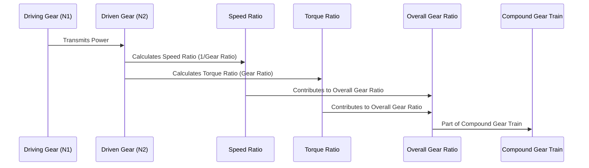

# Foundation: Gear Ratios
## 1. Conceptual Mental Model (First principles, historical context, and fundamental paradigm shifts)

### First Principles
Gear ratios are a fundamental concept in mechanical engineering and play a crucial role in the design and functionality of many mechanical systems, including LEGO models. At its core, a gear ratio is a measure of the relative speeds of two gears meshed together. It is defined as the ratio of the number of teeth on the driving gear to the number of teeth on the driven gear. This ratio determines how the speed and torque are transferred between the gears.

### Historical Context
The concept of gear ratios dates back to ancient civilizations, with evidence of gear mechanisms found in the Antikythera mechanism, an ancient Greek analog computer used to predict astronomical positions. Over the centuries, gears have evolved from simple wooden wheels to the intricate metal gears we see today. LEGO, introduced in the 1940s, brought gears into the realm of play and education, allowing enthusiasts to explore mechanical principles in a hands-on manner.

### Fundamental Paradigm Shifts
The shift from manual to automated mechanical systems has been driven by the need for precision and efficiency. Gear ratios are a key component in this evolution, enabling the design of complex machines that can perform specific tasks with high accuracy. In the context of LEGO, understanding gear ratios allows builders to create models that mimic real-world machines, from simple vehicles to intricate robotic systems.

## 2. Essential Terminology & Taxonomy (Comprehensive architectural definitions)

### Gear Ratio
The gear ratio is the ratio of the number of teeth on the driving gear (input gear) to the number of teeth on the driven gear (output gear). It is expressed as:
\[ \text{Gear Ratio} = \frac{\text{Number of Teeth on Driving Gear}}{\text{Number of Teeth on Driven Gear}} \]

### Driving Gear
The driving gear is the gear that is directly powered by an external force, such as a motor or a hand crank. It is responsible for transmitting power to the driven gear.

### Driven Gear
The driven gear is the gear that receives power from the driving gear. Its speed and torque are determined by the gear ratio.

### Speed Ratio
The speed ratio is the inverse of the gear ratio. It represents the ratio of the speed of the driven gear to the speed of the driving gear:
\[ \text{Speed Ratio} = \frac{1}{\text{Gear Ratio}} \]

### Torque Ratio
The torque ratio is the inverse of the speed ratio. It represents the ratio of the torque of the driven gear to the torque of the driving gear:
\[ \text{Torque Ratio} = \text{Gear Ratio} \]

### Compound Gear Train
A compound gear train is a series of gears connected together, where the output of one gear pair serves as the input to the next. The overall gear ratio of a compound gear train is the product of the individual gear ratios:
\[ \text{Overall Gear Ratio} = \text{Gear Ratio}_1 \times \text{Gear Ratio}_2 \times \ldots \times \text{Gear Ratio}_n \]

### Idler Gear
An idler gear is a gear that is used to reverse the direction of rotation or to maintain contact between two gears that are too far apart to mesh directly. It does not affect the gear ratio of the system.

### Worm Gear
A worm gear is a type of gear where the driving gear (worm) is a helical screw, and the driven gear (worm wheel) is a spur gear. Worm gears are used to achieve high gear ratios and to provide self-locking mechanisms.

## 3. Architecture & Core Workflow (Detailed ASCII and Mermaid diagrams with step-by-step dataflow)

### ASCII Diagram
```
+-------------------+       +-------------------+
| Driving Gear (N1) |       | Driven Gear (N2)  |
|                   |       |                   |
|    +-------+      |       |      +-------+    |
|    |       |      |       |      |       |    |
|    |   N1  |      |       |      |   N2  |    |
|    |       |      |       |      |       |    |
|    +-------+      |       |      +-------+    |
|                   |       |                   |
|                   |       |                   |
|                   |       |                   |
+-------------------+       +-------------------+
          |                             |
          |                             |
          |                             |
          v                             v
      +-------+                     +-------+
      | Speed |                     | Torque|
      | Ratio |                     | Ratio |
      +-------+                     +-------+
          |                             |
          |                             |
          v                             v
      +-------------------+       +-------------------+
      | Overall Gear Ratio|       | Compound Gear Train|
      +-------------------+       +-------------------+
```

### Mermaid Sequence Diagram


## 4. Common Misconceptions & Mental Traps (Subtle edge cases and flawed mental models)

### Misconception: Gear Ratio Affects Only Speed
One common misconception is that gear ratios affect only the speed of the gears. In reality, gear ratios also affect the torque. A higher gear ratio results in higher torque but lower speed, while a lower gear ratio results in lower torque but higher speed.

### Mental Trap: Assuming Linear Scaling
Another mental trap is assuming that the effects of gear ratios scale linearly. For example, doubling the number of teeth on the driving gear does not simply double the torque; it quadruples it, as the torque ratio is the square of the gear ratio.

### Misconception: Idler Gears Have No Effect
Idler gears are often overlooked because they do not affect the gear ratio. However, they are crucial for reversing the direction of rotation or maintaining contact between gears that are too far apart.

### Mental Trap: Ignoring Friction and Efficiency Losses
Friction and efficiency losses can significantly affect the performance of gear systems. It is important to consider these factors when designing gear trains, as they can lead to unexpected performance issues.

## 5. Socratic Discussion Starters (Advanced questions for deep Socratic exploration)

1. **How does the choice of gear ratio affect the overall performance of a LEGO model, and what trade-offs must be considered?**
2. **In what scenarios would a compound gear train be more advantageous than a single gear pair, and how does the overall gear ratio change in such systems?**
3. **How can the principles of gear ratios be applied to other mechanical systems beyond LEGO, and what are the key differences in their implementation?**

These questions are designed to encourage deep thinking and a thorough understanding of gear ratios and their applications in mechanical systems.
