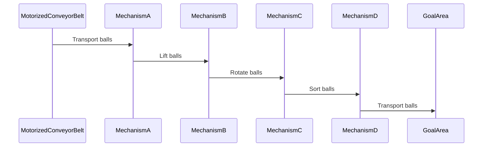

# Foundation: Great Ball Contraption
## 1. Conceptual Mental Model (First principles, historical context, and fundamental paradigm shifts)

### First Principles
The Great Ball Contraption (GBC) is a mechanical system designed to transport a series of balls through a complex network of interconnected mechanisms. At its core, the GBC operates on principles of energy transfer, mechanical advantage, and chain reaction dynamics. The system is driven by an initial input of energy, typically a motorized conveyor belt, which sets off a cascade of events that propagate through the entire structure.

### Historical Context
The concept of the Great Ball Contraption was first introduced in 2001 by LEGO enthusiasts at the FIRST LEGO League (FLL) competition. The challenge was to design and build a machine that could transport 100 balls from a starting point to a goal area within a specified time frame. This challenge sparked a global interest in LEGO robotics and mechanical engineering, leading to a diverse array of GBC designs and innovations.

### Fundamental Paradigm Shifts
The GBC represents a paradigm shift in mechanical design by emphasizing the importance of modular, interconnected systems. Unlike traditional single-purpose machines, the GBC is a network of subsystems that work together to achieve a common goal. This approach encourages creativity, problem-solving, and a deeper understanding of mechanical principles.

## 2. Essential Terminology & Taxonomy (Comprehensive architectural definitions)

### Ball
A spherical object used as the primary medium of transport within the GBC. Balls are typically made of plastic and are designed to roll smoothly through the system.

### Conveyor Belt
A continuous moving surface used to transport balls from the starting point to the first mechanism in the GBC. The conveyor belt is typically motorized and serves as the initial energy input for the system.

### Mechanism
A subsystem within the GBC that performs a specific function, such as lifting, rotating, or sorting balls. Mechanisms can be simple or complex and are often interconnected to form a chain reaction.

### Chain Reaction
A sequence of events in which the output of one mechanism serves as the input for the next, creating a continuous flow of balls through the system. Chain reactions are a fundamental aspect of the GBC and are responsible for its dynamic and engaging nature.

### Gear Ratio
The ratio of the number of teeth on two gears that are meshed together. Gear ratios are used to adjust the speed and torque of mechanisms within the GBC, allowing for precise control over ball movement.

### Tolerance
The allowable deviation from a specified dimension or measurement. Tolerances are critical in GBC design to ensure that components fit together properly and function as intended.

### Stress Distribution
The way in which forces are distributed throughout a structure. Proper stress distribution is essential in GBC design to prevent structural failure and ensure long-term durability.

### Material Properties
The characteristics of the materials used in GBC construction, such as strength, flexibility, and durability. Material properties play a crucial role in determining the performance and reliability of the system.

## 3. Architecture & Core Workflow (Detailed ASCII and Mermaid diagrams with step-by-step dataflow)

### ASCII Diagram
```
+-------------------+       +-------------------+       +-------------------+
|  Motorized        |       |  Mechanism A      |       |  Mechanism B      |
|  Conveyor Belt    |  ---> |  (Lifting)        |  ---> |  (Rotating)       |
+-------------------+       +-------------------+       +-------------------+
      |                         |                         |
      v                         v                         v
+-------------------+       +-------------------+       +-------------------+
|  Mechanism C      |       |  Mechanism D      |       |  Goal Area        |
|  (Sorting)        |  ---> |  (Conveyor Belt)  |  ---> |                   |
+-------------------+       +-------------------+       +-------------------+
```

### Mermaid Sequence Diagram


### Step-by-Step Dataflow
1. **Motorized Conveyor Belt**: Balls are placed on the conveyor belt, which is powered by a motor. The belt moves the balls in a linear motion towards the first mechanism.
2. **Mechanism A (Lifting)**: The balls are lifted by a series of gears and pulleys, increasing their potential energy.
3. **Mechanism B (Rotating)**: The lifted balls are then rotated by a motorized shaft, changing their direction and introducing rotational energy.
4. **Mechanism C (Sorting)**: The rotating balls are sorted into different paths by a series of gates and chutes, based on their size or color.
5. **Mechanism D (Conveyor Belt)**: The sorted balls are transported by a secondary conveyor belt towards the goal area.
6. **Goal Area**: The balls are collected in the goal area, completing the transport process.

## 4. Common Misconceptions & Mental Traps (Subtle edge cases and flawed mental models)

### Misconception: The GBC is a simple machine
**Flawed Mental Model**: Many practitioners assume that the GBC is a straightforward machine with a single purpose. However, the GBC is a complex network of interconnected mechanisms that work together to achieve a common goal. Each mechanism serves a specific function, and the system as a whole is greater than the sum of its parts.

### Misconception: Tolerances are not important
**Flawed Mental Model**: Tolerances are often overlooked in GBC design, but they are critical for ensuring that components fit together properly and function as intended. Even small deviations in dimensions can lead to significant issues, such as jamming or misalignment.

### Misconception: Gear ratios are only for speed control
**Flawed Mental Model**: Gear ratios are often used solely for speed control, but they also play a crucial role in adjusting torque. By selecting the appropriate gear ratio, practitioners can optimize the performance of mechanisms within the GBC, ensuring that they operate efficiently and reliably.

### Misconception: Stress distribution is not a concern
**Flawed Mental Model**: Stress distribution is often overlooked in GBC design, but it is essential for preventing structural failure. By understanding the forces acting on the system and distributing them evenly, practitioners can ensure that the GBC remains stable and durable over time.

### Misconception: Material properties are irrelevant
**Flawed Mental Model**: Material properties are often ignored in GBC design, but they play a crucial role in determining the performance and reliability of the system. By selecting the appropriate materials, practitioners can optimize the strength, flexibility, and durability of the GBC, ensuring that it functions as intended.

## 5. Socratic Discussion Starters (Advanced questions for deep Socratic exploration)

### Discussion Question 1
How does the concept of chain reaction dynamics apply to the Great Ball Contraption, and what are the implications for system design and optimization?

### Discussion Question 2
In what ways does the Great Ball Contraption challenge traditional notions of mechanical design, and how can these principles be applied to other fields of engineering and technology?

### Discussion Question 3
How do tolerances and stress distribution impact the performance and reliability of the Great Ball Contraption, and what strategies can practitioners use to optimize these factors in their designs?
