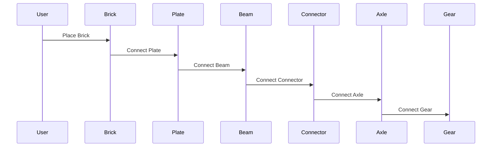

# Foundation: History
## 1. Conceptual Mental Model (First principles, historical context, and fundamental paradigm shifts)

### First Principles
Lego, a beloved toy and construction system, is fundamentally rooted in the principles of modular construction and the physical properties of plastic. The first Lego bricks were designed to interlock securely, allowing for the creation of complex structures with a high degree of stability and versatility. This modular approach is based on the principle of discrete, interchangeable components that can be assembled and disassembled repeatedly without losing their structural integrity.

### Historical Context
The history of Lego can be traced back to the early 20th century in Denmark. Ole Kirk Christiansen, a carpenter, founded Lego in 1932, initially producing wooden toys. In 1947, the company began experimenting with plastic injection molding, a process that would revolutionize the toy industry. The first Lego bricks were introduced in 1949, and the interlocking system was patented in 1958. Lego's success was driven by a combination of factors, including the toy's educational value, its ability to foster creativity, and its adaptability to various construction projects.

### Fundamental Paradigm Shifts
The introduction of the interlocking brick system marked a significant paradigm shift in toy design. Prior to Lego, most construction toys were either non-modular or lacked the structural integrity to support complex builds. Lego's interlocking system allowed for the creation of intricate structures with a high degree of stability and versatility. This shift in design philosophy has had a lasting impact on the toy industry and has inspired the development of other modular construction systems.

## 2. Essential Terminology & Taxonomy (Comprehensive architectural definitions)

### Brick
A Lego brick is the fundamental building block of the Lego system. It is a rectangular prism with a specific set of dimensions and a unique interlocking mechanism. The standard Lego brick measures 8mm x 8mm x 3.2mm and has a stud pattern on the top and a recessed pattern on the bottom that allows it to interlock with other bricks.

### Stud
A stud is a small, cylindrical protrusion on the top surface of a Lego brick. The studs are designed to fit into the recessed patterns on the bottom surface of other bricks, allowing them to interlock securely. The standard Lego brick has four studs arranged in a 2x2 grid.

### Recess
A recess is a small, cylindrical indentation on the bottom surface of a Lego brick. The recesses are designed to accept the studs from other bricks, allowing them to interlock securely. The standard Lego brick has four recesses arranged in a 2x2 grid.

### Plate
A Lego plate is a flat, rectangular piece that is used to create walls, floors, and other flat surfaces. Plates are typically half the height of a standard Lego brick and have a stud pattern on the top surface that allows them to interlock with other bricks and plates.

### Beam
A Lego beam is a long, rectangular piece that is used to create structural supports and other long, straight elements. Beams are typically twice the length of a standard Lego brick and have a stud pattern on the top surface that allows them to interlock with other bricks and plates.

### Connector
A Lego connector is a specialized piece that is used to connect beams and other long, straight elements. Connectors come in a variety of shapes and sizes and are designed to provide additional stability and support to complex structures.

### Axle
A Lego axle is a cylindrical piece that is used to create rotating joints and other moving parts. Axles are typically made of metal and have a smooth surface that allows them to rotate freely within the holes of other pieces.

### Gear
A Lego gear is a circular piece with teeth that is used to create rotating joints and other moving parts. Gears come in a variety of sizes and are designed to interlock with other gears, allowing them to rotate in sync.

## 3. Architecture & Core Workflow (Detailed ASCII and Mermaid diagrams with step-by-step dataflow)

### ASCII Diagram
```
+-------------------+
|       Brick       |
+-------------------+
|       Stud        |
|       Stud        |
+-------------------+
|       Recess      |
|       Recess      |
+-------------------+

+-------------------+
|       Plate       |
+-------------------+
|       Stud        |
|       Stud        |
+-------------------+

+-------------------+
|       Beam        |
+-------------------+
|       Stud        |
|       Stud        |
+-------------------+

+-------------------+
|     Connector     |
+-------------------+
|       Stud        |
|       Stud        |
+-------------------+

+-------------------+
|       Axle        |
+-------------------+
|       Hole        |
|       Hole        |
+-------------------+

+-------------------+
|       Gear        |
+-------------------+
|       Tooth       |
|       Tooth       |
+-------------------+
```

### Mermaid Sequence Diagram


## 4. Common Misconceptions & Mental Traps (Subtle edge cases and flawed mental models)

### Misconception: Lego is only for children
One common misconception is that Lego is only for children. While Lego is often marketed as a toy for children, it is a versatile construction system that can be enjoyed by people of all ages. Lego has been used by architects, engineers, and hobbyists to create complex structures and models, and it has even been used in educational settings to teach problem-solving and critical thinking skills.

### Misconception: Lego bricks can only be used to build static structures
Another common misconception is that Lego bricks can only be used to build static structures. While Lego is often used to build static structures, it can also be used to create moving parts and mechanisms. Lego has a wide range of specialized pieces, including axles, gears, and connectors, that can be used to create rotating joints and other moving parts.

### Misconception: Lego bricks can only be used to build simple structures
A third common misconception is that Lego bricks can only be used to build simple structures. While Lego is often used to build simple structures, it can also be used to create complex and intricate designs. Lego has a wide range of specialized pieces, including plates, beams, and connectors, that can be used to create walls, floors, and other flat surfaces, as well as structural supports and other long, straight elements.

### Misconception: Lego bricks can only be used to build structures that are symmetrical
A fourth common misconception is that Lego bricks can only be used to build structures that are symmetrical. While Lego is often used to build symmetrical structures, it can also be used to create asymmetrical designs. Lego has a wide range of specialized pieces, including plates, beams, and connectors, that can be used to create walls, floors, and other flat surfaces, as well as structural supports and other long, straight elements.

## 5. Socratic Discussion Starters (Advanced questions for deep Socratic exploration)

### Discussion Question 1
How does the interlocking mechanism of Lego bricks contribute to their structural integrity and versatility? Can you think of any other construction systems that use a similar interlocking mechanism?

### Discussion Question 2
How does the use of modular construction in Lego differ from traditional construction methods? What are the advantages and disadvantages of using modular construction in Lego?

### Discussion Question 3
How can Lego be used as a tool for education and problem-solving? Can you think of any specific examples of how Lego has been used in educational settings?
