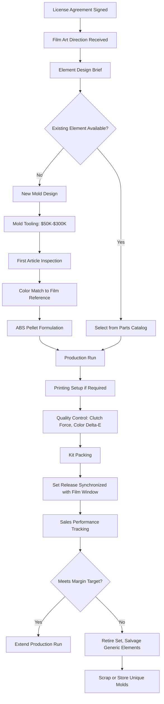

# Lesson 2: Expansion Through Themed Sets, Licensing Model Emergence

## 1. First-Principles Intuition & Invariants

To understand the magnitude of the shift that occurred in Lego's product architecture between 1997 and 2005, one must first internalize the founding invariant of the Lego System: that every element, regardless of the set it originates from, must interlock constructively with every other element ever produced. Godtfred Kirk Christiansen formalized this as the "system of play" in the 1950s, and for four decades it produced a parts ecosystem defined by combinatorial openness. A brick from a 1978 Castle set could join a beam from a 1985 Space set without friction, without adapter, without compromise. The system's intellectual core was that narrative was something the builder imposed on the material after the fact; the material itself was narrative-agnostic.

The licensing era inverted this relationship. When Lego signed its first agreement with Lucasfilm in 1998 for Star Wars–themed construction sets, scheduled to coincide with the 1999 release of *The Phantom Menace*, the company committed to a product architecture in which narrative preceded material. A set depicting the X-wing starfighter was not a collection of generic elements that happened to resemble a fictional spacecraft when arranged according to instructions; it was a purposeful assemblage of elements—many newly designed, some printed with proprietary markings, others cast in colors that existed solely to match a film's production design—that locked the builder into a specific representational outcome. The minifigure of Luke Skywalker was not a generic smiley-faced figure wearing a pilot's helmet; it was a character, identified by a uniquely printed face, a specific torso pattern, and a head mold exclusive to that character. The parts were still interoperable with the broader system at the stud level, but their semantic weight had shifted from universal to particular.

This was not a subtle change. It restructured the company's relationship with its own inventory. Prior to licensing, Lego's product designers worked within a closed palette of approximately thirty brick colors and a catalog of parts whose growth was governed by structural necessity. New elements entered the system only when existing elements could not accomplish a required mechanical or representational function. After 1999, new elements entered the system because a film's art direction demanded them. Sand red, dark tan, flat silver, and a dozen other colors were introduced or resurrected to match the visual language of specific film franchises. The parts catalog, which had grown at a measured pace for decades, expanded rapidly, and the cost of that expansion—new mold tooling at fifty thousand to three hundred thousand dollars per element, new color-matched ABS formulations, new printing pad setups—had to be recovered through set sales that were simultaneously bearing royalty payments to external rights holders.

The licensing model also introduced a temporal dependency that the classic system had never contained. A Lego Castle set from 1984 had no expiration date; it could sit on a shelf for a decade and still sell, because the medieval fantasy it depicted was culturally evergreen. A Star Wars set tied to a film release carried a marketing window. It had to hit retail before the film premiered, peak during the film's theatrical run, and then either sustain momentum through home video release or face declining relevance. Lego's production planning, which had been organized around annual or biannual product cycles, now had to synchronize with Hollywood's release calendar, with all the forecasting risk that implied. When a film underperformed, as several did, the associated Lego inventory became a liability rather than an asset, and the company had limited ability to redirect that inventory to other product lines because the sets contained franchise-specific elements, printed minifigures, and instruction booklets depicting scenes from the film.

The fundamental invariant that emerged—and that practitioners must understand to analyze Lego's product history from this period forward—is the tension between system openness and narrative specificity. Every licensed set is a compromise between these two forces. The more faithfully a set reproduces a licensed property's visual identity, the more specialized its elements must be, and the less those elements contribute to the combinatorial openness of the broader system. Lego's designers learned to manage this tension through a discipline they came to call "element abstraction": designing specialized parts that, while born from a specific franchise's requirements, were geometrically generic enough to be useful in other contexts. A curved slope molded in dark red for an X-wing wing panel could serve equally well as a architectural cornice in a modular building, provided its geometry was not so idiosyncratic that it had no secondary use. The most successful licensed elements are those that disappear into the general parts catalog after their franchise run ends. The least successful are those that remain permanently associated with a single set, orphaned after the license expires, taking up warehouse space and tooling investment with no secondary application.

## 2. Core Architecture & Mechanics

The mechanical architecture of a licensed Lego set differs from a classic set in several quantifiable dimensions, and understanding these differences is essential for any practitioner analyzing the company's product strategy or attempting to model the economic behavior of the licensed product line.

The first structural change is in the parts composition ratio. A classic Lego set from the 1980s—take 6074, the Black Falcon's Fortress—contains approximately 470 elements, of which fewer than ten are unique to that set. The vast majority are standard bricks, plates, slope bricks, and minifigure components shared across dozens of other Castle sets and many non-Castle themes. The set's identity is established through its assembly instructions and its minifigure heraldry, not through unique parts. By contrast, a set like 7191, the 2000 Ultimate Collector Series X-wing, contains 1,304 elements, of which roughly forty are either newly designed for that set or produced in a color exclusive to it. The unique-element ratio shifts from under two percent to over three percent, and this understates the impact because those unique elements are disproportionately concentrated in the set's most visible, structural surfaces—the fuselage, the wings, the cockpit canopy—precisely where replacement with generic elements would be most visually conspicuous.

The second structural change is the introduction of printed elements as a design language. In the classic era, printing was reserved for minifigure torsos, faces, and occasional signage elements like the classic space pattern on a 2x2 tile. Licensed sets expanded printing to structural elements: control panels, hull plates, droid body sections, and large canopy pieces. Each printed element requires a dedicated pad-printing setup, where silicone pads transfer ink from etched plates onto the ABS surface in register tolerances of fractions of a millimeter. A multi-color print on a complex curved surface like a droid's dome requires sequential pad applications, each with its own alignment fixture and curing interval. The per-unit cost of a printed element can be three to five times that of the same element unprinted, and the printing setup carries a fixed cost that must be amortized across the production run. When a set is retired and its printed elements are no longer needed, the printing plates are destroyed and the setup cost is sunk.

The minifigure underwent its own architectural transformation under licensing. The classic minifigure was a modular system: a standard head, a standard torso, standard legs, and accessory elements. Faces were universally the simple smiley pattern, and character differentiation was achieved through torso printing and headgear. Licensed minifigures required unique head molds—Chewbacca's elongated muzzle, C-3PO's golden droid face, the gilled Gungan head—and these molds could not be reused for other characters. The head mold for Jar Jar Binks, produced for the 1999 Star Wars line, was used in exactly three sets over two years and then never again. That mold cost an estimated hundred fifty thousand dollars to produce, and its entire productive life yielded elements for perhaps five hundred thousand minifigures spread across those sets. The per-figure tooling cost for that single head mold, ignoring all other production costs, was roughly thirty cents per unit, a meaningful fraction of the minifigure's total manufacturing cost.

The revenue architecture itself underwent a structural shift that practitioners modeling Lego's financial history must account for. The classic set generated revenue through a straightforward margin: manufacturing cost plus packaging, distribution, and retail markup, yielding a wholesale price that produced a target gross margin. The licensed set adds a royalty layer to this stack. Industry-standard toy licensing agreements typically specify a royalty rate of eight to fifteen percent of wholesale revenue, plus a minimum guarantee—an upfront payment the manufacturer must pay regardless of whether the licensed product sells. For a flagship Star Wars set retailing at one hundred dollars, with a wholesale price of approximately fifty-five dollars, a ten percent royalty removes five dollars and fifty cents from the margin per unit. The minimum guarantee structure means that if the product underperforms, Lego has already committed capital to Lucasfilm that it cannot recover, and this guarantee must be earned out through sales before Lego begins generating positive net revenue on the license.

The Harry Potter license, signed in 2000 ahead of the first film's 2001 release, compounded this architecture. Lego now held two major licenses simultaneously, each with its own release calendar, minimum guarantees, and royalty structures. The company's annual product portfolio, which had once been organized around its own internal themes—Town, Space, Castle, Pirates—now had to accommodate external creative timelines over which it had no control. When Warner Bros. delayed a Harry Potter film or Lucasfilm pushed back a Star Wars release, Lego's associated product inventory either sat in warehouses accruing storage costs or launched into a market with diminished promotional tailwind. The classic system had no analogous risk; a Castle set's release timing was entirely internal.

The BIONICLE line, launched in 2001, represents a critical counterexample within this period. It was Lego's first major original narrative-driven theme—not licensed, but built from scratch with its own characters, mythology, and story arc developed in-house through a partnership with the creative agency Goodbye Kansas (formerly known for film effects work). BIONICLE's construction system was mechanically radical, abandoning the stud-and-tube interlocking paradigm in favor of ball-and-socket joints, custom beam elements, and technic-adjacent connectors. It demonstrated that Lego could create narrative-driven products without external licensing, capturing the storytelling dimension that licensed sets offered while retaining full ownership of the intellectual property. The line's commercial success—it generated revenue that helped sustain the company through its 2003-2004 financial crisis—validated the narrative-driven model while exposing the licensing model's vulnerability: when you own the narrative, your royalty layer is zero and your creative calendar is your own.

The tension between these two approaches—the licensed model with its guaranteed cultural relevance but eroded margins, and the original narrative model with its full ownership but uncertain audience appeal—became the defining strategic question of Lego's early 2000s product portfolio. The company's near-bankruptcy in 2003, driven by a combination of unsold licensed inventory, over-diversification into non-core businesses, and the fundamental forecasting error of producing too many sets tied to films that underperformed, forced a reckoning. Under Jørgen Vig Knudstorp, who took over as CEO in 2004, the company restructured its licensing portfolio, cutting underperforming agreements and concentrating on properties with demonstrated revenue potential. The Star Wars license was retained. The Harry Potter license was paused after the third film's associated sets underperformed, then revived years later when the franchise's cultural momentum proved more durable than its initial film cycle had suggested.

## 3. High-Performance Optimization & Failure Modes

The licensed product line's optimization challenge is fundamentally one of inventory and tooling economics: how to produce enough unique elements to satisfy a franchise's visual fidelity requirements without accumulating so many low-reuse parts that the warehousing and tooling costs exceed the royalty-bearing revenue the sets generate. Lego addressed this through several mechanisms that practitioners should understand as design constraints rather than mere business decisions.

The first mechanism is element standardization across a licensed theme's full product run. When Lego committed to a multi-year Star Wars program, the design team established a shared palette of structural elements—the fuselage curves, the wing panels, the cockpit canopies—that would appear across multiple sets at different price points. A canopy element designed for a twenty-dollar X-wing set would also serve as the canopy for a sixty-dollar Y-wing and a hundred-dollar snowspeeder, with printing or color variation providing differentiation. This reduced the per-set tooling burden by spreading mold costs across multiple product SKUs. The discipline required was considerable: designers working on individual sets had to check their element requests against a theme-wide parts registry to confirm that any new element they proposed had a reuse plan across at least three sets in the current or planned product cycle. Elements that could not demonstrate this reuse case were rejected, and the designer was required to find a solution using existing catalog parts.

The second mechanism is the retirement and salvage cycle. Every Lego set has a production life, typically twelve to twenty-four months for standard sets and longer for premium products. When a licensed set retires, its unique elements must be either scrapped, stored for potential future reuse if the license continues, or redirected to non-licensed themes if their geometry permits. The decision tree is driven by storage cost—each unique element occupies warehouse space that costs approximately fifteen to twenty-five euros per cubic meter per year in Lego's Danish and Czech facilities—and by the probability of future reuse. Star Wars elements have a high salvage value because the license is perpetual and new sets depicting the same vehicles are likely. Elements from a one-off film license, such as the 2003 Spider-Man line, have minimal salvage value because the license may not continue and the elements are too visually specific for non-licensed reuse.

The most consequential failure mode in the licensed product architecture is what practitioners internally refer to as the inventory mismatch: producing licensed sets in volumes calibrated to a film's expected cultural impact, only to find that the film underperforms and the sets sit unsold. This occurred acutely with the 2002 Star Wars Attack of the Clones line, where Lego produced sets in anticipation of film-driven demand that did not materialize at the projected magnitude. The unsold inventory could not be redirected to other themes because the sets contained Episode II–specific printing, minifigures, and packaging. The standard remediation is markdown: selling the sets at reduced prices through secondary retail channels, Lego's own factory stores, and eventually clearance liquidation. Each markdown step erodes the margin further, and because the royalty is typically calculated on wholesale revenue rather than retail, the royalty payment was locked in at the original wholesale price regardless of how little Lego ultimately realized from the sale. Lego absorbs the full markdown loss while the licensor's royalty is unaffected.

A secondary failure mode is element proliferation: the gradual accumulation of unique parts in the catalog as licensed themes come and go, each leaving behind a residue of specialized elements that are too few to justify continued production but too numerous to simply discard. By 2003, Lego's active parts catalog had grown to over twelve thousand unique elements, nearly double its late-1990s count, and a significant fraction of this growth was attributable to licensed themes. Each catalog element requires a master mold, a production mold, a quality control specification, a storage bin, and a tracking number in the inventory management system. The overhead of maintaining this catalog was a material contributor to the company's cost structure, and the 2004 restructuring under Knudstorp included a deliberate reduction of the active parts catalog by eliminating elements with no planned reuse, many of them licensed orphans.

The practitioner analyzing Lego's licensed product history must also understand the interaction between licensing and the adult collector market, which emerged as a significant revenue driver during this period. Licensed sets, particularly Star Wars, attracted adult buyers who had no prior engagement with Lego as a construction toy but were drawn by the franchise affiliation. The Ultimate Collector Series, launched in 2000 with the large-scale X-wing and TIE Interceptor sets, was explicitly targeted at this demographic: sets with higher piece counts, more complex assembly, display-grade finished models, and premium pricing that carried higher absolute margin dollars per unit even after royalty payments. The adult market's price insensitivity—collectors would pay two hundred to five hundred dollars for a display model—meant that licensed sets at this tier could absorb higher royalty rates and still deliver acceptable margins, making the adult collector segment the most economically efficient application of the licensing model.

The licensing architecture that emerged from this period's experimentation, failure, and restructuring became the template for every major Lego theme partnership that followed: the concentration on a small number of high-value, long-term licenses rather than a broad portfolio of short-term agreements; the synchronization of product releases with franchise milestones but the decoupling of production volume from single-film performance; the investment in element designs with cross-set reuse plans documented before mold tooling begins; and the maintenance of original narrative themes alongside licensed ones, ensuring that the company retains a product portfolio not entirely dependent on external creative calendars. The Marvel and DC licenses, the Lord of the Rings and Hobbit agreements, and the Minecraft and Overwatch partnerships all operate within this architecture, and each represents a negotiation between the same fundamental forces: narrative specificity drawing customers in, and system openness pulling elements back toward universal utility.
