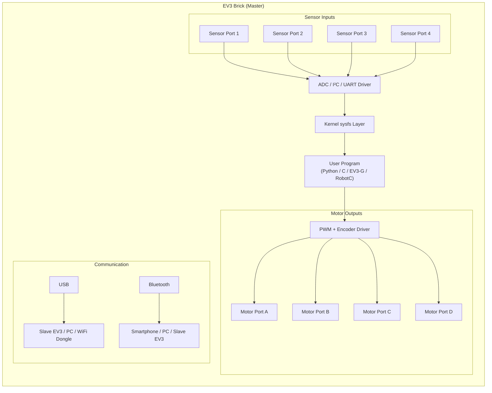

# Lesson 3: Digital Integration, Mindstorms Robotics, Video Game Expansion

## 1. First-Principles Intuition & Invariants

To understand why the introduction of Mindstorms in 1998 represented such a profound inflection point in Lego's history, one must first appreciate the conceptual tension that had always existed at the heart of the brick system. From Ole Kirk Christiansen's wooden toys through the patent-defining stud-and-tube coupling system of 1958, Lego's invariant proposition was deterministic physicality: a child's intent, expressed through hands, produced a fixed, inspectable structure. The model sat on the shelf. It did nothing unless you moved it. Technic pushed this boundary considerably — axles turned, pistons pumped, differentials distributed torque — but the system remained open-loop. Every motion was a direct consequence of a human hand applying force. There was no feedback, no memory, no behavior.

The Mindstorms RCX, developed through a partnership with the MIT Media Lab and the influential work of Seymour Papert's constructionist learning theory, introduced a closed-loop paradigm to plastic bricks for the first time. Papert had argued since the 1960s that children learn most powerfully not by being taught but by constructing artifacts in a shareable world. Lego's existing system satisfied the construction half of this equation brilliantly. What Mindstorms added was the shareable behavior: a model could now respond to its environment, make decisions, and produce output that was not merely mechanical but computational. The brick itself became a first-class component in a feedback system. This was not merely a product extension; it was a philosophical repositioning of what the medium could express.

The invariant that survived every hardware generation from the RCX through the NXT to the EV3 and beyond is what might be called the **embodied computation principle**: the program is inseparable from the physical structure that hosts it. A PID loop written for a line-following robot is not abstract software; it is a description of how a specific chassis geometry, a specific sensor placement, and specific motor dynamics will interact with a specific floor surface. Change the wheelbase by two stud-lengths and the same program fails. This coupling between code and construction is not a limitation — it is the defining pedagogical and engineering characteristic of the platform, and understanding it deeply is what separates practitioners who merely program Mindstorms from those who engineer with it.

The historical arc from RCX to EV3 also traces a broader industry narrative. When the RCX launched, the dominant model of physical computing for education involved either specialized electronics kits largely inaccessible to children or rudimentary BASIC interpreters on classroom microcomputers. The RCX brought a 32-bit Renesas H8/3292 microcontroller, infrared communication, and a visual programming environment into a yellow ABS brick that plugged directly into a Technic chassis. It was a genuinely radical act of integration. By the time the EV3 arrived in 2013, the landscape had shifted dramatically: Arduino had democratized hobbyist microcontrollers, Raspberry Pi had brought Linux to a $35 board, and Python had become the lingua franca of computational education. The EV3 responded by running a Linux kernel internally while still exposing an approachable graphical environment, a architectural decision whose implications for advanced practitioners are substantial and worth examining in detail.

The expansion into video games through the Lego Island franchise in 1997, and the subsequent explosion of titles built around licensed themes, introduced a parallel digital ontology: Lego not as a construction medium but as a representational one. The brick aesthetic — chunky geometry, visible seams, the deliberate blocky approximation of organic forms — became a visual language in its own right. The Lego Star Wars series beginning in 2005, developed by Traveller's Tales, demonstrated that this visual language carried genuine emotional and comedic weight independent of physical construction. For the advanced practitioner interested in Lego's history as a design system, the game franchise is not a marketing sidebar. It represents the moment when Lego's formal vocabulary, the geometric constraints and proportional rules of minifigure-scale construction, became decoupled from physical substrate and proved itself as a cultural and representational idiom capable of standing alone.

---

## 2. Core Architecture & Mechanics

### The RCX: Infrared, Ports, and the ROM Firmware Model

The RCX (Robotic Command eXplorer) brick established architectural patterns that persisted through every subsequent Mindstorms generation. Its physical form housed a Renesas H8 microcontroller running at 16 MHz with 32KB of RAM and 16KB of onboard ROM firmware. Three output ports drove motors through a simple H-bridge configuration, allowing bidirectional control. Three sensor input ports accepted passive sensors (touch, light) through a voltage-divider circuit whose readings were digitized by the microcontroller's on-chip ADC. This topology — multiple outputs, multiple sensor inputs, single computational core — defined the Mindstorms pattern and reflected a deliberate pedagogical choice: parallel actuator-sensor reasoning mirrors the way students naturally think about robot behavior ("if the touch sensor fires, stop the left motor").

Communication used a 2400-baud infrared serial link between the RCX and the host computer's IR tower, a constraint that significantly shaped programming workflows. Programs had to be compiled and downloaded in their entirety before execution; there was no interactive REPL or live debugging. This batch-download model demanded that practitioners develop strong mental simulation skills — the ability to trace program execution and predict sensor interactions before uploading, because debugging in situ was laborious.

The RCX supported multiple program slots (five independent program banks), and sophisticated practitioners learned to exploit this for behavioral modularity: one slot ran the primary navigation loop, another housed a calibration routine, and switching between them via physical button press served as a primitive state machine. It was a workaround, but it was a genuinely useful one, and it illustrates the broader principle that hardware constraints on this platform have historically produced creative architectural responses rather than dead ends.

### The NXT: ARM7, Bluetooth, and the Sensor Ecosystem Opening

The 2006 NXT represented a hardware leap whose significance extended well beyond raw specifications. The move to an Atmel ARM7 processor at 48 MHz, combined with 64KB of RAM and 256KB of flash storage, expanded the complexity of programs the platform could host. More consequentially, the NXT introduced USB connectivity and Bluetooth 2.0, fundamentally changing the relationship between the brick and external computing systems. For the first time, it was practical to communicate with a running NXT program in real time, sending commands and receiving sensor telemetry while the robot operated. This opened the door to hybrid architectures where the NXT handled low-latency motor control while a PC or later a smartphone processed vision data or ran planning algorithms.

The NXT's sensor port used an I²C bus on ports 1 through 4, and this proved to be its most important long-term architectural decision. By adopting a standard communication protocol rather than a proprietary one, Lego inadvertently created an open ecosystem. Third-party manufacturers — HiTechnic, Mindsensors, Dexter Industries — could produce compatible sensors that plugged directly into NXT ports. Gyroscopes, compass modules, acceleration sensors, infrared seekers for the Lego Mindstorms Competition ball, and even camera modules all became available. For advanced practitioners building competition robots, the third-party sensor ecosystem was not optional enrichment; it was a core capability that the official sensor lineup could not provide.

The I²C sensor addressing scheme follows the standard protocol: each device has a 7-bit address (the NXT treats it as an 8-bit address with the R/W bit appended), and querying a sensor involves writing a register address and then reading the response bytes. When working with a HiTechnic gyroscope, for instance, the register layout is as follows:

| Register | Offset | Description |
|---|---|---|
| Manufacturer | 0x00–0x07 | ASCII string "HiTechnc" |
| Sensor Type | 0x08–0x0F | ASCII string "Gyro    " |
| Angular Velocity | 0x42 | Signed byte, raw rotation rate |
| Angular Velocity (high precision) | 0x43 | Low byte of 16-bit value |

Reading these registers directly in NXT-G required the third-party LabView-based sensor blocks provided by HiTechnic. Reading them in RobotC required a small I²C transaction wrapper. Either way, the practitioner needed to understand register-level communication — a meaningfully deeper skill than configuring the native touch sensor.

### The EV3: Linux Core, Daisy-Chaining, and the Architecture Decision Tree

The EV3 (2013) is architecturally the most sophisticated and, for advanced practitioners, the most interesting Mindstorms brick. It runs a Texas Instruments Sitara AM1808 ARM9 processor at 300 MHz on top of a Linux 2.6 kernel, with 64MB of RAM and 16MB of flash. A microSD card slot allows booting alternative firmware images, a capability that proved transformative. The stock EV3 firmware presents the familiar graphical environment, but practitioners can install ev3dev — a full Debian Linux distribution for the EV3 — which exposes the brick as a standard Linux computer communicating with motors and sensors through a kernel driver layer.

Under ev3dev, motors are controlled by writing values to files in the sysfs filesystem. A large Technic motor attached to output port A is accessible at `/sys/class/tacho-motor/motor0/`. Setting speed, position, and run commands is a matter of writing to the appropriate attribute files. This architecture matters because it means every language with file I/O capability — Python, C, Ruby, JavaScript via Node.js — can control EV3 hardware with no special SDK required. The practical workflow for a Python session looks like this:

```bash
# Navigating the ev3dev sysfs interface for motor control
# Motor attached to output port A

MOTOR_PATH = '/sys/class/tacho-motor/motor0'

# Set the regulation mode to control by speed
with open(MOTOR_PATH + '/speed_sp', 'w') as f:
    f.write('500')           # 500 degrees per second

with open(MOTOR_PATH + '/command', 'w') as f:
    f.write('run-forever')   # Begin continuous rotation

# Read the current encoder position (degrees from start)
with open(MOTOR_PATH + '/position', 'r') as f:
    position = int(f.read())
```

The encoder feedback here is not incidental. Each EV3 large motor contains a 1-degree resolution quadrature encoder, meaning the motor's rotational position is available in real time. For a differential-drive chassis, integrating encoder counts provides dead-reckoning odometry accurate enough for short navigation tasks before accumulated error demands correction from an external sensor.

The EV3's daisy-chain capability, introduced to allow multiple bricks to share a single USB or Bluetooth connection, reflects the platform's design intent for large-scale educational builds. A single master EV3 can command up to three additional slave bricks, extending the available port count from 4 motor outputs and 4 sensor inputs to 16 motor outputs and 16 sensor inputs. This is essential for humanoid robot builds like the official LEGO MINDSTORMS EV3 Elephant or for competition robots requiring both a full articulated manipulator arm and a six-wheel drivetrain.

The signal and data flow from sensor input to motor output within the EV3 can be understood through the following diagram:



The EV3's UART sensor protocol deserves particular attention because it represents the architectural break from the NXT's I²C model. LEGO's fourth-generation sensors — the EV3 color sensor, infrared sensor, and gyro sensor — communicate over a 115,200-baud serial UART link. The brick and sensor perform an auto-negotiation handshake at power-on during which the sensor transmits its type information, available modes, and data formats. This means the firmware knows exactly what a connected sensor provides without any user configuration, a significant usability improvement. For the practitioner, it also means that the EV3 gyroscope cannot be directly substituted with the HiTechnic NXT gyroscope without an adapter or firmware-level shim, because the communication protocols are fundamentally different.

### Video Game Architecture: The Brick-to-Voxel Translation Problem

The architectural challenge that the Lego video game teams faced from Lego Island onward was essentially a translation problem: how do you represent a system defined by discrete, uniform-geometry interlocking elements in a render engine that natively works with continuous geometry and triangulated meshes? The early games, Lego Island included, essentially abandoned construction fidelity in favor of approximation — characters and objects looked vaguely Lego-like but were not constructable from real bricks. Traveller's Tales' breakthrough with Lego Star Wars was not purely graphical; it was ontological. They committed to building every in-game asset from actual Lego parts following actual part geometry, which meant the in-game models were theoretically constructable in physical bricks. This constraint produced the visual coherence that defined the franchise: everything shared the same facet angles, the same stud spacing, the same proportional vocabulary, because everything was derived from the same parts library.

The implication for understanding Lego as a design system is that the video game franchise proved the brick vocabulary to be both necessary and sufficient for expressive character design at minifigure scale. The chunky proportions, the C-shaped hands, the fixed facial expression (or in the Traveller's Tales games, the sliding expression range) turned out to carry remarkable emotional legibility at game resolution. This is a formal design result, not merely a commercial one.

---

## 3. High-Performance Optimization & Failure Modes

### PID Control on Differential Drive Chassis

The single most common performance failure in Mindstorms robotics is a line-follower or positioning system that oscillates, hunts, or drifts despite apparently correct sensor readings. Almost without exception, the root cause is a poorly tuned proportional-integral-derivative controller applied to motor speed. Understanding why this fails requires tracing the control loop from sensor to motor with physical specificity.

Consider a standard differential-drive EV3 line-follower using a single color sensor positioned at the front center of the chassis, measuring reflected light intensity. The sensor returns a value between 0 (black) and 100 (white). The robot's task is to follow the boundary between a black line and a white surface, which means the setpoint is approximately 45 — the edge, where sensor reading is at the midpoint of its dynamic range. The error signal at any moment is `error = 45 - sensor_reading`. A pure proportional controller applies motor correction as `correction = Kp * error`, then sets `left_motor_speed = base_speed + correction` and `right_motor_speed = base_speed - correction`.

With Kp too low, the robot is under-reactive: it drifts off the line before the correction accumulates sufficient magnitude to steer it back. With Kp too high, it overcorrects past the setpoint on every cycle, producing oscillation that worsens as speed increases. The practical starting value for Kp on an EV3 chassis with a 17-stud wheelbase running at 400 degrees-per-second motor speed is typically in the range of 0.4 to 0.8, but chassis geometry dominates this number. A narrower wheelbase amplifies turning response for the same correction value, so the effective Kp scales approximately inversely with wheelbase.

The derivative term addresses oscillation directly by damping rapid changes in error. The derivative signal is `Kd * (error - last_error)`, where `last_error` is the error from the previous loop cycle. When the error is decreasing rapidly — meaning the robot is already steering back toward the line — the derivative term subtracts from the correction, reducing the tendency to overshoot. The practical effect on a physical chassis is dramatic: a robot that hunts visibly at Kp = 0.8 with Kd = 0 will often track smoothly at Kp = 0.8 with Kd = 3.0 to 5.0. The correct ratio of Kd to Kp is empirical and chassis-specific, but the direction of iteration is reliable: increase Kd until oscillation is suppressed, then verify that the system still responds to step changes in line position (a Kd value that is too high produces a sluggish, non-responsive system).

The integral term is frequently unnecessary in line-following applications and commonly introduces more problems than it solves. Its purpose is to eliminate steady-state error — the persistent small offset that accumulates when the proportional response alone cannot null the error completely. In a line-follower on a closed circuit, this manifests as a consistent tendency to ride on one side of the line edge. If your surface has consistent reflectivity and your sensor is well-calibrated, the integral term is not needed. If you do add it, the integral windup failure mode is particularly destructive on the EV3: if the robot runs off the line entirely, error accumulates continuously in the integral register, and when the sensor reacquires the line the accumulated integral drives the motors to full asymmetric correction for several cycles, spinning the robot off in the opposite direction. The mitigation is integral clamping: cap the integral value at a maximum magnitude (typically no more than ±30 in normalized sensor units) and reset it whenever the error crosses zero.

A complete, deployable Python implementation under ev3dev for a PID line-follower runs as follows:

```python
#!/usr/bin/env python3
# EV3 PID Line Follower - ev3dev Python
# Hardware: EV3 large motors on ports B and C
#           EV3 color sensor on port 1

import time
from ev3dev2.motor import LargeMotor, OUTPUT_B, OUTPUT_C
from ev3dev2.sensor.lego import ColorSensor
from ev3dev2.sensor import INPUT_1

left_motor  = LargeMotor(OUTPUT_B)
right_motor = LargeMotor(OUTPUT_C)
sensor      = ColorSensor(INPUT_1)
sensor.mode = 'COL-REFLECT'

# Tuning parameters - calibrate per chassis
Kp         = 0.6
Ki         = 0.001
Kd         = 4.0
BASE_SPEED = 400       # degrees per second
SETPOINT   = 45        # midpoint of black(0)/white(100) range
INTEGRAL_CAP = 30

integral   = 0
last_error = 0

try:
    while True:
        reflected = sensor.reflected_light_intensity
        error     = SETPOINT - reflected

        integral  = max(-INTEGRAL_CAP, min(INTEGRAL_CAP, integral + error))
        derivative = error - last_error

        correction = (Kp * error) + (Ki * integral) + (Kd * derivative)

        left_motor.run_forever(speed_sp=int(BASE_SPEED + correction))
        right_motor.run_forever(speed_sp=int(BASE_SPEED - correction))

        last_error = error
        time.sleep(0.01)    # 100 Hz loop

except KeyboardInterrupt:
    left_motor.stop()
    right_motor.stop()
```

The 10-millisecond loop period deserves comment. The EV3 running Python under ev3dev achieves reliable 50–100 Hz control loop rates depending on sensor type and system load. The color sensor in `COL-REFLECT` mode returns a fresh reading every 1–3 ms at the hardware level, so at 100 Hz the program is not sensor-limited. If you observe the loop running slower than expected, the most common cause is file I/O overhead in the sysfs motor commands, which can be reduced by switching to the ev3dev2 library's internal buffering or by using the `SpeedDPS` class rather than raw `speed_sp` writes.

### Sensor Drift and Gyroscope Offset on the EV3

The EV3 gyroscope is the sensor most frequently blamed for robot behavior failures in competition contexts, and the blame is usually deserved — but the failure mode is specific and preventable. The EV3 gyro sensor exhibits a consistent slow drift in its reported angular velocity while nominally stationary: it reports a non-zero rotation rate even when the robot is completely still. This offset accumulates during integration into angle, producing heading error that grows roughly linearly with time. In a 90-second competition run, unmitigated gyro drift can produce heading errors of 10 to 25 degrees depending on temperature and sensor age.

The mitigation protocol is threefold. First, perform a hardware reset of the gyroscope by briefly disconnecting its cable while the EV3 is powered on and reconnecting it immediately before the run begins — this forces the sensor to re-execute its power-on calibration sequence. Second, hold the robot completely stationary for at least two seconds after program start before reading any gyroscope values, allowing the sensor's internal averaging filter to establish a stable zero reference. Third, implement a software drift-correction check: at any point in the program where the robot is known to be stationary (waiting for a trigger, loading an arm mechanism), sample the gyroscope reading over 50 cycles and subtract the mean from subsequent readings as a bias offset. Teams that implement all three of these measures routinely achieve heading accuracy of under 2 degrees over 60-second runs with no additional hardware.

### NXT-G and EV3-G: Dataflow Architecture and Its Failure Modes

The stock Lego graphical programming environments — NXT-G and EV3-G, both derived from National Instruments LabVIEW — implement a dataflow execution model that is architecturally distinct from the sequential execution model most programmers expect. In a dataflow program, a block executes when all of its input data wires carry valid values. Execution order is determined by data dependency, not by visual position on the canvas. This means that two blocks with no data connection between them can execute in any order, or concurrently, depending on the runtime scheduler.

The failure mode this produces is subtle and maddening to debug. A sequence of motor commands placed left-to-right on the canvas will execute sequentially only if they are connected by sequence wires (the gray wires) in addition to any data wires. Practitioners who rely on visual left-to-right ordering without sequence wires will find that the program behaves non-deterministically — sometimes correctly, sometimes with operations executing out of order depending on which block's inputs resolved first. The invariant rule is: **if order of execution matters, use sequence wires**. Data wires alone do not guarantee order.

The other systemic failure in EV3-G is memory leak behavior in long loops that contain local variable blocks or large array operations. The EV3 firmware does not perform garbage collection aggressively during loop execution, and a My Block (subroutine) called repeatedly inside a loop that allocates local arrays can consume available memory over the course of several hundred iterations until the brick silently terminates the program. The mitigation is to move all array allocations outside the loop body and pass them as references where the graphical language permits, or to switch to a text-based environment (Python, Java via leJOS, or RobotC) where memory management is explicit.

### The Lego Video Game Design Trap: Clip-Scaled Complexity

For advanced practitioners who study Lego as a design system across both physical and digital media, the video game franchise exhibits a characteristic failure mode in its later entries: complexity inflation that violates the formal constraints that made the early games distinctive. The Traveller's Tales games through roughly 2010 maintained strict adherence to the parts-library construction principle — every asset was buildable from real Lego pieces at correct stud dimensions. As the franchise expanded and development schedules compressed, later games increasingly introduced assets that approximated Lego aesthetics with custom geometry rather than actual Lego part shapes. The characteristic stud spacing and facet geometry became decorative rather than structural, and with it went much of the tactile legibility that made earlier titles feel coherent.

The design lesson for practitioners working at the intersection of physical and digital Lego systems is that the formal constraints of the brick vocabulary are not burdens to be minimized but generators of coherence. The constraints of stud spacing, the 5:6 stud-to-plate height ratio, the limited rotational angles achievable through Technic joint geometry — these are the same constraints that make a physical Lego model instantly recognizable as such across wildly different scales and subjects. When digital systems abandon these constraints in favor of expressive freedom, they lose the vocabulary and produce something that looks approximately like Lego but carries none of its formal weight. The programmable brick systems made the same error when early third-party NXT firmware allowed arbitrary motor control frequencies outside the standard PWM envelope: the motors worked, technically, but the interaction model diverged from what the hardware was optimized to deliver, and reliability suffered. Working within the formal system, deeply and precisely, has always been the source of Lego's expressive range, not a limitation of it.
