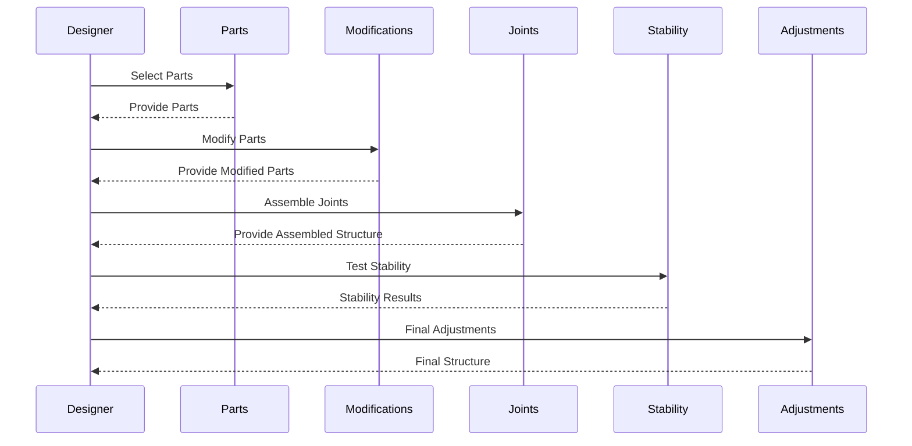

# Foundation: Illegal Builds
## 1. Conceptual Mental Model (First principles, historical context, and fundamental paradigm shifts)

### First Principles
In the domain of Lego, "illegal builds" refer to constructions that deviate from the official Lego building guidelines, often involving unconventional techniques, non-standard parts, or assemblies that challenge the structural integrity and aesthetic norms set by Lego. These builds push the boundaries of what is possible with Lego, often leading to innovative designs and solutions that were not originally intended by Lego's design team.

### Historical Context
The concept of illegal builds emerged as Lego enthusiasts began to explore the creative potential of Lego beyond its intended use. Early pioneers in this field, such as Adam Reed Tucker and Nathan Sawaya, demonstrated that Lego could be used to create complex and intricate structures that were not possible with standard Lego techniques. This led to a community of builders who sought to challenge the limitations of Lego and explore new possibilities.

### Fundamental Paradigm Shifts
The shift from traditional Lego builds to illegal builds represents a significant paradigm shift in the Lego community. It challenges the notion that Lego is a toy with strict rules and encourages builders to think creatively and experiment with unconventional techniques. This shift has led to a greater appreciation for the versatility and potential of Lego as a medium for artistic expression.

## 2. Essential Terminology & Taxonomy (Comprehensive architectural definitions)

### 1. **Non-Standard Parts**
   - **Definition:** Parts that are not part of the official Lego set or are modified in some way to achieve a specific effect.
   - **System-Level Definition:** Non-standard parts are any components that deviate from the official Lego catalog, including custom-made parts, modified parts, or parts from other brands that are compatible with Lego.

### 2. **Unconventional Techniques**
   - **Definition:** Building methods that deviate from the official Lego instructions and guidelines.
   - **System-Level Definition:** Unconventional techniques involve the use of alternative assembly methods, such as using non-standard parts, creating custom joints, or employing innovative building strategies that are not explicitly outlined in Lego's official building guidelines.

### 3. **Structural Integrity**
   - **Definition:** The ability of a Lego structure to maintain its shape and stability under various conditions.
   - **System-Level Definition:** Structural integrity is determined by the balance of forces acting on the structure, the distribution of stress, and the material properties of the Lego parts used.

### 4. **Aesthetic Norms**
   - **Definition:** The visual standards and conventions that are generally accepted within the Lego community.
   - **System-Level Definition:** Aesthetic norms encompass the color schemes, part usage, and overall design principles that are considered standard within the Lego community, often derived from official Lego sets and instructions.

### 5. **Custom Joints**
   - **Definition:** Connections between Lego parts that are not part of the official Lego catalog.
   - **System-Level Definition:** Custom joints are innovative ways of connecting Lego parts that are not explicitly outlined in Lego's official building guidelines, often involving the use of non-standard parts or unconventional techniques.

### 6. **Modular Design**
   - **Definition:** A design approach that involves breaking down a structure into smaller, interchangeable components.
   - **System-Level Definition:** Modular design is a method of constructing Lego structures by breaking them down into smaller, reusable components that can be assembled and disassembled in various configurations.

### 7. **Stress Distribution**
   - **Definition:** The way in which forces are distributed throughout a Lego structure.
   - **System-Level Definition:** Stress distribution is the mathematical analysis of how forces are distributed throughout a Lego structure, taking into account the material properties of the Lego parts, the geometry of the structure, and the external forces acting on the structure.

### 8. **Balance**
   - **Definition:** The state of equilibrium in a Lego structure.
   - **System-Level Definition:** Balance is the condition in which the forces acting on a Lego structure are in equilibrium, ensuring that the structure remains stable and does not tip over or collapse.

## 3. Architecture & Core Workflow (Detailed ASCII and Mermaid diagrams with step-by-step dataflow)

### ASCII Diagram
```
+-------------------+
|   Initial Design  |
+-------------------+
          |
          v
+-------------------+
|  Select Parts     |
+-------------------+
          |
          v
+-------------------+
|  Modify Parts     |
+-------------------+
          |
          v
+-------------------+
|  Assemble Joints  |
+-------------------+
          |
          v
+-------------------+
|  Test Stability   |
+-------------------+
          |
          v
+-------------------+
|  Final Adjustments|
+-------------------+
```

### Mermaid Sequence Diagram


## 4. Common Misconceptions & Mental Traps (Subtle edge cases and flawed mental models)

### Misconception 1: Structural Integrity is Only About Stability
- **Flawed Mental Model:** Many builders assume that structural integrity is solely about ensuring that a Lego structure does not tip over or collapse.
- **Correct Understanding:** Structural integrity involves not only stability but also the distribution of stress throughout the structure, ensuring that no part of the structure is subjected to excessive stress that could lead to failure.

### Misconception 2: Aesthetic Norms are Universal
- **Flawed Mental Model:** Some builders believe that aesthetic norms are universally accepted and should be strictly adhered to.
- **Correct Understanding:** Aesthetic norms are subjective and can vary widely within the Lego community. What is considered aesthetically pleasing to one builder may not be to another.

### Misconception 3: Custom Joints are Always Better
- **Flawed Mental Model:** Many builders assume that custom joints are always better than standard Lego joints.
- **Correct Understanding:** Custom joints can offer unique advantages, but they also introduce additional complexity and potential points of failure. The decision to use custom joints should be based on a careful analysis of the specific requirements of the build.

### Misconception 4: Modular Design is Always the Best Approach
- **Flawed Mental Model:** Some builders believe that modular design is the best approach for all Lego builds.
- **Correct Understanding:** Modular design can offer many advantages, such as reusability and flexibility, but it may not be the best approach for all builds. The decision to use modular design should be based on the specific requirements of the build.

### Misconception 5: Stress Distribution is Only a Concern for Large Structures
- **Flawed Mental Model:** Many builders assume that stress distribution is only a concern for large Lego structures.
- **Correct Understanding:** Stress distribution is a concern for all Lego structures, regardless of size. Even small structures can be subject to excessive stress if the forces are not properly distributed.

## 5. Socratic Discussion Starters (Advanced questions for deep Socratic exploration)

### Discussion Question 1
- **Question:** How does the concept of illegal builds challenge the traditional notion of Lego as a toy with strict rules? What are the implications of this shift for the Lego community and the broader world of creative building?

### Discussion Question 2
- **Question:** In what ways do unconventional techniques and non-standard parts enhance the creative potential of Lego? How do these techniques impact the structural integrity and aesthetic norms of Lego builds?

### Discussion Question 3
- **Question:** What are the trade-offs between using custom joints and standard Lego joints in illegal builds? How do these trade-offs impact the overall success of the build?
