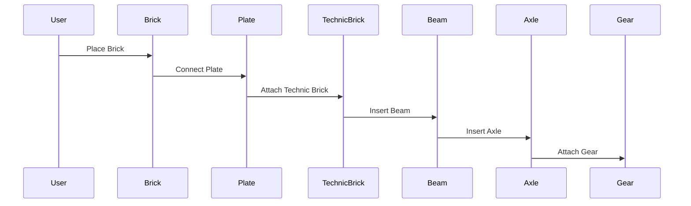

# Foundation: Instructions
## 1. Conceptual Mental Model (First principles, historical context, and fundamental paradigm shifts)

### First Principles
Lego, a Danish toy manufacturer, introduced their iconic plastic building blocks in 1949. The fundamental principle behind Lego is the interlocking mechanism that allows for the construction of a vast array of structures. This principle is rooted in the concept of modular design, where individual components can be combined in various configurations to create complex systems. The interlocking mechanism is based on the principles of geometry and mechanical engineering, specifically the use of a stud-and-tube system that ensures a secure fit between pieces.

### Historical Context
The Lego system was inspired by the Danish woodworker Ole Kirk Christiansen, who began making wooden toys in the 1930s. His son Godtfred, recognizing the potential of plastic as a material for toy construction, developed the Lego brick in 1949. The Lego brick's design was revolutionary because it allowed for a high degree of flexibility and creativity in construction. Over the years, Lego has expanded its product line to include themed sets, electronic components, and even programmable robots, all while maintaining the core principle of modular design.

### Fundamental Paradigm Shifts
The introduction of Lego bricks marked a significant paradigm shift in the toy industry. Prior to Lego, toys were often single-purpose and lacked the potential for open-ended play. Lego's modular design allowed children (and adults) to create their own unique structures, fostering creativity and problem-solving skills. This paradigm shift has had a lasting impact on the toy industry and has influenced the design of other modular systems, such as Meccano and K'NEX.

## 2. Essential Terminology & Taxonomy (Comprehensive architectural definitions)

### 1. Lego Brick
**Definition:** A Lego brick is the fundamental building block of the Lego system. It consists of a rectangular prism with a stud-and-tube interlocking mechanism on the top and bottom surfaces. The standard Lego brick measures 8mm x 8mm x 3.2mm and has six studs on the top surface.

### 2. Stud
**Definition:** A stud is a small cylindrical protrusion on the top surface of a Lego brick. The stud-and-tube system allows Lego bricks to interlock securely, providing structural integrity to the assembled model. The diameter of a Lego stud is 4.8mm, and the height is 1.8mm.

### 3. Tube
**Definition:** A tube is a small cylindrical recess on the bottom surface of a Lego brick that allows it to interlock with the stud of another brick. The diameter of a Lego tube is 5.2mm, and the depth is 1.8mm.

### 4. Plate
**Definition:** A plate is a flat Lego piece that is used to create walls, floors, and other flat surfaces. Plates are typically half the height of a standard Lego brick (1.6mm) and come in various sizes, including 1x1, 2x2, 2x4, and 4x4.

### 5. Technic Brick
**Definition:** A Technic brick is a specialized Lego brick that is used for building mechanical systems. Technic bricks have grooves on the sides that allow for the attachment of gears, axles, and other mechanical components. The standard Technic brick measures 8mm x 8mm x 12mm and has six studs on the top surface.

### 6. Beam
**Definition:** A beam is a long, thin Lego piece that is used to create structural supports and frames. Beams come in various lengths and can be connected to other beams or bricks using the stud-and-tube system. The standard beam measures 8mm x 3.2mm x 16mm.

### 7. Axle
**Definition:** An axle is a cylindrical component that is used to connect gears and other mechanical parts in Lego models. Axles come in various lengths and can be inserted into the grooves of Technic bricks. The standard axle diameter is 4mm.

### 8. Gear
**Definition:** A gear is a circular component with teeth that is used to transmit mechanical power in Lego models. Gears can be connected to axles or other gears using the stud-and-tube system. The number of teeth on a gear determines its gear ratio, which affects the speed and torque of the mechanical system.

## 3. Architecture & Core Workflow (Detailed ASCII and Mermaid diagrams with step-by-step dataflow)

### ASCII Diagram
```
+-------------------+
|    Lego Brick     |
+-------------------+
|       Studs       |
|                   |
|       Tubes       |
+-------------------+
        |
        v
+-------------------+
|      Plate        |
+-------------------+
        |
        v
+-------------------+
|    Technic Brick  |
+-------------------+
        |
        v
+-------------------+
|       Beam        |
+-------------------+
        |
        v
+-------------------+
|       Axle        |
+-------------------+
        |
        v
+-------------------+
|       Gear        |
+-------------------+
```

### Mermaid Sequence Diagram


## 4. Common Misconceptions & Mental Traps (Subtle edge cases and flawed mental models)

### Misconception 1: Lego is only for children
**Explanation:** Lego is often perceived as a toy for children, but it is a versatile system that can be enjoyed by people of all ages. Lego can be used to build complex mechanical systems, architectural models, and even art installations. The misconception that Lego is only for children stems from its origins as a toy, but it has evolved into a powerful tool for creativity and problem-solving.

### Misconception 2: Lego bricks can only be used for building
**Explanation:** Lego bricks are often used for building, but they can also be used for a variety of other purposes. Lego can be used to create mechanical systems, such as robots and vehicles, as well as architectural models and art installations. The misconception that Lego bricks can only be used for building stems from the limited scope of Lego sets available in the past. However, Lego has expanded its product line to include a wide range of sets that cater to different interests and skill levels.

### Misconception 3: Lego bricks are interchangeable with other building systems
**Explanation:** Lego bricks are often compared to other building systems, such as Meccano and K'NEX, but they are not interchangeable. Lego bricks have a unique stud-and-tube interlocking mechanism that allows them to fit together securely. Other building systems use different interlocking mechanisms, which means that Lego bricks cannot be used with other systems. The misconception that Lego bricks are interchangeable with other building systems stems from the similarity in appearance between Lego bricks and other building systems. However, the differences in interlocking mechanisms make Lego bricks unique and specialized.

### Misconception 4: Lego models are always stable
**Explanation:** Lego models are often perceived as stable, but they can be prone to collapse if not constructed properly. The stability of a Lego model depends on the distribution of weight and the strength of the interlocking connections. The misconception that Lego models are always stable stems from the simplicity of Lego bricks and the ease of construction. However, the complexity of Lego models can lead to subtle issues that affect stability, such as uneven weight distribution and weak connections.

### Misconception 5: Lego is only for building static structures
**Explanation:** Lego is often perceived as a system for building static structures, but it can also be used to build dynamic systems, such as robots and vehicles. Lego has a wide range of mechanical components, such as gears, axles, and motors, that can be used to create moving parts. The misconception that Lego is only for building static structures stems from the limited scope of Lego sets available in the past. However, Lego has expanded its product line to include a wide range of sets that cater to different interests and skill levels.

## 5. Socratic Discussion Starters (Advanced questions for deep Socratic exploration)

### Discussion Question 1
How does the interlocking mechanism of Lego bricks contribute to the stability and flexibility of Lego models? Can you provide an example of a Lego model that demonstrates both stability and flexibility?

### Discussion Question 2
How has the evolution of Lego sets influenced the way people use Lego for creative and problem-solving purposes? Can you provide an example of a Lego set that has expanded the possibilities of Lego construction?

### Discussion Question 3
How does the modular design of Lego bricks relate to other modular systems, such as Meccano and K'NEX? Can you compare and contrast the interlocking mechanisms of these systems and discuss their strengths and weaknesses?
