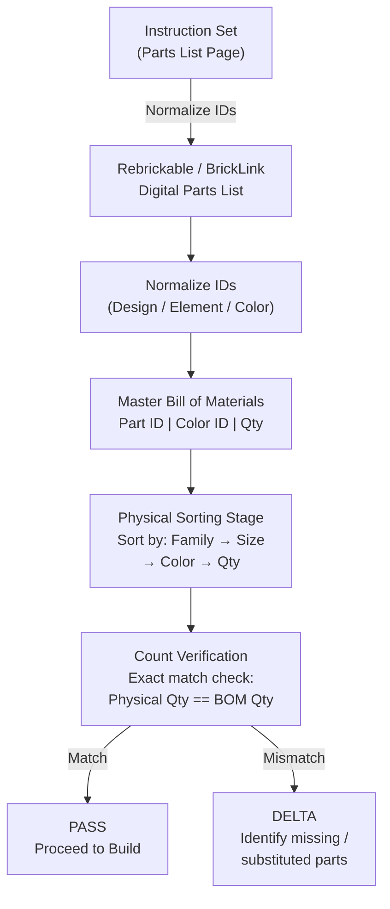

# Lesson 2: Part Identification through Inventory

## 1. First-Principles Intuition & Invariants

Every Lego build, from a 42-piece Creator set to a 9,000-piece Millennium Falcon, is ultimately a substitution problem: the instructions specify a precise part at a precise moment, and your physical inventory must match that specification or the build fails. What separates an advanced practitioner from a casual assembler is the depth of fluency they bring to this matching problem. A novice looks at a part and sees a shape. An expert sees a design ID, a system of connection geometry, a color variant with its own production history, and a functional role within the larger mechanical assembly.

The Lego system is deceptively unified. Beneath the apparent simplicity of interlocking bricks lies one of the most precisely standardized dimensional systems in mass-manufactured consumer goods. The fundamental unit of horizontal measure is the stud pitch: 8 mm center-to-center. Vertical measure runs in two parallel units — the standard brick height of 9.6 mm (including the stud) and the plate height of 3.2 mm. Three plates stack to exactly one brick height, and this arithmetic precision is not incidental; it is the entire basis on which SNOT (Studs Not On Top) geometry, offset paneling, and mixed-orientation subassemblies function without gaps or stress. When you understand these invariants in your hands rather than just abstractly, you can identify a part's dimensional class at a glance, infer its legal connection set, and cross-reference it against an inventory database with speed and confidence.

The nomenclature used in official Lego documentation has evolved significantly over the decades, which creates a first major complexity for the inventory practitioner. Lego's internal system assigns each unique mold a **design ID** (sometimes called a "part number"), and each colorway of that mold a separate **element ID**. A 2×4 brick in black carries a different element ID than the same mold in sand green, even though the design ID — 3001 — is shared. BrickLink, the dominant third-party marketplace and cataloging platform, maintains its own part numbering scheme that partially overlaps with official Lego design IDs but diverges for parts that were produced before BrickLink's catalog was systematized. Rebrickable, by contrast, normalizes across BrickLink IDs, official Lego element IDs, and LDraw part numbers simultaneously. Knowing which numbering system an instruction set, a pick-a-brick order, or a parts list is operating in is the first diagnostic question you must ask before any inventory verification work begins.

Connection geometry divides the Lego universe into several distinct mechanical families, and correct part identification is impossible without internalizing these families as a practitioner. The classic stud-and-tube system — where a hollow cylindrical tube on the underside of a brick receives the stud of the brick below — is the original connection mechanism and remains the basis for all System-scale parts. The press fit between stud and tube is calibrated to deliver approximately 1.9 to 2.4 N of separation force on a standard ABS brick, which is why a freshly produced brick holds firmly but can be released by hand without tools. Technic pin connections, by contrast, are friction-based axial joints: a cross-section pin inserts into a matching cross-hole, and retention comes from the deformation of the pin's ribs against the bore wall. Knowing which family a part belongs to tells you immediately how it connects, what loads it can bear, and what failure mode to expect — stud-tube joints fail in vertical shear, while Technic pin joints fail in bending moment around the pin axis.

Color identification carries its own layer of expert knowledge that instruction verification demands. Lego has produced parts in well over 150 distinct colors across its production history, and many of these colors have been retired, renamed, or subtly reformulated. The critical invariant here is that **color in instructions is never decorative context — it is a functional constraint**. A part specified in Light Bluish Gray is not interchangeable with the older Light Gray, even though both appear gray to a casual eye; the tolerances and surface finish differ, and in Technic assemblies involving studless beams and pin joints, mixing production generations of gray can introduce friction inconsistencies. For color-critical builds and instruction creation, practitioners use Lego's official color nomenclature cross-referenced against the BrickLink color table, which assigns each color a consistent integer ID. The colors 1 (White), 11 (Black), 85 (Dark Bluish Gray), 86 (Light Bluish Gray), and 194 (Medium Stone Gray, Lego's internal name for what BrickLink calls Light Bluish Gray) are among the most frequently confused pairs in advanced sorting workflows.

The core invariant that ties all of this together is **specificity over similarity**. In inventory verification, a close match is an incorrect match. The functional requirements of a Lego assembly — load paths, connection counts, rotation clearances, visual continuity — are defined by the exact part, and approximation introduces failure.

---

## 2. Core Architecture & Mechanics

Understanding how the Lego cataloging ecosystem is structured allows you to move fluently between physical sorting, digital inventory management, and instruction cross-referencing. The workflow involves three distinct layers that interact constantly: the physical taxonomy of the parts themselves, the digital catalog infrastructure, and the instruction document format.

The physical taxonomy begins with what practitioners call **part families** — groups of molds that share a base geometry but are distinguished by size, stud pattern, or feature additions. The humble 2×4 brick (design ID 3001) belongs to the rectangular brick family, which includes every NxM combination from 1×1 to 2×10, as well as brick variants with side studs, embossed logos, and hollow interiors. Each member of a family is cataloged independently because connection counts, weight, and structural contribution all vary by size. A practiced inventory hand learns to distinguish these by feel as well as sight — a 2×3 brick and a 2×4 brick are unlikely to be confused visually, but a 1×3 and a 1×4 tile differ by one internal stud width, and incorrect substitution at the tile level in a large flat surface assembly will generate a staggered fault line that propagates for dozens of additional parts.

The definitive digital infrastructure for Lego part identification centers on three platforms: **BrickLink**, **Rebrickable**, and **BrickOwl**, each with distinct architectural strengths. BrickLink functions as both a marketplace and a canonical parts database; its catalog assigns each part a string ID (e.g., `3001` for the 2×4 brick, `32523` for a 3-module Technic beam), and maintains a separate image-based lookup table organized by category. Rebrickable's core value is its set-to-parts explosion API, which takes a set number and returns a full bill of materials with quantities, colors, and element IDs, normalized across BrickLink and official Lego nomenclature. For practitioners building instruction-following workflows, Rebrickable's parts list is the most reliable source for pre-verification before physical sorting begins.

The structure of a Lego instruction document itself encodes part information at multiple levels. Modern official instructions include a **parts inventory page** — typically positioned at the front or back of the booklet — that presents every element as an isometric icon alongside its quantity, color name, and in recent digital editions, its element ID. This page functions as the ground truth for the build. When working from an instruction set, the first professional act is to audit this inventory page against your physical sort, not to begin building.

The following diagram represents the conceptual data flow of a complete inventory verification workflow:

Physical sorting deserves extended treatment because it is where practitioner skill most directly determines workflow efficiency. The professional approach sorts in three cascading passes. The first pass is a **family sort**: all flat tiles together, all standard bricks together, all Technic beams together, all plates together, and so on. Family identification is based on the fundamental connection geometry of each piece — does it have studs and tubes, only tubes, cross-holes, bar slots, or ball sockets? This pass requires no counting and can proceed quickly even with a large collection.

The second pass performs a **dimensional sub-sort** within each family. Within the tile family, for example, parts are separated by their stud-equivalent footprint: 1×1, 1×2, 1×3, 1×4, 1×6, 1×8, 2×2, 2×4, and so on. For Technic beams, the governing dimension is module count — a 3M beam (design ID 32523) is physically shorter than a 5M beam (32316) by exactly two stud pitches (16 mm), and mixing them is a build-terminating error at any step that requires a specific chassis span. Within Technic, the design language also distinguishes **liftarms** (beams with Technic pin holes, no studs) from **bricks with holes** (which carry both studs and pin holes), and **bent liftarms** (elbows at defined angles: 90°, 135°, 53/37° double-bend) from straight ones. These distinctions are not cosmetic — they determine structural configuration entirely.

The third pass is a **color sort within dimensional subgroups**, followed by a count verification against the bill of materials. At this stage, good lighting and a neutral background are operational requirements, not conveniences. Many practitioners maintain a dedicated LED daylight-balanced sorting mat (5000–6500 K color temperature) specifically because accurate color discrimination between problematic color pairs — Medium Stone Gray vs. Dark Stone Gray, Bright Red vs. Dark Red, Tan vs. Dark Tan — is not reliably achievable under warm incandescent light.

Connection mechanism identification is a micro-skill that deserves explicit attention. The stud-and-tube system is visually self-evident, but Technic connection geometry is more subtle. The **standard Technic pin** (design ID 3673) uses a symmetric ribbed shaft that provides identical friction in either orientation; the **friction pin with stop bush** (32556) adds a flange on one end that prevents full insertion; the **axle-pin combo** (11214) has a cross-section axle on one end and a pin on the other, allowing mixed-geometry connections. Identification of these variants by inspection alone requires knowing the visual cues: pin length (1 stud module vs. 2), presence of an axle cross-section, flange position, and rib pattern. A 3-module axle (design ID 4519) and a 2-module axle (32062) with extended end differ by only 8 mm and are frequently conflated in bulk Technic sorts.

---

## 3. High-Performance Optimization & Failure Modes

The highest-leverage optimization in professional inventory verification is **pre-build digital reconciliation** before a single part is physically touched. The workflow begins with extracting the set number from the instruction booklet, pulling the full parts list from Rebrickable's API or database export, and comparing it against your digital personal collection if you maintain one in BrickLink's inventory system or Rebrickable's "My Collection" module. This digital pre-check identifies missing parts, color mismatches, and design ID discrepancies before physical sorting begins, which eliminates the expensive failure mode of discovering a missing part 80% through a build — a scenario that forces either a halt or a structural compromise at a mechanically critical moment.

For practitioners who maintain large sorted collections, the BrickLink XML inventory export format is the standard interchange format. A collection exported from BrickLink's inventory tool produces a structured file where each entry encodes design ID, color ID, quantity, and optionally condition (new vs. used). Importing this against a desired set's parts list produces a delta report — the exact shortfall, by part and color, that must be sourced before the build begins. The professional discipline is to run this reconciliation for every significant build rather than relying on the assumption that a large collection is likely to contain what you need. Assumption-based inventory management is the single most common cause of mid-build part failures, and it scales worse with collection size, not better, because larger collections contain more near-miss parts that satisfy a visual check but fail a dimensional or color check.

The failure mode of **part substitution** deserves specific analysis. It occurs when an assembler, unable to locate a specified part, substitutes a visually similar one. The consequences are non-uniform across part types. Substituting a 1×4 tile for a 1×4 plate in a cosmetic panel is recoverable — the stud height difference adds approximately 1.6 mm of protrusion, which may be visually acceptable. Substituting a Technic 3M beam for a Technic 2M beam in a suspension linkage is not recoverable: the geometric relationship between pivot points changes, joint angles no longer close, and the assembly either binds or introduces a stress concentration at the wrong location. The practical rule is that **substitutions in structural Technic assemblies are almost always load-path errors**, while substitutions in System brick cosmetic cladding are frequently tolerable with minor dimensional compensation.

Color-based failures are more insidious because they pass visual inspection. The transition from the original gray palette to the "new gray" palette in 2004 is the most consequential historical boundary in Lego color management. Before 2004, the standard grays were called Light Gray (BrickLink color 9) and Dark Gray (BrickLink color 10). After 2004, these were replaced by Light Bluish Gray (color 86) and Dark Bluish Gray (color 85), which carry a subtly cooler, bluer undertone. In a large sorted collection containing both pre- and post-2004 parts, mixing these color generations within a single build surface is visually detectable at any angle of light that creates raking shadows — the tonal difference becomes stark. For high-fidelity MOCs and instruction-following builds where visual continuity matters, every gray part must be verified by color generation, not just by hue category.

An advanced failure mode specific to Technic builds is **pin friction class confusion**. Lego produces pins in two distinct friction classes: **friction pins** (also called "quality" or "firm" pins), which provide axle-equivalent grip to hold structural positions, and **smooth pins** (blue-tipped in modern production, design ID 4274 in black), which allow free rotation. The color coding was introduced precisely to prevent this confusion, but older black smooth pins and black friction pins are visually indistinguishable without tactile testing — inserting both into a beam and comparing the resistance. Using a friction pin where the instruction specifies a smooth pin locks a joint that must rotate, introducing binding loads that propagate through the assembly. Using a smooth pin where a friction pin is required allows an angular member to collapse under load. Neither error is immediately catastrophic, but both undermine the kinematic intent of the design.

Optimizing a large inventory sort for speed without sacrificing accuracy relies on the technique of **staged exclusion**. Rather than sorting the full bulk collection for every build, an experienced practitioner first extracts the parts list and identifies the top-10 highest-risk items — typically the parts that are least common in bulk collections, most color-sensitive, or most dimensionally unique. These are sourced and verified first. The balance of common parts (2×4 bricks, 1×2 plates, standard black Technic beams) are then sorted from bulk, and because common parts sort quickly by touch, the total verification time is dominated by the rare-part resolution phase rather than the bulk sort phase. This staged approach reduces overall verification time for a 500+ part build by roughly 30 to 40 percent compared to a uniform sequential sort.

The final discipline is **documentation of delta outcomes**. When a build reveals a missing, substituted, or damaged part, that information should be recorded back into your digital inventory — either as a quantity correction in BrickLink or as a note in Rebrickable. A collection that is accurately reflected in a digital inventory is worth substantially more as a working tool than a larger but untracked collection, because every future build benefits from the accumulated accuracy of past reconciliations. The inventory is not a snapshot of your collection at one moment; it is a living document that improves with every build you complete.
