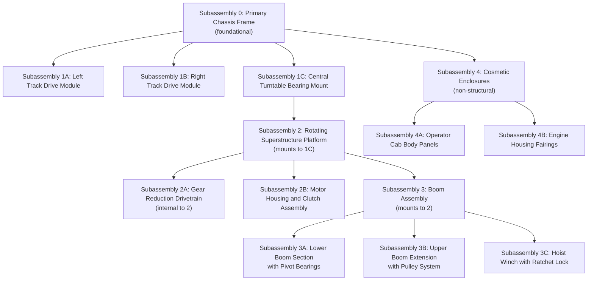

# Lesson 3: Subassembly Construction Hierarchy

## 1. First-Principles Intuition & Invariants

The architectural integrity of any advanced Lego Technic model—whether a crawler crane with functional hoisting mechanisms, a supercar with independent suspension, or a walking hexapod—depends fundamentally not on individual brick connections but on the strategic decomposition of the entire structure into modular subassemblies that can be independently constructed, validated, and integrated. This hierarchical construction methodology mirrors the assembly line philosophies of industrial manufacturing, where large systems are broken into manageable subsystems that undergo parallel fabrication before final integration. The subassembly approach transforms construction from a monolithic, error-prone process into a sequence of testable, reversible operations that preserve structural integrity at every stage.

At its core, subassembly hierarchy rests on three invariants that govern all physical construction systems. First, **load path continuity** demands that every force-bearing element must transfer stress through a complete, unbroken chain from the point of application to the structural foundation. A steering mechanism attached to a chassis must route torsional loads through rigid axle housings and cross-braced frames, never through fragile single-stud connections. Second, **assembly sequence dependency** dictates that certain structural elements become inaccessible after surrounding components are installed. A motor mount buried within a gearbox housing cannot be adjusted or reinforced after side panels enclose it; therefore, the motor subassembly must achieve verified rigidity before enclosure. Third, **interface standardization** requires that connection points between subassemblies employ predictable, rigid geometry—typically full-width liftarm interfaces with multiple pin connections distributed across a 5-hole span or triangulated beam arrangements that resist both shear and torsion.

These invariants are not arbitrary conventions but emerge from the physical constraints of Lego's studded and pinned connection topology. Unlike welded steel assemblies or bonded composite structures that achieve continuous stress distribution across joints, Lego connections concentrate forces at discrete pin-hole interfaces. Each pin experiences localized shear stress, and each axle transmits torsion through the friction fit between its cruciform cross-section and the surrounding hub geometry. When forces exceed the friction coefficient or mechanical interference of these interfaces, connections slip, rotate, or catastrophically disengage. Subassembly hierarchy mitigates this vulnerability by ensuring that every functional mechanism—gearbox, suspension arm, drivetrain differential—undergoes isolated stress testing before integration, allowing the builder to reinforce weak joints or redistribute loads before the error propagates into the larger assembly.

The cognitive advantage of subassembly construction extends beyond mechanical robustness. By decomposing a 3,000-piece model into twelve independent modules, the builder reduces working memory load and establishes clear troubleshooting boundaries. When a completed model exhibits a functional defect—a gearbox that binds under load, a suspension arm with excessive play—the modular architecture isolates the fault domain. Rather than disassembling the entire structure to access internal components, the builder removes only the affected subassembly, diagnoses the issue on the workbench, and reintegrates the corrected module. This modularity transforms debugging from destructive forensic archaeology into surgical component replacement.

Understanding subassembly hierarchy also reveals the implicit logic embedded within official Lego instruction manuals. Advanced Technic sets never instruct the builder to "construct the entire chassis from baseplate to roof in one operation." Instead, instructions orchestrate a carefully sequenced assembly flow: first, the drivetrain core with motor mounts and gear reduction stages; second, the chassis floor with longitudinal beams and cross-bracing; third, suspension assemblies that bolt onto predefined mounting points; fourth, body panels and cosmetic cladding that enclose but do not structurally participate in load bearing. This sequence respects assembly accessibility, allowing each subassembly to be inserted through open gaps before surrounding structures close off access. Deviating from this sequence—for instance, installing body panels before suspension arms—forces the builder into contorted insertion angles that risk damaging delicate components or make certain steps physically impossible.

The hierarchical decomposition also governs the selection of primary structural anchors. Every model contains one or more **rigid core assemblies** that serve as the foundational reference frame to which all other modules attach. In a vehicle, this is typically the central chassis beam running longitudinally from front axle to rear differential, constructed from 13M or 15M liftarms cross-braced with perpendicular 9M or 11M beams to form a truss structure. In a stationary mechanism like a gantry crane, the rigid core is the vertical tower assembly, built from four corner pillars connected by horizontal square frames at regular vertical intervals. All rotating, articulating, or load-bearing subassemblies—steering racks, boom actuators, gear transmissions—mount to this rigid core through high-integrity connection points that distribute attachment forces across at least three pin locations spaced in non-collinear geometry.

Recognizing the difference between structural and cosmetic subassemblies is critical for efficient construction. Structural subassemblies bear mechanical loads and must achieve high torsional rigidity through triangulated beam networks. Cosmetic subassemblies—body panels, fairings, decorative grilles—contribute minimal strength and serve primarily to conceal internal mechanisms or provide visual authenticity. Mixing these categories by routing load paths through cosmetic panels introduces catastrophic failure modes: panels flex, pop off under stress, or crack at mounting points. Advanced builders enforce strict separation, ensuring that every functional mechanism derives its rigidity from internal cross-braced frames, while cosmetic panels attach superficially through clip-on connections or single-pin friction joints that allow easy removal for maintenance access.

The subassembly hierarchy also encodes knowledge about mechanical tolerance accumulation. Each pin-hole connection introduces approximately 0.15 mm of radial clearance, necessary for ease of assembly but detrimental to precision. When ten connections stack serially—as in a long gear train or multi-stage articulated arm—cumulative tolerances produce 1.5 mm of endpoint slop, enough to cause gear skipping or inaccurate actuator positioning. Skilled builders combat tolerance stacking by closing geometric loops: instead of cantilevering a 20-stud beam supported only at one end, they anchor both ends to the rigid core, transforming serial tolerance accumulation into a closed kinematic chain where opposing constraints cancel out slack. Subassembly construction enables this strategy by completing rigid loops within each module before integration, rather than attempting to close loops across the entire model during final assembly when misalignments are difficult to correct.

## 2. Core Architecture & Mechanics

The practical execution of subassembly hierarchy begins with architectural decomposition—the systematic process of analyzing a complete model design and partitioning it into functionally cohesive modules that respect mechanical boundaries and assembly accessibility constraints. This decomposition is not arbitrary; it follows predictable patterns determined by the model's kinematic topology and load distribution. The first step in any complex build is to identify the **primary load-bearing frame**, the static structural skeleton that defines the model's overall geometry and serves as the mounting foundation for all dynamic components.

Consider a Technic crawler crane as the canonical example. The primary frame consists of the undercarriage chassis, a rectangular lattice constructed from 13M and 15M liftarms arranged in a double-beam configuration. This chassis runs longitudinally from the front idler wheels to the rear drive sprockets, cross-braced at five-hole intervals with perpendicular 9M beams that prevent lateral racking. The cross-braces employ triangulation: rather than simple perpendicular connections that allow parallelogram deformation under shear loads, diagonal 7M liftarms connect corner vertices to opposite-corner midpoints, converting the rectangular frame into a truss structure that resists deformation in all planes. This primary frame forms Subassembly Zero, the foundational reference to which all subsequent modules attach.

The second-order subassemblies comprise the functional mechanical systems: the tracked drive assemblies, the turntable base, the superstructure gantry, and the hoisting boom. Each of these modules exhibits internal mechanical complexity but presents a standardized interface to the primary frame. The tracked drive subassembly, for instance, contains the drive sprocket mounting hub, the tensioned track chain with interleaved links, the suspension rocker arms with shock absorption springs, and the idler wheel mounting brackets. Internally, this subassembly contains twelve to fifteen individual connections forming a closed kinematic loop, but its interface to the primary chassis consists of exactly six pin connections distributed across a 5×3 hole rectangular mounting plate. This standardized interface allows the entire track assembly to be constructed independently on the workbench, tested for smooth rotation and proper tension, then installed onto the chassis as a single rigid unit using six simultaneous pin insertions.

The assembly sequence tree for the crawler crane follows this dependency graph:

This tree structure reveals several critical principles. First, subassemblies at the same hierarchical level (1A, 1B, 1C) are independent and can be constructed in parallel or in any order, since none depends on the others for assembly access or structural support. Second, subassemblies at higher levels (2, 3) strictly depend on lower-level subassemblies being completed and integrated first; attempting to install the boom (Subassembly 3) before the superstructure platform (Subassembly 2) is geometrically impossible since the boom's pivot bearings mount to hardpoints on the superstructure. Third, cosmetic enclosures (Subassembly 4) appear last in the sequence because they enclose internal mechanisms and would obstruct access if installed prematurely.

Within each subassembly, the builder employs a microcosm of the same hierarchical logic. The tracked drive module (Subassembly 1A) itself decomposes into tertiary components: the sprocket hub assembly, the track tensioning mechanism, and the suspension rocker linkage. The sprocket hub is constructed first as an isolated unit, beginning with a 5M axle passed through a series of bushings and secured with 2M axle pins. The drive sprocket wheel slides onto this axle, followed by spacing bushings that set the correct lateral offset to align with the track chain's pitch. This hub subassembly is then inserted into the mounting bracket, a U-shaped cradle formed by two parallel 7M liftarms separated by 3M perpendicular connector pegs. Only after the hub achieves verified rotational freedom—tested by spinning the axle and confirming zero binding—does the builder proceed to installing the suspension rocker arms onto the same mounting bracket.

The suspension rocker mechanism illustrates another key principle: **kinematic closure before integration**. Each rocker arm pivots on a central axle pin, with two trailing arms that support the road wheel axles. If the builder attempts to attach this rocker linkage while it remains kinematically open—with only one end connected to the mounting bracket—the dangling arms will flop loosely, making it nearly impossible to align the opposing connection points. Instead, the builder pre-assembles the entire rocker linkage as a closed four-bar mechanism on the workbench, installing both pivot pins and all four road wheels before attempting to mount the completed assembly onto the chassis. The closed kinematic chain provides rigidity during handling and ensures that all mounting points align simultaneously when the subassembly is pressed into place.

Connection point geometry directly determines the mechanical integrity of subassembly interfaces. The strongest connections employ **distributed pin arrays** that resist multiple failure modes. A single-pin connection, regardless of pin diameter, allows rotation around the pin axis—acceptable for intentional pivots but catastrophic for rigid attachments. A two-pin connection spaced along a single axis prevents rotation in the plane perpendicular to that axis but still allows tilting and flexing. A three-pin connection arranged in a triangular pattern creates a kinematically determined interface that resists all six degrees of freedom: three translational and three rotational. For maximum rigidity, advanced builders employ rectangular four-pin or six-pin mounting plates where opposing pin pairs create redundant constraint that distributes shear loads and prevents individual pins from bearing excessive force.

The mechanical advantage of distributed connections becomes evident under dynamic loading. When a crawler crane's boom hoists a 500-gram payload, the lifting force generates a bending moment at the boom's pivot point. If the boom attaches to the superstructure through a two-pin hinge spaced 2 holes apart, each pin must resist half the shear force while the bending moment creates a couple forcing the pins to extract from their holes. Doubling the connection to four pins spaced in a 3×3 rectangular array halves the shear load per pin and doubles the moment arm resisting extraction, quadrupling the effective connection strength. This principle applies universally: gearbox housings should bolt to chassis frames through at least four corner pins, motor mounts should distribute torque reaction through six-pin faceplates, and suspension towers should anchor through triangulated bracing that ties into three non-collinear chassis hardpoints.

Axle-based connections present distinct challenges due to their reliance on friction rather than mechanical interference. Unlike pins that lock into holes with a tactile snap, axles slide smoothly through bushings and depend on friction between the cruciform axle profile and the circular bushing bore to transmit torque. Under heavy rotational loads, insufficient axle length or inadequate bushing constraint causes slippage, where the axle spins uselessly within the bushing. To prevent this failure mode, every axle transmission must employ **captured torque transfer**: the axle passes through at least two bushings spaced multiple studs apart, and torque-transmitting gears or cams are positioned between these bushings rather than cantilevered beyond them. For example, a motor output shaft should pass through a bushing in the motor housing, then through a gear meshing with the drivetrain, then through a second bushing in the gearbox wall, ensuring that torque loads are captured between rigid supports rather than applied at an unsupported endpoint.

The assembly order within a gearbox subassembly demonstrates how sequence logic prevents impossible geometries. A typical two-stage reduction gearbox contains an input shaft with a 12-tooth gear, an intermediate shaft with a 20-tooth driven gear and a 12-tooth driving gear, and an output shaft with a 20-tooth driven gear. The naive assembly sequence—installing the input shaft first, then the intermediate shaft, then the output shaft—fails because the intermediate shaft cannot be inserted once the output shaft is in place; the gears occupy overlapping spatial volumes during insertion even though they mesh correctly in final position. The correct sequence installs the intermediate shaft first, allowing it to be inserted vertically through open space, then installs the input and output shafts from opposite sides, threading them through their respective bushings until their gears engage the intermediate gears. This geometric dependency is not documented in instruction manuals through abstract flowcharts but encoded implicitly in the step-by-step imagery, requiring the builder to develop spatial reasoning that anticipates insertion path conflicts.

Subassembly validation checkpoints prevent error propagation. After completing each module, the builder performs mechanical verification tests appropriate to the subassembly's function. A drivetrain subassembly should be tested for gear mesh smoothness by manually rotating the input shaft through multiple revolutions, listening for binding or clicking sounds that indicate misaligned gears or insufficient axle support. A suspension subassembly should be compressed and released to verify spring return action and confirm that rocker arms pivot freely without rubbing against adjacent components. A steering subassembly should be tested for full lock-to-lock travel, ensuring that the rack-and-pinion mechanism does not bind at extreme angles and that return springs center the steering without excessive resistance. Identifying defects at this modular stage—when the subassembly is isolated and accessible—requires minutes to correct. Discovering the same defect after integrating ten subsequent modules may require hours of destructive disassembly.

## 3. High-Performance Optimization & Failure Modes

Optimizing subassembly construction for efficiency and robustness requires strategic planning before the first brick is placed. The professional approach begins with **reverse dependency mapping**: analyzing the final integrated model to identify which subassemblies must be installed in strict sequence and which can be parallelized. A vehicle chassis often allows simultaneous construction of the front suspension, rear drivetrain, and steering mechanism, since these modules mount to independent regions of the primary frame with no spatial interference. Skilled builders leverage this parallelism by pre-sorting parts into subassembly-specific containers, allowing rapid context switching between modules without hunting through the entire parts inventory for each component.

The concept of **interface-first construction** dramatically reduces integration failures. Rather than completing each subassembly to full internal detail before attempting integration, the builder first establishes all mounting interfaces by installing the connector plates and attachment points on both the subassembly and the primary frame, then verifies that the interface geometry aligns correctly through a dry-fit test without final pin insertion. This early validation catches dimensional mismatches—such as a mounting plate shifted one hole off-center—before the builder invests time in completing the subassembly's internal complexity. If the interface test reveals misalignment, correcting the mounting plate positions requires removing only a few connector pins, whereas attempting correction after the subassembly is fully detailed may require disassembling internal gearboxes or suspension linkages to access the mounting interface.

Advanced builders employ **kinematic visualization** to predict assembly path conflicts. Before constructing a subassembly, they mentally simulate the installation motion: which direction the module will slide during integration, whether any internal components will collide with existing structures during insertion, and whether the final pin connections are accessible after the module is positioned. For complex installations—such as sliding a gearbox assembly laterally into a narrow cavity between chassis beams—the builder may intentionally leave certain internal components temporarily removed, allowing the gearbox housing to fit through the restricted opening, then installing those components in-situ after the housing is secured. This technique is common when installing large gears or axle-mounted cams that protrude beyond the gearbox housing perimeter; the gear is omitted during housing installation, then slid onto its axle through an access port in the chassis side panel after the gearbox is locked into position.

The most insidious failure mode in subassembly construction is **cascading misalignment**, where a small dimensional error in an early subassembly propagates through subsequent modules until the final assembly exhibits catastrophic mismatch. Consider a chassis where the left and right side rails are intended to be perfectly parallel, separated by exactly 9 studs. If the builder installs the first cross-brace with a subtle angular error—perhaps 1 degree of skew—the side rails diverge by 0.3 studs over a 20-stud length. This discrepancy may be imperceptible during construction of the first few subassemblies, but when the builder attempts to install a rear axle housing that spans between the side rails with a rigid 9-stud beam, the housing either refuses to fit or installs under severe stress, bowing the side rails outward. Preventing this failure requires establishing reference datums: after installing each cross-brace, the builder measures the side rail separation at multiple points along the chassis length, confirming parallelism before proceeding to the next cross-brace. Any deviation exceeding 0.5 studs triggers immediate correction by loosening the cross-brace pins and realigning the rails using a rigid spacing jig—typically a temporary 9M liftarm clamped between the rails to enforce correct separation.

Torsional rigidity in subassemblies demands attention to **closed-section geometry**. An open-channel beam—such as a single liftarm—resists bending but offers minimal resistance to twisting. Connecting two parallel liftarms with perpendicular cross-pins transforms the open channel into a closed box section, increasing torsional rigidity by an order of magnitude. Gearbox housings exemplify this principle: the most robust designs enclose the gear train within a complete rectangular frame formed by four perimeter liftarms connected at every corner and reinforced with internal diagonal bracing. This closed-section geometry prevents the housing from warping under the torque reactions generated by high-load gear meshing. Subassemblies that neglect torsional rigidity—such as a motor mount consisting of a single liftarm bolted to a chassis beam—will flex and twist during operation, causing gears to skip or motor shafts to misalign.

Thermal considerations rarely affect Lego assemblies, but repetitive mechanical stress induces **connection fatigue** in long-duration operational models. Pin-hole connections subjected to thousands of load cycles—such as suspension pivots on a remote-controlled vehicle driving over rough terrain—gradually wear, increasing radial clearance and introducing slop. High-performance builders combat fatigue by employing **friction-pinned reinforcement**: after installing a pin connection in a high-stress location, they insert a 2M axle pin or 3M connector peg into an adjacent hole, chosen such that the pin's shaft presses against the primary pin's shaft within the liftarm's internal geometry. This friction lock prevents the primary pin from working loose under vibrational loads and redistributes stress across multiple connection points. Critical pivot points—such as steering knuckle pivots or boom hinge bearings—should employ this reinforcement on both sides of the joint.

The debugging workflow for subassembly defects follows a structured isolation protocol. When a completed model exhibits a functional failure—such as a gearbox that jams during operation—the builder first identifies which subassembly contains the fault by testing each module in sequence. For a multi-stage gearbox, this involves manually rotating each intermediate shaft while observing downstream motion: if rotating the second-stage shaft causes the third-stage to bind, the fault lies in the third-stage gear mesh or axle support. Once isolated, the subassembly is removed from the model and placed on a workbench under magnified inspection. The builder checks for common defects: gears installed backward with tooth profiles inverted, axles cut too short to fully engage bushings, missing spacer bushings that allow gears to slide laterally out of mesh, or bent liftarms that misalign parallel shafts. Correcting the defect at this isolated stage—rather than attempting repairs in-situ within the cramped confines of the assembled model—reduces repair time by an order of magnitude and prevents accidental damage to adjacent subassemblies.

Advanced models incorporating pneumatic or linear actuator systems require **hydraulic circuit subassembly isolation**. A pneumatic system consists of the compressor/pump assembly, the valve distribution manifold, the tubing runs with inline connectors, and the cylinder actuators. Each of these components forms a distinct subassembly that can be independently pressure-tested before integration. The valve manifold subassembly is connected to the compressor output and each valve port is sealed with a temporary plug; the system is pressurized and left for five minutes to verify that no leaks occur at valve seals or mounting points. Only after this validation are the tubing runs connected and the cylinder actuators installed. This staged testing isolates leak sources immediately rather than forcing the builder to trace mysterious pressure losses through a fully assembled model with dozens of connection points hidden beneath body panels.

Load-bearing subassemblies must account for **non-uniform stress distribution**. When a crane boom hoists a payload, the lower boom section experiences maximum bending stress at the pivot point, while the upper boom section experiences maximum tensile stress along the top chord and compressive stress along the bottom chord. Uniform construction—using identical liftarm cross-sections along the entire boom length—results in over-engineering the tip and under-engineering the root. Optimized boom subassemblies employ graduated reinforcement: the lower section uses double-layer liftarm construction with diagonal cross-bracing every three holes, while the upper section transitions to single-layer construction with cross-bracing every five holes, reducing weight at the tip where bending moments are minimal. This graduated approach requires careful subassembly planning to ensure that the transition zones employ compatible connection geometry that maintains structural continuity across the strength gradient.

The ultimate validation of subassembly hierarchy occurs during disassembly and repair cycles. A well-designed modular architecture allows any subassembly to be removed and reinstalled without disturbing unrelated modules. When a motor fails in a vehicle's drivetrain, the builder should be able to unbolt the motor subassembly—consisting of the motor, its mounting bracket, and the first-stage gear reduction—by removing six interface pins, extract the entire module, replace the motor on the workbench, and reinstall the module in under ten minutes. Conversely, a poorly modularized design that integrates the motor directly into the chassis core forces the builder to disassemble the steering system, suspension mounts, and body panels before accessing the motor, transforming a ten-minute repair into a two-hour reconstruction ordeal. This accessibility criterion—the ability to service any functional module by removing only its direct interface connections—serves as the ultimate metric of subassembly hierarchy quality and distinguishes professional-grade construction from naive monolithic assembly.
