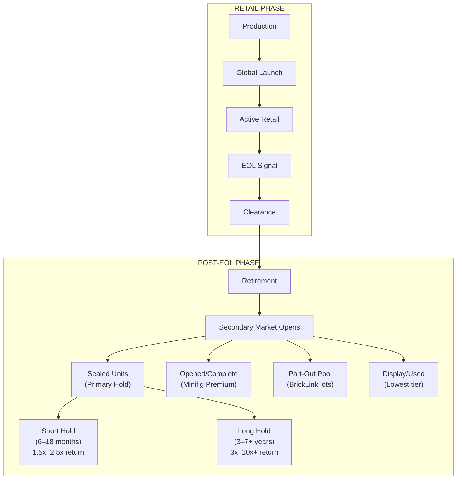

# Lesson 1: Market Mechanics, Scarcity Economics, Value Drivers

## 1. First-Principles Intuition & Invariants

There is a peculiar moment that every serious Lego investor encounters, usually early in their career and rarely forgotten: they check the retail price of a set they bought two years ago, only to find it selling sealed on BrickLink for three times what they paid. The box hasn't changed. The plastic hasn't improved. No new units were manufactured. And yet the market has spoken with a clarity that would make any commodities trader sit up straight. Understanding *why* that happens, and more importantly how to predict *which* sets will follow that trajectory and *when*, is the central problem of Lego investing — and it is a problem with a surprisingly rigorous structure underneath it.

The first invariant to internalize is that Lego's value mechanics are driven not by speculation alone, but by a physical constraint that is architecturally baked into the product's lifecycle: **End of Life (EOL) is permanent and supply is never replenished.** Unlike equities, which can dilute through secondary offerings, or commodities, which fluctuate with extraction rates, a retired Lego set has a fixed global supply ceiling that only decreases as sets are opened, pieces are lost, and boxes are destroyed. Every collector who cracks a seal is, from the investment perspective, consuming a unit of finite supply. This makes the sealed Lego set a genuinely unusual financial instrument — closer to a first-edition book or a vintage wine than to a share of stock, yet far more liquid than either, thanks to platforms purpose-built for the trade.

The second invariant is that **demand is structurally asymmetric over time.** At the moment of retail availability, the buyer pool is broad but shallow: casual shoppers, parents buying gifts, hobbyists building for fun, and a smaller cohort of investors buying to hold. After retirement, that casual retail demand evaporates entirely, but a new and more concentrated demand pool emerges. AFOLs (Adult Fans of Lego) who missed the retail window, completionists hunting for a finished theme, gift-buyers seeking a specific nostalgic set, and institutional resellers all compete for the same diminishing pool of sealed units. Demand doesn't shrink after retirement — it reorganizes and intensifies around specific catalysts.

The third invariant concerns the nature of **licensed intellectual property as a value amplifier.** A Lego Technic crane or a Creator modular building derives value primarily from its parts, its building experience, and its complexity. A licensed set — the Millennium Falcon (75192), the Eiffel Tower (10307), the Rivendell (10316) — derives value from all of those things *plus* the legal impossibility of re-release without renegotiating an IP license. License agreements expire, studios get acquired, rights become entangled in litigation, and production tooling gets retired. The practical effect is that a licensed set retiring carries a probabilistic premium over an equivalent unlicensed set, because the market discounts the possibility that Lego could simply re-release it in a new form number at any point. When the IP situation is sufficiently complex — a Disney acquisition, a franchise hiatus, a studio shutdown — the market prices that uncertainty as an upward risk premium rather than a downward one.

Underpinning all of this is the most fundamental economic mechanism at work: **Lego, as a corporation, is not in the investment business on your behalf.** The company retires sets based on internal production capacity, theme rotation strategy, licensing contract terms, and shelf space economics at retail partners. EOL dates are operationally determined, not market-driven. This creates the information asymmetry that skilled investors exploit: Lego announces retirements (or allows them to be inferred from production signals) on a timeline that retail consumers do not track, but that dedicated analysts monitor obsessively. The gap between the moment a set's retirement becomes predictable and the moment it becomes widely known is the primary alpha window in this market.

---

## 2. Core Architecture & Mechanics

### The EOL Pipeline and Retirement Cycle

Understanding how a set moves from retail shelf to collector's market requires mapping the full lifecycle with precision. The pipeline has distinct phases, each with its own pricing dynamics and practitioner signals.

Lego's active retail phase for a standard set runs approximately two to four years, though flagship sets (the Icons and Ultimate Collector Series lines) often sustain five to seven years. During this window, the set trades at or near its MSRP, occasionally discounting at major retail events (Black Friday at Target, Amazon Lightning Deals, Costco bundles). The practitioner's job during this phase is not to analyze price — it is to **accumulate at discount against a confirmed hold thesis.**

The EOL signal phase is where skill separates from luck. Direct EOL confirmation comes from Lego's own "retiring soon" badge on their official shop, which typically appears three to six months before final production. But experienced practitioners look for earlier signals: the set disappearing from Lego's main landing pages for its theme, retailer inventory draining without replenishment, the product vanishing from Lego's gift-finder tool, and BrickLink new-sealed listings beginning to thin while prices hold flat. The last signal — price holding as supply drops — is the classic pre-retirement indicator and should be tracked via BrickLink's price-guide history view, filtered to "New, Sealed" condition.

The clearance phase immediately preceding final retirement is psychologically dangerous for the inexperienced investor. When Target or Walmart marks a set down 30–40%, it appears to be a loss signal. In reality, this is frequently the last bulk-accumulation opportunity before the secondary market reprices. A set clearing at $60 that retailed at $100 and will trade sealed at $200 in 18 months represents a compelling entry if the hold thesis is sound. The discipline required is ignoring the narrative that "a discounted set is an unloved set."

### Sealed vs. Opened Pricing Spreads

The price gap between a sealed set and a complete-opened-with-box (CIB) set is not uniform across the catalog — it is a variable that reflects the specific value composition of each set. To reason about it correctly, practitioners decompose set value into three components: the **build experience premium**, the **minifigure premium**, and the **parts premium**.

The build experience premium is the value a buyer places on receiving an intact, unbuilt set. It is highest for sets with complex building techniques, large part counts, and strong display value — the Creator Expert modulars, the large Technic flagship vehicles, the Icons architectural pieces. It is lowest for sets whose appeal is primarily collectible (a small polybag) or figure-driven.

The minifigure premium accounts for the fact that certain figures are either exclusive to a single set or dramatically more desirable than the set's other contents. A set containing an exclusive variant of a major character (a chrome-armored stormtrooper, a rare Harry Potter figure in an obscure costume, a licensed superhero in a specific comic-accurate suit) may trade opened at 60–80% of its sealed price simply because the figure alone commands significant demand. The practitioner tracks this by cross-referencing the set's BrickLink minifig listings against the whole-set price. When a set's constituent figures sum to 40% or more of the sealed unit's value, the opened price will be resilient.

The parts premium is the domain of part-out analysis, discussed in detail below. For now, the key architectural insight is that **sealed price minus part-out value equals the market's current premium for the collector experience.** When that premium compresses to near zero, the sealed set is essentially a parts bundle with free storage — a signal that either part values have risen unusually, or sealed demand has dried up. Both conditions are actionable.

### Part-Out Arbitrage Fundamentals

The BrickLink Part-Out Value (POV) is the theoretical maximum revenue from selling every piece, minifigure, and instruction booklet in a set individually on BrickLink at prevailing market prices. It is computed automatically by BrickLink's "My Sets" part-out tool, which queries current minimum prices across all conditions for every catalog entry in a set. The raw number requires interpretation, not blind acceptance.

Practitioners apply three corrections to the raw BrickLink POV. First, they apply a **sell-through discount of 15–25%**, because minimum listed price is not minimum sold price. Many parts list at inflated prices and sit for months; others move immediately. A realistic realization rate against BrickLink minimum prices is in the 75–85% range for a well-executed part-out of a popular set. Second, they add a **shipping and packaging cost**, which for a large set sold in dozens of small lots can reach $40–80 in materials and labor — an amount that can entirely erase a thin arbitrage spread. Third, they apply a **BrickLink fee of 3% on sales**, plus PayPal or Stripe processing fees of approximately 2.9% + $0.30 per transaction.

The corrected part-out value formula the experienced investor uses is:

**Adjusted POV = (Raw BrickLink POV × 0.80) − Shipping Costs − (Raw POV × 0.059)**

When the adjusted POV exceeds the sealed market price by more than 15%, a part-out arbitrage exists. This spread is most commonly found immediately after a set retires — before the broader reseller community has acted on it — or when a rare, high-value part is included in a set that is otherwise under-appreciated by the collector market. A set containing a large-quantity run of an expensive Technic panel, a rare printed tile, or a currently out-of-production wheel hub can generate a dramatic POV premium that the casual flipper misses entirely.

The inverse analysis is equally important: when the sealed price substantially *exceeds* the adjusted POV, the market is paying a pure collector premium for the sealed experience. This condition signals either strong theme fandom, a compelling licensed IP, or a large-format set whose assembly experience is itself the product. These are the sets worth holding sealed for multi-year appreciation, because their value is not grounded in fungible plastic parts but in an experience that cannot be reverse-engineered from BrickLink lots.

### Rarity Factor Matrix

Rarity in the Lego secondary market is not a single variable but a composite of several independent factors. Mapping them explicitly helps practitioners avoid overpaying for surface-level scarcity while missing genuine structural rarity.

| Rarity Factor | Mechanism | Signal Sources | Premium Magnitude |
|---|---|---|---|
| Short Production Run | Low unit volume before EOL | Retailer stock-out speed, BrickLink new-sealed listing count | High (2x–5x) |
| Regional Exclusivity | Only sold in specific markets | Lego Shop country filters, fan forum import reports | Medium-High (1.5x–3x) |
| Promotional / GWP | Gift-with-purchase, never sold standalone | BrickLink GWP category, fan community tracking | Variable (1.3x–8x) |
| Complex IP License | License expiry or studio complication | IP news, franchise status, prior re-release history | High (1.8x–6x) |
| Exclusive Minifigure | Figure only in this set, high demand character | BrickLink minifig page, sold price history | Medium-High (adds flat $15–80) |
| Theme Discontinuation | Entire theme retired, not just one set | Lego theme page removal, official announcements | Medium (1.4x–2.5x) |
| Misprint / Production Error | Factory variation on a print or mold | Collector forums, authenticated BrickLink listings | Extreme (5x–20x+) |

The most reliably actionable of these factors are the first and third. Short production runs can often be inferred from the velocity at which new-sealed listings disappear from BrickLink during the retail window — a set that stocks BrickLink generously for two years and then abruptly drains in six weeks is signaling constrained supply against a sharp demand event, often a media tie-in release or a franchise revival. GWP (Gift With Purchase) sets carry a structural scarcity that is architecturally guaranteed from day one: they were never priced individually, they cannot be bought without meeting a purchase threshold, and their total production volume is a fraction of comparable retail sets. GWP analysis is a sub-discipline in its own right, and practitioners who build relationships with active Lego retail periods — buying to threshold specifically for the GWP, not the primary product — can accumulate genuinely scarce units at an effective cost basis near zero.

---

## 3. High-Performance Optimization & Failure Modes

### Workflow Optimization: The Research-to-Hold Pipeline

The practitioner who operates at a high level does not browse BrickLink opportunistically. They maintain a **tracked watchlist** with structured data fields, updated on a defined cadence. The core toolchain for this workflow is BrickLink's price guide (accessed per-set under "Price Guide" → condition filter "New, Sealed"), Brickset.com's retirement tracking and inventory fields, the LEGO Ambassador Network's community EOL reports, and BrickEconomy's historical price chart and ROI calculator.

The research cycle for a candidate set follows a consistent sequence. First, confirm the set is in active retail and identify its approximate production start date from Brickset. Second, pull BrickLink's last-six-months average sold price for new-sealed and compare it against MSRP — if the two are already diverging upward, the market is pricing in EOL expectations and the entry window may be thinning. Third, run the adjusted POV calculation against BrickLink's current part-out value. Fourth, assess the IP situation and theme trajectory using BrickEconomy's theme-level performance charts, which aggregate average ROI across all retired sets in a given theme. Fifth, estimate the total addressable market for the set's demand — a niche Technic set has a narrower buyer pool than a Star Wars flagship, which affects liquidity even if the percentage appreciation is similar.

The hold calendar matters more than most beginners appreciate. The majority of sealed Lego appreciation follows a characteristic curve: flat to declining in the first six to twelve months post-retirement (as clearance stock and early speculators flood the market), followed by a sharp inflection at twelve to twenty-four months (as supply exhausts and the collector demand base consolidates), and then a long, slow climb over years three through seven as the set becomes genuinely difficult to source. Practitioners who exit at eighteen months capture a real return but leave the majority of the appreciation on the table. Those who hold through the full curve risk liquidity events — platform fee changes, community taste shifts, a surprising re-release from Lego — but historically, the seven-year annualized return on top-tier sealed sets has outperformed most alternative collectible categories.

### Storage and Condition Preservation

Sealed set value is entirely contingent on condition. A box with a crushed corner, moisture staining, sun-fading on the top panel, or a price sticker penetrating the finish trades at a 20–40% discount to pristine sealed. The practitioner's storage protocol is therefore not incidental but financially material.

Sets should be stored flat, never stacked beyond two units high without a rigid shelf support, in a climate-controlled environment held at 60–70°F and below 50% relative humidity. Cardboard boxes — including Lego's own packaging — are hygroscopic and will absorb ambient moisture over years, eventually warping. Storing sets in archival plastic sleeve bags, available from document-preservation suppliers, before placing them in a dry storage container significantly extends the preservation window. UV exposure fades the printed ink on box art; storage in darkness or in UV-filtering storage bins is non-negotiable for multi-year holds. Any set earmarked for a five-plus-year hold should be photographed on all six faces immediately on acquisition, with metadata and purchase receipt stored alongside the images, to establish a provenance and condition baseline for eventual sale.

### Failure Modes and Their Mitigations

The most expensive failure mode in Lego investing is the **unexpected re-release.** Lego has re-released or spiritually succeeded sets that the market believed to be permanently retired — the rebooted Modular line variants, refreshed Star Wars UCS ships (the X-Wing, the Millennium Falcon) under new set numbers, and rebuilt Creator Expert locations. When a re-release hits retail, the predecessor's sealed price typically drops 20–50% within six months, as buyers who wanted the building experience redirect to the new version and the collector premium compresses. The mitigation is to hold sets where the specific configuration, the included figures, and the box art vintage are themselves part of the value proposition — the original 2007 Millennium Falcon (10179) did not collapse when 75192 launched in 2017, because the collector community had developed a specific affection for the first-generation product.

The second critical failure mode is **liquidity miscalculation.** Large sets above $500 MSRP have proportionally fewer buyers at any given price point, which means that selling a sealed $1,500 set on BrickLink may require weeks or months of market exposure, multiple price adjustments, and significant packaging and shipping effort. The investor who needs to liquidate quickly will frequently accept 15–25% below the stated market price to find a buyer. This is not a failure of the investment thesis — it is a failure to account for the illiquidity premium that all large-format holds require. Position sizing accordingly: a portfolio composed entirely of large-format UCS holds is a portfolio that cannot be liquidated quickly.

The third failure mode is **part-value erosion during a long hold.** The adjusted POV floor under a sealed set's price is not static. If Lego begins including previously rare parts in multiple new sets — a mold redesign, a part appearing in a large consumer-facing set, a part retired from use entirely — its BrickLink price moves accordingly, compressing or eliminating the parts floor. Practitioners monitor the BrickLink "Wanted List" price alerts for the highest-value parts in their held sets and reassess the POV floor annually. A set whose parts floor has eroded substantially may still appreciate on collector premium alone, but the downside risk calculation changes.

Finally, the most psychologically difficult failure mode is **thesis drift under social pressure.** The Lego investment community on Reddit (r/legomarket, r/lego), the Eurobricks forums, and specialized Discord servers is active, opinionated, and occasionally prone to coordinated enthusiasm that inflates short-term prices and pulls inexperienced investors into overcrowded positions. A set that "everyone" on a forum is buying sealed has already had a substantial portion of its easy appreciation front-run. The practitioner who identified the opportunity before the community consensus arrived will profit; the one who arrives with the consensus will likely capture the last 20% of a move while bearing the full risk of a sentiment reversal. The antidote is a written investment thesis, established before community opinion forms, with specific price targets and exit triggers that do not flex under forum pressure. The discipline of Lego investing, like all asset-class disciplines, is ultimately a discipline of independent analysis executed consistently in the face of market noise.
