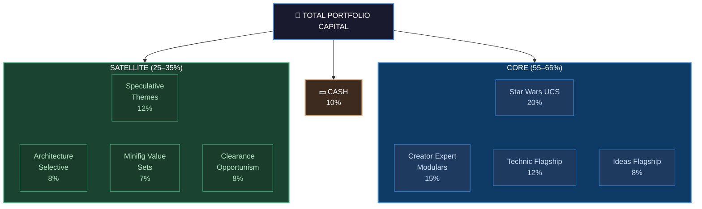
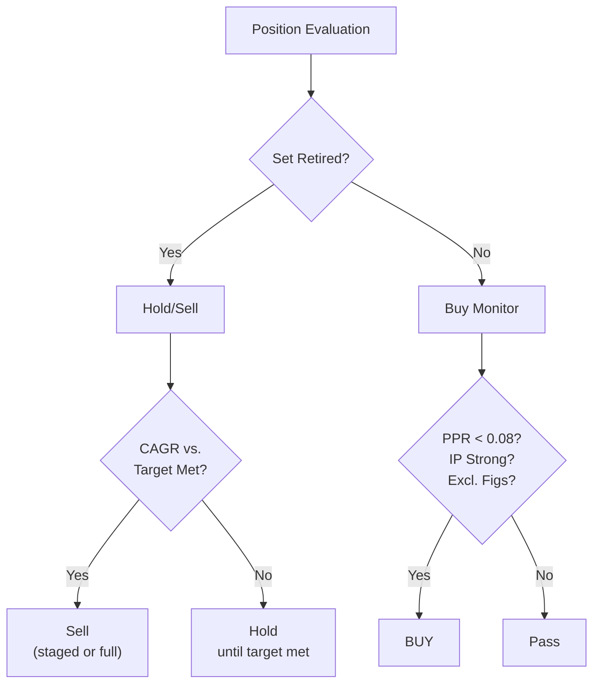

# Lesson 2: Evaluation Frameworks, Risk Models, Portfolio Strategy

## 1. First-Principles Intuition & Invariants

The Lego investment thesis rests on a deceptively simple mechanical principle: the LEGO Group manufactures any given set for a finite production window, after which the supply of sealed units becomes permanently fixed. Demand, however, does not fix itself in the same way. Adult Fans of Lego (AFOLs) who skipped a set during its retail life routinely discover, sometimes years later, that the model aligns with a building interest they only later developed, or that a child has reached the age where a particular theme becomes suddenly compelling. This creates a structural asymmetry. Supply is a step function that drops to zero at retirement. Demand is a curve that may continue rising for years, fed by nostalgia, completionism, and the expanding population of adult builders who entered the hobby through a gateway set and now want to backfill the ones they missed.

This asymmetry is the engine, but it is not a guarantee. The secondary market for Lego sets is not a monolithic appreciation machine. It is a fragmented, theme-sensitive, condition-graded, liquidity-constrained market where some sets triple in value within three years of retirement while others sit unsold at ten percent below retail. The difference between these outcomes is almost never luck. It is the product of identifiable structural factors: intellectual property strength, set categorization within the LEGO Group's product taxonomy, piece-to-price economics at retail, minifigure exclusivity, production run duration, and the density of competing investors who happened to buy the same set at the same time.

The master equation governing every position in a Lego portfolio is total return, and it must account for the full burden of carrying cost, not merely the headline exit price. Total return equals exit price minus entry price minus storage cost minus platform transaction fees minus shipping and handling minus the opportunity cost of capital tied up over the holding period, all divided by the entry price. Most novice Lego investors calculate only the first two terms and declare a profit. The practitioner calculates all of them, because the difference between a headline return of forty percent and a net return of twelve percent is entirely consumed by the terms most people ignore.

Storage cost is the silent killer of Lego portfolio returns. A collection of two hundred sealed sets occupying forty square feet of climate-controlled space in a market where commercial storage rents at twelve dollars per square foot per month is bleeding nine thousand six hundred dollars annually against a portfolio that may have cost thirty thousand dollars to assemble. That is an annualized drag of thirty-two percent before any set has sold. Climate control is not optional for long-term holds. ABS plastic tolerates temperatures between 59 and 77 degrees Fahrenheit with relative humidity between 30 and 50 percent without dimensional change, adhesive degradation on box seals, or label discoloration. Exceed these bounds and box corrugation absorbs moisture, warping and softening; prolonged UV exposure bleaches printing on retail packaging, reducing condition grade from Mint to merely New, a degradation that can strip 15 to 25 percent from exit value on sight alone.

The core invariants of Lego investing are four. First, sealed condition is paramount. An opened set, even one with all bags intact and instructions present, trades at a persistent 30 to 50 percent discount to its sealed counterpart. Second, IP-licensed themes with established multi-generational cultural footprint, principally Star Wars but also Harry Potter, Marvel, and certain Disney properties, command deeper post-retirement demand pools than in-house LEGO Group original themes, though notable exceptions exist among flagship Creator Expert and Ideas sets. Third, set scarcity is established at retirement and is absolute; the LEGO Group has demonstrated willingness to re-release similar or updated models, which constitutes the single largest idiosyncratic risk to any individual position. Fourth, liquidity in the Lego secondary market is measured in weeks to months for premium sets at fair prices, not minutes or hours as in equity markets, and this time-to-exit must be modeled into any portfolio strategy that requires capital recovery on a schedule.

## 2. Core Architecture & Mechanics

### Historical CAGR Patterns by Theme

Compound annual growth rate in the Lego secondary market is not uniform across themes. It varies by an order of magnitude depending on category, IP licensing, set tier within the theme, and the macro-environment of Lego investing at the time of retirement. The following patterns are drawn from historical BrickLink sale data, BrickEconomy tracking, and auction-platform realized prices over the period 2010 through 2023. They are retrospective observations, not forward guarantees, but they establish the baseline from which forward-looking decisions are made.

Star Wars Ultimate Collector Series (UCS) starships have historically delivered the strongest and most consistent post-retirement returns in the Lego investment universe. The Millennium Falcon, set 10179, retailed at $499.99 in 2007 and was discontinued that same year after a production run of approximately eighteen months. Sealed copies reached $4,000 to $5,000 by 2017, representing a CAGR in the range of 23 to 26 percent over the decade following retirement. The announcement of set 75192, a re-release, caused an immediate price compression to approximately $2,000 to $2,500, a vivid illustration of the reissue risk that every Lego investor must model. Even after that compression, the set delivered a CAGR of roughly 12 to 15 percent from retail to post-crash equilibrium, a figure that still outperforms most broad-market equity indices over the same period. The Super Star Destroyer, set 10221, retailed at $399.99 in 2011, retired in 2013, and reached peak secondary pricing around $800 to $900 by 2017, a CAGR of approximately 15 to 18 percent. These are flagship outliers, but they define the ceiling of what the market has demonstrated it will pay for large-format, display-grade, culturally embedded licensed models.

Creator Expert modular buildings occupy a distinct and arguably more predictable tier. These sets appeal to adult collectors building city-scale displays, a demographic with high completionist motivation. The Parisian Restaurant, set 10243, retailed at $159.99 in 2014, retired in 2017, and saw sealed prices reach $280 to $320 by 2021, a CAGR of approximately 12 to 14 percent. The Town Hall, set 10224, retired in 2014 after a $199.99 retail run, reaching $500 to $650 by 2019, a CAGR of 18 to 22 percent. The modular building subtheme benefits from a structural demand driver that other themes lack: each new modular release increases the number of collectors who want to backfill prior releases to complete their street. This is a compounding demand effect, not a static one.

Technic flagship models, typically the annual release priced at $300 to $450 (Porsche 911 GT3 RS, set 42056; Bugatti Chiron, set 42083; Lamborghini Sián, set 42115), have historically delivered more modest but reliable returns. The Porsche 911 GT3 RS retailed at $299.99 in 2016, retired in 2019, and reached $380 to $450 by 2022, a CAGR of approximately 6 to 9 percent. These are lower-volatility positions, appropriate for portfolio ballast rather than alpha generation. The Technic collector base is narrower than the Star Wars or Creator Expert bases, which constrains demand-side growth but also reduces speculative overshoot and the correction risk that follows it.

Architecture sets are the most internally variable category. Landmark and skyline sets with strong cultural recognition, such as the Statue of Liberty, set 21042, or the London Skyline, set 21034, have shown solid 8 to 14 percent CAGR. Smaller or less recognizable Architecture sets have frequently failed to outperform their retail price after fees and storage. The Architecture subtheme rewards selective position-taking rather than blanket accumulation.

Ideas sets, the crowdsourced-design line, exhibit the highest variance of any major theme. First-generation Ideas sets produced in limited quantities, such as the Shinkai 6500 Submarine, set 21100, or the Hayabusa, set 21101, achieved extraordinary returns due to extremely short production windows and small production volumes. Later Ideas waves, with longer production runs and broader awareness of their investment potential, have produced more ordinary returns. The lesson is structural: the Ideas line's value driver is scarcity established by short production runs, and this scarcity must be verified at the individual set level rather than assumed from the theme label.

Themes with poor historical investment performance include most City, Friends, and junior-oriented product lines. These themes move large volume at retail but serve a consumer base that ages out and does not typically backfill. Ninjago is a special case: the theme has run continuously since 2011, producing a deep collector base, but the sheer number of sets released each year floods the secondary market and suppresses individual set appreciation. Selective Ninjago investments, particularly large-format temple sets and exclusive minifigure-bearing sets, have outperformed, but the theme as a whole has not been a reliable appreciation vehicle.

### Condition Grading and Price Impact

The Lego secondary market recognizes a condition taxonomy that directly maps to price multiples. The primary division is between sealed and opened sets. Within the sealed category, the gradations are Mint in Sealed Box (MISB), which requires the factory shipping carton to be unopened with no tape degradation, no corner dinging, no shelf wear, and no shipping label residue; and New in Sealed Box (NISB), which permits minor cosmetic box imperfections so long as the seal remains intact. The price differential between MISB and NISB ranges from 5 to 15 percent depending on set size and collector demand, with large-format display models commanding the premium most aggressively because the box itself becomes part of the collector's display narrative.

Below the sealed threshold, the condition taxonomy drops sharply in value. New Open Box, where all bags remain factory-sealed but the outer box has been opened, typically trades at a 20 to 35 percent discount to sealed. Complete in Open Box, where bags have been opened but all elements are verified present, trades at 50 to 65 percent of sealed value. Used Complete sets, assembled and disassembled with potential minor play wear, trade at 25 to 40 percent of sealed value. The implication for portfolio construction is straightforward: every decision to open a sealed set, to inspect contents, to verify piece counts, or to build for personal enjoyment, is a deliberate conversion of a higher-grade asset into a lower-grade one and should be undertaken with full awareness of the value destruction involved.

Box condition itself is a graded attribute with market-recognized damage categories. Corner dinging, the compression or crushing of box corners from stacking or handling, is the most common and typically reduces value 3 to 8 percent depending on severity. Shelf wear, the surface scuffing of printed panels from sliding against other boxes on retail shelves, reduces value 2 to 5 percent. Creasing, usually from pressure during shipping or storage, can reduce value 5 to 12 percent depending on whether the crease crosses printed graphics. Tape degradation, where the factory seal tape yellows, lifts, or splits, introduces doubt about whether the box has been opened and can reduce value 10 to 20 percent even if the contents are verified untouched. Water damage, sun fading, and pest exposure are terminal degradations that can reduce value below retail cost.

The grading workflow for a sealed set entering a portfolio is a systematic inspection protocol. Position the box under even, diffuse lighting on a flat surface. Inspect all six panels for creases, pressing lightly to detect structural weakening of the corrugation. Examine each corner for compression, using visual sighting along the edge to detect deviation from the factory right angle. Verify seal integrity at every tape line, checking for lifting, yellowing, or resealing artifacts such as adhesive residue inconsistent with factory application. Photograph the box from all six sides plus corner close-ups of any detected imperfection. These photographs serve two purposes: they establish the condition baseline at the time of acquisition for insurance and dispute resolution, and they become the listing assets at time of sale, where condition transparency directly correlates with sale velocity and final price realization.

### Platform Fee Structures

The Lego secondary market is fragmented across multiple platforms, each with a distinct fee architecture, buyer demographic, and liquidity profile. Platform selection is not a neutral choice; it is a strategic decision that affects net return by five to fifteen percentage points on a given sale.

BrickLink is the dominant marketplace for Lego secondary sales, with the deepest pool of Lego-specific buyers and the most granular price history data available. BrickLink charges sellers a commission of 3 percent of the total order amount, including the shipping charge. Payment processing through PayPal or Stripe adds approximately 2.9 percent plus $0.30 per transaction. The combined effective cost of selling on BrickLink is approximately 5.9 percent plus $0.30. BrickLink does not charge listing fees, and there is no cap on the number of listings. The platform's buyer base skews toward experienced AFOLs, parts resellers, and set collectors who are highly price-aware and who use the platform's own price guide, which aggregates six months of sale data, as their primary pricing reference. Selling on BrickLink requires competitive pricing against the platform's own historical data, which can be both an advantage (transparent price discovery) and a constraint (buyers anchor to the six-month average and resist premium pricing even when condition justifies it).

eBay operates with a fundamentally different fee structure and buyer demographic. eBay's final value fee for collectibles, the category under which most sealed Lego sets are listed, is 13.25 percent of the total sale amount including shipping, with a per-item cap that varies by category and has historically been $7,500. eBay offers managed payments, so there is no separate PayPal processing fee. Listing fees are zero for the first 250 listings per month with a standard account, after which insertion fees apply. The effective selling cost on eBay is approximately 13.25 percent, more than double BrickLink's, but eBay provides access to a substantially larger and less price-sensitive buyer pool. eBay buyers include gift purchasers, casual collectors, and non-AFOL consumers who search by set name rather than navigating BrickLink's catalog structure. This audience will frequently pay above BrickLink price-guide levels, particularly for gift-giving occasions and for sets with strong mainstream brand recognition such as Star Wars or Harry Potter. The platform selection decision between BrickLink and eBay for a given set is a function of the fee differential versus the price premium the broader eBay audience will bear, calibrated by the urgency of the sale.

StockX has emerged as a secondary venue for high-profile sealed Lego sets, particularly UCS Star Wars models, large Technic flagships, and certain Ideas sets. StockX operates an auction-verification model: sellers list at an asking price, buyers bid, and StockX authenticates the item before forwarding it to the buyer. StockX's transaction fee for sellers is 10 percent, with a processing fee of approximately 3 percent, yielding a combined effective cost of approximately 13 percent. The platform's value proposition is authentication and transactional trust for buyers who are not Lego-literate enough to verify condition and authenticity themselves. StockX is appropriate for premium sets where authentication value exceeds the fee burden, and inappropriate for mid-tier or sub-$200 sets where fees consume too large a share of the sale price.

Direct peer-to-peer sales through collector forums, Discord communities, and Facebook Lego groups eliminate platform fees entirely but introduce their own cost in the form of payment risk, dispute exposure, and the time required to find a buyer. PayPal Goods and Services transactions carry a 2.9 percent plus $0.30 fee and provide seller and buyer protection. PayPal Friends and Family transfers carry no fee but provide no protection and should be used only with established, trusted counterparties. The zero-commission advantage of direct sales must be weighed against the increased labor of buyer acquisition and the risk of chargebacks or fraudulent disputes.

| Platform | Commission | Processing Fee | Effective Cost | Best For |
|---|---|---|---|---|
| BrickLink | 3.0% | ~2.9% + $0.30 | ~5.9% + $0.30 | Competitive listings to AFOLs |
| eBay | 13.25% | Included | ~13.25% | Broad audience, gift buyers |
| StockX | 10.0% | ~3.0% | ~13.0% | Premium sets needing authentication |
| Direct (PayPal G&S) | 0% | 2.9% + $0.30 | ~2.9% + $0.30 | Known buyers, forum communities |
| Direct (PayPal F&F) | 0% | 0% | 0% | Trusted counterparties only |

### Liquidity Constraints and Time-to-Exit

Liquidity in the Lego market is not instantaneous. Unlike equity markets, where a market order fills in seconds, selling a sealed Lego set at a target price requires a buyer to be present at that price point at the time of listing, and the pool of such buyers for any given set is thin. The following diagram illustrates the typical liquidity curve for a sealed Lego set listed on BrickLink at fair market value:

```mermaid
flowchart TD
    title["Time-to-Exit Probability at Fair Market Price (Sealed Set)"]
    
    subgraph chart [" "]
        direction LR
        
        w1["Week 1<br/>~5% Sale Probability"]
        w2["Week 2<br/>~15% Sale Probability"]
        w3["Week 3<br/>~25% Sale Probability"]
        w4["Week 4<br/>~40% Sale Probability"]
        w5["Week 5<br/>~55% Sale Probability"]
        w6["Week 6<br/>~65% Sale Probability"]
        w7["Week 7<br/>~75% Sale Probability"]
        w8["Week 8<br/>~85% Sale Probability"]
        w9["Week 9<br/>~95% Sale Probability"]
        w10["Week 10<br/>~100% Sale Probability"]
        
        w1 --> w2
        w2 --> w3
        w3 --> w4
        w4 --> w5
        w5 --> w6
        w6 --> w7
        w7 --> w8
        w8 --> w9
        w9 --> w10
    end
    
    title --> chart
    
    style w1 fill:#e8e8e8
    style w2 fill:#d4d4d4
    style w3 fill:#c0c0c0
    style w4 fill:#a0a0a0
    style w5 fill:#808080
    style w6 fill:#6a6a6a
    style w7 fill:#545454
    style w8 fill:#3e3e3e
    style w9 fill:#282828
    style w10 fill:#121212
```

The median time-to-sale for a sealed set priced at the BrickLink six-month average is approximately three to six weeks. Pricing 10 percent above the average extends median time-to-sale to eight to twelve weeks. Pricing 20 percent above the average can extend time-to-sale to three to six months or result in no sale at all during the listing window. Pricing 10 percent below the average typically produces a sale within one to two weeks. This price-velocity tradeoff is the primary lever the seller controls, and it must be exercised deliberately based on the portfolio's capital recovery requirements, not left to default pricing behavior.

Large-format sets, those with retail prices above $300, have structurally thinner buyer pools than mid-range sets. A $200 Creator Expert set priced at $300 post-retirement will typically find a buyer faster than a $400 UCS set priced at $600, because the number of collectors willing to spend $600 on a single Lego set is a fraction of those willing to spend $300. This is not a flaw in the set's investment thesis; it is a mechanical property of the demand curve. Portfolio strategies that concentrate capital in high-value sets must accept longer holding periods at exit and must not rely on liquidating these positions on a fixed schedule.

### Portfolio Architecture and Diversification Framework

A Lego investment portfolio is a collection of positions across themes, set sizes, price tiers, and retirement timelines, structured to manage the idiosyncratic risks that apply to individual sets. The core-satellite model, borrowed from traditional portfolio theory and adapted to the specifics of the Lego market, provides a workable architecture.

The core consists of positions in blue-chip sets: Star Wars UCS models, Creator Expert modular buildings, flagship Technic models, and high-recognition Ideas sets. These positions have the deepest historical data, the most predictable post-retirement demand curves, and the most liquid secondary markets. They are the ballast of the portfolio. Core positions should represent 50 to 65 percent of total portfolio capital. The satellite consists of speculative positions: recently retired themes whose post-EOL trajectory is not yet established, smaller licensed sets with strong minifigure value, Architecture sets with cultural recognition, and opportunistic clearance purchases. Satellite positions carry higher risk and higher potential return. They should represent 20 to 35 percent of portfolio capital. The remaining 5 to 15 percent is held as cash reserves for opportunistic acquisition, particularly during LEGO Group clearance events, Black Friday discounting, and post-retirement fire sales at retailers liquidating remaining stock.

Diversification across retirement timelines is the dimension most often neglected by novice investors and most critical to managing liquidity. If every position in a portfolio retires in the same twelve-month window, the entire portfolio becomes available for sale simultaneously, flooding the investor's own exit pipeline and forcing price concessions to move volume. The remedy is to track the LEGO Group's production cycle and stagger acquisitions so that positions retire across a three-to-five-year horizon. The LEGO Group typically refreshes product lines on eighteen-to-thirty-six-month cycles, with larger sets running longer. Monitoring retirement indicators, such as the "Retiring Soon" tags on LEGO Shop at Home, inventory depletion patterns at major retailers, and the Brickset retirement tracker, allows the investor to construct a staggered exit timeline rather than a concentrated one.

Position sizing is the mechanism that prevents any single set from inflicting disproportionate damage on portfolio returns. The rule of thumb, derived from historical reissue and theme-collapse events, is that no single set should represent more than 10 to 15 percent of total portfolio cost basis. When a position exceeds this threshold, either through appreciation or through an outsized initial purchase, partial liquidation should be considered to rebalance. The 10179 Millennium Falcon re-release is the canonical case study: investors who held concentration positions in 10179 experienced 40 to 50 percent portfolio drawdowns when 75192 was announced. Investors who held 10179 at 8 percent of portfolio cost absorbed the same percentage decline in the individual position but saw only a 3 to 4 percent portfolio-level impact.

### Evaluation Metrics and the Buy/Hold/Sell Decision

The evaluation of a prospective or existing Lego investment position draws on a defined set of quantitative and qualitative metrics. These metrics form the input to a structured buy/hold/sell decision rather than a discretionary judgment.

Piece-to-price ratio (PPR) is the foundational quantitative metric. It is calculated as retail price divided by piece count, yielding a cost per element. The LEGO Group's average PPR across all themes has historically been approximately $0.10 to $0.12 per element. Sets with PPR below $0.08 per element at retail are statistically likely to appreciate, because the market perceives them as value-dense and the post-retirement price floor is effectively established below retail cost by the piece-count valuation. Sets with PPR above $0.15 per element at retail carry elevated risk, as the market may not sustain the premium pricing post-retirement unless other factors, such as exclusive minifigures or IP licensing, provide compensating value.

Minifigure value contribution assesses whether a set's secondary market value is disproportionately driven by exclusive minifigures. Sets like the Cloud City, set 75222, or various Star Wars battle packs derive significant secondary value from minifigures that are exclusive to that set and are not reproduced elsewhere. To evaluate this, identify the minifigures included in the set, check their availability across all sets in which they appear using BrickLink's minifigure catalog, and estimate the sum of minifigure market values at current BrickLink prices. If minifigure value exceeds 40 to 50 percent of the set's current secondary market price, the set's price is minifigure-driven, and the investor must assess the risk that the LEGO Group re-releases those minifigures in a different set, which would collapse the scarcity premium.

The buy/hold/sell decision tree integrates these metrics with retirement status, holding period, and portfolio context:

The decision framework is not static. It is re-evaluated at defined intervals: quarterly for active positions, at retirement announcement for pre-retirement positions, and immediately upon any LEGO Group announcement of a re-release, theme cancellation, or major product line restructuring that affects a held position.

## 3. High-Performance Optimization & Failure Modes

### Entry Optimization: Sourcing Below MSRP

The single highest-leverage action in Lego investing is reducing the entry price. Every dollar saved at acquisition compounds through the entire holding period as a reduction in the cost basis against which exit price is measured. A set purchased at 20 percent below MSRP achieves its target return threshold 18 to 24 months earlier than the same set purchased at MSRP, assuming identical exit price. Sourcing below MSRP is therefore not merely a discount-hunting exercise; it is a portfolio acceleration strategy.

The LEGO Group's own retail channel, LEGO Shop at Home, runs periodic promotions that represent the cleanest below-MSRP sourcing opportunity. The Double VIP points event, typically run four to six times per year, effectively reduces entry price by 10 percent through the redemption value of accumulated VIP points, with the points typically valid for 12 to 18 months. VIP points accrue at 5 percent of purchase value during standard periods and 10 percent during Double VIP events. For a $300 set purchased during a Double VIP event, the earned points carry a redemption value of approximately $30, reducing effective entry cost to $270. Combined with periodic gift-with-purchase promotions that carry their own secondary market value, effective entry cost can be reduced an additional 3 to 5 percent.

Third-party retailers, principally Amazon, Walmart, and Target in the US market, periodically discount Lego sets below MSRP for inventory clearance, seasonal sales events, and competitive price matching. Amazon price history, tracked through services such as CamelCamelCamel or Keepa, reveals that most Lego sets hit cyclical price lows one to three times per year, typically during Q1 (post-holiday clearance), Q2 (mid-year inventory reduction), and Q4 Black Friday through Cyber Monday events. Discount depth varies by theme and set age. Sets in their final six months of retail life are the highest-priority targets for below-MSRP sourcing, as they combine the deepest discounts with the shortest time to retirement-driven appreciation. The monitoring workflow is to identify candidate sets based on retirement timeline tracking, set price-drop alerts at 15 percent below MSRP for core positions and 25 percent below MSRP for satellite positions, and execute purchases when alerts trigger, verifying against multiple retailers to ensure the discount is not an outlier or pricing error.

Bulk purchasing from retailers liquidating inventory, particularly when a major retailer discontinues carrying the LEGO line or closes a store, can yield discounts of 30 to 50 percent below MSRP. These opportunities are infrequent and require rapid execution. The practitioner maintains relationships with store managers at retail Lego sections, monitors liquidation auction sites such as B-Stock and Direct Liquidation for bulk Lego lots, and is prepared to evaluate and commit to bulk purchases within 24 to 48 hours of listing.

### Exit Optimization: Timing, Staging, and Platform Selection

Exit optimization is the process of converting held positions into realized returns at maximum net value, accounting for platform fees, time-to-sale, and the psychological cost of prolonged listing management. The dominant principle is staged selling: no position of meaningful size, meaning more than three to five copies of a single set, should be liquidated through a single listing or a single platform simultaneously. Dumping ten copies of a set onto BrickLink at once creates visible supply that suppresses the platform's price guide average and signals to buyers that the seller is motivated, inviting lowball offers.

The staged exit protocol divides a position into three to five tranches. The first tranche, typically 20 to 30 percent of the position, is listed at a premium price, 10 to 15 percent above the BrickLink six-month average, on the platform with the broadest buyer reach, typically eBay for mainstream-recognizable sets or BrickLink for AFOL-market sets. This tranche tests the market's willingness to pay above-average prices and, if it sells, establishes a new comparable sale that supports higher pricing on subsequent tranches. The second tranche, 30 to 40 percent, is listed at the six-month average on the primary platform. The third tranche is held in reserve, listed only if market prices continue to appreciate, or held long-term if the portfolio strategy calls for extended holding to capture multi-year appreciation curves.

The optimal exit window for most sets begins approximately six to twelve months after retirement, when retail inventory has been depleted and the supply of sealed units transitions from retailers to the secondary market, and extends for two to four years, during which demand from collectors who missed the set during retail life drives price appreciation. Selling too early, within the first three months of retirement, captures minimal appreciation because the market has not yet absorbed the supply transition. Selling too late, beyond four to five years post-retirement, risks encountering re-release announcements, theme fatigue, or the arrival of a new generation of collectors who do not share the nostalgic attachment that drove demand for the original set.

### Storage Cost Optimization

Storage is the controllable drag on portfolio returns, and optimizing it requires modeling storage as a cost per dollar of portfolio value rather than as a fixed overhead. The target benchmark is storage cost below 2 percent of portfolio cost basis annually. A $30,000 portfolio should incur no more than $600 per year in storage-specific costs, including climate control incremental utility expense, shelving depreciation, and insurance premiums.

Home storage is the lowest-cost option for portfolios under approximately $50,000 cost basis, assuming available space that does not displace other use. The capital cost of shelving, using commercial-grade wire shelving rated at 600 pounds per shelf, is approximately $3 to $5 per shelf-foot. A portfolio of 150 sets averaging 0.5 cubic feet each requires approximately 75 cubic feet of storage, which fits on 50 linear shelf-feet at one-foot shelf depth, a capital cost of $150 to $250. Climate control incremental cost, assuming a dedicated room or closet where temperature is maintained at 65 to 72 degrees Fahrenheit and humidity is controlled with a standalone dehumidifier rated for the space, adds approximately $8 to $15 per month in electricity and dehumidifier maintenance. The annual carrying cost for home storage of a $30,000 portfolio is approximately $150 to $180 in climate control plus $150 to $250 in shelving amortized over five years, yielding an annual storage cost of approximately $180 to $200, or 0.6 to 0.7 percent of cost basis. This is well within the 2 percent benchmark.

Commercial self-storage becomes necessary for portfolios exceeding home capacity, typically above $50,000 to $75,000 cost basis. A climate-controlled 10x10 foot unit, sufficient for approximately $75,000 to $100,000 cost basis in sealed sets, rents at $80 to $150 per month depending on market, yielding an annual cost of $960 to $1,800. At $75,000 cost basis, this represents 1.3 to 2.4 percent, near or exceeding the benchmark. The implication is that portfolios above this scale must achieve returns that compensate for commercial storage drag, or must find below-market storage solutions such as shared warehouse space, residential garage climate modification, or bulk storage in lower-cost geographic regions.

Insurance is a non-optional component of storage cost. Standard homeowner's and renter's insurance policies typically cap collectibles coverage at $1,500 to $2,500 and may exclude collectibles intended for resale. A collectibles rider or scheduled personal property endorsement is required for full coverage. Pricing varies by insurer, but collectibles riders typically cost $0.50 to $2.00 per $100 of declared value annually, meaning a $30,000 portfolio incurs $150 to $600 in annual insurance premiums. The declared value must be supported by documentation: purchase receipts, condition photographs, and current market valuations from BrickLink or a qualified appraiser. Under-insurance is a more common failure than over-insurance in the Lego investment community, and the financial consequence of a fire, flood, or theft event on an uninsured portfolio is total loss of cost basis.

### Failure Mode Catalog and Mitigation

The Lego investment market presents a defined set of failure modes, each with identifiable antecedent signals and mitigation strategies. The following table summarizes the primary failure modes, their warning indicators, and the appropriate response:

| Failure Mode | Mechanism | Warning Signal | Mitigation |
|---|---|---|---|
| Re-release | LEGO Group announces updated version of held set | Rumor patterns on Eurobricks, Brickset; trademark filings; convention reveals | Position sizing cap at 10-15%; staged exit on announcement |
| Theme collapse | LEGO Group discontinues theme abruptly | Declining shelf space at retail; absence of new set announcements at toy fairs | Diversify across minimum 3-4 themes; avoid concentration in single theme |
| Speculative bubble / correction | Market-wide price surge driven by investor influx, followed by reversal | Rapid price acceleration across unrelated sets; high listing volume from new sellers | Sell into strength during acceleration; hold cash reserve for post-correction acquisition |
| Storage damage | Fire, flood, pest, UV, humidity destroys or degrades inventory | N/A (event-driven) | Insurance coverage; climate monitoring; redundant smoke/water detectors; quarterly visual inspection |
| Liquidity lock | Need to liquidate on schedule; market cannot absorb volume at target price | Extended time-to-sale; price guide declining; listing accumulation | Staged selling; cross-platform listing; price flexibility protocol |
| Grading dispute | Buyer claims condition downgrade from listed grade | Buyer photos showing damage not in listing photos | Comprehensive condition photography at acquisition; documented grading; transparent listing description |
| Chargeback / fraud | Buyer files payment dispute after receiving item | Buyer with new account, no feedback; shipping to non-confirmed address | Platform protection where available; tracked/insured shipping; signature confirmation above threshold |
| Platform disruption | BrickLink/eBay policy change increases fees or restricts Lego sales | Platform policy announcements; fee restructuring notices | Multi-platform presence; direct sales channel development; cash reserve to absorb temporary fee increases |

The most consequential of these is the re-release failure mode, because it operates at the individual position level with portfolio-wide consequences if concentration was permitted. The LEGO Group's re-release of the Millennium Falcon from 10179 to 75192 in 2017 is the defining case study. The announcement caused an immediate 40 to 50 percent decline in 10179 sealed pricing. Investors who had treated 10179 as a permanent blue-chip hold without modeling re-release risk experienced portfolio drawdowns that took two to three years to recover as the market re-priced 10179 as a distinct collectible rather than the only available UCS Falcon. The mitigation, position sizing at 10 to 15 percent maximum per set and staged selling when re-release signals emerge, is simple in principle and requires discipline in execution. The re-release signal timeline typically spans six to eighteen months from first rumor to retail availability, providing a window for staged exit before maximum price compression occurs.

The speculative bubble failure mode is systemic rather than idiosyncratic. The Lego secondary market experienced a pronounced bubble during 2020 and 2021, driven by pandemic-era discretionary spending, stimulus-driven capital, and a surge of new entrants who treated Lego investing as a near-guaranteed appreciation vehicle. Sealed set prices across multiple themes appreciated 30 to 80 percent in compressed timeframes, far exceeding historical CAGR patterns. The correction began in late 2022 as pandemic-era conditions reversed, and by 2023 many sets had returned to or below their pre-bubble price trajectories. The mitigation for bubble risk is counter-cyclical discipline: when market-wide price acceleration exceeds historical norms by a wide margin, the investor should be selling into strength, not buying. Cash reserves maintained through the bubble period become acquisition capital during the correction, when below-trend prices create high-value entry opportunities.

The grading dispute failure mode is the most common operational risk in day-to-day portfolio management. It arises from asymmetry between the seller's condition assessment and the buyer's condition expectation, and it is almost entirely preventable through disciplined listing practices. The protocol is to photograph the box from all six sides under even lighting, capture close-up images of every detectable imperfection, and write a condition description that explicitly names every imperfection visible in the photographs. This protocol extends listing preparation time per set from approximately two minutes to approximately fifteen minutes, but it eliminates the vast majority of grading disputes and the associated return, refund, and negative feedback costs that follow.

### Quarterly Portfolio Review Protocol

The operational rhythm of a Lego investment portfolio is a quarterly review cycle. Each quarter, the investor performs the following sequence of actions. First, pull current BrickLink price guide data and eBay sold listing data for every held position. Second, calculate current market value for each position and aggregate to portfolio level. Third, calculate CAGR from entry for each position and for the portfolio as a whole. Fourth, identify any position where CAGR has exceeded the target exit threshold, typically 12 to 15 percent annualized, and flag for staged exit evaluation. Fifth, identify any position where market price has declined below cost basis and assess whether the decline is market-wide, theme-specific, or position-specific, determining whether hold, partial exit, or tax-loss harvesting is appropriate. Sixth, review retirement timeline data for all pre-retirement positions, updating expected retirement windows based on current retail inventory signals. Seventh, review storage cost against the 2 percent benchmark and flag if exceeded. Eighth, assess portfolio allocation against target ranges and flag any drift exceeding 5 percentage points for rebalancing consideration. Ninth, document the review in a portfolio ledger, recording position-by-position cost basis, current market value, CAGR, and any actions taken or flagged for future execution.

This protocol takes approximately two to three hours for a portfolio of 50 to 100 distinct positions and provides the systematic discipline that distinguishes a managed portfolio from a collection of speculative bets. The ledger, maintained in a spreadsheet with one row per position and columns for set number, set name, theme, entry price, entry date, quantity, storage location, condition grade, current market value, last valuation date, and notes, becomes the authoritative record for insurance, tax reporting, and strategic decision-making.
