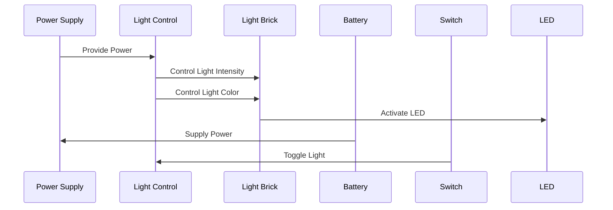

# Foundation: Lighting
## 1. Conceptual Mental Model (First principles, historical context, and fundamental paradigm shifts)

### First Principles
Lighting in Lego constructions serves a dual purpose: it enhances the aesthetic appeal and can also simulate functional lighting within a model. The fundamental principle of lighting in Lego is to create a visual effect that mimics natural or artificial light sources, thereby adding depth and realism to the model. This involves understanding the physics of light, such as reflection, refraction, and absorption, and applying these principles to Lego components.

### Historical Context
The concept of lighting in Lego models has evolved over time. Initially, Lego models were static and did not incorporate any form of lighting. However, with the advent of electric Lego sets in the 1970s, the possibility of adding lights to models became a reality. The introduction of the 88001 Electric Light Brick in 1977 marked a significant milestone, allowing modelers to incorporate functional lighting into their creations. Over the years, Lego has introduced various lighting elements, including LED lights, light panels, and light bricks, each with unique characteristics and capabilities.

### Fundamental Paradigm Shifts
A key paradigm shift in Lego lighting occurred with the introduction of LED technology. Traditional light bricks used incandescent bulbs, which were less efficient and had a shorter lifespan. The shift to LED lights brought about several advantages, including longer lifespan, lower power consumption, and the ability to produce a wider range of colors. This shift has enabled Lego modelers to create more sophisticated and realistic lighting effects in their models.

## 2. Essential Terminology & Taxonomy (Comprehensive architectural definitions)

### Light Brick
A Light Brick is a Lego element designed to emit light. It typically consists of a housing that contains an LED or incandescent bulb, a power source, and a mechanism to control the light's intensity and color. Light bricks are used to simulate light sources within Lego models, such as headlights, taillights, and interior lighting.

### Light Panel
A Light Panel is a Lego element that emits light across a larger surface area. It is typically used to simulate windows, headlights, or other light-emitting surfaces within Lego models. Light panels are available in various sizes and colors, allowing modelers to create a wide range of lighting effects.

### Power Supply
A Power Supply is a Lego element that provides electrical power to light bricks and other electronic components within a Lego model. Power supplies can be battery-powered or connected to an external power source. They are essential for powering light bricks and other electronic components, enabling them to function as intended.

### Light Intensity
Light Intensity is a measure of the amount of light emitted by a light brick or light panel. It is typically measured in lumens (lm), which is a unit of luminous flux. Light intensity is an important factor in creating realistic lighting effects within Lego models, as it determines the brightness of the light source.

### Light Color
Light Color is a measure of the color emitted by a light brick or light panel. It is typically measured in terms of its wavelength or hue. Light color is an important factor in creating realistic lighting effects within Lego models, as it determines the color of the light source.

### Light Control
Light Control is a mechanism that allows modelers to adjust the intensity and color of light bricks and light panels. Light control can be achieved through various means, such as switches, dimmers, and color changers. Light control is an important factor in creating dynamic and interactive lighting effects within Lego models.

## 3. Architecture & Core Workflow (Detailed ASCII and Mermaid diagrams with step-by-step dataflow)

### ASCII Diagram
```
+-------------------+       +-------------------+       +-------------------+
|   Power Supply    |------>|   Light Control   |------>|    Light Brick    |
+-------------------+       +-------------------+       +-------------------+
          |                                   |                                   |
          |                                   |                                   |
          v                                   v                                   v
+-------------------+       +-------------------+       +-------------------+
|   Battery         |       |   Switch          |       |   LED             |
+-------------------+       +-------------------+       +-------------------+
```

### Mermaid Sequence Diagram


### Step-by-Step Dataflow
1. The Power Supply provides electrical power to the Light Control.
2. The Light Control adjusts the intensity and color of the Light Brick based on user input.
3. The Light Brick activates the LED, emitting light with the specified intensity and color.
4. The Battery supplies power to the Power Supply, ensuring a continuous power supply.
5. The Switch can toggle the Light Control, turning the light on or off.

## 4. Common Misconceptions & Mental Traps (Subtle edge cases and flawed mental models)

### Misconception: Light Bricks Always Emit Bright Light
Many modelers assume that light bricks always emit bright light, regardless of the power supply or light control settings. However, the intensity of light emitted by a light brick is determined by the power supply and light control settings. A weak power supply or low light control setting can result in a dim light, which may not be suitable for certain lighting effects.

### Misconception: Light Panels Are Only Used for Windows
Light panels are often used to simulate windows in Lego models, but they can also be used to create other light-emitting surfaces, such as headlights, taillights, and interior lighting. Modelers should consider the versatility of light panels and use them to create a wide range of lighting effects.

### Misconception: Light Control Is Only Necessary for Dynamic Lighting Effects
Light control is not only necessary for dynamic lighting effects but also for static lighting effects. Even in static lighting effects, light control can be used to adjust the intensity and color of light bricks and light panels, creating more realistic lighting effects.

### Misconception: Light Bricks and Light Panels Are Interchangeable
Light bricks and light panels are not interchangeable, as they have different characteristics and capabilities. Light bricks are typically used to simulate point light sources, such as headlights and taillights, while light panels are used to simulate light-emitting surfaces, such as windows and interior lighting. Modelers should choose the appropriate lighting element based on the desired lighting effect.

## 5. Socratic Discussion Starters (Advanced questions for deep Socratic exploration)

### Discussion Question 1
How do the principles of light reflection, refraction, and absorption apply to Lego lighting, and how can modelers use these principles to create more realistic lighting effects in their models?

### Discussion Question 2
What are the advantages and disadvantages of using LED lights over incandescent bulbs in Lego models, and how do these factors influence the design and functionality of Lego lighting elements?

### Discussion Question 3
How can modelers use light control to create dynamic and interactive lighting effects in their Lego models, and what are some examples of models that incorporate advanced lighting control techniques?
