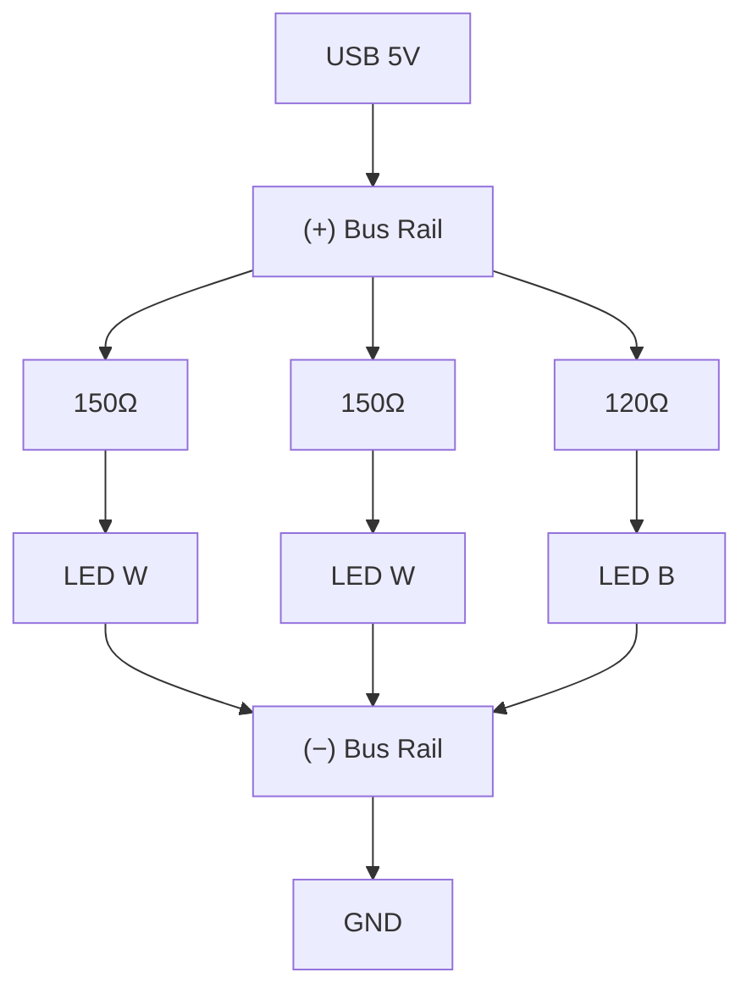

# Lesson 1: Light Sources, Electrical Fundamentals, Circuit Design

## 1. First-Principles Intuition & Invariants

There is a moment in every serious Lego builder's progression when the craft pivots from pure geometry to something closer to architectural installation. That moment usually arrives with a first string of LEDs tucked behind a Lego window frame, and what follows — the glow diffusing through a 1×2 trans-clear brick, the reflected light tracing the angles of a tiled wall — is irreversible. Once you've seen a modular building at night with working street lamps, you cannot un-see it. Lighting transforms static plastic geometry into something that reads as inhabited, as real. And getting it right demands that you understand electricity, not merely fumble with it.

The foundational invariant of any LED circuit is that an LED is a current-driven device, not a voltage-driven one. This distinction carries enormous practical weight. Connecting an LED directly to a voltage source — say, a 9V battery — without resistance in series is not merely suboptimal; it is destructive. The LED's internal resistance drops sharply as it heats up, which draws more current, which generates more heat, which drops resistance further. This thermal runaway cycle takes seconds to destroy the junction. Every single LED circuit you build, regardless of complexity or elegance, must respect one law above all others: current through the LED must be controlled, and that control is achieved through deliberate resistance management.

Understanding why requires a brief visit to the physics of the p-n junction. An LED is a semiconductor diode with a bandgap engineered to emit photons when electrons recombine with holes across the junction. The color and wavelength of that light is determined by the bandgap energy, which is why different LED colors have measurably different forward voltage drops (V_f). A warm white LED typically has a V_f of approximately 2.9–3.2V, while a cool white runs slightly higher at 3.0–3.4V. Red LEDs, with their lower bandgap, drop only 1.8–2.2V. Blue and green LEDs, using gallium nitride compounds, sit at 3.0–3.5V. These are not interchangeable assumptions — if you treat a red LED as if it has the same V_f as a blue one when calculating your resistor, you will either underdrive the blue or overdrive the red. Measure and design specifically.

The practical implication for Lego lighting is that your power source choice constrains everything downstream. The LEGO Power Functions system (now largely superseded but still widely used in custom builds) operates on AAA battery boxes delivering 4.5V, or the standard medium battery box delivering 9V. LEGO's newer Powered Up ecosystem uses 7.4V LiPo-based hubs. USB power, which has become the dominant choice for display-quality Lego builds, delivers a stable regulated 5V at up to 500mA on a standard port, or 2–3A on a powered hub. Third-party Lego lighting kits from manufacturers like Lightailing, Briksmax, and Game of Bricks are designed around 5V USB because it simplifies resistor selection and provides regulated, stable voltage that a AAA battery box cannot sustain over time. Batteries sag — their terminal voltage drops as they discharge. A fresh set of three AAAs in series might deliver 4.7V but will fall to 3.6V by the end of their useful life, shifting your LED brightness noticeably across that range. For a permanent display piece on a shelf, USB from a wall adapter is the correct choice. For a portable diorama or a battery-box MOC, you must design for the low end of your voltage range so the circuit behaves acceptably across the battery's entire discharge curve.

## 2. Core Architecture & Mechanics

### LED Typology and Selection

The LED landscape available to Lego builders has matured considerably. You are no longer limited to the blunt, overly-bright 5mm through-hole LEDs of the early 2000s. The working vocabulary for a serious Lego lighting practitioner includes at minimum four categories: nano/micro LEDs on flexible wire, RGB LEDs (both common-cathode and common-anode), fiber optic strands fed by a single LED source, and strip LEDs for large-area illumination.

**Nano LEDs on flexible wire** are the backbone of room-scale Lego lighting. The dominant form factor places an 0402 or 0603 SMD LED at the tip of a 25–30cm flexible wire measuring roughly 1–1.5mm in diameter. This wire threads through hollow stud channels, runs inside Technic axle holes, and hides completely beneath plate layers. The LED emitter head itself is typically 2–3mm in diameter, designed to press-fit into a standard 4.8mm Lego stud bore with a friction-fit adapter, or sit inside a 1×1 round brick. Warm white LEDs in this format render at approximately 2700–3000K and suit interior architectural lighting: living rooms, street lamps, lantern posts, and candlelit tavern scenes. Cool white at 5000–6500K reads as modern, clinical, or daylight-exterior, appropriate for hospital interiors, office buildings, or laboratory sets. Selecting the wrong color temperature for a scene does not break the circuit — it breaks the narrative.

**RGB LEDs** in Lego applications appear in two practical architectures. The simplest is a four-terminal through-hole or SMD LED with separate red, green, and blue emitter dies sharing a common cathode (or in common-anode variants, a common anode). By individually controlling current through each channel with separate resistors, you can produce any color in the visible spectrum. Because each color channel has a different V_f, each channel requires its own resistor calculation — you cannot use one resistor value for all three legs. The second, more powerful architecture uses addressable LEDs such as the WS2812B, which integrates a control IC alongside the RGB dies into a single package. Each WS2812B accepts a single-wire serial data protocol and can be daisy-chained to produce individually addressable LED arrays. This is the architecture behind Neopixel-style lighting effects and is relevant to Lego builders who integrate microcontrollers — most commonly a small Arduino Nano or a Raspberry Pi Pico — into display bases hidden beneath a build. The 5V operating voltage aligns perfectly with USB power and Arduino logic levels.

**Fiber optics** solve the most persistent problem in Lego lighting: physical access. Routing a wire to every window, every streetlamp, every cockpit indicator light in a dense build produces a wiring harness that rivals a small aircraft. Fiber optics allow a single bright LED source, placed in an accessible location in the base of the build, to illuminate dozens of strand endpoints routed independently to their destinations. The fiber bundles carry light, not electricity, so they can be bent, knotted, cut to length, and routed through spaces too tight for any wire. The tradeoff is color inflexibility — the entire bundle takes the color of the source LED — and transmission loss over distance, which means bundles beyond approximately 50cm begin to show visible dimming at the strand tips. For star-field ceilings, galaxy maps, or dense urban window grids, there is no superior technique.

### Resistor Calculation: The Core Workflow

The resistor calculation is the irreducible arithmetic every practitioner must own. The formula derives directly from Ohm's Law and Kirchhoff's voltage law applied to a series circuit:

$$R = \frac{V_{supply} - V_f}{I_f}$$

Where R is the required resistance in ohms, V_supply is your power rail voltage, V_f is the LED's forward voltage, and I_f is the target forward current in amperes. For the nano LEDs used in most Lego lighting kits, the rated I_f is typically 15–20mA, though running them at 10mA produces perfectly adequate brightness at reduced heat and extended lifespan. Consider a concrete example: a warm white LED (V_f = 3.0V) on a 5V USB supply, targeting 15mA:

$$R = \frac{5.0 - 3.0}{0.015} = \frac{2.0}{0.015} = 133\ \Omega$$

The nearest standard resistor value is 150Ω, which will deliver approximately 13.3mA — slightly under target, but well within the LED's operating range. If you use 100Ω, current rises to 20mA, which is acceptable but runs the LED closer to its absolute maximum. For a permanent display build, choose 150Ω. The table below provides pre-calculated resistor values for the most common build scenarios.

| Power Source | V_f (LED Color) | Target I_f | Calculated R | Use Standard |
|---|---|---|---|---|
| 5V USB | 3.0V (warm white) | 15mA | 133Ω | 150Ω |
| 5V USB | 3.2V (cool white) | 15mA | 120Ω | 120Ω |
| 5V USB | 2.0V (red) | 15mA | 200Ω | 200Ω |
| 5V USB | 3.3V (blue/green) | 15mA | 113Ω | 120Ω |
| 9V LEGO | 3.0V (warm white) | 15mA | 400Ω | 390Ω |
| 9V LEGO | 2.0V (red) | 15mA | 467Ω | 470Ω |
| 4.5V (3×AAA) | 3.0V (warm white) | 10mA | 150Ω | 150Ω |

Third-party Lego lighting kits (Lightailing, Briksmax) ship their LED strings with the resistor pre-integrated inline on the wire, typically as a surface-mount component in a heat-shrink sleeve located 10–15cm from the LED head. This is deliberate: it removes the resistor calculation burden from the builder and reduces the number of loose components in the build cavity. When you purchase these kits, you are buying a specific voltage compatibility — confirm whether the kit is rated 5V USB before connecting it to anything else. Connecting a 5V-rated pre-resistored LED to a 9V rail will burn through the pre-integrated resistor's current rating even if the resistor itself doesn't fail immediately.

### Series vs. Parallel Wiring Architecture

The topology of your wiring network determines how the circuit behaves under load and how it fails. Series wiring connects LEDs end-to-end along a single current path: current flows through the first LED, then the second, then the third, then back to ground. The critical consequence is that the forward voltages of every LED in the series string accumulate. Two warm white LEDs in series consume 6.0V of your supply just in V_f alone, leaving only 2V across a 9V supply for the resistor — which works fine — but three in series at 9.0V total V_f leaves nothing for resistance, and the circuit cannot achieve stable current regulation. Series strings also fail catastrophically from a single dead LED: one open junction breaks the entire chain. For this reason, series wiring has limited application in Lego builds beyond running matched pairs of LEDs from a 9V supply when you've verified the math carefully.

Parallel wiring places each LED on its own branch, with its own resistor, all branches sharing the same supply voltage and ground rails. Each LED branch operates independently: the failure of one LED leaves all others functioning, the brightness of each LED is independently governed by its branch resistor, and you can mix different LED colors on the same supply rail simply by giving each color its own correctly calculated resistor. This is architecturally superior for virtually all Lego lighting applications. The aggregate current draw of a parallel network equals the sum of all individual branch currents — if you have thirty 15mA LED branches, your power source must deliver 450mA without voltage sag. USB 2.0 at 500mA handles this barely; a USB wall adapter rated 1A or 2A handles it comfortably. Always calculate total current before committing to a power source.

The wiring architecture inside a Lego build is a physical routing problem as much as an electrical one. The standard approach uses two trunk wires — one for the positive supply rail, one for ground — running through the base plate layer or the hollow core of large structures, with individual LED branches tapping off these trunks at points of access. Lightailing and similar kit systems implement this with their hub boards: a small PCB with a USB input connector and multiple output ports for individual LED strings, each pre-wired with matching polarity. This hub sits in the base of the build, beneath a plate layer, with its USB cable exiting through a gap at the rear.

The diagram below maps a minimal parallel lighting network for a modular building:

Each branch runs from the positive bus through its resistor, through its LED, and returns to the common ground rail. The LED polarity — anode to the resistor side, cathode to ground — must be consistent across every branch.

### Polarity Management and Identification

Polarity errors are the single most common failure mode in DIY Lego lighting builds. Installing an LED backwards produces no light and no damage from a single brief test at low current, but sustaining reverse bias at operating voltage stresses the junction and shortens its life. The practitioner's discipline is to establish a consistent polarity convention and verify it at every connection point before closing up the build.

On through-hole LEDs, two physical cues identify the anode: the longer lead is the anode (positive), and the flat side of the epoxy lens body indicates the cathode (negative). On SMD LEDs at the end of flexible wire leads, the kit manufacturer uses a consistent color code — typically red wire for positive (anode) and black or white wire for negative (cathode). Lightailing uses red and black; Briksmax uses red and white. Confirm your kit's convention in the product documentation before wiring, because mixing kits in a single build can introduce conflicting conventions that only manifest as dark LEDs after the structure is assembled.

For hub-based systems, the output connectors are keyed to prevent reversal — the micro-JST or 2-pin PH connectors used by most kit manufacturers are physically asymmetrical. This is an intentional design choice that removes polarity ambiguity at the connection point. The convention breaks down only when builders cut and re-splice wires to extend reach, at which point a visual check with a multimeter in diode-test mode (which will display the forward voltage drop across a correctly oriented LED, typically 1.8–3.3V depending on color) is the definitive verification method.

## 3. High-Performance Optimization & Failure Modes

### Thermal Management in Enclosed Builds

A Lego structure is thermally hostile to electronics in ways that an open workbench is not. LEGO ABS has a glass transition temperature of approximately 105°C, and while typical LED operating temperatures will never approach this threshold under normal conditions, densely packed electronics in an enclosed cavity do accumulate heat over long display periods. The practical concern is not ABS deformation — it is LED color shift and lumen depreciation. White LEDs using phosphor conversion are particularly susceptible to phosphor degradation under sustained heat, and even modest temperature increases of 20–30°C above ambient will measurably reduce their useful lifespan from tens of thousands of hours toward a few thousand. The mitigation is straightforward: run LEDs at conservative current levels (10mA rather than 20mA), ensure the hub board or resistors have some air gap within the build cavity rather than being sandwiched between solid plate layers, and use a USB wall adapter with overcurrent protection rather than a battery box that can sustain an overcurrent condition silently.

### Light Bleed and Optical Isolation

The optical behavior of trans-color and clear LEGO bricks is not always a virtue. Trans-clear bricks are excellent light pipes — they will conduct light far beyond the window you intended to illuminate and produce visible glow in unintended locations when an LED is placed inside a room-scale Lego interior. The technique for controlling this is optical isolation: placing 1×1 black plates or black rubber bricks around the LED emitter head to create a local blackout zone, limiting light propagation to the intended aperture only. Black electrical tape wrapped around the flexible wire near the LED head (but not over the emitter) is an equivalent field fix. For builds with adjacent rooms on separate circuits, a double layer of black 1×1 plates between cavities is typically sufficient to prevent cross-illumination.

Fiber optic installations introduce their own optical artifact: a halo glow at the bundle entry point where the source LED's unfocused spill light escapes into the surrounding brick cavity. Enclosing the LED source in a 1×1 round brick or a small printed cylinder of black PLA, with the fiber bundle inserted tightly into the stud bore, eliminates this spill cleanly. The fit between the fiber bundle and the brick bore must be snug — excess air gap around the fibers not only wastes source brightness but creates the halo effect.

### Failure Diagnosis Workflow

When an LED in a completed build fails to illuminate, the diagnostic process follows a logical sequence that respects the irreversibility of disassembly. Begin with the power source: confirm the USB port or adapter is active using a known-good load such as a phone charger. Measure voltage at the hub output port with a multimeter — if it reads 0V or significantly below 5V, the hub board has failed or is in overcurrent protection, which resets by unplugging and re-plugging the USB connection. If hub voltage is correct, trace the specific LED branch by disconnecting and reconnecting its JST connector while the system is live; a correctly functioning LED will produce a brief flash at the moment of connection. No flash indicates either an open circuit in the wire, a failed LED junction, or a reversed polarity connection. Use the diode-test function on a multimeter to verify the LED out-of-circuit: a reading of 1.8–3.3V in forward bias with no reading in reverse bias confirms a healthy LED. A reading of 0V in both directions indicates a shorted junction; a reading of infinite resistance in both directions indicates an open junction — both conditions mean the LED has failed and must be replaced.

Wire breaks on flexible LED leads almost always occur at the most flexed point, which is typically where the wire emerges from the LED head's heat-shrink strain relief or at a point where the wire has been repeatedly bent over a stud edge. Visual inspection under a loupe will reveal the break location as a kink or slight discoloration of the insulation. Repair is achievable with a fine-tipped soldering iron at 300–320°C, 63/37 tin-lead solder (which flows at lower temperature than lead-free and is preferable for the fine-gauge wire used in Lego lighting), and a minimal flux application to ensure a clean bond to the small pad. Flux residue on these small wires should be cleaned with isopropyl alcohol on a cotton swab to prevent long-term corrosion.

### Scaling to Complex Builds: Current Budget Planning

A disciplined Lego lighting practitioner approaches a large build — a full-scale modular street, a detailed Star Wars capital ship, an amusement park MOC — the way a stage lighting director approaches a production: with a written current budget calculated before a single LED is routed. The process is straightforward. Enumerate every LED in the build, group them by color, assign each group its branch current (typically 10–15mA), and sum the totals. Add a 20% safety margin. Select a power source that can deliver this current continuously without entering thermal throttling. A 2A USB wall adapter at 5V supports a theoretical maximum of approximately 100 LED branches at 15mA each — in practice, allowing for adapter inefficiency and cable resistance, 80 branches is a comfortable real-world maximum for a single 2A adapter. Builds exceeding this threshold should use multiple USB adapters on separate physical zones of the build, with each zone independently controlled, rather than a single oversized supply that creates a single point of failure for the entire installation.

The attention you give to this current planning phase pays dividends not only in reliability but in the quality of the light itself. LEDs driven at exactly their design current, from a stable regulated supply, with proper thermal clearance and optical isolation, produce light that is consistent, predictable, and enduring. The glow from a well-engineered Lego installation does not compete with the architecture — it reveals it.
