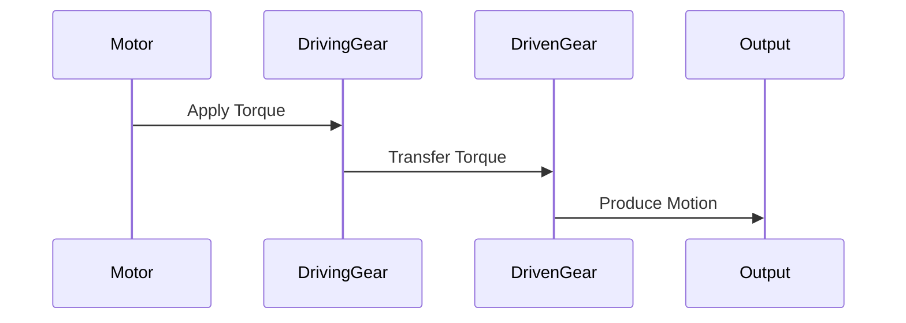

# Foundation: Mechanisms
## 1. Conceptual Mental Model (First principles, historical context, and fundamental paradigm shifts)

### First Principles
Mechanisms in the context of Lego building are systems designed to perform specific tasks through the interaction of parts. These systems are governed by principles of physics, such as force, motion, and energy transfer. At the core, Lego mechanisms are about understanding how simple machines (levers, pulleys, gears, etc.) can be combined to create complex movements and functions.

### Historical Context
The concept of mechanisms dates back to ancient civilizations, with the Greeks and Egyptians developing early forms of simple machines. The Industrial Revolution further advanced the understanding and application of mechanical systems. Lego, introduced in 1949, brought these principles into the realm of play and education, allowing individuals to build and experiment with mechanisms in a tangible, accessible way.

### Fundamental Paradigm Shifts
The introduction of Lego bricks marked a shift from theoretical to practical application of mechanical principles. Lego's modular system allows for the rapid prototyping and testing of mechanical ideas, fostering innovation and a deeper understanding of how mechanisms work. This hands-on approach has democratized the study of mechanics, making it accessible to a wide audience.

## 2. Essential Terminology & Taxonomy (Comprehensive architectural definitions)

### Gear Ratio
**Definition:** The gear ratio is the ratio of the number of teeth on the driving gear to the number of teeth on the driven gear. It determines the speed and torque of the output relative to the input.
**Formula:** \( \text{Gear Ratio} = \frac{\text{Number of Teeth on Driving Gear}}{\text{Number of Teeth on Driven Gear}} \)

### Torque
**Definition:** Torque is the measure of the force that can cause an object to rotate about an axis. In Lego mechanisms, torque is crucial for understanding how much force is needed to turn gears or other rotating parts.
**Formula:** \( \tau = r \times F \), where \( \tau \) is torque, \( r \) is the radius of the force application, and \( F \) is the force applied.

### Kinetic Energy
**Definition:** Kinetic energy is the energy possessed by an object due to its motion. In Lego mechanisms, kinetic energy is often used to describe the energy of moving parts, such as gears or levers.
**Formula:** \( KE = \frac{1}{2} m v^2 \), where \( KE \) is kinetic energy, \( m \) is mass, and \( v \) is velocity.

### Potential Energy
**Definition:** Potential energy is the energy stored in an object due to its position or configuration. In Lego mechanisms, potential energy is often associated with springs or elevated parts that can release energy when moved.
**Formula:** \( PE = mgh \), where \( PE \) is potential energy, \( m \) is mass, \( g \) is the acceleration due to gravity, and \( h \) is height.

### Lever Arm
**Definition:** The lever arm is the perpendicular distance from the fulcrum to the point where force is applied. It is a critical factor in determining the mechanical advantage of a lever.
**Formula:** \( \text{Mechanical Advantage} = \frac{\text{Lever Arm of Effort}}{\text{Lever Arm of Load}} \)

### Fulcrum
**Definition:** The fulcrum is the pivot point of a lever. It is the point around which the lever rotates and is crucial for the mechanical advantage of the system.

### Cam
**Definition:** A cam is a rotating or sliding piece that, through its shape, imparts a specific motion to another part. In Lego mechanisms, cams are used to create complex motions, such as reciprocating or oscillating movements.

### Crankshaft
**Definition:** A crankshaft is a rotating shaft that converts reciprocating motion into rotational motion. In Lego mechanisms, crankshafts are often used to convert the linear motion of a piston into the rotational motion of a gear or other rotating part.

## 3. Architecture & Core Workflow (Detailed ASCII and Mermaid diagrams with step-by-step dataflow)

### ASCII Diagram of a Simple Gear Mechanism
```
+-------------------+
|       Motor       |
+-------------------+
          |
          v
+-------------------+
|     Driving Gear  |
+-------------------+
          |
          v
+-------------------+
|    Driven Gear    |
+-------------------+
          |
          v
+-------------------+
|       Output      |
+-------------------+
```

### Mermaid Sequence Diagram of a Simple Gear Mechanism


## 4. Common Misconceptions & Mental Traps (Subtle edge cases and flawed mental models)

### Misconception: Gear Ratio Determines Speed Only
**Flawed Mental Model:** Many practitioners believe that gear ratio affects only the speed of the output, ignoring its impact on torque.
**Correct Understanding:** Gear ratio affects both speed and torque. A higher gear ratio increases speed but decreases torque, and vice versa.

### Misconception: All Levers Have Equal Mechanical Advantage
**Flawed Mental Model:** Some believe that all levers provide the same mechanical advantage, regardless of their configuration.
**Correct Understanding:** The mechanical advantage of a lever depends on the lengths of the lever arms. Different types of levers (first, second, third class) have different mechanical advantages based on the position of the fulcrum.

### Misconception: Cam Shape Does Not Affect Motion
**Flawed Mental Model:** Practitioners might assume that the shape of a cam does not significantly impact the motion of the follower.
**Correct Understanding:** The shape of a cam directly determines the motion of the follower. Different cam profiles can create various types of motion, such as linear, oscillating, or reciprocating.

### Misconception: Crankshafts Always Convert Linear to Rotational Motion
**Flawed Mental Model:** Some believe that crankshafts are always used to convert linear motion to rotational motion.
**Correct Understanding:** Crankshafts can be used to convert linear motion to rotational motion, but they can also be used in reverse to convert rotational motion to linear motion, such as in a piston mechanism.

## 5. Socratic Discussion Starters (Advanced questions for deep Socratic exploration)

### Question 1
How does the choice of gear ratio in a Lego mechanism affect the overall performance and efficiency of the system? Can you provide examples of when a high gear ratio might be advantageous and when a low gear ratio might be more suitable?

### Question 2
In what ways do levers and pulleys complement each other in Lego mechanisms? Can you design a simple mechanism that uses both levers and pulleys to achieve a specific task, and explain the mechanical advantages and disadvantages of your design?

### Question 3
How does the shape of a cam influence the motion of a follower in a Lego mechanism? Can you create a cam profile that produces a specific motion, such as a smooth oscillation, and explain the mathematical principles behind your design?
