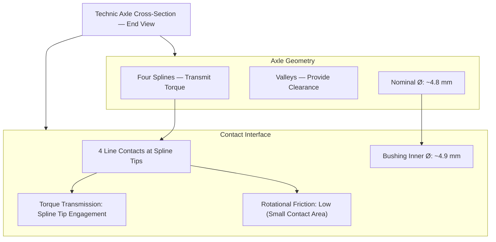
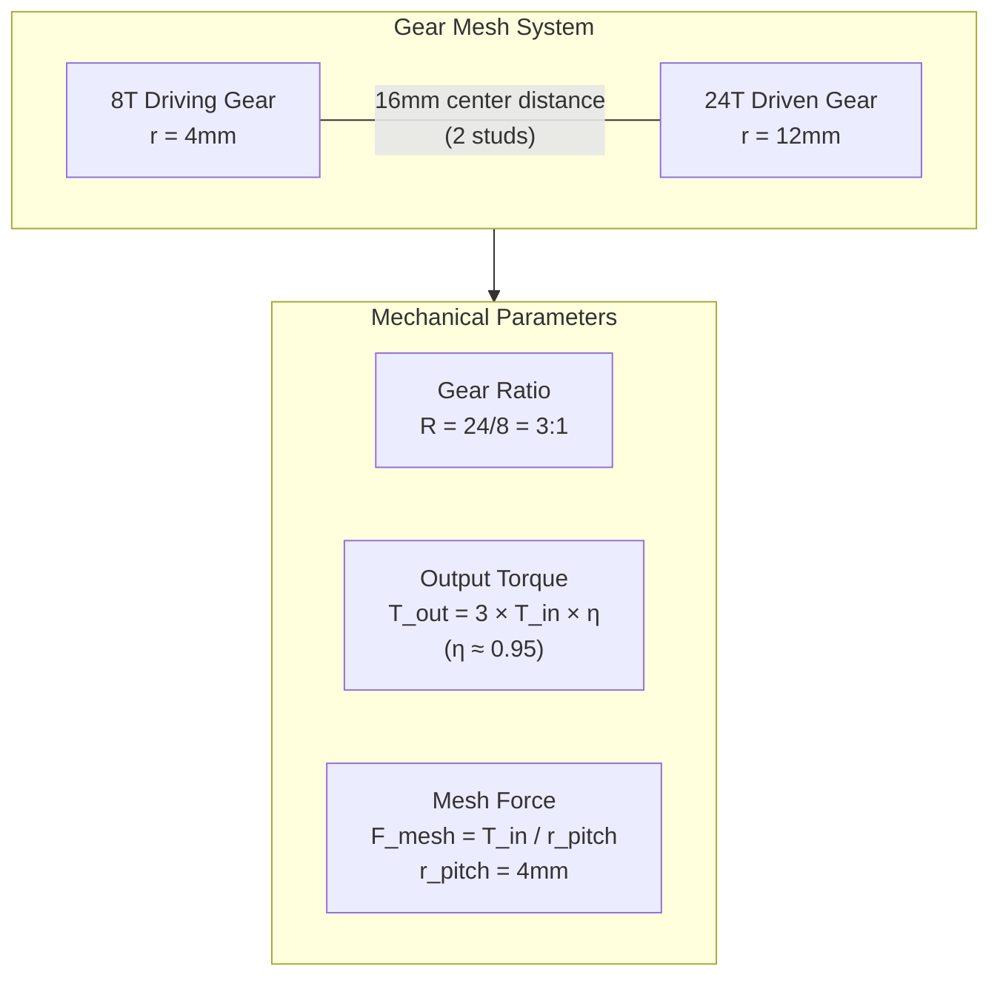
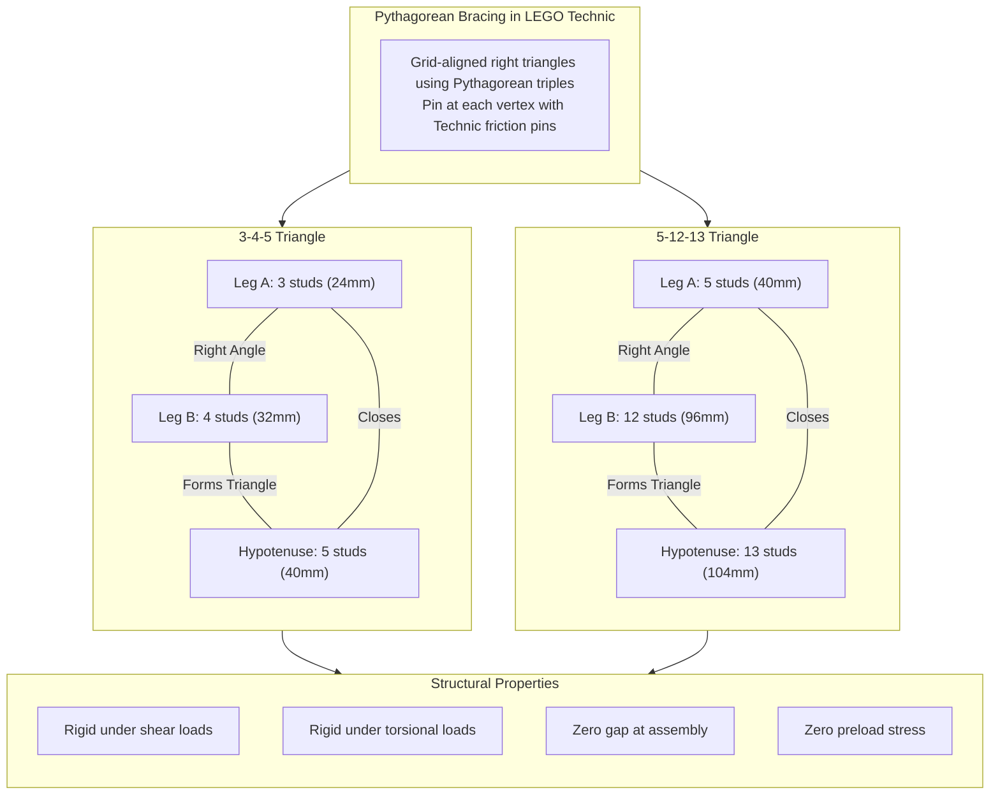

# Lesson 1: Mechanical Fundamentals in LEGO Systems

## 1. First-Principles Intuition & Invariants

The LEGO system is a precision-engineered modular construction medium manufactured from acrylonitrile butadiene styrene (ABS) thermoplastic. While commonly regarded as a children's toy, the system's dimensional precision and mechanical properties place it firmly within the domain of serious mechanical engineering. Every connection, every beam, every gear in the LEGO ecosystem adheres to a strict dimensional invariant system that governs how forces propagate, how torque transfers, and how motion translates through an assembly. To build mechanisms that perform predictably under load, you must understand the material, the dimensional lattice, and the mechanical quantities that define every interaction between elements.

The ABS plastic used in LEGO elements has a Young's modulus of approximately 2.3 GPa, a tensile strength of 40–50 MPa, and a glass transition temperature near 105°C. These are not abstract numbers. The modulus tells you how much a beam will deflect under a given load, which in turn tells you whether your chassis frame will hold its geometry under the weight of a drivetrain or whether it will sag. The tensile strength sets the ceiling on how much force a pin or axle can carry before the material yields. The glass transition temperature defines the thermal envelope: a motor running at stall current can heat adjacent ABS elements past 80°C, softening nearby liftarms and causing pin bores to ovalize. A friction coefficient of approximately 0.3 between two ABS surfaces—comparable to nylon-on-nylon contact—means that friction is the primary mechanism by which studs hold together, pins retain their position, and worm gears self-lock. Every structural decision in LEGO engineering ultimately reduces to managing this friction coefficient: exploiting it where you need grip and fighting it where you need motion.

The dimensional framework of the LEGO system is built on one fundamental constant: the 8.0 millimeter stud pitch. Every stud on every element sits on an 8.0mm grid, and every Technic hole aligns to this same grid. The vertical dimension follows a related but distinct system: one plate is 3.2mm tall, one brick is 9.6mm tall, and the ratio between them is exactly 3:1. These three numbers—8.0mm, 3.2mm, and 9.6mm—are the irreducible invariants of the LEGO system. Every SNOT technique, every half-stud offset, and every structural alignment in advanced building derives from the mathematical relationships between these dimensions.

The most critical derived relationship is the SNOT ratio: five plates stack to 16.0mm (5 × 3.2mm), which equals exactly two stud pitches (2 × 8.0mm). This convergence is not coincidental; it is an intentional design feature that allows sideways-facing elements to align with the vertical stud grid. When you mount a brick on its side using a SNOT bracket, the stud row on that sideways brick falls at a height determined by the bracket's geometry. By stacking the correct number of plates beneath the bracket—typically in increments of five plates for full alignment—you can make the sideways studs sit at exactly the same height as vertical studs, creating seamless transitions between normal and SNOT construction. Half-stud offsets, achieved through jumper plates that displace attachments by 4.0mm, extend this system to non-integer positions. A 1×2 jumper plate has a single centered stud rather than two side-by-side studs, shifting the connection point by half a stud relative to the grid. This is essential for SNOT work where alignment to the half-stud is required, and it also enables non-orthogonal bracing angles that would otherwise be impossible.

Three mechanical quantities govern everything in a LEGO mechanism: force, torque, and the transfer of motion. Force, measured in newtons (N), is the push or pull transmitted through studs, pins, and gear teeth. When you stack twenty bricks on top of each other, the bottom brick carries the compressive force of all nineteen bricks above it, distributed across its stud-tube interfaces. When you pull two bricks apart laterally, you are applying a shear force to the studs. The 2–3 N clutch force per stud—the frictional resistance to separation—sets the upper limit on how much lateral force a stud connection can tolerate before sliding apart. Torque, measured in newton-meters (N·m) or newton-centimeters (N·cm), is the rotational analog of force. When a motor turns a driveshaft, the shaft transmits torque through its cross-section. That torque propagates through gears, axles, and differentials, and at each stage of transfer, some fraction is lost to friction. An 8-tooth gear driving a 24-tooth gear multiplies torque by a factor of three, but only about 95% of the input torque reaches the output; the remaining 5% is consumed by sliding friction between the gear teeth. In a multi-stage gear train, these losses compound: three successive 3:1 reductions produce 27:1 overall torque multiplication, but at 95% efficiency per stage, only about 85.7% of the input torque reaches the output.

Friction is the central paradox of LEGO mechanical design. The same physical phenomenon that holds your structures together—friction between studs and tubes, between friction pins and their bores—is the phenomenon that robs your mechanisms of power. A friction pin inserted into a Technic hole exerts radial pressure through its spring ribs, creating a rotational resistance of roughly 0.5 to 1.0 N·cm. That resistance is essential when the pin serves as a structural fastener; it keeps the pin from rotating and maintains alignment under vibration. But when the same friction pin is used as a pivot for a rotating arm, that 0.5–1.0 N·cm resistance becomes a parasitic drag that the motor must overcome continuously, wasting power and generating heat. The designer's task is to deploy friction selectively: maximize it where connections must remain fixed, and minimize it where motion must occur. This is why LEGO manufactures both friction pins (with ribs) and smooth pins (without ribs): the former for structural fastening, the latter for rotational joints. Selecting the wrong pin type in a mechanism is one of the most common causes of poor performance, and one of the easiest to correct once diagnosed.

## 2. Core Architecture & Mechanics

The stud-tube clutch mechanism is the most fundamental connection in the LEGO system. Each standard stud measures approximately 4.9mm in diameter at its base and 1.7mm in height. Each standard brick contains hollow tubes on its underside, with an inner diameter of approximately 4.9mm. When a stud is inserted into a tube, the slight interference—typically 0.0–0.1mm depending on manufacturing tolerance—creates radial pressure that generates friction along the cylindrical contact surface. This friction is what resists separation of the parts. Consider a standard 2×4 brick: it has eight studs on top and three tubes underneath. When another brick is placed on top, each of the eight upper studs engages with a corresponding tube or wall surface on the lower brick, producing a total clutch force of approximately 16–24 N. This is the force required to pull the bricks straight apart. Shear force—the lateral force required to slide one brick across the other—is higher, because the shear path engages the full cross-section of multiple studs simultaneously, with the friction between the top surface of the lower brick and the underside of the upper brick also contributing.

```
    Stud-Tube Clutch Cross-Section (simplified)
    
         ┌─────┐   ┌─────┐
         │  ●  │   │  ●  │          Studs: Ø ~4.9mm, h ~1.7mm
         ├─────┘   └─────┤
         │                 │
         │   ○         ○   │       Tubes: Ø_in ~4.9mm
         │                 │       Interference: 0.0–0.1mm
         └─────────────────┘
              ↑
         Stud engages tube — friction resists separation
         Clutch force per stud: ~2–3 N
         2×4 brick total: ~16–24 N
```

The Technic pin system introduces a fundamentally different connection type: the pin-in-hole joint, which allows rotation while constraining translation. The standard Technic hole in a liftarm or brick has a diameter of approximately 4.9mm. The friction pin features longitudinal ribs along its shaft that expand its effective diameter to approximately 4.9–5.0mm, creating an interference fit when pressed into the hole. The ribs serve a dual purpose that is mechanically elegant: they provide the radial force that generates friction for retention, and they reduce the contact surface area, which means the friction is concentrated at a small number of line contacts rather than spread across a full cylindrical surface. This maximizes the normal force per unit area (for retention) while minimizing the total contact area (which would otherwise increase rotational drag). Smooth pins, by contrast, have a uniform cylindrical shaft at approximately 4.8mm diameter—0.1mm smaller than the hole. This clearance fit allows the pin to rotate freely with minimal friction, on the order of 0.05 N·cm or less per pin. The smooth pin still constrains lateral movement, because the 0.1mm clearance is small enough to prevent significant lateral play in most applications, though smooth pins can slide out of their bores under vibration or gravity, which is why they are typically used with end caps, bushings, or in through-holes where axial retention is provided by adjacent geometry.

The Technic axle introduces torque transfer capability. The axle has a nominal diameter of 4.8mm but is not cylindrical—it has a cross-shaped splined cross-section. The four splines engage with matching internal splines in gears, bushings, and liftarm axle holes. This design is a precision engineering choice that resolves a fundamental tension in shaft design. A fully cylindrical shaft would require a tight fit to transmit torque without slipping, but a tight fit creates high friction and makes assembly difficult. A loose fit reduces friction but introduces backlash and allows the shaft to rock within its bearing. The splined cross-section solves this by transmitting torque through four line contacts at the spline tips while maintaining clearance in the valleys between splines. The result is a shaft that transmits torque efficiently while rotating with minimal friction and without perceptible backlash.



The torsional stiffness of a LEGO axle is finite and consequential. An axle behaves as a torsional spring with stiffness $k = GJ/L$, where $G$ is the shear modulus of ABS (approximately 0.8 GPa), $J$ is the polar moment of inertia of the splined cross-section (approximately 60–80 mm⁴ for a 4.8mm splined axle), and $L$ is the axle length. For a standard 6-stud (48mm) axle, the torsional stiffness works out to approximately 20 N·cm per degree of twist. Under a torque of 20 N·cm, this axle will twist approximately one degree. For a 12-stud (96mm) axle under the same load, the twist doubles to two degrees. In precision mechanisms—synchronized liftarms, multi-axis steering linkages, or timing-critical valve gear—this torsion produces measurable phase errors. The practical implication is straightforward: use the shortest axle that fits the application, and when torque is high, use parallel axles to split the load rather than a single long shaft.

The LEGO gear system is built on a single module: every standard spur gear has 8 teeth per stud of pitch diameter. An 8-tooth gear has a pitch diameter of 1 stud (8.0mm), a 24-tooth gear has a pitch diameter of 3 studs (24mm), and a 40-tooth gear has a pitch diameter of 5 studs (40mm). The center-to-center distance for two meshing gears follows directly from this: $D = (N_1 + N_2) / 16$, expressed in studs. An 8-tooth gear meshing with a 24-tooth gear requires a center distance of $(8 + 24) / 16 = 2$ studs, which is why the 8T–24T pair fits perfectly on a 2-stud-spaced Technic liftarm. This dimensional compatibility is not accidental; the entire gear system was designed so that standard gears mesh at integer-stud spacings, allowing any gear pair to be mounted on a standard liftarm without offset.

The gear ratio $R = N_{\text{driven}} / N_{\text{driver}}$ determines torque multiplication and speed reduction. An 8-tooth driver turning a 24-tooth driven gear produces $R = 3$, tripling the output torque and dividing the output speed by three. The torque multiplication is not free: the force at the gear mesh increases in inverse proportion to the pitch radius. For an input torque $T_{\text{in}}$ applied to an 8-tooth gear (pitch radius 4mm, half of the 8mm pitch diameter), the tangential force at the mesh is $F = T_{\text{in}} / 4\text{mm}$. This same force acts on the 24-tooth gear at its pitch radius of 12mm, producing an output torque of $T_{\text{out}} = F \times 12\text{mm} = (T_{\text{in}} / 4\text{mm}) \times 12\text{mm} = 3 \times T_{\text{in}}$, confirming the 3:1 ratio. The practical consequence is that the 8-tooth gear teeth carry three times the force per unit torque that the 24-tooth gear teeth carry, making the 8-tooth gear the limiting component in high-torque applications. With only four teeth in mesh at any instant and the smallest tooth cross-section of any standard gear, the 8-tooth gear is the weakest link. In high-load gear trains, always place 8-tooth gears on the low-torque (high-speed, input) side and use larger gears on the high-torque (low-speed, output) side.



Force path analysis is the discipline of tracing how a load travels through a structure from its point of application to its point of reaction. In a LEGO structure, force paths run through studs in compression and shear, through pins in shear, through axles in torsion and bending, and through the ABS material of beams and liftarms in tension, compression, and bending. The integrity of a structure depends on every element in the force path being adequate for the load it carries, and on the path being continuous—unbroken by gaps, loose connections, or missing cross-bracing.

A vertical stack of bricks under compressive load has a straightforward force path: the load passes through each brick in sequence, from the top brick down through the stud-tube interfaces to the base. The load per stud is simply the total load divided by the number of engaged studs. A lateral load introduces a more complex force path. A horizontal force applied to the top of a vertical brick stack creates a moment (force × height) that must be resisted by the base. The moment is resisted by a couple: the studs on one side of the base are placed in tension—the clutch friction resists uplift—and the studs on the other side are placed in compression. The taller the stack, the greater the moment arm, and the greater the tensile load on the uplift-side studs. A stack of twenty bricks under a 1 N lateral load at the top generates a base moment of $1\text{N} \times 192\text{mm}$ (20 × 9.6mm) = 192 N·mm. If the base is a 2×4 brick (8 studs, 32mm wide), the resisting couple arm is approximately 32mm, giving a tensile force per side of $192\text{N·mm} / 32\text{mm} = 6\text{N}$, or roughly 1.5 N per stud if four studs are on the uplift side. This is within the clutch capacity of the studs, but a forty-brick stack under the same load would exceed the clutch capacity and topple.

```
    Lateral Force Path Through a Brick Stack

         F → ┌───┐
              │   │        Load applied at height h
              │   │
              │   │        Moment at base = F × h
              │   │
              ├───┤
     ↑T  ↓C   │   │   ↓C  ↑T
     │   │    ├───┤    │   │
     │   │    └───┘    │   │
     └───┘              └───┘
     Tension             Compression
     (clutch friction    (bearing contact)
      resists uplift)

    Base couple:  T × W = F × h
    where W = base width (32mm for 2×4)
    T_per_stud = (F × h) / (W × n_uplift_studs)
```

The solution to this weakness is cross-bracing. A single column of bricks is weak in bending because the force path is open: lateral force creates a moment that the base must resist alone. When you add diagonal bracing—connecting the top of the column to a separate anchor point with a liftarm in tension or compression—the force path becomes closed. The diagonal member carries the lateral force directly to the anchor, bypassing the base moment entirely. This is the structural principle behind triangulated frames, and it applies identically to LEGO construction.

## 3. High-Performance Optimization & Failure Modes

The most powerful structural technique in the LEGO system is triangulation using Pythagorean triples. A triangle is the only rigid polygon: unlike a quadrilateral, which can deform by changing its angles without changing its side lengths, a triangle's shape is fully determined by its three side lengths. When you build a triangular frame from three liftarms pinned at their corners, the frame cannot deform without stretching or compressing the liftarms—a feat that requires forces far beyond what any reasonable load would produce.

The challenge in LEGO triangulation is that the three vertices must land on the 8.0mm stud grid. Not all triangles achieve this; only right triangles whose legs are integer multiples of the stud pitch produce vertices that fall on grid points. These are the Pythagorean triples, and only two are practical within typical LEGO build scales: the 3-4-5 triple and the 5-12-13 triple. A 3-4-5 triangle has legs of 3 studs (24mm), 4 studs (32mm), and a hypotenuse of 5 studs (40mm). A 5-12-13 triangle has legs of 5 studs (40mm), 12 studs (96mm), and a hypotenuse of 13 studs (104mm). When you pin three liftarms of these lengths at their corners, the pins engage with Technic holes at the vertices and the resulting triangle is dimensionally perfect with zero gap and zero stress in the members at rest.



The 3-4-5 triangle is the workhorse of Technic bracing. It appears in chassis frames, in steering linkages, in gearbox housings, and in any structure that must resist torsion or shear. A rectangular frame made of four liftarms pinned at the corners is a parallelogram: it can shear into a rhombus under load. Add a single diagonal liftarm forming a 3-4-5 triangle across one corner, and the frame becomes rigid. This is the most efficient rigidity improvement in the LEGO system: one additional beam and two pins convert a floppy parallelogram into a rigid frame.

The 5-12-13 triangle serves larger structures where the 3-4-5's proportions are too squat. It provides a diagonal bracing member at a shallower angle, useful when the bracing member must clear other components or when the structure's proportions are longer and narrower. Both triples are exact: the hypotenuse lands on a real Technic hole position with no gap, which means no preload stress is introduced into the frame during assembly. This is critical, because preloaded frames transfer that stress to the pin connections, accelerating pin bore wear and degrading the fit of future pin insertions.

When you need a bracing angle that does not correspond to a Pythagorean triple, half-stud offsets provide a solution. By using a jumper plate or offset bracket to shift a connection point by 4.0mm (half a stud), you can create triangles with non-integer stud dimensions that still have vertices on physical connection points. A triangle with legs of 1.5 studs and 2 studs has a hypotenuse of 2.5 studs, which is another Pythagorean triple. The same principle extends to other half-stud multiples, but you must verify that the hypotenuse length corresponds to a real Technic element. Not all half-stud triangles produce lengths that match available liftarm sizes, and forcing a non-matching length into place introduces stress that will eventually distort the pin bores.

Pin selection is the most consequential decision in mechanism design after structural geometry. Every rotating joint in a Technic mechanism uses one or more pins to connect moving parts. The choice between friction pins and smooth pins determines not only the joint's rotational resistance but also its retention behavior under vibration. Friction pins, with their spring ribs, should be used exclusively for joints that must not rotate: structural connections, fixed-angle linkages, and anchor points. The 0.5–1.0 N·cm rotational resistance prevents the joint from moving under its own weight or under minor vibration, maintaining the assembly's geometry. Using a friction pin in a rotating joint introduces a parasitic torque that the driving motor must overcome continuously. In a mechanism with multiple joints—a four-bar linkage has four pin joints—the cumulative friction of four friction pins could add 2–4 N·cm of resistance, which may be comparable to or larger than the actual load the mechanism is designed to move. The motor wastes power overcoming joint friction rather than doing useful work, and the mechanism moves sluggishly, with jerky motion as static friction transitions to kinetic friction at each start-stop cycle.

Smooth pins should be used for all rotating joints. Their clearance fit allows rotation with a friction torque of typically less than 0.05 N·cm per pin, roughly an order of magnitude less than friction pins. The trade-off is retention: smooth pins can slide out of their bores under gravity or vibration, particularly when the joint is oriented vertically. The standard solutions are to use a 3L smooth pin long enough to span two liftarm thicknesses (so each end is captured in a separate element), to cap the pin end with a bushing or 1×1 round plate that prevents axial extraction, or to use a combination pin that has ribs on one end only. The combination pin is particularly elegant: the ribbed end goes into the stationary member for retention, while the smooth end goes into the rotating member for low friction. This is the pin you should reach for by default in mechanism pivots, because it solves both problems simultaneously without additional parts.

Axle torsion is a frequently overlooked failure mode in Technic mechanisms. When torque is applied to an axle, the axle twists like a spring, and the angular deflection is proportional to the axle length and the applied torque. The torsional stiffness formula $k = GJ/L$ tells us that doubling the axle length halves the stiffness, doubling the twist for the same torque. The practical effect is that long axles introduce compliance into the drive system: when the load on the output end changes, the axle first twists or untwists before the output responds, introducing a lag. In a synchronized mechanism—such as a four-wheel-drive chassis where front and rear axles must rotate at the same speed—this compliance causes the wheels to go out of phase, producing visible desynchronization under load.

The mitigation strategies proceed in order of preference. First, use the shortest axle that reaches between its endpoints; an axle that spans only two liftarm thicknesses (16mm) will twist roughly three times less than one spanning six thicknesses (48mm) under the same load. Second, when torque must be carried over a long distance, use a torque tube: an axle running inside a hollow structural member such as a 4×4 tube or a large liftarm with a central bore, which supports the axle against bending and reduces the effective unsupported length. Third, use two parallel axles with a gear or differential at each end to split the torque between them, halving the load per axle. Fourth, use a drive shaft built from multiple short axle segments connected by universal joints, which introduces compliance at the joints but keeps each axle segment short and stiff. The universal joint approach is standard in LEGO vehicle drivetrains: a short axle from the motor to a U-joint, a short intermediate shaft, another U-joint, and a short axle to the differential. Each segment is only 2–3 studs long, keeping torsional deflection negligible.

Gear train efficiency is governed by the number of meshing interfaces and the type of gears used. Standard spur gears—the 8T, 16T, 24T, and 40T—achieve approximately 95–97% efficiency per mesh, with the loss primarily due to sliding friction between involute tooth profiles. Bevel gears are slightly less efficient at 90–93% due to the additional axial thrust component that generates friction at the bearing surface. Worm gears are the least efficient at 40–70%, with the efficiency depending on the lead angle: steeper lead angles are more efficient but less likely to self-lock. A worm gear driving a 24-tooth gear produces a 24:1 ratio in a single stage, but at 50% efficiency, half the input power is lost to friction. This is acceptable in applications where the self-locking property is required—winches, crane mechanisms, static-load-holding joints—but wasteful in power transmission applications where a multi-stage spur gear train would achieve the same ratio with higher overall efficiency.

Backlash is the angular play between meshing gears when the torque direction reverses. In a single gear mesh, backlash is typically 0.5–1.0 degree, caused by the clearance between tooth profiles that is necessary to prevent binding. In a multi-stage gear train, backlash compounds: three stages with 0.5 degree each produce 1.5 degree at the output. For most mechanisms, this is acceptable. For precision positioning mechanisms—such as a robotic arm that must hold a specific angle—backlash causes positioning error when the direction of approach changes. The mitigation is to use anti-backlash techniques: spring-loading one gear against the other to maintain tooth contact in both directions, or approaching the target position from the same direction every time to avoid the backlash transition. In practice, the spring-loading approach is difficult to implement cleanly in LEGO because there is no easy way to mount a torsion spring between two gears on the same axle. The directional approach is more practical: design the mechanism so that gravity or a return spring always loads the gear train in the same direction, keeping the teeth in contact on one face regardless of motion direction.

The clutch gear—the 24-tooth clutch element with an internal slip mechanism—is an intentional failure point designed to protect motors and mechanisms from overload. Its internal clutch allows the outer gear ring to slip relative to the center hub at a torque of approximately 2.5–3.0 N·cm. Below this threshold, the gear transmits torque normally. Above it, the gear slips, producing an audible clicking sound and preventing further torque from reaching the downstream mechanism. This is a mechanical fuse: it sacrifices smooth operation to protect components that are more expensive or harder to replace.

The clutch gear must be placed at the correct point in the gear train. If placed too early—on the high-speed, low-torque side—the torque at the clutch may be below the slip threshold, and the gear never slips, providing no protection. If placed too late—on the low-speed, high-torque side—the operating torque may already exceed the slip threshold, and the gear slips continuously, preventing the mechanism from functioning. The correct placement requires calculating the torque at each stage of the gear train. For a gear train with a 9:1 overall reduction (8T→24T→8T→24T, two 3:1 stages), the torque at each stage is three times the previous stage. If the motor delivers 1 N·cm of torque, the torque after the first stage is 3 N·cm, and after the second stage is 9 N·cm. The clutch gear's 2.5 N·cm threshold is between these values, so the clutch should be placed between the first and second stages, where the torque is approximately 1–2 N·cm (before the first stage's multiplication, or after the first stage but before the second). In practice, placing the clutch gear as the driven gear on the first reduction stage is usually correct: the motor's torque passes through the clutch before being multiplied, so the clutch sees the motor's raw output torque and slips before any multiplication occurs.

| Failure Mode | Root Cause | Mitigation |
|---|---|---|
| Stud shear | Lateral load on studs exceeds ABS shear strength | Use Technic pins for lateral loads; reserve studs for vertical alignment and compression |
| Pin bore deformation | Repeated friction pin insertion/removal in thin liftarms | Use smooth pins for high-cycle connections; reinforce with thick beams; use combination pins |
| Axle torsion/wind-up | Long axle under high torque transmits compliance | Shortest possible axle; parallel torque paths; torque tube; U-joint driveshaft segments |
| Clutch gear slip | Operating torque exceeds 2.5–3.0 N·cm threshold | Recalculate gear train torque at each stage; move clutch to a lower-torque position |
| Gear tooth wear | High-speed, high-load plastic-on-plastic contact | Reduce speed at mesh point; use larger gears (more teeth sharing load); avoid 8T on high-torque side |
| ABS creep | Sustained load over weeks/months deforms connection | Use mechanical locks (pins through holes) rather than friction-only stud connections for loaded structures |
| Pin extraction | Smooth pins slide out under vibration or gravity | Use 3L pins spanning two elements; cap with bushings; use combination pins with ribbed end in stationary member |
| Motor stall damage | Mechanism jam causes sustained stall current, heating | Install clutch gear between motor and load; use current-limiting controller; detect stall via encoder feedback |

Motor stall is a system-level failure that affects the entire mechanism. When a mechanism jams—whether from a gear tooth breaking, an obstruction in the path, or excessive load—the motor continues to draw current in an attempt to move. At stall, a LEGO Power Functions L-motor draws approximately 1.5–2.0 A, which is sufficient to demagnetize the motor's permanent magnets if sustained for more than a few seconds, and to melt ABS plastic adjacent to the motor housing due to resistive heating in the windings. The first line of defense is the clutch gear: if the jam occurs downstream of the clutch, the clutch slips and the motor continues to spin freely, drawing only its no-load current. If the jam occurs upstream of the clutch, or if no clutch is installed, the motor stalls and protection must come from the electrical side: a current-limiting motor controller, a thermal cutoff, or a fuse. In practice, the most reliable protection is mechanical. Always include a clutch gear or a friction clutch—a pin-in-hole joint calibrated to slip at a known torque—between the motor and any mechanism that could jam. The cost of a clutch gear is negligible compared to the cost of a burned-out motor or a melted chassis.

A final consideration that separates expert builders from novices is serviceability: the ability to disassemble and repair a mechanism without destroying the surrounding structure. A well-designed mechanism uses pins rather than studs wherever the connection may need to be broken for maintenance, because pins can be extracted with a pin separator tool without prying on adjacent elements. Axles should be inserted with at least one end accessible for extraction, either at the end of a liftarm run or in a location where a bushing can be removed to provide finger access. Gears should be mounted on accessible axles, not buried inside a sealed housing where you cannot see the mesh or reach the axle to pull it out. These practices increase the initial build complexity slightly but pay dividends when a mechanism requires adjustment, repair, or modification.

Every connection in a LEGO mechanism serves two purposes simultaneously. It must perform its mechanical function—transmitting force, torque, or motion—and it must be reversible, because LEGO is a reconfigurable medium. A connection that is strong but permanent, like a friction pin pressed into a thin liftarm until it cannot be extracted without a destructive tool, is not an improvement over a connection that is equally strong and cleanly removable. Design for both strength and serviceability, and the mechanisms you build will be not only robust but also maintainable, modifiable, and ultimately more thoroughly understood.
