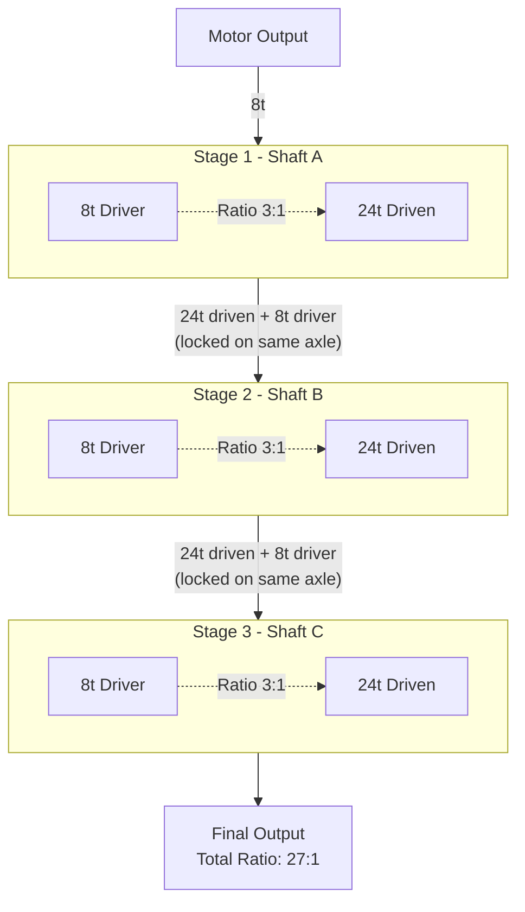

# Lesson 2: Gear Systems, Ratios, and Power Transmission

## 1. First-Principles Intuition & Invariants

There is a moment every serious Lego Technic builder encounters, usually during a first drivetrain project, when turning a small gear produces a satisfying, authoritative rotation in a larger one. The larger gear moves slower, but it resists your finger with noticeably more force. This is not a quirk of plastic parts. It is one of the most fundamental invariants in all of classical mechanics, expressed in ABS at a child's scale: power is conserved across a gear mesh, and any gain in torque must be paid for in rotational speed, in exact proportion.

Understanding why this is true at first principles, before touching a single axle pin, is what separates a builder who assembles gear trains from one who designs them deliberately.

A gear is a wheel with teeth. Its defining parameter is not its diameter but its tooth count, because tooth count governs how the gear behaves in a mesh. When two gears share a mesh, their teeth interlock in sequence, and each tooth that passes the contact point on the driver gear forces exactly one tooth to pass on the driven gear. This means the two gears' tooth counts are locked in a fixed ratio of angular velocities. If a 24-tooth gear drives an 8-tooth gear, the small gear must complete three full rotations for every one rotation of the large gear. The ratio $R = N_{\text{driven}} / N_{\text{driver}} = 8 / 24 = 1/3$ tells you that speed is multiplied by three in the direction from large to small. Run it in reverse, and speed is divided by three while torque is multiplied by three. This reciprocity is the core invariant of all gear work.

The deeper mechanical truth here comes from the conservation of energy. Power, expressed as $P = \tau \cdot \omega$ where $\tau$ is torque in Newton-meters and $\omega$ is angular velocity in radians per second, must be equal at input and output in a lossless mesh. Since power is conserved, if $\omega$ decreases by a factor of three, $\tau$ must increase by a factor of three. In practice, Lego plastic gears introduce a small frictional loss at each mesh, so a compound gear train with five stages will deliver meaningfully less torque than the ideal calculation predicts. This friction penalty compounds multiplicatively, which is one reason experienced builders minimize the number of mesh points in any load-bearing drivetrain. Every unnecessary gear stage is a tax on output torque.

Lego's gear library spans several geometrically distinct families, each suited to specific transmission tasks. The standard spur gear meshes on a common plane, with teeth cut parallel to the axis of rotation. This is the workhorse of Technic gear trains, available in 8, 16, 24, 36, and 40-tooth configurations. Spur gears transmit rotation between two parallel axles and do so with the highest efficiency of any Lego gear type, because the tooth contact geometry minimizes sliding friction. The bevel gear family changes this geometry by cutting teeth at an angle to the rotation axis, allowing two axles set at 90 degrees to share a mesh. Lego produces a standard 12-tooth bevel in both straight-cut and spiral-cut forms, as well as a larger 20-tooth bevel. The spiral-cut variant, sometimes called a "knob wheel" in Technic parlance, engages with more tooth surface area at any instant, which distributes load and produces noticeably smoother, quieter operation under high torque. The worm gear is categorically different from both: it is a helical screw that meshes perpendicularly with a standard spur gear, transmitting 90-degree rotation with an extreme reduction ratio in a single stage while simultaneously making the output shaft self-locking in the absence of power.

Each gear family encodes its own mechanical personality into the system it inhabits. Knowing when to reach for a bevel versus a worm versus a spur compound is not intuition that comes from reading — it comes from building the same mechanism in multiple configurations and feeling where the friction lives, where the backlash accumulates, and where the torque falls short of your expectations.

---

## 2. Core Architecture & Mechanics

### The Spur Gear Mesh: Geometry and Axle Spacing

A spur gear mesh between two Lego gears is only valid when their axles are spaced at the correct center-to-center distance. In the Lego system, all standard Technic beams operate on a 8mm pitch grid, and spur gears are designed so that specific pairings mesh correctly on that grid. The practical constraint is that the sum of the two pitch radii must equal the center distance, and Lego's parts are engineered so that integer combinations of the standard tooth counts (8, 16, 24, 40) produce axle spacings that land exactly on beam-hole positions.

The table below summarizes the valid standard spur gear pairings and their resulting ratios and center distances.

| Driver Teeth | Driven Teeth | Ratio (Driven/Driver) | Center Distance |
|---|---|---|---|
| 8 | 24 | 3.00 : 1 (reduction) | 2 studs (16 mm) |
| 8 | 40 | 5.00 : 1 (reduction) | 3 studs (24 mm) |
| 16 | 24 | 1.50 : 1 (reduction) | 2.5 studs (20 mm) |
| 24 | 24 | 1.00 : 1 (neutral) | 3 studs (24 mm) |
| 8 | 16 | 2.00 : 1 (reduction) | 1.5 studs (12 mm) |

The 16/24 pairing that produces a 2.5-stud center distance is a critical practical detail. Because 2.5 studs does not land on a standard beam hole, this pairing requires a half-stud offset bracket or an angled beam to position the axles correctly. Many builders new to Technic attempt this pairing on a standard beam frame and discover the gears bind or skip teeth under load. The fix is not to force the mesh — it is to use the geometry that the parts demand.

### Bevel Gears and 90-Degree Transmission

The bevel gear mesh introduces a direction change into the power transmission path. When two 12-tooth bevel gears mesh at 90 degrees, the ratio is 1:1 — speed and torque pass through unchanged, with the axle direction rotated 90 degrees in space. This is enormously useful for routing drive from a motor mounted along one axis to a mechanism oriented on a perpendicular one, as in a steering rack or a crane's lateral slew drive.

Bevel gear meshes are more sensitive to axle positioning than spur meshes. If the two axles are not precisely intersecting at 90 degrees, the teeth will contact on one face more than the other, creating uneven wear and a characteristic clicking noise under load. The correct bevel mesh has both axles passing through the same point in space, with their axes at exactly 90 degrees. In Lego this is most reliably achieved by using a cross-shaped liftarm junction or a turntable plate as the structural anchor for both axle bearings, so the geometry is enforced by the parts rather than by measurement.

A 12-tooth bevel meshed with a 20-tooth bevel produces a 1.67:1 reduction in a single 90-degree stage, which is useful when you need directional change and mild torque multiplication simultaneously. This combination is common in Technic supercar differentials, where the drive shaft arrives longitudinally and must be turned 90 degrees to drive the wheel hubs.

### The Worm Gear: Self-Locking Reduction at Extreme Ratios

The worm gear meshes with a standard spur gear (typically a 24-tooth in Technic builds) in a configuration where the worm's single helical tooth advances the spur gear by exactly one tooth per full rotation of the worm shaft. This produces a reduction ratio equal to the tooth count of the spur gear: a worm meshing with a 24-tooth gear gives 24:1 in a single stage. The mechanical implication is striking — a motor rotating at 300 RPM drives the output shaft at just 12.5 RPM while multiplying torque by a factor of 24, minus friction losses.

The more consequential property of the worm gear is its self-locking behavior. Because of the high helix angle of the worm tooth, back-driving the mesh — that is, applying force to the spur gear output to turn the worm shaft — generates a contact force that is almost entirely perpendicular to the direction of motion, producing a frictional resistance that exceeds the driving force at any realistic load. The output shaft holds its position without any braking mechanism. This is why worm gears appear in Technic elevating platforms, crane booms, and linear actuator stages: the mechanism holds its position under gravity without requiring a clutch, latch, or motor hold torque.

The limitation is efficiency. A worm mesh in Lego typically transfers only 50–70% of input power to the output, with the remainder dissipated as heat in the plastic teeth. This matters significantly in battery-powered builds where motor runtime is a constraint, and it makes worm gears a poor choice for high-speed continuous rotation applications.

### Compound Gear Trains: Staged Ratio Multiplication

A single gear mesh provides a ratio determined entirely by two tooth counts. A compound gear train extends this by placing multiple gear stages in series, with each stage's output shaft serving as the next stage's input. The total ratio of the compound train is the product of the individual stage ratios.

Consider a three-stage compound train where each stage uses an 8-tooth driver and a 24-tooth driven gear:

$$R_{\text{total}} = R_1 \times R_2 \times R_3 = 3 \times 3 \times 3 = 27 : 1$$

The architecture of a compound train matters as much as the math. In a standard series compound train, each intermediate shaft carries both the driven gear of the previous stage and the driver gear of the next stage, locked together on a common axle so they rotate as one. The key structural requirement is that these intermediate axles are supported at both ends by the frame, because the radial forces from two gear meshes acting on the same shaft can produce significant bending moments. A Technic axle unsupported at one end will deflect under load, causing the mesh geometry to degrade and generating the characteristic "gear grinding" noise that signals imminent tooth damage.

The diagram below illustrates the signal path and ratio accumulation through a three-stage compound spur train.

Each intermediate shaft (A, B, C) must be supported at both ends. The two gears on each intermediate shaft must be locked together — using a Technic axle with cross-section passing through both — so they cannot rotate independently. If you accidentally mount one gear on a free-spinning bushing on a fixed axle, the stage produces no torque multiplication at all; the gears spin without transmitting power. This is an extremely common assembly error that produces a build that rotates freely under no load but stalls the moment any resistance is applied.

### Idler Gears and Direction Control

A gear inserted between driver and driven without its axle being an intermediate compound stage is called an idler. It transmits rotation without affecting the final ratio, because its own tooth counts cancel out of the product: a 24-tooth idler between an 8-tooth driver and a 24-tooth driven gear produces the same 3:1 ratio as a direct mesh, but reverses the direction back so both the driver and the driven gear rotate in the same direction. Idlers are used specifically to control rotation direction or to bridge a physical gap between non-adjacent axles, not to change ratio.

---

## 3. High-Performance Optimization & Failure Modes

### Gear Mesh Preload and Backlash

Every gear mesh has some degree of backlash — the small amount of angular play present when the mesh is at rest. In Lego plastic gears, backlash is a consequence of manufacturing tolerance, tooth profile clearance, and the softness of ABS under compressive load. A small amount of backlash is necessary: a mesh with zero backlash binds under thermal expansion and loads the bearings heavily. Too much backlash, however, causes audible clatter during direction changes and introduces positioning error in mechanisms requiring precision, such as steering systems or stepper-driven plotters.

The practical tool for managing backlash in Technic builds is center distance control. Because Technic beam frames position axles on a fixed 8mm grid, you have limited ability to vary center distances continuously. However, by choosing specific beam orientations, Technic half-beams, rubber-bushed axle holes, or angular liftarm configurations, you can intentionally introduce a small preload into a critical mesh. A mesh under slight preload has near-zero backlash because the driving teeth are always in contact with the driven teeth on both flanks. The cost is increased friction and motor current draw, so preloaded meshes should be reserved for the final output stage, never deep inside a compound train where the friction multiplies through every subsequent stage.

### Axle Torsion and Length Management

A Technic axle transmitting torque across a long unsupported span will twist under load. This torsional deflection is proportional to the fourth power of the axle diameter and inversely proportional to its unsupported length. Lego axles have a fixed cross-section, so the only design variable available is span. For high-torque stages — those driving a worm gear output or the final reduction stage of a compound train — the axle span should not exceed two to three beam lengths without an intermediate bushing support. The intermediate support can be a standard beam hole, a half-bushing, or a Technic pin-hole in a cross-braced liftarm; what matters is that it constrains radial deflection without binding the axle in torsion.

The failure mode is subtle: a long, unbraced axle does not break. Instead, it deflects just enough under peak load to pull the driver gear out of its optimal mesh position, increasing backlash dynamically and causing tooth-to-tooth impact loading on gear engagement. Over time this erodes the tooth profiles of plastic gears, producing rounded teeth that slip under moderate load — a condition that is impossible to fix without replacing the gears entirely.

### Power Routing Strategy: Building Toward the Load

The most common efficiency error in Technic gear trains is placing the highest-reduction stage first (closest to the motor) rather than last (closest to the load). The correct strategy is to build reduction from motor to load, with the final stage delivering the highest torque at the lowest speed. Here is why this matters structurally: in a 27:1 compound train, the intermediate shafts at stage 1 and stage 2 carry relatively low torque — only 3:1 and 9:1 of motor output respectively. The structural forces on those shafts are proportionally lower, meaning lighter frame support is acceptable. The final output shaft, however, carries the full 27:1 torque multiplication and must be supported by the most rigid axle mounting in the entire assembly. If the highest-torque stage is closest to the motor, then all three intermediate shafts experience high torque, requiring heavy structural support throughout — wasting mass and introducing more friction at every mesh.

### The Clutch Gear as a Torque Fuse

Lego produces a 24-tooth clutch gear specifically to protect drive trains from stall damage. The clutch gear contains a spring-loaded internal detent mechanism that transmits torque normally up to a calibrated threshold, then slips when the output is blocked or overloaded. This is functionally identical to a mechanical torque limiter. Its threshold is roughly calibrated to the stall torque of an L-series Technic motor — if the drivetrain torque exceeds what the motor should sustain, the clutch slips before the motor overheats or the gears strip.

The clutch gear should be placed on the high-speed, low-torque side of your compound train, closest to the motor. If you place it on the high-torque output side, the clutch threshold — which is fixed — represents a much smaller fraction of the working torque, and it will slip even during normal operation. Mounted at the motor stage, the clutch sees only motor-level torque, slips only under genuine overload, and protects the entire downstream mechanism.

### Identifying and Correcting Mesh Failure

When a gear train fails under load, the failure mode is diagnostic. A sudden click-and-slip pattern during direction changes indicates excessive backlash in a critical mesh, usually from an axle that has deflected off center. Continuous skipping under steady load — a rhythmic, regular clicking correlated with the rotation speed of a specific gear — indicates tooth damage on that gear; the skip happens at the same point in every revolution as the damaged tooth passes through the mesh. A gradual, progressive loss of output torque combined with warmth in the gear housing indicates frictional overload across multiple mesh points, usually from a compound train with too many stages or an overloaded worm gear stage.

The diagnostic procedure is to isolate each stage by removing downstream load and running the motor with your finger on each intermediate shaft, feeling for vibration, thermal buildup, and noting at what point in the drivetrain the slip originates. Once you have identified the offending stage, reseat both axle bearings, verify center distance by checking that the gears rotate without any lateral wobble or rhythmic stiffness, and replace any gear that shows flattened or missing tooth profiles. In all but the most heavily loaded builds, Lego's ABS gears will outlast the project if they are given correct center distances and adequate axle support. The parts do not fail arbitrarily; they fail when the geometry is wrong.

The goal of every gear train you design is to feel inevitable — smooth under load, silent at speed, and sized so the motor never approaches its stall current during normal operation. When those conditions are met, the physics of power conservation and the geometry of meshing teeth are working exactly as they should: transforming the motor's modest output into precisely the torque and speed your mechanism demands.
