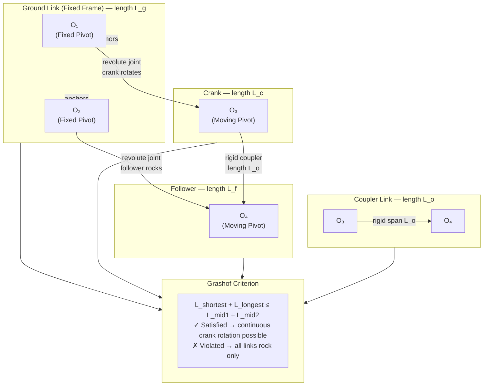

# Lesson 3: Linkages, Levers, and Oscillatory Mechanisms

## 1. First-Principles Intuition & Invariants

The mechanical lever stands as humanity's first force multiplier, a rigid bar pivoting about a fixed point that transforms distance into force or force into distance with ruthless geometric efficiency. When Archimedes claimed he could move the Earth given a lever long enough and a place to stand, he was articulating the fundamental invariant of all lever systems: mechanical advantage is the ratio of output force to input force, and this ratio equals the inverse ratio of distances traveled. In Lego Technic construction, this principle manifests not through continuous metal beams but through discrete studded geometry, where every beam hole represents a potential fulcrum point and every connection represents a force vector constrained by pin friction and material yield limits.

The mathematical invariant underlying all lever systems emerges from the conservation of energy: work input must equal work output in an ideal frictionless system. Since work equals force multiplied by distance, the equation $F_{\text{in}} \times d_{\text{in}} = F_{\text{out}} \times d_{\text{out}}$ governs every seesaw, every pry bar, every nutcracker. Rearranging this relationship yields the mechanical advantage formula $MA = F_{\text{out}} / F_{\text{in}} = d_{\text{in}} / d_{\text{out}}$, revealing that distance sacrificed at the input translates directly to force gained at the output. In Lego terms, pushing a beam end through six studs of travel to achieve one stud of motion at the load point delivers a theoretical mechanical advantage of six, though friction at pin joints and beam flexure under load will degrade this ideal ratio by fifteen to thirty percent depending on construction rigidity.

The three classical lever classes distinguish themselves by the relative positions of fulcrum, effort, and load along the beam axis. A first-class lever places the fulcrum between effort and load, creating systems like seesaws, crowbars, and Lego beam balances where the mechanical advantage depends entirely on the ratio of effort arm length to load arm length. Second-class levers position the load between fulcrum and effort, exemplified by wheelbarrows and nutcrackers, always producing mechanical advantage greater than unity because the effort arm necessarily exceeds the load arm. Third-class levers sacrifice mechanical advantage for speed and range of motion by placing the effort between fulcrum and load, as seen in fishing rods, tweezers, and the human forearm, where a small input motion near the fulcrum generates large output displacement at the load point.

When levers join together through pinned connections that permit relative rotation, they form linkages—kinematic chains that transform input motion into complex output trajectories. The simplest useful linkage, the four-bar mechanism, consists of four rigid links connected by four revolute joints forming a closed loop. One link serves as the fixed ground reference, one as the input crank, one as the output rocker or follower, and one as the floating coupler that traces an arc through space. The Grashof criterion governs whether a four-bar linkage can achieve full revolution or only oscillatory rocking motion: if the sum of the shortest and longest link lengths is less than or equal to the sum of the remaining two link lengths, at least one link can rotate continuously. This mathematical constraint determines whether your Lego walking mechanism will stride smoothly or lock up halfway through its cycle.

The crank-slider mechanism converts continuous rotary motion into reciprocating linear motion through a crank pin that drives a slider along a constrained path. Every piston engine, every sewing machine needle, every reciprocating saw embodies this kinematic pattern. In Lego construction, the crank typically manifests as a cross-axle offset from the center of rotation by one, two, or three studs, driving either a beam with a sliding pin joint or a rack gear that converts the oscillation into intermittent linear travel. The slider's velocity profile follows a sinusoidal pattern, accelerating from rest at each stroke end and reaching maximum velocity at mid-stroke, creating inertial loads that stress pin joints and beam connections at the reversal points where acceleration spikes to its maximum magnitude.

Cam mechanisms replace the circular crank motion with an arbitrarily profiled rotating surface that pushes against a follower, generating output motion profiles limited only by the cam designer's imagination. A circular cam with an offset center produces simple harmonic motion identical to a crank-slider, but cams can implement dwells where the follower remains stationary for a portion of the cycle, rapid rises where velocity peaks early, and gentle descents where deceleration extends over a large rotation angle. Lego cam construction typically employs circular elements—wheels, pulleys, or specialized cam pieces—mounted eccentrically on axles, with the follower implemented as a beam end pressing against the cam surface under spring loading or gravitational force. The contact force between cam and follower must overcome friction and any external load while preventing separation during high-speed operation, requiring either mechanical spring preload or careful mass balancing.

The fundamental invariant connecting all these mechanisms stems from the principle of virtual work: in any static equilibrium configuration, the sum of forces times their virtual displacements equals zero. For linkages undergoing motion, this becomes the principle of virtual power, where input torque times input angular velocity equals output force times output linear velocity plus power dissipated by friction. This relationship reveals why mechanical advantage varies continuously throughout a linkage cycle. At the moment when a four-bar coupler link passes through its fully extended or fully collapsed configuration, the mechanical advantage approaches infinity or zero respectively, creating dead-center positions where the mechanism cannot transmit force regardless of how much input torque you apply. Skilled mechanism designers either avoid these positions entirely or use external spring forces to carry the linkage through them.

## 2. Core Architecture & Mechanics

First-class lever implementation in Lego Technic begins with selecting a fulcrum beam that establishes the ground reference frame. The 9-length beam serves as the canonical example, with the fulcrum pin placed at the center hole for balanced mechanical advantage, or offset to any other hole position to create asymmetric force ratios. The fulcrum pin must be a friction pin rather than a smooth axle to permit rotation under load while preventing free-spinning behavior that would eliminate position control. The beam holes at positions 1 through 4 on one side of the fulcrum represent potential effort attachment points, while holes 6 through 9 on the opposite side serve as load attachment points, with the mechanical advantage calculated by counting hole positions: effort at hole 2 and load at hole 8 yields $MA = (8-5)/(5-2) = 3/3 = 1$, a balanced lever with no mechanical advantage. Moving the effort to hole 1 and load to hole 9 changes the ratio to $(9-5)/(5-1) = 4/4 = 1$ still, but moving effort to hole 1 and load to hole 7 yields $(7-5)/(5-1) = 2/4 = 0.5$, a speed multiplier that sacrifices force for velocity.

The friction at the fulcrum pin introduces a loss mechanism that violates the ideal work conservation principle, with the friction torque approximately constant regardless of applied load. This creates a nonlinear efficiency curve where light loads suffer proportionally greater losses than heavy loads. A 9-length beam pivoting on a single black friction pin exhibits rotational friction torque of approximately 0.3 N·cm in clean, well-assembled condition. If the effort arm spans 4 holes (3.2 cm from fulcrum) and applies 5 N of force, the useful output work per radian of rotation equals $(5 \text{ N} \times 0.032 \text{ m} - 0.003 \text{ N·m}) = 0.157 \text{ N·m}$ compared to the ideal $0.160 \text{ N·m}$, representing a 98% efficiency. However, if the effort force drops to 1 N, the friction torque claims $(0.003/0.0032) = 0.938$ of the input energy, degrading efficiency to 6.2%. This behavior explains why Lego mechanical systems using long lever chains must maintain moderate to high force levels throughout the power transmission path to avoid friction-dominated inefficiency.

Second-class lever construction in Lego typically employs a lifting arm where the fulcrum sits at one end, the load attaches at an intermediate point, and the effort applies at the far end. A 15-length beam mounted with its first hole pinned to the ground frame, load attachment at hole 6, and effort applied at hole 15 yields $MA = (15-1)/(6-1) = 14/5 = 2.8$, providing substantial force multiplication. This configuration excels at lifting applications where a motor or pneumatic cylinder at the beam end can elevate a heavy model section with reduced force demand. The critical failure mode for second-class levers involves beam bending under load, particularly when using thinner beam profiles like the 1-width liftarms that offer less bending stiffness than 2-width or 3-width variants. A 15-length 1-width liftarm subjected to a 20 N load at hole 6 experiences a maximum bending moment of $20 \text{ N} \times 0.032 \text{ m} = 0.64 \text{ N·m}$ at the fulcrum point, sufficient to induce visible deflection of 2-3 mm at the load point. This deflection introduces play into the mechanism and can cause binding if the load must follow a precise path. The remedy involves either doubling the beam with a parallel reinforcement liftarm connected by perpendicular cross-bracing, or substituting a 2-width beam that increases the area moment of inertia by approximately 400% for only a 100% increase in mass.

Third-class lever systems deliberately sacrifice mechanical advantage for velocity and range of motion, implementing configurations where effort applies closer to the fulcrum than the load does. The classic Lego example employs a 7-length beam with fulcrum at hole 1, effort at hole 3, and load at hole 7, yielding $MA = (7-1)/(3-1) = 6/2 = 3$ with the denominator in the numerator position, indicating the lever demands three times as much input force to move a given load but delivers three times the output velocity. This configuration appears in sweeping arms, throwing mechanisms, and rapid-deployment systems where speed outweighs force. The human forearm exemplifies this pattern: the biceps muscle attaches to the radius bone approximately 4 cm from the elbow joint, while the hand grips objects 30-40 cm from that joint, creating a mechanical disadvantage of 7.5 to 10 that enables the hand to trace large rapid arcs at the cost of requiring substantial muscle force for even light loads.

Four-bar linkage synthesis begins with defining the fixed ground link length and orientation, then selecting crank, coupler, and follower lengths that satisfy both the Grashof criterion and the desired output motion. A simple crank-rocker mechanism uses a 5-length ground link, 3-length crank, 7-length coupler, and 5-length follower. Checking the Grashof inequality: shortest link is 3, longest is 7, sum is 10; remaining links sum to $5+5=10$. The equality case $10 = 10$ indicates the mechanism sits at the boundary of full rotation capability, with the 3-length crank able to complete continuous revolution while driving the 5-length follower through an oscillatory rocking motion. The coupler point—any point fixed to the coupler link away from its two pin joints—traces a complex curve through space that can approximate straight lines, circles, figure-eights, or more exotic trajectories depending on link ratios and coupler point location.

Constructing this linkage in Lego requires precise pin spacing that often does not align with the integer stud grid. The ground link spans 5 holes (4 stud spacing = 32 mm), the crank link spans 3 holes (16 mm), but when the crank rotates 90 degrees, its endpoint sits 16 mm horizontally from the crank pivot and demands that the coupler link's other end sit 40 mm from the ground link's second pivot for a 7-hole coupler (48 mm) to connect. The Pythagorean distance $\sqrt{16^2 + (48-40)^2} = \sqrt{256+64} = \sqrt{320} = 17.9$ mm does not equal the required 48 mm coupler length, revealing that this linkage geometry cannot be assembled from Lego beams without deformation. The solution involves either adjusting link ratios until Pythagorean closure holds at all crank angles within acceptable tolerances, or introducing a sliding joint that permits one link length to vary by 1-2 studs during the motion cycle.

The practical Lego four-bar linkage employs specific hole patterns that have been empirically validated by builders: the 3-5-7-5 configuration just described actually works when the coupler link is 9 holes (64 mm) instead of 7, creating a more elongated linkage that maintains chain closure throughout the cycle. Another reliable pattern uses a 4-4-5-6 configuration: ground span of 4 holes (24 mm), crank of 4 holes (24 mm), coupler of 5 holes (32 mm), and follower of 6 holes (40 mm). The Grashof check yields $4+6=10$ versus $4+5=9$, failing the criterion with 10 > 9, indicating no link can complete full rotation and both crank and follower will only rock through limited angles. This creates a double-rocker mechanism where input oscillation at one joint produces output oscillation at the opposite joint, useful for synchronized bilateral motion like walking legs.

Crank-slider mechanisms convert the circular crank motion into linear reciprocation through a sliding joint that constrains the coupler link's endpoint to travel along a straight guide path. The simplest Lego implementation uses a 4-length beam as the crank, mounted on an axle offset 1 stud from the center of a wheel or large turntable. The crank's free end connects via a pin joint to a long beam that slides within a pair of guide rails built from parallel beams or channel pieces. As the crank rotates, the slider beam oscillates back and forth with stroke length equal to twice the crank radius: a 1-stud offset produces 16 mm stroke, a 2-stud offset yields 32 mm stroke, and a 3-stud offset delivers 48 mm stroke.

The slider velocity profile follows $v(t) = \omega r \cos(\omega t)$ where $\omega$ represents the crank angular velocity and $r$ the crank radius. Velocity peaks at $v_{\text{max}} = \omega r$ when the crank passes through horizontal orientation, and drops to zero at the stroke ends where the crank aligns vertically. This sinusoidal profile creates maximum acceleration $a_{\text{max}} = \omega^2 r$ at the stroke ends, where the slider reverses direction. A crank rotating at 60 RPM ($\omega = 6.28$ rad/s) with 2-stud radius ($r = 0.016$ m) generates peak acceleration of $6.28^2 \times 0.016 = 0.63$ m/s², or about 0.06 g—mild enough for smooth operation. Doubling the RPM to 120 quadruples the acceleration to 2.5 m/s² or 0.26 g, approaching the threshold where inertial forces begin stressing pin connections and causing the slider to bounce or bind in its guides.

The connecting rod ratio—coupler length divided by crank radius—governs how closely the slider motion approximates pure sinusoidal translation. An infinite connecting rod ratio produces perfect sinusoidal motion, but practical mechanisms use finite ratios between 3 and 10. At ratio 4 (coupler length 4 times crank radius), the piston position deviates from sinusoidal by approximately 6% at maximum deviation, introducing second-order harmonic content into the motion. This manifests as asymmetric stroke timing: the forward stroke completes slightly faster than the return stroke. For a 3-stud crank radius (24 mm) operating with an 11-hole coupler (80 mm), the connecting rod ratio equals $80/24 = 3.33$, producing noticeable asymmetry that may matter for precise reciprocating mechanisms but typically remains negligible for general-purpose linear actuation.

Slider guide construction determines whether the mechanism runs smoothly or binds under load. The simplest guide uses two parallel beams spaced one stud apart, with the slider beam fitting loosely between them. This provides lateral constraint but permits several millimeters of vertical play that allows the slider to tilt and bind when side loads apply. Superior guides employ four-sided boxing where the slider travels inside a rectangular channel formed by beams on all four sides, maintaining parallel alignment throughout the stroke. The clearance between slider and guide should span 0.3 to 0.5 mm per side—approximately the thickness difference between a smooth Lego axle and its containing beam hole—allowing free motion while minimizing play. Tighter clearances risk binding from accumulated tolerance stack-up and dust contamination, while looser clearances permit excessive rattling and loss of positional accuracy.

Cam and follower systems implement arbitrary motion profiles by shaping the cam surface to produce the desired follower displacement as a function of cam rotation angle. A simple eccentric cam consists of a circular wheel mounted with its center offset from the axle center by one or more studs, identical in kinematics to a crank but typically larger in diameter to provide a smooth contact surface for the follower. A 56-tooth turntable mounted on an axle displaced 2 studs from its geometric center creates an eccentric cam with 2-stud throw that imparts sinusoidal motion to a follower beam pressing against its perimeter.

Designing more complex cam profiles requires specifying the follower displacement function $s(\theta)$ where $\theta$ represents cam rotation angle and $s$ represents follower position. A cam with dwell might implement: $s(\theta) = 0$ for $0 < \theta < 90°$, $s(\theta) = R(1-\cos(\theta-90°))$ for $90° < \theta < 180°$ (harmonic rise over 90 degrees), and $s(\theta) = 2R$ for $180° < \theta < 360°$ (dwell at raised position). Translating this abstract function into Lego geometry requires approximating the smooth curve with stacked rings or stepped layers, or accepting that circular Lego elements can only produce sinusoidal or multi-harmonic profiles by combining multiple eccentric circles at different phases.

The follower design dramatically affects cam system performance and reliability. A knife-edge follower—a beam corner pressing directly against the cam—creates high contact stress that accelerates wear and requires substantial preload force to maintain contact through the motion cycle. A roller follower, implemented in Lego as a small wheel or pulley mounted on a pin at the follower beam's end, distributes contact force over a larger area and reduces friction from sliding to rolling contact. The roller diameter should be small relative to the cam's minimum radius of curvature to avoid geometric interference where the roller bridges across concave cam sections. A 2-stud diameter roller works well with cam base circles of 8 studs or larger, maintaining contact conformity while providing adequate rolling surface.

Spring preloading maintains follower contact with the cam surface during high-speed operation when inertial forces might cause separation. A Lego rubber band or compression spring between the follower and a fixed anchor point applies continuous contact force that must overcome both the follower's mass times its maximum acceleration and any external loads opposing follower motion. For a follower with effective mass 50 grams undergoing maximum acceleration of 1 m/s² during a rapid cam rise, the required preload force is $0.05 \text{ kg} \times 1 \text{ m/s}^2 = 0.05$ N plus external load, plus a safety factor of 2-3× to prevent bouncing. A single Lego rubber band stretched to 150% of its rest length provides approximately 0.5-1 N of force, adequate for this application but approaching its limit for more aggressive cam profiles or higher speeds.

Oscillatory motion synthesis through linkage and lever combinations enables complex mechanical behaviors from simple rotating inputs. A walking leg mechanism might employ a crank-rocker four-bar linkage to generate the basic fore-aft swing motion, coupled with a second crank-slider mechanism that raises and lowers the foot in coordination with the swing phase. Proper phasing between these two motion components determines whether the leg lifts during forward swing and plants during rearward swing (correct walking gait) or reverses this timing (incorrect stumbling motion). The phase relationship derives from the relative angular positions of the two input cranks: mounting them 180 degrees apart on a common axle creates antiphase motion where one reaches maximum extension while the other reaches minimum, ideal for alternating left-right leg pairs.

The velocity and acceleration profiles of coupled mechanisms must match at their connection points to avoid binding or impact loads. If a crank-slider mechanism feeds a lever that amplifies its motion, the slider's sinusoidal velocity profile gets multiplied by the lever's mechanical advantage ratio, but the lever's rotational inertia introduces its own acceleration demands. At the moment when the slider reverses direction, both slider and lever must simultaneously decelerate to zero velocity and reverse acceleration—a coordination that happens naturally if all joints rotate freely and masses remain small relative to driving forces. If joint friction is high or driven masses large, the reversal point introduces stress that manifests as jerky motion, pin shear loading, or complete jam if torque demand exceeds motor capacity.

## 3. High-Performance Optimization & Failure Modes

Friction management in lever and linkage systems separates smoothly operating mechanisms from jerky, inefficient constructions. Every pin joint introduces rotational friction that dissipates energy proportional to the product of friction torque and angular velocity. For a four-bar linkage with three moving joints, the total power loss equals $P_{\text{loss}} = (T_{f1}\omega_1 + T_{f2}\omega_2 + T_{f3}\omega_3)$ where $T_f$ represents each joint's friction torque and $\omega$ its angular velocity. Since joint velocities depend on linkage configuration and vary throughout the motion cycle, power loss fluctuates continuously, creating uneven motor loading that manifests as speed variations if the motor lacks sufficient torque reserve.

Reducing joint friction begins with proper pin selection. Black friction pins provide adequate grip for light-duty applications but introduce approximately 0.3 N·cm of friction torque per joint. Grey three-quarter-length pins reduce this to 0.15 N·cm while maintaining sufficient retention force to prevent joint separation under normal loads. Blue axle pins—combinations of a half-length axle stub and a perpendicular pin—drop friction even lower to approximately 0.08 N·cm by replacing the pin's continuous surface contact with a line contact along the axle's circumference. For ultra-low-friction applications, mounting small bushings on axles and using these as revolute joints reduces friction to near-negligible levels, though at the cost of increased play and reduced tolerance to side loading.

Joint preloading and bearing surface quality govern friction magnitude regardless of pin type. A pin pressed tightly into an undersized hole deforms the hole's walls, increasing the contact normal force and multiplying friction. Holes should accept pins with minimal insertion force—you should be able to press a pin through with thumb pressure alone. If a pin requires tools or excessive force to insert, the hole is undersized or obstructed, and the resulting joint will run hot and tight. Conversely, pins that fit loosely and rattle within their holes introduce excessive play that degrades positional accuracy and permits the mechanism to develop uneven motion from backlash accumulation. The acceptable insertion force range spans 5-15 N for friction pins, measurable with a spring scale if precision matters.

Beam deflection under load limits the maximum forces that lever systems can transmit without introducing positional errors or catastrophic failure. A beam's bending stiffness depends on its area moment of inertia $I$, Young's modulus $E$, and length $L$ according to the formula for maximum deflection under a concentrated load: $\delta_{\text{max}} = \frac{FL^3}{3EI}$ where $F$ represents the applied force. A 1-width Lego liftarm has approximate dimensions 8 mm wide by 2.5 mm thick, yielding $I = \frac{1}{12}(0.008)(0.0025)^3 = 1.04 \times 10^{-11}$ m⁴. ABS plastic's Young's modulus spans 2-3 GPa; using 2.5 GPa, a 15-hole liftarm (120 mm) loaded at its center with 10 N deflects by $\delta = \frac{10 \times 0.12^3}{3 \times 2.5 \times 10^9 \times 1.04 \times 10^{-11}} = 0.0022$ m or 2.2 mm. This deflection might seem small but represents nearly one-third of a stud spacing, enough to cause binding in tightly toleranced mechanisms.

Reinforcing beams against bending requires increasing the area moment of inertia through one of three strategies: widening the beam, thickening it, or adding parallel redundancy. Substituting a 2-width beam increases the width from 8 mm to 16 mm, quadrupling the moment of inertia (since $I$ scales with width to the first power times thickness cubed) but in reality only doubling it because the 2-width beam's geometry includes hollow sections. The effective improvement is approximately 3-4× reduction in deflection. Alternatively, laminating two 1-width beams in parallel with perpendicular cross-bracing maintains each beam's individual moment of inertia but distributes the load between two members, halving the deflection. The cross-bracing proves critical—without it, the two beams behave independently and each deflects the full amount, providing no improvement. With cross-bracing every 5-7 holes, the paired beams act as a composite structure with doubled effective moment.

Buckling failure occurs when compressive loads in linkage members exceed the critical buckling load given by Euler's formula: $F_{\text{critical}} = \frac{\pi^2 EI}{(KL)^2}$ where $K$ represents the end-fixity coefficient (1 for pinned-pinned, 0.7 for pinned-fixed, 0.5 for fixed-fixed). A 9-hole beam (72 mm) with pinned ends ($K=1$) and the previously calculated moment of inertia has critical buckling load $F_c = \frac{\pi^2 \times 2.5 \times 10^9 \times 1.04 \times 10^{-11}}{0.072^2} = 49.5$ N. This substantial value suggests slender Lego beams rarely buckle under typical mechanism loads, but the calculation assumes perfect axial loading. Real mechanisms introduce bending moments from misaligned forces, reducing the effective buckling threshold by 50-70%. A coupler link subjected to 30 N of compressive force with even slight eccentricity may buckle suddenly, manifesting as a rapid lateral bow that jams the mechanism and potentially breaks the beam at mid-span.

Dead-center positions in crank-rocker linkages create force transmission singularities where mechanical advantage approaches zero or infinity. When the crank and coupler links align colinearly, pushing on the input produces no perpendicular force component to drive the follower link's rotation—all force transmits axially through the coupler, compressing it without generating output motion. Conversely, when the follower and coupler align, any force applied to the follower generates infinite mechanical advantage at the crank, requiring zero input torque to hold the linkage in this configuration. These singularities appear as stuck positions during hand-cranking, where the mechanism suddenly becomes very easy or very hard to turn.

Avoiding dead centers requires either limiting the mechanism's range of motion to exclude these configurations, or providing auxiliary forces that carry the linkage through them. A torsion spring between the follower and ground frame stores energy during the approach to dead center and releases it on the far side, using stored potential energy to overcome the force transmission gap. The spring stiffness must be carefully tuned: too weak and the mechanism still stalls, too strong and it snaps through dead center with destructive violence. An alternative approach uses a secondary linkage with cranks phased 90 degrees from the primary system, ensuring that when one mechanism passes through dead center with minimal torque capacity, the other operates at peak mechanical advantage and carries the combined load.

Cam-follower contact stress concentrates force over small areas, accelerating wear and potentially causing plastic deformation. The Hertzian contact stress between a cylindrical roller follower and a flat cam surface approximates $\sigma = \sqrt{\frac{FE'}{\pi rL}}$ where $F$ is contact force, $E'$ the effective Young's modulus (for ABS-on-ABS approximately 1.4 GPa), $r$ the roller radius, and $L$ the roller width. A 2-stud diameter roller (8 mm radius) with 2-stud width (16 mm) supporting 5 N of contact force experiences $\sigma = \sqrt{\frac{5 \times 1.4 \times 10^9}{\pi \times 0.008 \times 0.016}} = 18.6$ MPa. ABS plastic's yield strength spans 40-50 MPa, providing a safety factor of approximately 2.5×—acceptable for occasional use but marginal for continuous operation over thousands of cycles.

High-speed cam operation introduces dynamic effects beyond static force analysis. As cam angular velocity increases, the follower's required acceleration scales quadratically with speed, and inertial forces add to the spring preload demand. For a cam implementing a harmonic rise over 90 degrees of rotation, the maximum follower acceleration is $a_{\text{max}} = \frac{\pi^2 h \omega^2}{2}$ where $h$ represents the total rise distance. A cam with 3-stud rise (24 mm) rotating at 120 RPM ($\omega = 12.56$ rad/s) generates peak acceleration of $\frac{\pi^2 \times 0.024 \times 12.56^2}{2} = 18.7$ m/s² or 1.9 g. If the follower assembly has effective mass 100 grams, the inertial force reaches $0.1 \times 18.7 = 1.87$ N, requiring this much additional spring preload beyond static load to prevent follower bounce at high speed.

Mechanism resonance occurs when the driving frequency matches a natural frequency of the follower system or structural components. A follower beam with mass $m$ and spring stiffness $k$ has natural frequency $f_n = \frac{1}{2\pi}\sqrt{\frac{k}{m}}$. A 15-hole beam (effective mass 20 grams) under moderate spring preload (stiffness approximately 500 N/m from a Lego rubber band) exhibits $f_n = \frac{1}{2\pi}\sqrt{\frac{500}{0.02}} = 25.2$ Hz. If the cam rotates at 1512 RPM (25.2 rev/s), the driving frequency exactly matches the follower's natural frequency, inducing resonant amplification where follower displacement grows much larger than the cam profile dictates, potentially causing the follower to separate from the cam or overstress its mounting points. Operating speeds must avoid resonant bands spanning ±10% of natural frequencies, requiring cam speed either below 1360 RPM or above 1660 RPM for this example.

Multi-linkage coupling introduces kinematic constraint conflicts when independent mechanisms share connection points. Two four-bar linkages merging at a common coupler point must satisfy the closure equations of both chains simultaneously, constraining the system to one degree of freedom despite having multiple input cranks. If the linkages' geometric ratios don't permit compatible motion, the system over-constrains and binds. Verifying compatibility requires solving both linkages' position equations for a range of crank angles and confirming that the calculated coupler positions coincide within tolerances. When they diverge by more than 0.5 mm, the coupled system will experience binding forces that sum vectorially at the common point, stressing pins and beams or preventing motion entirely.

Clearance accumulation in long kinematic chains degrades output precision through tolerance stack-up. Each pin joint introduces approximately 0.1 mm of radial clearance between pin and hole, and this clearance manifests as angular play that multiplies along the chain. For a four-bar linkage with 10-hole coupler length (80 mm), a 0.1 mm clearance at the crank-coupler joint creates $\arctan(0.1/80) = 0.07°$ of angular error at the coupler output. If the follower is 8 holes long (64 mm), this angular error translates to $64 \times \tan(0.07°) = 0.078$ mm of output position uncertainty. A five-link chain would accumulate errors to nearly 0.5 mm, approaching the point where positional accuracy becomes meaningless. Minimizing clearance through tight pin fits and using bushings at critical joints reduces error accumulation proportionally.

Mechanism optimization for speed versus torque involves adjusting link ratios to match load requirements. Short crank arms paired with long follower arms create high mechanical advantage but slow output motion. Lengthening the crank to 2-3× the follower length inverts this relationship, producing fast output motion at the cost of reduced torque capacity. For a walking mechanism where legs must swing rapidly but carry little load, long crank arms optimize for speed. For a lifting platform where output speed is secondary to force capacity, short crank arms maximize mechanical advantage. The optimal ratio balances motor torque capacity against desired output velocity and load, typically landing between 1:1 (balanced) and 1:3 (speed-favoring) for most applications.

Motor torque curves intersect mechanism load curves to determine operating points. A Lego Power Functions L-motor provides approximately 0.4 N·m of stall torque, dropping linearly to zero at its no-load speed of 380 RPM. If a crank-slider mechanism requires 0.2 N·m of input torque at 200 RPM to overcome friction and drive its load, the motor operates at the intersection of its torque curve and the load line, delivering 0.2 N·m at roughly 240 RPM with power to spare. If mechanism friction increases or load rises such that required torque reaches 0.3 N·m, the operating point shifts to 160 RPM, slowing the mechanism. When required torque exceeds 0.4 N·m, the motor stalls completely, unable to turn the mechanism at any speed. Gear reduction between motor and mechanism multiplies available torque while dividing speed proportionally, shifting the motor's torque curve upward to accommodate higher loads.

Gear-driven linkage systems combine rotary power transmission with planar motion conversion, enabling compact, efficient mechanisms. Mounting a crank on a gear axle rather than directly on a motor shaft permits multiple mechanisms to share a single motor through the gear train's branching topology. A 24-tooth gear driving an 8-tooth gear at 3:1 reduction creates three times the torque at one-third the speed, ideal for force-multiplying lever systems. Conversely, an 8-tooth driving a 24-tooth implements 1:3 speed increase for rapid oscillating mechanisms requiring minimal force. Combining both reduction and increase stages in sequence enables fine-tuning of the torque-speed operating point to match motor capabilities and load demands precisely.

The practical builder synthesizes these principles through iterative prototyping: construct the basic linkage geometry, operate it by hand to identify binding points and dead centers, reinforce weak beams showing deflection, adjust link lengths to improve motion profiles, add spring preloading where contacts are marginal, test under motor power at progressively higher speeds until failure modes emerge, then address each failure through specific countermeasures. This empirical approach converges on robust designs faster than pure analytical prediction because Lego's discrete geometry and non-ideal material properties introduce behaviors that resist exact modeling. The skilled practitioner develops intuition for which configurations will succeed through accumulated experience across dozens of mechanism builds, recognizing patterns in beam deflection, joint friction, and kinematic closure that signal whether a design will operate smoothly or require fundamental revision. This tacit knowledge, combined with the explicit mechanical principles detailed throughout this lesson, transforms the builder from component assembler into mechanism designer capable of creating novel kinematic solutions to complex motion challenges.
